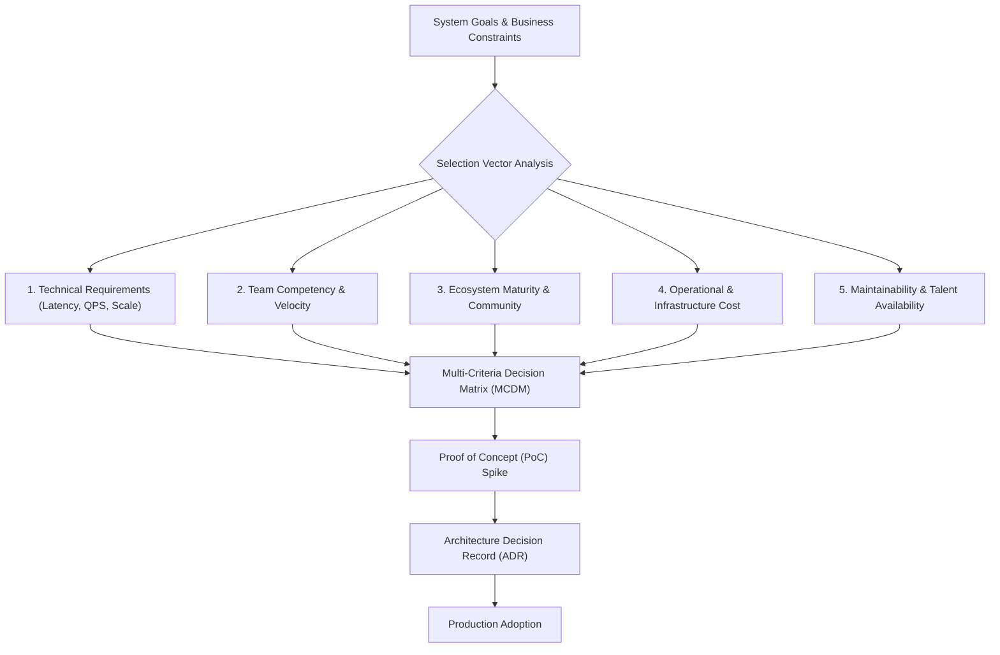
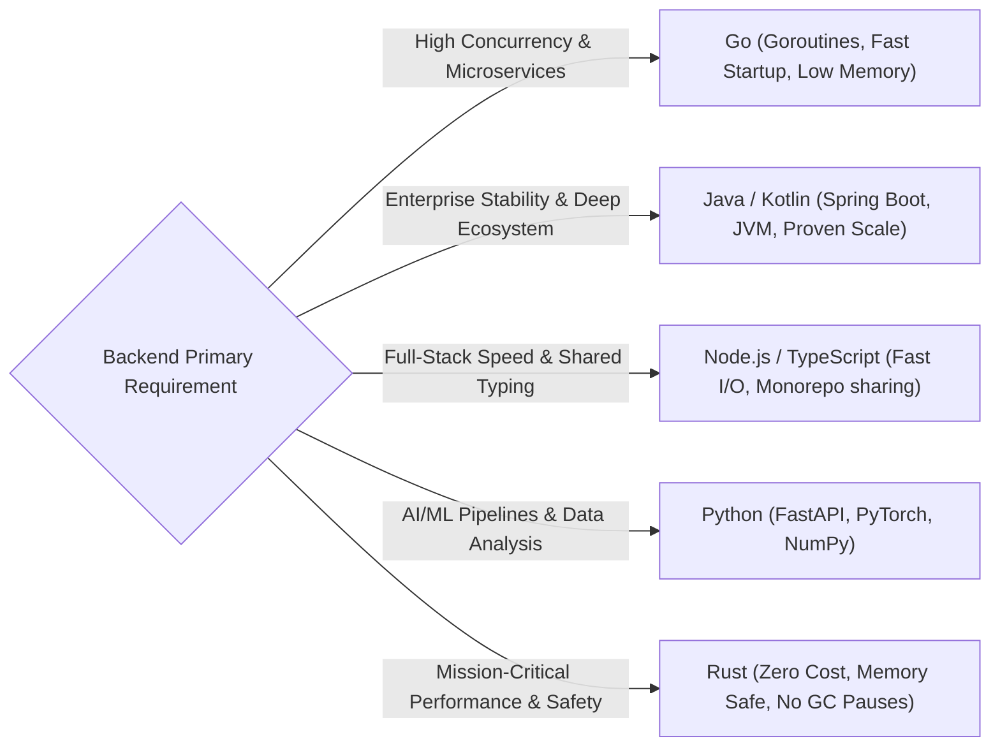
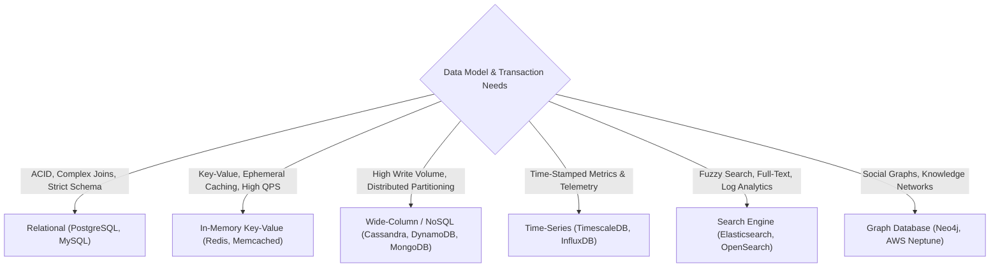
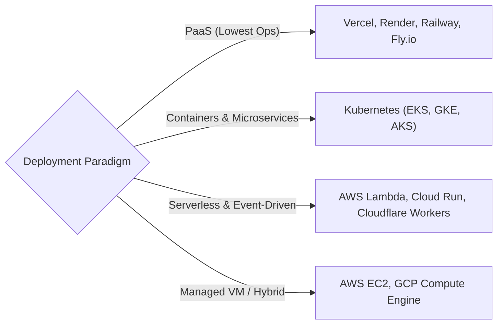

# Technology Stack Selection Guide

An exhaustive, engineering-grounded framework, decision matrix, and trade-off manual for selecting the optimal technology stack across frontend, backend, databases, caching, message brokers, and cloud infrastructure.

---

## 📌 1. The Core Philosophy of Tech Stack Selection

Technology selection is **not about picking the newest, trendiest tool**; it is an exercise in **constraint satisfaction and risk management**. Every framework, database, and protocol comes with operational trade-offs, talent requirements, and long-term maintenance overhead.



---

## 🧭 2. The 5-Dimension Evaluation Vector

Before evaluating specific tools, evaluate your problem against these five engineering dimensions:

1. **Workload Characteristics (I/O vs CPU)**:
   - High I/O, heavy concurrency, streaming (e.g., chat, notification): Asynchronous, event-driven platforms (Node.js, Go, Elixir, Spring WebFlux).
   - High CPU computation, mathematical crunching, ML: Compiled, optimized languages (C++, Rust, Go, Python with C-bindings).
2. **Access Patterns & Data Relationships**:
   - Structured, relational, strict transactional ACID consistency: Relational Database (PostgreSQL, MySQL).
   - Unstructured, schema-flexible, massive horizontal write throughput: NoSQL Key-Value / Wide-Column (Cassandra, DynamoDB, MongoDB).
3. **Latency & Throughput SLA**:
   - Ultra-low microsecond/sub-millisecond requirements: In-memory datastores (Redis), zero-garbage-collection compiled runtimes (Rust, C++, optimized Go).
4. **Developer Velocity vs Type Safety**:
   - Rapid early-stage prototyping: TypeScript, Python, Ruby.
   - Long-lived enterprise reliability, large engineering teams: Strict static typing (Java, Go, Rust, TypeScript).
5. **Total Cost of Ownership (TCO)**:
   - Compute efficiency, cloud licensing, managed vs self-hosted maintenance burdens.

---

## 🛠️ 3. Layer-by-Layer Selection Matrices

---

### Layer 1: Programming Language & Backend Runtime



| Technology | Best Suited For | Key Advantages | Trade-offs & When to Avoid |
|---|---|---|---|
| **Go** | Microservices, Cloud Native tools, High-throughput network services, Kubernetes ecosystem | Blazing fast compilation, minimal memory footprint, built-in concurrency (goroutines/channels) | Limited metaprogramming, verbose error handling, lack of complex OOP abstractions |
| **Java / JVM (Spring Boot)** | Complex enterprise domains, financial systems, large-scale monolithic or microservice architectures | Mature ecosystem, battle-tested libraries, virtual threads (Java 21 Project Loom), rich profiling tools | High initial memory footprint, JVM warm-up delay, enterprise boilerplate |
| **Node.js / TypeScript** | Real-time I/O, B2B SaaS, Rapid prototyping, Unified full-stack codebases | Non-blocking event loop, massive npm package registry, shared types across frontend and backend | CPU-bound bottlenecks (blocks event loop), callback/async debugging complexity, package ecosystem instability |
| **Python (FastAPI / Django)** | Machine Learning backends, Data Science, Internal tooling, AI integrations | Unmatched developer speed, readable syntax, AI/ML library hegemony | High execution latency, Global Interpreter Lock (GIL) concurrency hurdles, higher cloud runtime cost |
| **Rust** | High-performance infrastructure, Game backends, Crypto/Web3, OS-level utilities | Zero-cost abstractions, fearless concurrency, memory safety without Garbage Collection | Steep learning curve (borrow checker), slower compilation speeds, smaller candidate hiring pool |

---

### Layer 2: Database Layer (SQL vs NoSQL vs Specialized)



| Category | Primary Technologies | When to Choose | When to Avoid |
|---|---|---|---|
| **Relational (RDBMS)** | **PostgreSQL**, MySQL, CockroachDB | Financial transactions, e-commerce orders, relational business entities requiring strict ACID guarantees and foreign key constraints | Write rates exceeding 100k+ writes/second per instance without sharding |
| **Document Store** | **MongoDB**, DocumentDB | Semi-structured data, catalogs, rapid schema evolution where relationships are denormalized inside document boundaries | Highly normalized relational schemas requiring multi-table transactional joins |
| **Wide-Column Store** | **Apache Cassandra**, ScyllaDB, DynamoDB | Massive horizontal write scale (e.g., IoT sensor telemetry, social feed timelines), multi-region active-active setups | Systems requiring dynamic filtering, ad-hoc queries, or cross-partition transactions |
| **In-Memory Store** | **Redis**, Memcached, Dragonfly | Session storage, distributed locks, transient caching, leaderboard sorted sets, rate limit counters | Primary durable persistent storage without backup or memory overflow mitigations |
| **Search Engine** | **Elasticsearch**, OpenSearch, Meilisearch | Full-text autocomplete, faceted search filters, log monitoring, fuzzy textual matching | Primary authoritative source of truth for financial transactions |

---

### Layer 3: Caching Strategy & Technologies

1. **Application-Level Cache (In-Process)**:
   - *Tools*: Caffeine (Java), Go Cache (Go), `lru-cache` (Node.js).
   - *Use Case*: Microsecond-level lookup of static, non-volatile data; no network serialization overhead.
   - *Trade-off*: Memory consumption per application pod; cache inconsistency across horizontally scaled pods.
2. **Distributed Cache**:
   - *Tools*: **Redis**, Memcached.
   - *Use Case*: Shared cache state across hundreds of application replicas; rich data structures (Hashes, Sets, Sorted Sets, Bitmaps).
   - *Trade-off*: Network hop latency (~1-3 ms), cache invalidation complexity, serialization/deserialization CPU cost.

---

### Layer 4: Inter-Service Communication & Messaging

| Communication Style | Primary Technologies | Ideal Scenario | Key Architectural Invariant |
|---|---|---|---|
| **Synchronous RPC** | **gRPC (HTTP/2 + Protobuf)** | Low-latency internal microservice-to-microservice communication | Strict schema definition via `.proto` files, binary performance |
| **Synchronous Web API** | **REST (JSON over HTTP/1.1 or HTTP/2)** | Public client-facing APIs, web/mobile consumer endpoints | Human-readable, widespread tooling, HTTP status standard |
| **Log-Centric Streaming** | **Apache Kafka**, Apache Pulsar, Redpanda | Event-driven architecture, event sourcing, CDC (Change Data Capture), audit trails | Sequential commit log, high throughput, replayable event retention |
| **Message Queuing** | **RabbitMQ**, AWS SQS, NATS | Asynchronous task delegation, worker queues, complex message routing (fan-out, topic, direct) | Message acknowledgment, dead-letter queues (DLQ), ephemeral delivery |

---

### Layer 5: Frontend Frameworks & Client Architectures

| Framework | Best Suited For | Key Architectural Benefit | Trade-offs |
|---|---|---|---|
| **React + Next.js** | Content-heavy platforms, SEO-critical e-commerce, Enterprise SaaS | Hybrid rendering (SSR, SSG, ISR), vast component ecosystem, React Server Components (RSC) | Framework churn, hydration overhead, complex mental model |
| **Vue + Nuxt** | Rapid SaaS development, clean progressive adoption | Intuitive reactivity system, organized single-file components (`.vue`), gentle learning curve | Smaller ecosystem than React in North American enterprise markets |
| **Svelte + SvelteKit** | High-performance interactive dashboards, embedded web views | Compile-time reactivity without Virtual DOM, minimal bundle sizes | Smaller third-party library ecosystem |
| **Flutter / React Native** | Cross-platform mobile development (iOS + Android) | Single shared codebase, near-native performance, rapid UI iteration | Platform-specific bridge constraints, complex native module debugging |

---

### Layer 6: Cloud Infrastructure, Hosting & Deployment



- **PaaS (Platform as a Service)**: Ideal for startups and MVPs (Vercel, Render, Fly.io). Minimizes DevOps headcount.
- **Serverless / CaaS (Containers as a Service)**: Ideal for bursty, event-driven workloads (AWS Lambda, Google Cloud Run). Zero idle cost, auto-scaling to zero.
- **Orchestrated Containers (Kubernetes)**: Ideal for medium-to-large microservice fleets requiring fine-grained network routing, service meshes (Istio), and multi-cloud resilience.

---

## ⚖️ 4. The Anti-Pattern Checklist (What NOT to Do)

1. **Resume-Driven Development (RDD)**: Selecting a niche, bleeding-edge framework solely because it looks good on a resume rather than fitting system requirements.
2. **Premature Microservices & Distributed Sprawl**: Splitting a small application into 15 microservices across 5 different programming languages before understanding core domain boundaries.
3. **The 'One Database Fits All' Fallacy**: Forcing relational SQL schemas into a document database, or using a relational database for high-throughput time-series metrics.
4. **Ignoring Team Competency**: Choosing Rust or Scala when 100% of the engineering staff is senior in Python or Java, leading to velocity collapse and production operational blindspots.
5. **Vendor Lock-in Over-Optimization**: Burning months building multi-cloud abstractions for an application that will only ever run on AWS or GCP.

---

## 📋 5. Technology Selection Architecture Decision Record (ADR) Template

Document every major technology choice in your repository using this standardized ADR template:

```markdown
# ADR-001: Selection of Primary Relational Database

## Status
Accepted / Under Evaluation / Deprecated

## Context & Problem Statement
Our application requires a primary persistent store for financial ledger balances and user transactions. 
We anticipate 5,000 write TPS at launch, growing to 25,000 TPS within 18 months. Strong ACID consistency 
and foreign key referential integrity are mandatory non-functional requirements.

## Decision Drivers
- Strict transactional consistency (ACID guarantees).
- Rich indexing options (B-Tree, GiST, GIN for JSONB attributes).
- Team operational familiarity and automated cloud backup tooling.
- Cost-effective read replicas and connection pooling.

## Considered Options
1. PostgreSQL (Amazon RDS / Cloud SQL)
2. MySQL (Amazon Aurora)
3. MongoDB (Document Database)

## Decision Outcome
**Chosen Option**: PostgreSQL

### Rationale:
- PostgreSQL natively satisfies our strict ACID consistency requirements.
- Native `JSONB` support allows flexible attribute storage without losing relational integrity.
- Battle-tested connection poolers (PgBouncer, HikariCP) handle high concurrency efficiently.
- Team possesses 6+ years of operational troubleshooting and query optimization experience in PostgreSQL.

### Positive Consequences:
- Immediate developer velocity with established ORM and migration tooling.
- Zero risk of transactional inconsistency during multi-account balance transfers.

### Negative Consequences / Trade-offs:
- Horizontal write scaling requires manual sharding or partitioning if traffic exceeds 30,000 writes/sec.
```
