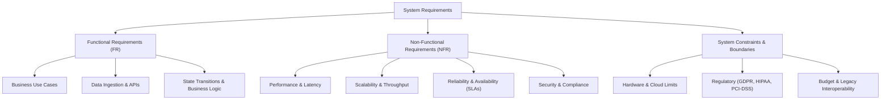

# System Requirements Engineering

Comprehensive guide, formal taxonomies, analysis frameworks, and production templates for defining software system requirements across Low-Level Design (LLD) and High-Level Design (HLD).

---

## 📌 1. Taxonomy of System Requirements

System requirements bridge business problem definitions with technical architectural reality. They are divided into three primary tiers:



---

## ⚙️ 2. Functional Requirements (FR)

Functional requirements define **what the system must specifically do**, its behavioral contracts, and user interactions.

### Key Components of Robust FRs:
1. **Core User Workflows**: Explicit actions a user or external service can trigger.
2. **Input Validation & Pre-conditions**: What must be true before an operation proceeds.
3. **System Behavior & Output**: The deterministic response of the system under success scenarios.
4. **Error Handling & Post-conditions**: How failure scenarios are handled and what state the system is left in.

### Production Example (E-Commerce Checkout):
- **FR-1 (Cart Conversion)**: The system must convert active shopping cart items into an immutable Order entity upon payment authorization.
- **FR-2 (Inventory Allocation)**: The system must hold inventory reservations for 15 minutes during the checkout session.
- **FR-3 (Notification)**: The system must asynchronously dispatch order confirmation emails and webhook events to warehouse management.

---

## 🛡️ 3. Non-Functional Requirements (NFR / Quality Attributes)

Non-functional requirements describe **how well the system performs its functions**. They govern architectural decisions, capacity estimation, and infrastructure selection.

### The Canonical NFR Matrix:

| Category | Primary Metrics / Dimensions | Key Questions for System Architects |
|---|---|---|
| **Performance** | Latency (p50, p95, p99), Response Time, Throughput | Is read latency sub-50ms? What is the acceptable p99 write delay? |
| **Scalability** | Requests per second (RPS/QPS), Concurrent users, Storage growth | How does the system scale under 10x traffic spikes? Horizontal vs vertical? |
| **Availability** | Uptime percentage (99.9% vs 99.99%), MTTR, MTTD | Can the system survive single-node or single-region datacenter failures? |
| **Reliability** | Fault tolerance, Data loss tolerance, Error rate (<0.01%) | Are writes idempotent? What happens during network partitions? |
| **Consistency** | Strong Consistency vs Eventual Consistency (CAP Theorem) | Does every read immediately see the latest write, or is lag tolerated? |
| **Security** | Authentication (OAuth2, OIDC), Encryption (At-rest, In-transit), RBAC | Is sensitive data masked? Are audit logs tamper-evident? |
| **Observability** | Telemetry, Distributed Tracing, Metrics, Log retention | Can engineers trace a request end-to-end across microservices? |

---

## 📐 4. High-Level Design (HLD) vs Low-Level Design (LLD) Requirements

| Perspective | System Requirements in HLD | System Requirements in LLD |
|---|---|---|
| **Primary Scope** | Macro system boundaries, distributed topology, data pipelines | Micro class structure, object interfaces, memory lifecycle |
| **Capacity Scoping** | QPS, Daily Active Users (DAU), Network Bandwidth, TB/PB storage | In-memory footprint, thread pools, lock contention, GC pauses |
| **Protocol & APIs** | HTTP/2, gRPC, WebSocket endpoints, Message Broker payloads | Method signatures, exceptions, DTOs, dependency injection |
| **Key Invariants** | High Availability, Partition Tolerance, Disaster Recovery | Concurrency safety, Thread safety, SOLID principles, Extensibility |

---

## 📝 5. Production Requirements Template for System Design

Use this standardized template when beginning any LLD or HLD topic in this repository:

```markdown
# [System Name] - Requirements Specification

## 1. Scope & Goals
- **Objective**: [1-2 sentences summarizing the system mission]
- **In-Scope**: [Explicit features covered in this design]
- **Out-of-Scope**: [Explicit features deferred or ignored]

## 2. Functional Requirements (FR)
- **FR-01**: The system must allow users to...
- **FR-02**: The system must provide an API endpoint to...
- **FR-03**: In the event of [failure condition], the system must...

## 3. Non-Functional Requirements (NFR)
- **Availability**: [e.g., 99.99% uptime / 4 nines]
- **Latency**: [e.g., Read p99 < 20ms, Write p99 < 100ms]
- **Consistency**: [e.g., Eventual consistency acceptable with 500ms replication lag]
- **Durability**: [e.g., 99.999999999% data persistence guarantee on persistent blobs]

## 4. Scale & Capacity Estimation
- **Users**: [DAU / MAU]
- **Throughput**:
  - Read QPS: [Calculated value]
  - Write QPS: [Calculated value]
  - Read/Write Ratio: [e.g., 100:1]
- **Storage Volume**:
  - Daily Ingestion: [e.g., 50 GB / day]
  - 5-Year Storage Capacity: [e.g., ~100 TB]
- **Network Bandwidth**:
  - Incoming Traffic: [e.g., 5 MB/s]
  - Outgoing Traffic: [e.g., 500 MB/s]
```

---

## 🎯 6. Requirements Elicitation Framework: The 5-Step Process


1. **Clarify Scope & Boundaries**: Never assume unspecified features. Establish hard system boundaries immediately.
2. **Enumerate Functional Use Cases**: Identify primary actors, entry points, and end-to-end user journeys.
3. **Derive Traffic & Capacity Math**: Transform business user numbers into concrete engineering requirements (QPS, Bandwidth, IOPS, Storage).
4. **Pinpoint NFRs & CAP Priorities**: Choose trade-offs deliberately (e.g., AP vs CP in CAP, Latency vs Consistency in PACELC).
5. **Formalize Acceptance Criteria**: Define exact conditions under which a requirement is considered fully met.
