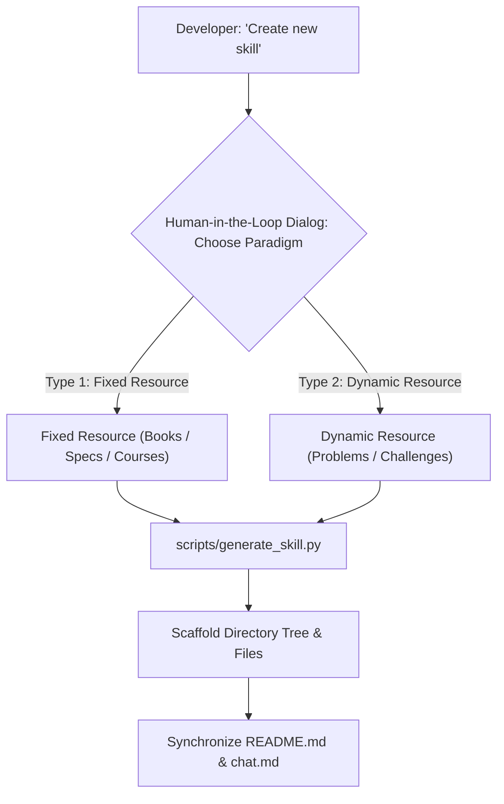

# Architecture & Operational Mechanics: `SkillGenerator` Meta-Skill

## 1. System Overview & Purpose

The **`SkillGenerator`** meta-skill provides automated, deterministic scaffolding of new agent skills. It ensures that every new skill added to the repository strictly respects the dual-paradigm architecture:
- Type 1: Fixed Resource Skill (`SkillsOnFixedResources`)
- Type 2: Dynamic Resource Skill (`SkillsOnDynamicResources`)

---

## 2. Scaffolding Pipeline

