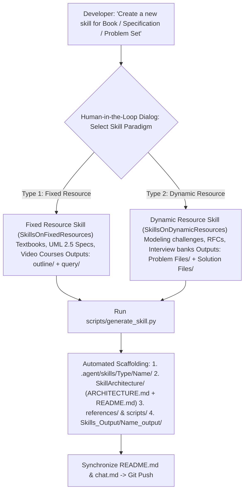

# UML Diagramming & Software Architecture

An exhaustive, high-performance software modeling manual, system architecture specification guide, and agentic AI skill system designed for deterministic object-oriented analysis & design (OOAD), structural modeling, dynamic behavioral analysis, and verified code generation.

---

## ⚡ Quick Navigation: Skill Outputs Hub

Access key outputs generated by each skill directly using the navigation buttons below:

### 📁 Universal Query Output Hub (Combined & Single-Skill Syntheses)

[](Skills_Output/query/Query_Hub_README.md)  
[](Skills_Output/query/001_uml_2_5_taxonomy_structural_vs_behavioral.md)  

### 🛠️ `UMLSkill` Outputs (Problem Ingestion & Multi-Tier Solutions)

[](Skills_Output/UMLSkill_output/Problem%20Files/question%20bank.md)  
[-059669?style=for-the-badge&logo=diagramsdotnet&logoColor=white)](Skills_Output/UMLSkill_output/Solution%20Files/Solution%20formatting.md)  
[](Skills_Output/UMLSkill_output/Problem%20Files/problem%20formatting.md)  

### 📐 `UML25Spec` Skill Outputs (OMG UML 2.5 Metamodels & Notation)

[](Skills_Output/UML25Spec_output/outline/UML25Spec_Complete_Outline.md)  
[](Skills_Output/UML25Spec_output/UML25Spec_Output_README.md)  

### ⚙️ System Tools & Roadmaps

[](.agent/skills/SkillGenerator/SKILL.md)  
[](chat/finalized%20chat.md)  
[](Upcoming%20Updates/Upcoming%20Updates.md)  
[](chat/chat.md)  
[](.agent/skills/type%20of%20skills.md)  

---

## 🎯 Core Philosophy & Project Objective

> *"The objective of this project is to establish deterministic control and architectural transparency over agentic software modeling models. Rather than allowing an agent to generate superficial sketches or ungrounded class definitions, the agent must anchor all designs to formal OMG UML 2.5 metamodels, strict object-oriented invariants (multiplicity, visibility, composition vs aggregation), side-by-side Java 21 implementations, runtime heap analysis, and explicit human-in-the-loop consensus."*

### Moving from Black-Box AI to Collaborative System Modeling

LLM-powered assistants frequently produce flawed software architectures:
1. **Unchecked Relationship Semantics**: Conflating Composition with Aggregation, omitting multiplicities, or proposing circular dependencies without lifecycle constraints.
2. **Missing Behavioral Synchronicity**: Drawing sequence diagrams that confuse synchronous RPCs with asynchronous event dispatches, omitting activation lifelines and error fragments (`alt`).
3. **State Invariant Blindness**: Inventing state machine models prone to deadlocks, illegal state transitions, or unhandled events.

**UML Diagramming** solves this by establishing a **Human-in-the-Loop, Invariant-Grounded Engineering Framework**:
- **Proactive Design Consultations**: When multiple valid architectural trade-offs exist (e.g. Composition vs Aggregation, Synchronous Call vs Event-Driven Messaging, State Pattern vs Strategy Pattern), the agent is **mandated** to present the candidate options alongside their trade-offs and seek developer consensus before generating final diagrams or code.
- **Authoritative Reference Grounding**: All modeling specifications and diagram notation rules are anchored directly to the formal OMG UML 2.5 standard and canonical software engineering literature.

---

## 📖 Key Deliverables

1. **The UML & Architecture Engineering Manual**: Formal metamodel specifications, PlantUML and Mermaid diagram definitions, and side-by-side runnable implementations in **Java 21**.
2. **`Skills_Input/` Directory (Central Ingestion & Reference Assets)**:
   - **`Skills_Input/books/`**: Curated textbooks and domain books:
     - **`Overall/`**: Comprehensive case study and diagram manual ([`[BEST] UML Diagramming.pdf`](Skills_Input/books/Overall/[BEST]%20UML%20Diagramming.pdf) by Dr. Suriya Sundaramoorthy, CRC Press, 431 pages, 40 chapters).
     - **`Structural/`**, **`Behavioral/`**, **`Architectural/`**: Domain-specific libraries.
   - **`Skills_Input/Templates/`**: Step-by-step blueprints instructing the agent on *how* to systematically model systems:
     - [`Class & Object Diagram Template`](Skills_Input/Templates/Class_and_Object_Diagram_Template.md): Attributes, visibility, multiplicities, composition vs aggregation, and Java OOP mapping.
     - [`Sequence & Interaction Diagram Template`](Skills_Input/Templates/Sequence_and_Interaction_Diagram_Template.md): Lifelines, synchronous/asynchronous messaging, reply flows, and combined fragments (`alt`, `opt`, `loop`, `par`).
     - [`State Machine & Activity Diagram Template`](Skills_Input/Templates/State_Machine_and_Activity_Diagram_Template.md): States, events, guards, actions, fork/join concurrency, and swimlanes.
     - [`Use Case & Component Diagram Template`](Skills_Input/Templates/Use_Case_and_Component_Diagram_Template.md): System boundaries, actors, provided/required interfaces, and port wiring.
3. **`Skills_Output/` Directory (Output Hub & Universal Query Center)**:
   - **`Skills_Output/query/` (Unified Investigation & Multi-Skill Query Hub)**:
     - The single destination for all deep-dive manuals, metamodel breakdowns, and cross-course query solutions.
     - Master Index: [`Skills_Output/query/Query_Hub_README.md`](Skills_Output/query/Query_Hub_README.md).
   - **`Skills_Output/UMLSkill_output/`**:
     - `Problem Files/`: Ingestion staging area (`Source of Problem/put the file here/`), formatting specs, dynamic categories (`problem categories.md`), and the master [`question bank.md`](Skills_Output/UMLSkill_output/Problem%20Files/question%20bank.md).
     - `Solution Files/`: Solutions organized by Primary Category and Subcategory with separate `<ID>_diagram.puml`, `<ID>_diagram.mmd`, `<ID>_implementation.java`, and `<ID>_derivation.md` files.
   - **`Skills_Output/UML25Spec_output/outline/`**:
     - Complete 22-clause specification outline ([`UML25Spec_Complete_Outline.md`](Skills_Output/UML25Spec_output/outline/UML25Spec_Complete_Outline.md)) providing zero-overhead topic discovery.
4. **`.agent/skills/` (Centralized Agent Skills Hub)**:
   - **`SkillGenerator`**: Universal meta-skill for creating production-ready agent skills via interactive Human-in-the-Loop (HITL) interviews.
   - **`SkillsOnFixedResources/`**: Reference skills (e.g., `UML25Spec`) with zero-token Table of Contents routing, deep specification outlines, and precision query CLI.
   - **`SkillsOnDynamicResources/UMLSkill/`**: Autonomous challenge ingestion, dynamic category classification (HITL), and question bank manager.
   - **`type of skills.md`**: Architectural manual documenting the fixed vs dynamic skill paradigms.
5. **`Upcoming Updates/` Roadmap**: Milestone tracking for planned modules and upcoming manuals.
6. **`chat/` Directory (Conversational & Governance Logs)**:
   - [`chat/chat.md`](chat/chat.md): Chronological, session-by-session log of all user requests, architectural decisions, and agent implementation steps.
   - [`chat/finalized chat.md`](chat/finalized%20chat.md): Single source of truth for all universal rules, updated guidelines, and permanent agent directives (including the **Mandatory 3-Tier Modeling Mapping: Java Code &rarr; UML Diagram &rarr; JVM Heap State**).

---

## ⚙️ Universal Skill Generator (`SkillGenerator`)

The repository features an autonomous meta-skill, **`SkillGenerator`**, located in [`.agent/skills/SkillGenerator/`](.agent/skills/SkillGenerator/), designed to scaffold new skills conforming to the architectural standard established in `Science_Of_Coding` and `Database Management System`.

### Skill Paradigms Supported



### How to Use `SkillGenerator`

#### Option 1: Interactive Agent Prompt (HITL)
Prompt the agent in chat:
> *"@SkillGenerator create a new skill for the textbook in Skills_Input/books/Structural"*

#### Option 2: Automated CLI Scaffolding
```bash
# Type 1: Fixed Resource Skill (Book / Specification / Course)
python .agent/skills/SkillGenerator/scripts/generate_skill.py --type fixed --name Fowler_UML --resource-type "Book" --source-path "Skills_Input/books/Structural"

# Type 2: Dynamic Resource Skill (Problem Intake / Solution Hub)
python .agent/skills/SkillGenerator/scripts/generate_skill.py --type dynamic --name SystemDesignSkill --category-doc "problem categories.md"
```

---

## 📂 Repository Structure

```
UML-Diagramming/
├── .agent/
│   └── skills/
│       ├── SkillGenerator/                         # Universal HITL Skill Scaffolder (scripts/, SKILL.md, SkillArchitecture/)
│       ├── SkillsOnFixedResources/                 # Type 1: Textbooks, Specifications & Course Skills
│       │   └── UML25Spec/                          # Formal OMG UML 2.5 Specification & Reference Skill
│       ├── SkillsOnDynamicResources/               # Type 2: Dynamic Practice & Ingestion Skills
│       │   └── UMLSkill/                           # Dynamic intake, HITL categorization, and solution generator
│       └── type of skills.md                       # Skill Typology Specification (Fixed vs Dynamic)
├── chat/
│   ├── chat.md                                     # Chronological Session & Decision Log
│   └── finalized chat.md                           # Single Source of Truth for Governance Rules
├── scripts/
│   └── audit_rendering.py                          # Single-Pass O(N) Git-Aware Markdown/Diagram Auditor
├── Skills_Input/
│   ├── books/                                      # Curated Textbooks & Specifications
│   │   ├── Overall/                                # Comprehensive Case Studies ([BEST] UML Diagramming.pdf)
│   │   │   ├── chapters/                           # 40 individual Chapter Markdown summaries
│   │   │   └── vector_images/                      # 477 Scalable Vector Graphics (.svg) diagrams by chapter
│   │   ├── Structural/                             # Class, Object, Package, Component, Deployment
│   │   ├── Behavioral/                             # Use Case, Activity, State Machine
│   │   └── Architectural/                          # Interaction, Sequence, Communication, Timing
│   ├── Templates/                                  # Formal Step-by-Step Modeling Blueprints
│   │   ├── Class_and_Object_Diagram_Template.md    # Multiplicities, associations, invariants, OOP mapping
│   │   ├── Sequence_and_Interaction_Diagram_Template.md # Lifelines, synch/asynch, loops, alt/opt fragments
│   │   ├── State_Machine_and_Activity_Diagram_Template.md # States, triggers, guards, actions, fork/join
│   │   └── Use_Case_and_Component_Diagram_Template.md # Actors, boundaries, include/extend, ports/interfaces
│   └── TopicsOutline/                              # Master Domain Outlines
│       └── UML_2.5_Diagrams_Master_Outline.md      # Taxonomy of all 14 UML 2.5 diagrams
├── Skills_Output/
│   ├── Skills_Output_README.md                     # Centralized Output Protocol & Hub Guide
│   ├── query/                                      # 🌟 UNIFIED QUERY HUB (All Single & Combined Syntheses)
│   │   ├── Query_Hub_README.md                     # Master Index of all generated manuals
│   │   └── 001_uml_2_5_taxonomy_structural_vs_behavioral.md # Inaugural reference manual
│   ├── UMLSkill_output/                            # Dynamic Problem Ingestion & Modeling Solutions
│   │   ├── Problem Files/                          # Ingested challenges, question bank & formatting specs
│   │   │   ├── Problem_Files_README.md             # Registry instructions
│   │   │   ├── problem formatting.md               # Standardized problem schema
│   │   │   ├── problem categories.md               # 2-Tier category & subcategory taxonomy
│   │   │   ├── question bank.md                    # Master problem archive table
│   │   │   └── Source of Problem/                  # Ingestion drop zones
│   │   │       ├── Source_Of_Problem_README.md     # Ingestion workflow guide
│   │   │       └── put the file here/              # PDF / raw file staging drop zone
│   │   │           └── Put_The_File_Here_README.md
│   │   ├── Solution Files/                         # Multi-representation solutions
│   │   │   ├── Solution_Files_README.md            # Solution archive directory guide
│   │   │   └── Solution formatting.md              # Diagram (.puml/.mmd) + Java + Derivation spec
│   │   └── UMLSkill_Output_README.md               # Dynamic Skill Output Hub
│   └── UML25Spec_output/                           # Fixed Resource Output Workspace
│       ├── outline/                                # Complete specification outlines
│       │   └── UML25Spec_Complete_Outline.md       # Comprehensive 22-clause specification map
│       └── UML25Spec_Output_README.md              # Reference Skill Output Hub
├── Upcoming Updates/
│   └── Upcoming Updates.md                         # Serialized Milestone & Feature Tracking
├── .gitattributes                                  # Line normalization rules
├── .gitignore                                      # Standard repository exclusions
└── README.md                                       # Repository Overview & Public Portal
```

---

## 🤖 How to Use the Skills with Agentic AIs

### 1. `UML25Spec` (`SkillsOnFixedResources`)
- **Auto-Discovery**: Located at [`.agent/skills/SkillsOnFixedResources/UML25Spec/SKILL.md`](.agent/skills/SkillsOnFixedResources/UML25Spec/SKILL.md).
- **Interactive Prompts**:
  - *"Using @skill:UML25Spec, explain the formal metamodel differences between Composition and Shared Aggregation under Clause 11."*
  - *"Using UML25Spec and `Skills_Input/Templates/Sequence_and_Interaction_Diagram_Template.md`, model an e-commerce order cancellation flow."*

### 2. `UMLSkill` (`SkillsOnDynamicResources`)
- **Auto-Discovery**: Located at [`.agent/skills/SkillsOnDynamicResources/UMLSkill/SKILL.md`](.agent/skills/SkillsOnDynamicResources/UMLSkill/SKILL.md).
- **Interactive Prompts**:
  - *"Check if there are any pending challenge files in `put the file here/` using @skill:UMLSkill."*
  - *"Ingest this system design requirement into question bank.md and prompt me to select the category."*
  - *"Solve problem UML-1 adhering to Solution formatting.md with separate PlantUML, Mermaid, Java, and derivation files."*

---

## 🛠️ CLI Usage: Querying the Specifications Directly

You or any AI agent can query resources directly using the precision CLI scripts:

### 1. Keyword Search
```bash
python .agent/skills/SkillsOnFixedResources/UML25Spec/scripts/query_uml25spec.py "Composition"
python .agent/skills/SkillsOnFixedResources/UML25Spec/scripts/query_uml25spec.py "CombinedFragment"
```

### 2. Ingestion Queue Inspection
```bash
python .agent/skills/SkillsOnDynamicResources/UMLSkill/scripts/ingest_manager.py --status
python .agent/skills/SkillsOnDynamicResources/UMLSkill/scripts/ingest_manager.py --categories
```

### 3. Rendering Integrity Audit
```bash
python scripts/audit_rendering.py
python scripts/audit_rendering.py --all
```

---

## 🔒 Copyright & Terms of Use

**Copyright © 2026. All rights reserved.**

This repository and all its contents—including but not limited to the modeling manuals, query guides, architectural designs, agentic templates, decision trees, and code implementations—are proprietary material. **No unauthorized copying, distribution, reproduction, modification, or commercial use is permitted without explicit prior written consent from the author.**

