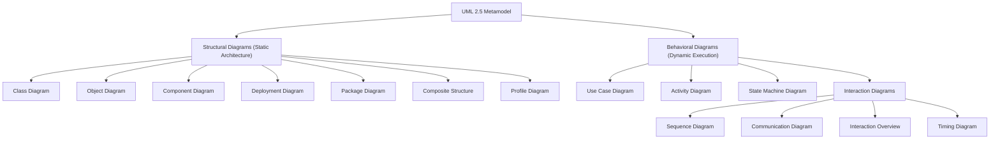
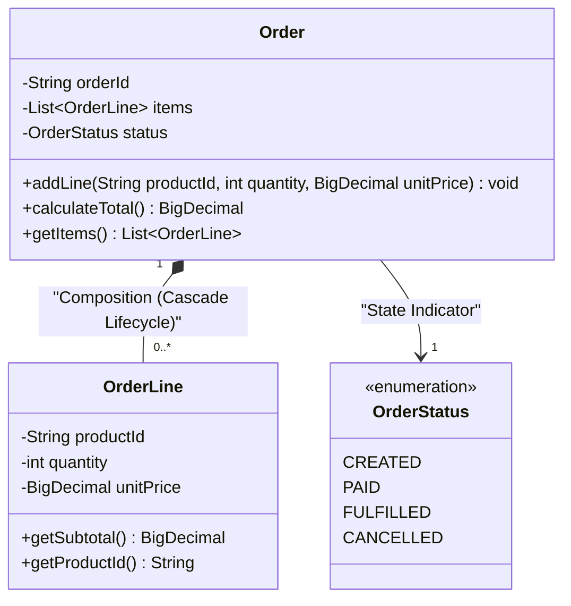
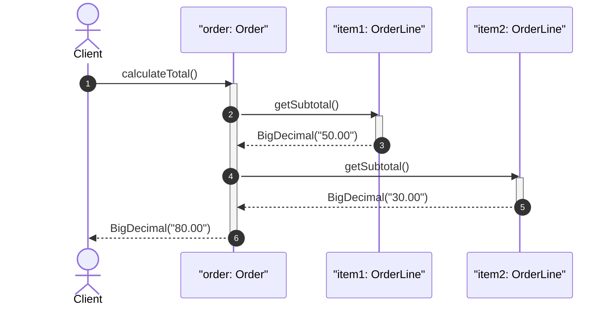

# Query 001: UML 2.5 Metamodel Taxonomy — Structural vs Behavioral Architecture

> **Source Attribution**: Derived from `@UML25Spec` (Clause 6: Additional Information, Clause 7: Common Structure, Clause 9: Classification, Clause 17: Interactions).

---

## 1. Executive Summary & Architectural Motivation

In software engineering, modeling systems visually without rigorous semantic precision leads to architectural divergence—where code, diagrams, and developer mental models drift apart. The **OMG Unified Modeling Language (UML) 2.5** standard solves this by formalizing 14 discrete diagram types grouped into two complementary perspectives:
1. **Structural Diagrams (Static Architecture)**: What elements exist in the system, how they are typed, and how they relate statically.
2. **Behavioral Diagrams (Dynamic Execution)**: How elements change state over time, how control flows, and how lifelines exchange messages.

---

## 2. Metamodel Taxonomy & Classification



---

## 3. Mandatory 3-Tier Concept Demonstration

To demonstrate how formal UML constructs map directly to runnable software and physical memory execution, we examine a canonical **Order & OrderLine E-Commerce Model** adhering to the 3-Tier Mapping Rule.

### Tier 1: Concrete Object-Oriented Implementation (Strictly Java)

```java
package com.modeling.ecommerce;

import java.math.BigDecimal;
import java.util.ArrayList;
import java.util.Collections;
import java.util.List;
import java.util.Objects;

/**
 * Concrete Aggregate Whole in a Composition Relationship.
 * Invariant: OrderLines cannot exist without an Order.
 */
public final class Order {
    private final String orderId;
    private final List<OrderLine> items;
    private OrderStatus status;

    public Order(String orderId) {
        this.orderId = Objects.requireNonNull(orderId, "orderId must not be null");
        this.items = new ArrayList<>();
        this.status = OrderStatus.CREATED;
    }

    public void addLine(String productId, int quantity, BigDecimal unitPrice) {
        if (this.status != OrderStatus.CREATED) {
            throw new IllegalStateException("Cannot add items to an already processed order");
        }
        // Composition enforcement: Order manages OrderLine instantiation
        this.items.add(new OrderLine(productId, quantity, unitPrice));
    }

    public BigDecimal calculateTotal() {
        return items.stream()
                .map(OrderLine::getSubtotal)
                .reduce(BigDecimal.ZERO, BigDecimal::add);
    }

    public List<OrderLine> getItems() {
        return Collections.unmodifiableList(items); // Defensive immutable view
    }

    public String getOrderId() { return orderId; }
    public OrderStatus getStatus() { return status; }
}

final class OrderLine {
    private final String productId;
    private final int quantity;
    private final BigDecimal unitPrice;

    OrderLine(String productId, int quantity, BigDecimal unitPrice) {
        if (quantity <= 0) throw new IllegalArgumentException("Quantity must be positive");
        this.productId = Objects.requireNonNull(productId);
        this.quantity = quantity;
        this.unitPrice = Objects.requireNonNull(unitPrice);
    }

    public BigDecimal getSubtotal() {
        return unitPrice.multiply(BigDecimal.valueOf(quantity));
    }

    public String getProductId() { return productId; }
    public int getQuantity() { return quantity; }
}

enum OrderStatus {
    CREATED, PAID, FULFILLED, CANCELLED
}
```

---

### Tier 2: Formal UML Diagram Specification

#### Structural View: Class Diagram (Composition & Multiplicities)



#### Behavioral View: Sequence Diagram (Synchronous Total Calculation)



---

### Tier 3: Runtime Architecture & JVM Heap Memory State

When `Order` is instantiated and populated with two `OrderLine` instances, the physical memory state in the JVM Heap is structured as follows:

```
[ JVM Stack Frame: Client Thread ]
    │
    └── variable `order` ──► [ JVM Heap: Order Instance @ 0x7A10 ]
                              ├── header: mark word + klass pointer
                              ├── field `orderId`: "ORD-9821"
                              ├── field `status`: Enum constant CREATED
                              └── field `items`: ArrayList @ 0x8F00
                                                    │
                               ┌────────────────────┴────────────────────┐
                               ▼                                         ▼
                 [ Element[0] @ 0x9010 ]                   [ Element[1] @ 0x9040 ]
                 OrderLine Instance                        OrderLine Instance
                 ├── productId: "PROD-A"                   ├── productId: "PROD-B"
                 ├── quantity: 2                           ├── quantity: 1
                 └── unitPrice: $25.00                     └── unitPrice: $30.00
```

---

## 4. Architectural Synthesis Table

| Dimension | Structural Modeling | Behavioral Modeling |
| :--- | :--- | :--- |
| **Primary Perspective** | Static type hierarchy, invariants, and linkages | Dynamic execution, time-ordered messaging, state changes |
| **Temporal Aspect** | Invariant across all points in time (`t = const`) | Evolving continuously across runtime execution (`t -> t + dt`) |
| **Java Code Construct** | Class definitions, fields, inheritance (`extends`), and interfaces (`implements`) | Method bodies, call invocations, state mutations, and event listeners |
| **Core Diagrams** | Class, Object, Component, Deployment | Sequence, Activity, State Machine, Use Case |
