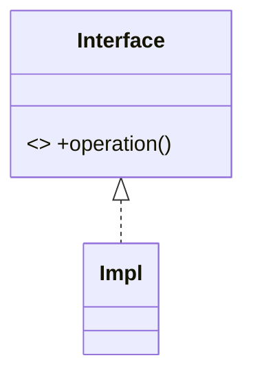

# <Topic Name>  (LLD)

> Copy this `_TEMPLATE` folder, rename it (e.g. `Parking_Lot_System`), and fill it in.

## Problem
Short description of what is being designed.

## Requirements
- Functional:
- Non-functional:

## Design
- Key classes / interfaces:
- Design patterns used:
- Relationships (inheritance, composition, aggregation):

## Folder layout
| Folder | Contents |
|---|---|
| `diagrams/` | UML class, sequence, state diagrams (PlantUML / Mermaid / images) |
| `code/` | Implementation (Java, etc.) |
| `notes/` | Reasoning, trade-offs, task statements |
| `resources/` | Books, PDFs, references |

## Diagram (Mermaid example)

## Trade-offs & Notes
