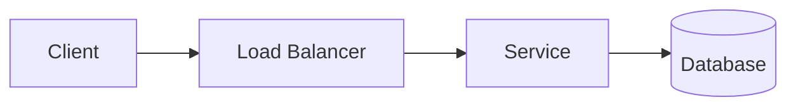

# <Topic Name>  (HLD)

> Copy this `_TEMPLATE` folder, rename it (e.g. `URL_Shortener`), and fill it in.

## Problem
Short description of the system.

## Requirements
- Functional:
- Non-functional (scale, latency, availability, consistency):

## Capacity Estimation
- Users / QPS:
- Storage:
- Bandwidth:

## High-Level Architecture
Components, data flow, APIs, data model.

## Folder layout
| Folder | Contents |
|---|---|
| `diagrams/` | Architecture, component, deployment, sequence diagrams |
| `code/` | Prototypes, API specs, schemas |
| `notes/` | Trade-offs, scaling, bottlenecks, alternatives |
| `resources/` | Books, PDFs, references |

## Diagram (Mermaid example)

## Deep Dives & Trade-offs
