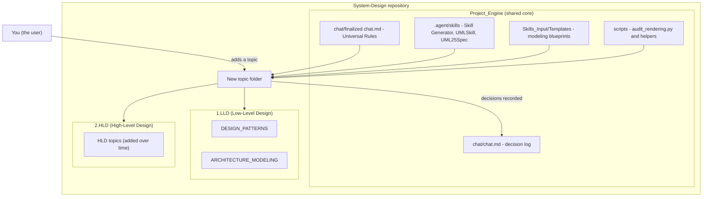
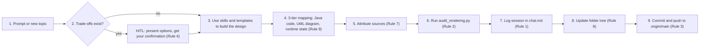
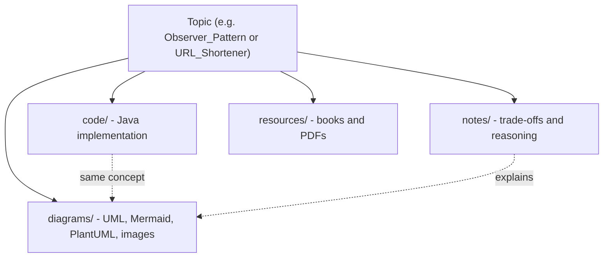
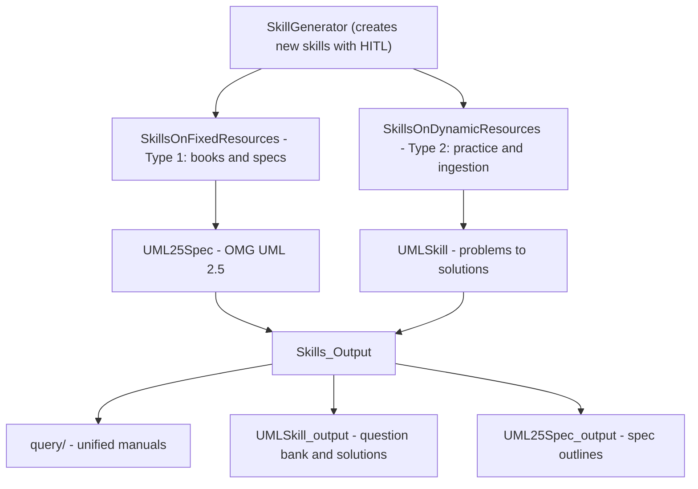

# How This Project Works (Graphical Overview)

> **Source Attribution**: Derived from `Project_Engine/chat/finalized chat.md` (Rules 1-9 and canonical folder structure), `Project_Engine/.agent/skills/` (skill typology), and the repository layout of `1.LLD/` and `2.HLD/`.

## 1. Big Picture: Engine and Topics

`Project_Engine` is the shared core. Every LLD and HLD topic follows its rules, skills and templates.

## 2. Lifecycle of One Task (Rules in Action)

## 3. Inside a Topic Folder

## 4. Skill System

## 5. Current Repository Map

| Path | Role |
|---|---|
| `Project_Engine/` | Shared core: rules, skills, templates, scripts, logs |
| `1.LLD/` | Low-level topics (design patterns, architecture modeling, UML) |
| `2.HLD/` | High-level topics (system architecture, scaling) |
| `README.md` | The only README in the project (Rule 10); other docs are named by topic |

