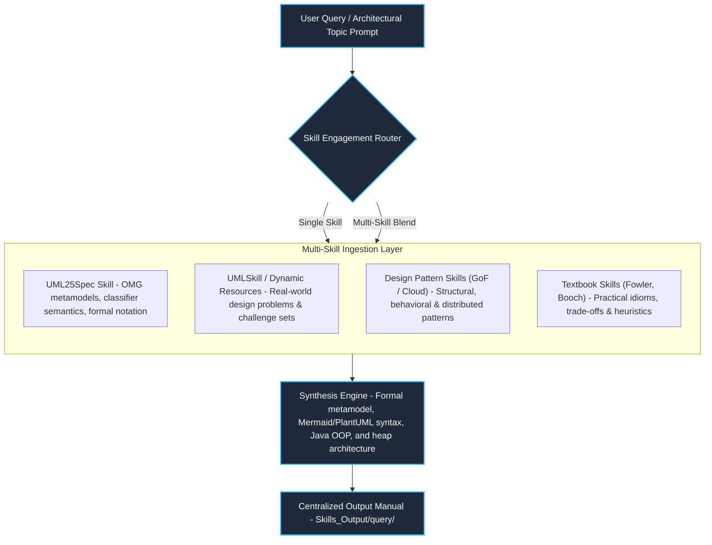

# Universal Query Output Archive (`Skills_Output/query/`)

This directory serves as the **centralized knowledge output hub** for all investigative queries, deep-dive manuals, formal UML metamodel analyses, and cross-course syntheses.

Whether a query is derived from a single standard (e.g. `UML25Spec`), a design pattern reference, or combines multiple sources (e.g. formal OMG metamodel + real-world microservice architecture + `UMLSkill` problem challenges), the final output manual is cataloged here under a single, unified index.

---

## ⚡ Query Execution & Multi-Skill Synthesis Matrix



---

## 📂 Topic-Centric Directory Taxonomy

All query manuals are organized into dedicated topic folders to keep knowledge domains modular while allowing queries to synthesize multiple sources:

```
Skills_Output/query/
├── Query_Hub.md                   # Central Master Index & Synthesis Registry (Rule 10 compliant)
├── UML_Metamodels/                # OMG UML 2.5 standards, classifiers, notations & diagrams
├── Design_Patterns/               # GoF, enterprise, and cloud design patterns
├── Distributed_Systems/           # Microservices, consensus, replication, caching & messaging
├── Concurrency_and_Runtimes/      # Threading, memory barriers, lock-free structures & JVM internals
└── System_Requirements/           # FR/NFR analysis, capacity planning & back-of-the-envelope estimation
```

---

## 📑 Master Query Manuals Index

| Query ID | Topic / Domain | Title / Manual Topic | Skills & Resources Utilized | Focus & Core Invariants | Status |
| :---: | :--- | :--- | :--- | :--- | :---: |
| [`001`](UML_Metamodels/001_uml_2_5_taxonomy_structural_vs_behavioral.md) | `UML_Metamodels` | **UML 2.5 Metamodel Taxonomy: Structural vs Behavioral Architecture** | `UML25Spec` & Canonical Standards | Complete classification of all 14 UML diagrams, static vs dynamic invariants, 3-tier mapping | Published |

---

## 📐 Unified Manual Output Standard

Every query manual generated in `Skills_Output/query/` follows this standardized schema:
1. **Title & Resource Context**: Section, Chapter, Clause, or Specification references.
2. **The Intuition First**: Plain-English explanation and core modeling dilemma.
3. **Formal Metamodel & Diagram Specification**: Syntax in Mermaid/PlantUML with complete multiplicity and visibility.
4. **Concrete Implementation in Java**: Strict backend OOP code mapping.
5. **Runtime Architecture & State Invariants**: JVM heap object graph, activation stack, or message flow.
6. **Modeling Pitfalls & Anti-Patterns**: Common traps (e.g. unconstrained associations, god classes, lifeline deadlocks).
