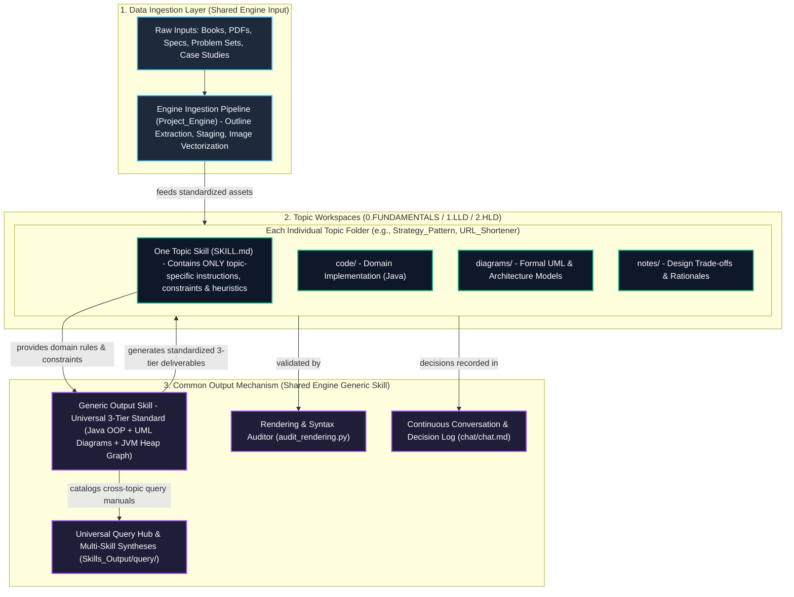

# System Design

A structured, production-grade study and engineering repository for **Low-Level Design (LLD)** and **High-Level Design (HLD)**, powered by a centralized autonomous execution core (**`Project_Engine/`**).

---

## 🏛️ Project Architecture: Engine & Topic-Skill Decoupling

The repository architecture cleanly decouples **universal execution mechanisms** from **domain-specific knowledge**:

1. **The Shared Engine (`Project_Engine/`)**:
   - **Data Ingestion Engine (Input)**: Ingests raw resources (textbooks, formal specifications, problem sets, case studies, requirements documents), parses outlines, stages raw assets, and vectorizes visual diagrams into clean SVG assets.
   - **Common Output Mechanism (Generic Skill)**: A standardized, reusable output engine that enforces the **Mandatory 3-Tier Modeling Standard** (Strict Java 21 OOP code + Formal Mermaid/PlantUML diagrams + JVM Heap/Stack runtime memory architecture) across all topics.
   - **Quality & Verification Gates**: Autonomous rendering audit (`audit_rendering.py`), continuous conversation logging (`chat/chat.md`), and automated Git synchronization.

2. **Topic Folders (`0.FUNDAMENTALS/`, `1.LLD/`, `2.HLD/`)**:
   - **One Topic Skill Per Topic**: Each individual topic folder contains its own dedicated skill file (`SKILL.md` or topic skill).
   - **Topic-Specific Instructions Only**: The topic skill contains **only** instructions, invariants, heuristics, design trade-offs, and edge cases unique to that specific topic (e.g., Strategy Pattern wiring, Observer lifecycle memory leak prevention, Saga orchestration vs choreography, or CAP theorem boundary rules).
   - Topic skills rely entirely on the engine for data ingestion, common 3-tier formatting, and verification.



---

## 📂 Repository Structure

```
System-Design/
├── Project_Engine/                                 # SHARED ENGINE: Ingestion, Generic Skills, Tooling & Logs
│   ├── .agent/
│   │   └── skills/
│   │       ├── SkillGenerator/                     # Universal HITL Topic Skill Scaffolder
│   │       ├── SkillsOnFixedResources/             # Foundational Reference Skills
│   │       │   └── UML25Spec/                      # Formal OMG UML 2.5 Specification Skill
│   │       ├── SkillsOnDynamicResources/           # Dynamic Ingestion & Practice Skills
│   │       │   └── UMLSkill/                       # Dynamic challenge ingestion & solution generator
│   │       └── type of skills.md                   # Skill Typology Specification (Fixed vs Dynamic)
│   ├── chat/
│   │   ├── chat.md                                 # Chronological Session & Decision Log
│   │   └── finalized chat.md                       # Single Source of Truth for Governance Rules
│   ├── scripts/                                    # audit_rendering.py (Auditor) & scaffold_engine.py (Automated Scaffolder & Watcher)
│   ├── Skills_Output/
│   │   ├── Skills_Output.md                        # Centralized Output Protocol & Hub Guide
│   │   └── query/                                  # UNIFIED QUERY HUB (Topic-Centric Multi-Skill Syntheses)
│   │       ├── Query_Hub.md                        # Master Index of all published query manuals (Rule 10)
│   │       ├── UML_Metamodels/                     # OMG UML 2.5 standards & metamodel taxonomy
│   │       │   ├── 001_uml_2_5_taxonomy_structural_vs_behavioral.md
│   │       │   └── 002_sequence_diagram_and_object_interactions.md
│   │       ├── Design_Patterns/                    # GoF, enterprise & cloud design patterns
│   │       ├── Distributed_Systems/                # Microservices, consensus, replication & caching
│   │       ├── Concurrency_and_Runtimes/           # JVM memory model, threads, locks
│   │       └── System_Requirements/                # Capacity planning, FR/NFR analysis
│   ├── Upcoming Updates/
│   │   └── Upcoming Updates.md                     # Serialized Milestone & Feature Tracking
│   ├── PROJECT_WORKFLOW.md                         # Detailed graphical operational workflows
│   └── Project_Engine.md                           # Engine Overview & Architecture Documentation
├── 0.FUNDAMENTALS/                                 # Core Software Engineering Foundations
│   ├── System Requirements/                        # Requirements engineering, FR/NFR taxonomies & templates
│   ├── Software Development Lifecycle/             # Methodologies, SDLC phases, testing, CI/CD (Outline.md)
│   ├── Software Architecture and Modeling/         # Views, patterns, ADRs, modeling (Outline.md)
│   │   ├── 1.ARCHITECTURE/                         # Architecture principles and documentation
│   │   └── 2.ARCHITECTURE_MODELING/                # Viewpoints & perspectives textbook and guides
│   ├── Science of Language Frameworks [Backend]/   # Runtimes, threading, frameworks, protocols (Outline.md)
│   ├── Design System [Front End]/                  # Design tokens, components, state, a11y (Outline.md)
│   └── Select Technology Stack/                    # Framework and technology selection matrices
├── 1.LLD/                                          # Low-Level Design Topics (Powered by Project_Engine)
│   ├── DESIGN_PATTERNS/                            # Topic Folders with dedicated topic skills
│   │   ├── Chapter-1-Strategy_Pattern/             # [Topic Skill + Java Code + Diagrams + Notes]
│   │   ├── Chapter-2-Observer_Pattern/             # [Topic Skill + Java Code + Diagrams + Notes]
│   │   ├── Chapter-3-Decorator_Pattern/            # [Topic Skill + Java Code + Diagrams + Notes]
│   │   ├── Chapter-4-Factory_Pattern/              # [Topic Skill + Java Code + Diagrams + Notes]
│   │   └── Chapter-5-Singleton_Pattern/            # [Topic Skill + Java Code + Diagrams + Notes]
│   └── UML-DIAGRAMMING/                            # UML Case Studies & Reference Workspaces
│       └── Books/
│           └── umlBook/                            # [BEST] UML Diagramming.pdf, chapters/, vector_images/, UML_Book.md
├── 2.HLD/                                          # High-Level Design Topics (Powered by Project_Engine)
│   └── HLD_Overview.md                             # High-Level Design Roadmap & Architecture Guide
└── README.md                                       # The ONLY README.md in the project (Rule 10)
```

---

## ⚡ Task Execution Lifecycle (Engine + Topic Skill in Action)

Whenever a topic, architectural inquiry, or design problem is executed, it flows through this invariant-grounded pipeline:

```mermaid
flowchart LR
    A["1. Ingestion / Topic Prompt"] --> B{"2. Trade-offs Exist?"}
    B -->|"Yes"| C["HITL Consultation: Present Options (Rule 4)"]
    B -->|"No"| D["Load Topic-Specific Skill"]
    C --> D
    D --> E["3. Apply Topic Skill Rules to Generic Output Engine"]
    E --> F["4. Produce Mandatory 3-Tier Deliverable (Rule 9)"]
    F --> G["5. Attribute Sources to Skills / Specs (Rule 7)"]
    G --> H["6. Run Rendering Auditor audit_rendering.py (Rule 2)"]
    H --> I["7. Record Session in chat/chat.md (Rule 1)"]
    I --> J["8. Sync Canonical Tree in finalized chat.md (Rule 8)"]
    J --> K["9. Auto Commit & Push to origin/main (Rule 3)"]

    classDef stage fill:#1e293b,stroke:#38bdf8,stroke-width:2px,color:#f8fafc;
    class A,B,C,D,E,F,G,H,I,J,K stage;
```



---

## 📜 Universal Directives & Invariant Rules

All interactions in this repository are governed by the Universal Rules documented in [`Project_Engine/chat/finalized chat.md`](Project_Engine/chat/finalized%20chat.md):

1. **Rule 1: Continuous Conversation Logging** — Every operation and architectural choice is logged in [`Project_Engine/chat/chat.md`](Project_Engine/chat/chat.md).
2. **Rule 2: Zero-Failure Rendering Audit** — Strict validation of code fences, double-quoted Mermaid labels (`Node["Label"]`), unescaped dollars in prose, and file references via `audit_rendering.py`.
3. **Rule 3: Automated Git Commit & Push** — Guaranteed remote synchronization on every turn.
4. **Rule 4: Human-in-the-Loop (HITL)** — No unilateral guesswork on design trade-offs.
5. **Rule 5: Non-Destructive Ingestion** — Raw problem and challenge assets are preserved until verified.
6. **Rule 6 & 7: Autonomous Reasoning & Source Attribution** — Deep independent conceptual breakdown with explicit references.
7. **Rule 8: Continuous Canonical Structure Sync** — Directory trees are kept strictly up to date across all architecture docs.
8. **Rule 9: Mandatory 3-Tier Modeling Mapping** — Every design must map across:
   - **Coding Level**: Java OOP application logic.
   - **UML Diagram Level**: Mermaid and PlantUML formal specifications.
   - **Runtime State Level**: Memory heap object graph and network flows.
9. **Rule 10: Single README Policy & Continuous Output/Query Catalog** — Strictly one `README.md` at root, continuously indexing all generated queries, manuals, and deliverables with names and clickable links.
10. **Rule 11: No `.gitignore` Without Explicit User Instruction** — Never create, modify, or add `.gitignore` files unless requested.

---

## 📑 Master Output & Query Catalog

All investigative queries, multi-skill syntheses, and architectural deliverables are cataloged below with direct links:

| Output ID / Scope | Category | Output Title & Deliverable | Description / Core Focus | Output Link |
| :---: | :--- | :--- | :--- | :--- |
| **`QUERY-001`** | `UML_Metamodels` | **UML 2.5 Metamodel Taxonomy: Structural vs Behavioral** | Full classification of all 14 UML diagrams, static vs dynamic invariants, 3-tier mapping | [`001_uml_2_5_taxonomy_structural_vs_behavioral.md`](Project_Engine/Skills_Output/query/UML_Metamodels/001_uml_2_5_taxonomy_structural_vs_behavioral.md) |
| **`QUERY-002`** | `UML_Metamodels` | **UML Sequence Diagrams & Object Interaction Mechanics** | Interaction taxonomy, 9 OOP concepts, Clause 17 formal metamodel, Java 21, JVM heap/stack | [`002_sequence_diagram_and_object_interactions.md`](Project_Engine/Skills_Output/query/UML_Metamodels/002_sequence_diagram_and_object_interactions.md) |
| **`LLD-DP-001`** | `DESIGN_PATTERNS` | **Software Design Patterns & Anti-Patterns Guide** | Complete behavioral, structural, creational, and concurrency design patterns alongside specific anti-patterns and misuse traps | [`design_patterns.md`](1.LLD/DESIGN_PATTERNS/design_patterns.md) |

> 💡 **Master Index**: See the centralized query registry in [`Project_Engine/Skills_Output/query/Query_Hub.md`](Project_Engine/Skills_Output/query/Query_Hub.md).

---

## 🧭 Navigation & Core Documentation

- **Visual Workflow & Architecture**: [`Project_Engine/PROJECT_WORKFLOW.md`](Project_Engine/PROJECT_WORKFLOW.md)
- **Engine Manual**: [`Project_Engine/Project_Engine.md`](Project_Engine/Project_Engine.md)
- **Governance & Rules**: [`Project_Engine/chat/finalized chat.md`](Project_Engine/chat/finalized%20chat.md)
- **Master Query Hub**: [`Project_Engine/Skills_Output/query/Query_Hub.md`](Project_Engine/Skills_Output/query/Query_Hub.md)
- **Session Log**: [`Project_Engine/chat/chat.md`](Project_Engine/chat/chat.md)
- **Low-Level Design**: [`1.LLD/`](1.LLD/)
- **High-Level Design**: [`2.HLD/HLD_Overview.md`](2.HLD/HLD_Overview.md)
