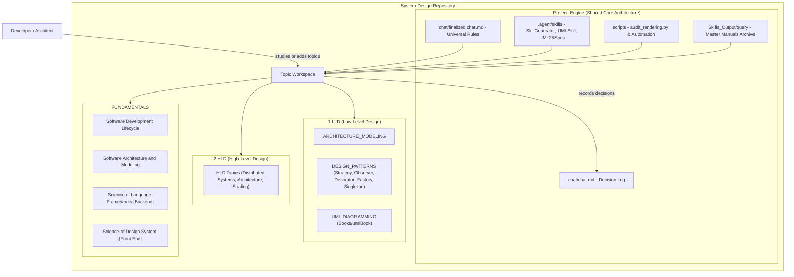
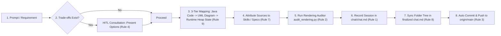

# System Design

A structured, production-grade study and engineering repository for **Low-Level Design (LLD)** and **High-Level Design (HLD)**, powered by a centralized autonomous execution core (**`Project_Engine/`**).

---

## 🏛️ Project Architecture Overview

The repository is organized into three primary workspaces. Every topic developed under LLD or HLD strictly adheres to the governance rules, skills, modeling templates, and validation scripts maintained in `Project_Engine/`.



---

## 📂 Repository Structure

```
System-Design/
├── Project_Engine/                                 # SHARED CORE: tooling, skills, scripts, and logs
│   ├── .agent/
│   │   └── skills/
│   │       ├── SkillGenerator/                     # Universal HITL Skill Scaffolder (scripts/, SKILL.md, SkillArchitecture/)
│   │       ├── SkillsOnFixedResources/             # Type 1: Textbooks, Specifications & Course Skills
│   │       │   └── UML25Spec/                      # Formal OMG UML 2.5 Specification & Reference Skill
│   │       ├── SkillsOnDynamicResources/           # Type 2: Dynamic Practice & Ingestion Skills
│   │       │   └── UMLSkill/                       # Dynamic intake, HITL categorization, and solution generator
│   │       └── type of skills.md                   # Skill Typology Specification (Fixed vs Dynamic)
│   ├── chat/
│   │   ├── chat.md                                 # Chronological Session & Decision Log
│   │   └── finalized chat.md                       # Single Source of Truth for Governance Rules
│   ├── scripts/                                    # audit_rendering.py (Single-Pass O(N) Git-Aware Auditor) + tooling
│   ├── Skills_Output/
│   │   └── query/                                  # UNIFIED QUERY HUB (All Single & Combined Syntheses)
│   ├── Upcoming Updates/
│   │   └── Upcoming Updates.md                     # Serialized Milestone & Feature Tracking
│   ├── PROJECT_WORKFLOW.md                         # Detailed graphical operational workflows
│   └── Project_Engine.md                           # Engine Overview & Architecture Documentation
├── 1.LLD/                                          # Low-Level Design topics (use Project_Engine)
│   ├── ARCHITECTURE_MODELING/                      # Architecture modeling resources & reference guides
│   ├── DESIGN_PATTERNS/                            # Chapter-1 Strategy ... Chapter-5 Singleton
│   └── UML-DIAGRAMMING/                            # UML case studies, specs, vector diagrams
│       └── Books/
│           └── umlBook/                            # [BEST] UML Diagramming.pdf, chapters/, vector_images/, UML_Book.md
├── 2.HLD/                                          # High-Level Design topics (use Project_Engine)
│   └── HLD_Overview.md                             # High-Level Design Roadmap & Architecture Guide
├── FUNDAMENTALS/                                   # Core Software Engineering Foundations
│   ├── Software Development Lifecycle/
│   ├── Software Architecture and Modeling/
│   ├── Science of Language Frameworks [Backend]/
│   └── Science of Design System [Front End]/
└── README.md                                       # Repository Root Overview & Entry Point (Rule 10)
```

---

## ⚡ How the Project Operates (Lifecycle of a Task)

Whenever a topic, problem, or design pattern is added, it follows the mandatory invariant-grounded lifecycle defined in `Project_Engine/chat/finalized chat.md`:



---

## 📜 Universal Directives & Invariant Rules

All interactions in this repository are governed by the Universal Rules documented in [`Project_Engine/chat/finalized chat.md`](Project_Engine/chat/finalized%20chat.md):

1. **Rule 1: Continuous Conversation Logging** — Every operation and architectural choice is logged in [`Project_Engine/chat/chat.md`](Project_Engine/chat/chat.md).
2. **Rule 2: Zero-Failure Rendering Audit** — Strict validation of code fences, double-quoted Mermaid labels (`Node["Label"]`), unescaped dollars in prose, and file references via `audit_rendering.py`.
3. **Rule 3: Automated Git Commit & Push** — Guaranteed remote synchronization on every turn.
4. **Rule 4: Human-in-the-Loop (HITL)** — No unilateral guesswork on design trade-offs.
5. **Rule 5: Non-Destructive Ingestion** — Raw problem and challenge assets are preserved until verified.
6. **Rule 6 & 7: Autonomous Reasoning & Source Attribution** — Deep independent conceptual breakdown with explicit references.
7. **Rule 8: Continuous Canonical Structure Sync** — Directory trees are kept strictly up to date.
8. **Rule 9: Mandatory 3-Tier Modeling Mapping** — Every design must map across:
   - **Coding Level**: Java OOP application logic.
   - **UML Diagram Level**: Mermaid and PlantUML formal specifications.
   - **Runtime State Level**: Memory heap object graph and network flows.
9. **Rule 10: Single README Policy** — Strictly one `README.md` at the repository root. All other guides are topic-named (`<Topic>.md`).
10. **Rule 11: No `.gitignore` Without Explicit User Instruction** — Never create, modify, or add `.gitignore` files unless requested.

---

## 🧭 Navigation & Core Documentation

- **Visual Workflow & Architecture**: [`Project_Engine/PROJECT_WORKFLOW.md`](Project_Engine/PROJECT_WORKFLOW.md)
- **Engine Manual**: [`Project_Engine/Project_Engine.md`](Project_Engine/Project_Engine.md)
- **Governance & Rules**: [`Project_Engine/chat/finalized chat.md`](Project_Engine/chat/finalized%20chat.md)
- **Session Log**: [`Project_Engine/chat/chat.md`](Project_Engine/chat/chat.md)
- **Low-Level Design**: [`1.LLD/`](1.LLD/)
- **High-Level Design**: [`2.HLD/HLD_Overview.md`](2.HLD/HLD_Overview.md)
