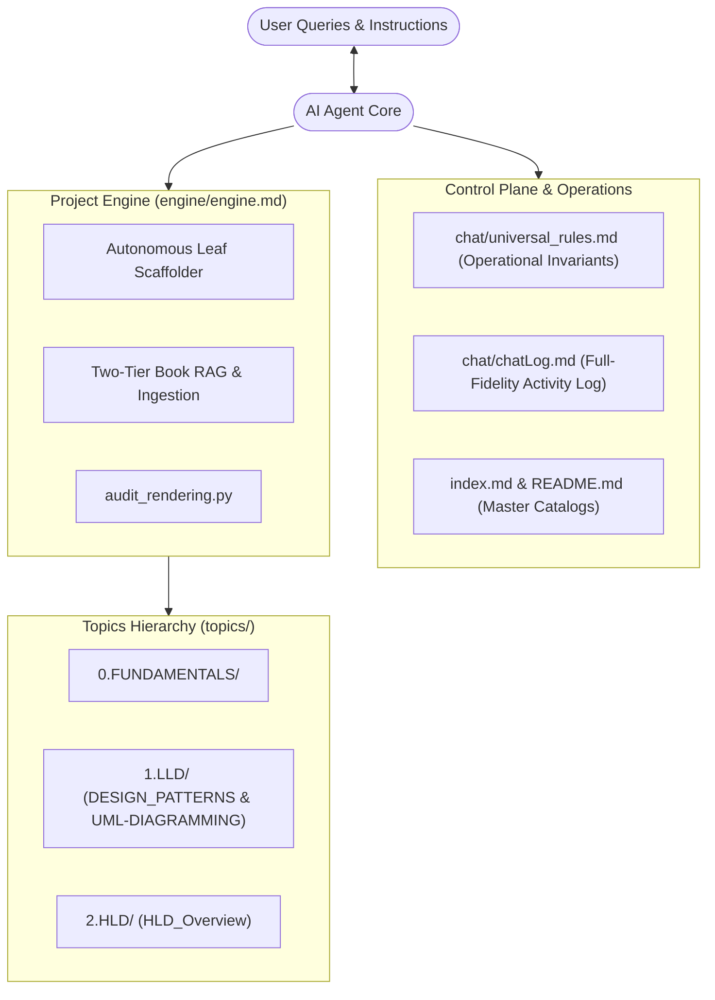

# System Design & Software Architecture

A structured, source-grounded engineering repository for **Low-Level Design (LLD)** and **High-Level Design (HLD)**, built upon the **Learning-Roadmap Project Architecture**.

---

## 🏛️ Project Architecture: Subsystems Overview

The repository is organized into distinct operational and domain subsystems:

1. **`architecture/`**: Comprehensive system design blueprints, sequence interactions, and canonical filesystem topology specifications ([`architecture/folderstructure.md`](architecture/folderstructure.md)).
2. **`engine/`**: Autonomous execution engine, leaf discovery algorithms, multi-source data ingestion pipelines (Books, Courses, Random), and rendering audit tooling.
3. **`chat/`**: Permanent governance invariants ([`chat/universal_rules.md`](chat/universal_rules.md)) and full-fidelity chronological session log ([`chat/chatLog.md`](chat/chatLog.md)).
4. **`topics/`**: Domain knowledge root hosting all learning topics (Fundamentals, LLD, HLD), structured into modular leaf nodes with standardized `Data_Ingestion/`, `template/`, and `output/` directories.
5. **`index.md`**: Master navigation catalog indexing all topics, query deliverables, and versioned notes across the project.



---

## 📂 Canonical Repository Tree

```
System-Design/
├── README.md                                 # Single root project overview & Master Output Catalog
├── index.md                                  # Master Navigation Catalog: Topics, Queries & Notes
├── outline.md                                # Single Master Topic Outline: Consolidated Curriculum
│
├── architecture/                             # Architectural Specifications Subsystem
│   ├── architecture.md                       # Comprehensive Project Architecture & Subsystems
│   └── folderstructure.md                    # Canonical Filesystem Topology Blueprint
│
├── engine/                                   # Computational & Agentic Engine Subsystem
│   ├── engine.md                             # Scaffolding logic, Two-Tier ingestion & verification
│   └── scripts/                              # audit_rendering.py, extract_chapters.py, etc.
│
├── chat/                                     # Governance, Logging & Rules Subsystem
│   ├── universal_rules.md                    # 16 Permanent Operational Invariants
│   └── chatLog.md                            # Full-fidelity chronological transcript
│
├── Upcoming Updates/                         # Strategic Roadmaps & Forward-Looking Blueprints
│   └── Upcoming Updates.md                   # Shared Agent Memory roadmap & implementation plan
│
└── topics/                                   # Domain Knowledge & Learning Roadmaps Root
    ├── 0.FUNDAMENTALS/                       # Core Software Engineering Foundations
    │   ├── System Requirements/
    │   ├── Software Development Lifecycle/
    │   ├── Software Architecture and Modeling/
    │   ├── Science of Language Frameworks [Backend]/
    │   ├── Design System [Front End]/
    │   └── Select Technology Stack/
    │
    ├── 1.LLD/                                # Low-Level Design Root
    │   ├── DESIGN_PATTERNS/                  # Terminal Leaf Node: Design Patterns
    │   │   ├── template/                     # template.md (custom blueprints)
    │   │   ├── Data_Ingestion/               # Head First Design Patterns, GoF, source codes
    │   │   └── output/
    │   │       └── query_DESIGN_PATTERNS/    # design_patterns.md (Patterns, Anti-Patterns & Inefficient Traps)
    │   └── UML-DIAGRAMMING/                  # Terminal Leaf Node: UML Diagramming
    │       ├── template/                     # template.md (custom blueprints)
    │       ├── Data_Ingestion/               # umlBook PDF, chapter breakdowns, vector SVG library
    │       └── output/
    │           └── query_UML-DIAGRAMMING/    # 001 and 002 formal UML metamodel manuals
    │
    └── 2.HLD/                                # High-Level Design Root
        └── HLD_Overview/                     # Terminal Leaf Node: HLD Overview
            ├── template/                     # template.md (custom blueprints)
            ├── Data_Ingestion/               # Staging & reference documents
            └── output/
                └── Note_version-1_HLD_Overview/ # HLD_Overview.md
```

---

## 📑 Master Output & Query Catalog

All investigative queries, multi-skill syntheses, and architectural deliverables are cataloged below with direct links:

| Output ID / Scope | Category | Output Title & Deliverable | Description / Core Focus | Output Link |
| :---: | :--- | :--- | :--- | :--- |
| **`QUERY-001`** | `UML_Metamodels` | **UML 2.5 Metamodel Taxonomy: Structural vs Behavioral** | Full classification of all 14 UML diagrams, static vs dynamic invariants, 3-tier mapping | [`001_uml_2_5_taxonomy_structural_vs_behavioral.md`](topics/1.LLD/UML-DIAGRAMMING/output/query_UML-DIAGRAMMING/001_uml_2_5_taxonomy_structural_vs_behavioral.md) |
| **`QUERY-002`** | `UML_Metamodels` | **UML Sequence Diagrams & Object Interaction Mechanics** | Interaction taxonomy, 9 OOP concepts, Clause 17 formal metamodel, Java 21, JVM heap/stack | [`002_sequence_diagram_and_object_interactions.md`](topics/1.LLD/UML-DIAGRAMMING/output/query_UML-DIAGRAMMING/002_sequence_diagram_and_object_interactions.md) |
| **`LLD-DP-001`** | `DESIGN_PATTERNS` | **Software Design Patterns, Anti-Patterns & Inefficient Traps** | Complete behavioral, structural, creational, and concurrency design patterns alongside specific anti-patterns, misuse traps, and inefficient implementation flaws | [`design_patterns.md`](topics/1.LLD/DESIGN_PATTERNS/output/query_DESIGN_PATTERNS/design_patterns.md) |
| **`LLD-DP-002`** | `DESIGN_PATTERNS` | **Head First Design Patterns: Complete Patterns & Anti-Patterns Catalog** | Exhaustive breakdown of all patterns in *Head First Design Patterns (2nd Ed)* with book-specific initial traps and Chapter 13 Anti-Patterns | [`001_head_first_design_patterns_and_antipatterns.md`](topics/1.LLD/DESIGN_PATTERNS/output/query_DESIGN_PATTERNS/001_head_first_design_patterns_and_antipatterns.md) |
| **`ARCH-001`** | `2. Architecture Patterns` | **Software Architecture: Patterns, Antipatterns, and Pitfalls** | Complete catalog of 24 architectural patterns, 5 major antipatterns, and 3 critical pitfalls from Richards, Ford & Gandhi | [`001_software_architecture_patterns_antipatterns_and_pitfalls.md`](topics/0.FUNDAMENTALS/Software%20Architecture%20and%20Modeling/1.ARCHITECTURE/2.%20Architecture%20Patterns/output/query_Architecture_Patterns/001_software_architecture_patterns_antipatterns_and_pitfalls.md) |
| **`ARCH-002`** | `2. Architecture Patterns` | **Architectural Styles vs. Architecture Patterns vs. Design Patterns** | Detailed breakdown distinguishing foundational styles (Monolith, 3-Tier), architecture patterns (CQRS, BFF), and design patterns (GoF, MVC) | [`002_architectural_styles_vs_architecture_patterns_vs_design_patterns.md`](topics/0.FUNDAMENTALS/Software%20Architecture%20and%20Modeling/1.ARCHITECTURE/2.%20Architecture%20Patterns/output/query_Architecture_Patterns/002_architectural_styles_vs_architecture_patterns_vs_design_patterns.md) |
| **`ARCH-STYLE-001`** | `1. Architecture Styles` | **Architectural Styles Catalog & Comparative Analysis** | Exhaustive taxonomy, topologies, and characteristic trade-offs of all 9 foundational styles from Richards & Ford | [`001_architectural_styles_catalog_and_comparative_analysis.md`](topics/0.FUNDAMENTALS/Software%20Architecture%20and%20Modeling/1.ARCHITECTURE/1.%20Architecture%20Styles/output/query_Architecture_Styles/001_architectural_styles_catalog_and_comparative_analysis.md) |
| **`ARCH-STYLE-002`** | `1. Architecture Styles` | **MVC and MVT in Software Architecture Classification** | Definitive taxonomy analysis: Why MVC/MVT are Technical Partitioning presentation patterns within the Layered Monolith, not standalone macro styles | [`002_mvc_mvt_in_architectural_styles_classification.md`](topics/0.FUNDAMENTALS/Software%20Architecture%20and%20Modeling/1.ARCHITECTURE/1.%20Architecture%20Styles/output/query_Architecture_Styles/002_mvc_mvt_in_architectural_styles_classification.md) |
| **`HLD-NOTE-001`**| `HLD_Overview` | **High-Level Design Overview & Distributed Systems Roadmap** | Foundations of large-scale architecture, distributed consensus, caching, microservices | [`HLD_Overview.md`](topics/2.HLD/HLD_Overview/output/Note_version-1_HLD_Overview/HLD_Overview.md) |

---

## 📜 Universal Directives & Invariant Rules

All interactions in this repository are governed by the Universal Rules documented in [`chat/universal_rules.md`](chat/universal_rules.md):

1. **Rule 1: Continuous Conversation Logging** — Every operation, prompt, and tool invocation is recorded in full in [`chat/chatLog.md`](chat/chatLog.md).
2. **Rule 2: Zero-Failure Rendering Audit** — Strict validation of code fences, double-quoted Mermaid labels (`Node["Label"]`), zero unescaped dollars in prose, and physical file references via `audit_rendering.py`.
3. **Rule 3: Mandatory Automated Git Commit & Push** — Proactively stage, commit, and synchronize all repository modifications to `origin/main`.
4. **Rule 4: Human-in-the-Loop (HITL) for Architectural Choices** — Never guess diagram categories or design trade-offs without presenting options and seeking user confirmation.
5. **Rule 5: Non-Destructive Ingestion & Zero Data Loss** — Raw problem assets and dropped source files are preserved until entries are verified.
6. **Rule 6: Autonomous Reasoning & Pedagogical Simplification** — Independent reasoning, analogies, and simplifications injected so complex models are effortlessly understood.
7. **Rule 7: Mandatory Skill & Concept Source Attribution** — Explicit citation of underlying books, courses, specifications, and clauses.
8. **Rule 8: Continuous Synchronization of the Canonical Folder Structure** — Maintain and update the filesystem tree in architecture documents whenever directories evolve.
9. **Rule 9: Mandatory 3-Tier Modeling Mapping** — Every modeling concept must detail OOP Code (Java 21) -> Formal UML Diagram -> Runtime State (JVM Heap/Stack).
10. **Rule 10: Single README Policy** — Exactly one `README.md` at the repository root. All other guides are named by topic (`<Topic>.md`).
11. **Rule 11: Continuous Output and Query Manual Indexing in Root `README.md`** — Dedicated Master Output & Query Catalog dynamically indexing every single deliverable with serialized ID, title, description, and link.
12. **Rule 12: Continuous Synchronization of `index.md` (Master Navigation Catalog)** — The master catalog (`index.md`) continuously indexes all topics, queries, and versioned notes across the project.
13. **Rule 13: No `.gitignore` Without Explicit User Instruction** — Never create, modify, or add `.gitignore` files unless requested.
14. **Rule 14: Comprehensive Resource Image Ingestion for Queries** — Extract and embed relevant diagrams, topologies, and figures from referenced books and courses into query manuals.
15. **Rule 15: Single `outline.md` Policy (Universal Master Topic Outline Protocol)** — Exactly one `outline.md` file at the repository root where strictly and exclusively topic curriculum outlines from all over the project are kept.
16. **Rule 16: Isolated Book Encapsulation & Concise Naming Protocol (Max Length Limits)** — Every PDF book must reside in its own dedicated subfolder under `Data_Ingestion/Books/<short_slug>/` (folder max 25 chars, PDF max 30 chars, no spaces/special chars) co-locating all extracted images and assets to guarantee desktop accessibility and prevent Windows path length violations.

---

## 🧭 Navigation & Core Documentation

- **Master Navigation Index**: [`index.md`](index.md)
- **Master Topic Curriculum Outline**: [`outline.md`](outline.md)
- **Visual Workflow & Architecture**: [`architecture/architecture.md`](architecture/architecture.md)
- **Folder Structure Blueprint**: [`architecture/folderstructure.md`](architecture/folderstructure.md)
- **Engine Manual**: [`engine/engine.md`](engine/engine.md)
- **Governance & Rules**: [`chat/universal_rules.md`](chat/universal_rules.md)
- **Full-Fidelity Activity Log**: [`chat/chatLog.md`](chat/chatLog.md)
