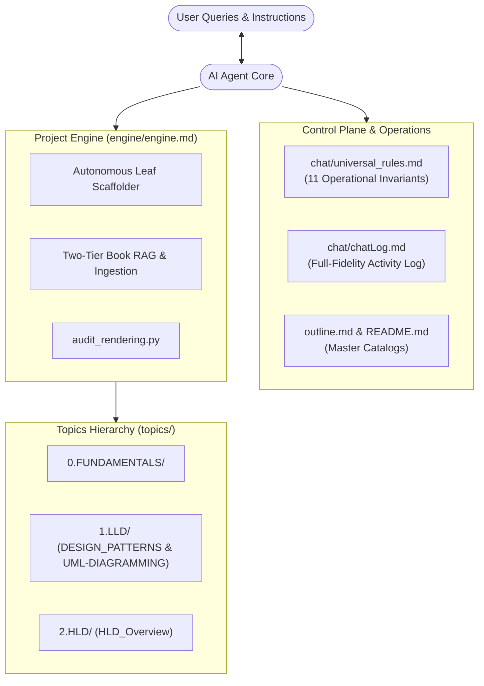

# System Design & Software Architecture

A structured, source-grounded engineering repository for **Low-Level Design (LLD)** and **High-Level Design (HLD)**, built upon the **Learning-Roadmap Project Architecture**.

---

## 🏛️ Project Architecture: Subsystems Overview

The repository is organized into distinct operational and domain subsystems:

1. **`architecture/`**: Comprehensive system design blueprints, sequence interactions, and canonical filesystem topology specifications ([`architecture/folderstructure.md`](architecture/folderstructure.md)).
2. **`engine/`**: Autonomous execution engine, leaf discovery algorithms, multi-source data ingestion pipelines (Books, Courses, Random), and rendering audit tooling.
3. **`chat/`**: Permanent governance invariants ([`chat/universal_rules.md`](chat/universal_rules.md)) and full-fidelity chronological session log ([`chat/chatLog.md`](chat/chatLog.md)).
4. **`topics/`**: Domain knowledge root hosting all learning topics (Fundamentals, LLD, HLD), structured into modular leaf nodes with standardized `Data_Ingestion/`, `template/`, and `output/` directories.
5. **`outline.md`**: Master navigation catalog indexing all topics, query deliverables, and versioned notes across the project.



---

## 📂 Canonical Repository Tree

```
System-Design/
├── README.md                                 # Single root project overview & Master Output Catalog
├── outline.md                                # Master Navigation Catalog: Topics, Queries & Notes
│
├── architecture/                             # Architectural Specifications Subsystem
│   ├── architecture.md                       # Comprehensive Project Architecture & Subsystems
│   └── folderstructure.md                    # Canonical Filesystem Topology Blueprint
│
├── engine/                                   # Computational & Agentic Engine Subsystem
│   ├── engine.md                             # Scaffolding logic, Two-Tier ingestion & verification
│   └── scripts/                              # audit_rendering.py, extract_chapters.py, etc.
│
├── chat/                                     # Governance, Logging & Rules Subsystem
│   ├── universal_rules.md                    # 11 Permanent Operational Invariants
│   └── chatLog.md                            # Full-fidelity chronological transcript
│
└── topics/                                   # Domain Knowledge & Learning Roadmaps Root
    ├── 0.FUNDAMENTALS/                       # Core Software Engineering Foundations
    │   ├── outline_0.FUNDAMENTALS.md         # Topic Manifest
    │   ├── System Requirements/
    │   ├── Software Development Lifecycle/
    │   ├── Software Architecture and Modeling/
    │   ├── Science of Language Frameworks [Backend]/
    │   ├── Design System [Front End]/
    │   └── Select Technology Stack/
    │
    ├── 1.LLD/                                # Low-Level Design Root
    │   ├── outline_1.LLD.md                  # LLD Manifest
    │   ├── DESIGN_PATTERNS/                  # Terminal Leaf Node: Design Patterns
    │   │   ├── template/                     # template.md (custom blueprints)
    │   │   ├── Data_Ingestion/               # Head First Design Patterns, GoF, source codes
    │   │   └── output/
    │   │       └── query_DESIGN_PATTERNS/    # design_patterns.md (Patterns, Anti-Patterns & Inefficient Traps)
    │   └── UML-DIAGRAMMING/                  # Terminal Leaf Node: UML Diagramming
    │       ├── template/                     # template.md (custom blueprints)
    │       ├── Data_Ingestion/               # umlBook PDF, chapter breakdowns, vector SVG library
    │       └── output/
    │           └── query_UML-DIAGRAMMING/    # 001 and 002 formal UML metamodel manuals
    │
    └── 2.HLD/                                # High-Level Design Root
        ├── outline_2.HLD.md                  # HLD Manifest
        └── HLD_Overview/                     # Terminal Leaf Node: HLD Overview
            ├── template/                     # template.md (custom blueprints)
            ├── Data_Ingestion/               # Staging & reference documents
            └── output/
                └── Note_version-1_HLD_Overview/ # HLD_Overview.md
```

---

## 📑 Master Output & Query Catalog

All investigative queries, multi-skill syntheses, and architectural deliverables are cataloged below with direct links:

| Output ID / Scope | Category | Output Title & Deliverable | Description / Core Focus | Output Link |
| :---: | :--- | :--- | :--- | :--- |
| **`QUERY-001`** | `UML_Metamodels` | **UML 2.5 Metamodel Taxonomy: Structural vs Behavioral** | Full classification of all 14 UML diagrams, static vs dynamic invariants, 3-tier mapping | [`001_uml_2_5_taxonomy_structural_vs_behavioral.md`](topics/1.LLD/UML-DIAGRAMMING/output/query_UML-DIAGRAMMING/001_uml_2_5_taxonomy_structural_vs_behavioral.md) |
| **`QUERY-002`** | `UML_Metamodels` | **UML Sequence Diagrams & Object Interaction Mechanics** | Interaction taxonomy, 9 OOP concepts, Clause 17 formal metamodel, Java 21, JVM heap/stack | [`002_sequence_diagram_and_object_interactions.md`](topics/1.LLD/UML-DIAGRAMMING/output/query_UML-DIAGRAMMING/002_sequence_diagram_and_object_interactions.md) |
| **`LLD-DP-001`** | `DESIGN_PATTERNS` | **Software Design Patterns, Anti-Patterns & Inefficient Traps** | Complete behavioral, structural, creational, and concurrency design patterns alongside specific anti-patterns, misuse traps, and inefficient implementation flaws | [`design_patterns.md`](topics/1.LLD/DESIGN_PATTERNS/output/query_DESIGN_PATTERNS/design_patterns.md) |
| **`LLD-DP-002`** | `DESIGN_PATTERNS` | **Head First Design Patterns: Complete Patterns & Anti-Patterns Catalog** | Exhaustive breakdown of all patterns in *Head First Design Patterns (2nd Ed)* with book-specific initial traps and Chapter 13 Anti-Patterns | [`001_head_first_design_patterns_and_antipatterns.md`](topics/1.LLD/DESIGN_PATTERNS/output/query_DESIGN_PATTERNS/001_head_first_design_patterns_and_antipatterns.md) |
| **`HLD-NOTE-001`**| `HLD_Overview` | **High-Level Design Overview & Distributed Systems Roadmap** | Foundations of large-scale architecture, distributed consensus, caching, microservices | [`HLD_Overview.md`](topics/2.HLD/HLD_Overview/output/Note_version-1_HLD_Overview/HLD_Overview.md) |

---

## 📜 Universal Directives & Invariant Rules

All interactions in this repository are governed by the Universal Rules documented in [`chat/universal_rules.md`](chat/universal_rules.md):

1. **Rule 1: Continuous Conversation Logging** — Every operation and architectural choice is logged in [`chat/chatLog.md`](chat/chatLog.md).
2. **Rule 2: Zero-Failure Rendering Audit** — Strict validation of code fences, double-quoted Mermaid labels (`Node["Label"]`), zero unescaped dollars in prose, and file references via `audit_rendering.py`.
3. **Rule 3: Human-in-the-Loop (HITL) Git Commit & Push** — Mandatory confirmation buttons (`YES` / `NO`) before pushing changes to GitHub.
4. **Rule 4: Human-in-the-Loop (HITL) for Architectural Choices** — No unilateral guesswork on design trade-offs.
5. **Rule 5: Non-Destructive Ingestion** — Raw problem and challenge assets are preserved until verified.
6. **Rule 6 & 7: Autonomous Reasoning & Source Attribution** — Deep independent conceptual breakdown with explicit references.
7. **Rule 8: Continuous Canonical Structure Sync** — Directory trees are kept strictly up to date across all architecture docs.
8. **Rule 9: Single README Policy** — Strictly one `README.md` at the repository root. All other guides are topic-named (`<Topic>.md`).
9. **Rule 10: Continuous Output and Query Manual Indexing in Root `README.md`** — Dedicated Master Output & Query Catalog dynamically indexing every single output with serialized ID, title, description, and clickable link.
10. **Rule 11: No `.gitignore` Without Explicit User Instruction** — Never create, modify, or add `.gitignore` files unless requested.

---

## 🧭 Navigation & Core Documentation

- **Master Navigation Outline**: [`outline.md`](outline.md)
- **Visual Workflow & Architecture**: [`architecture/architecture.md`](architecture/architecture.md)
- **Folder Structure Blueprint**: [`architecture/folderstructure.md`](architecture/folderstructure.md)
- **Engine Manual**: [`engine/engine.md`](engine/engine.md)
- **Governance & Rules**: [`chat/universal_rules.md`](chat/universal_rules.md)
- **Full-Fidelity Activity Log**: [`chat/chatLog.md`](chat/chatLog.md)
