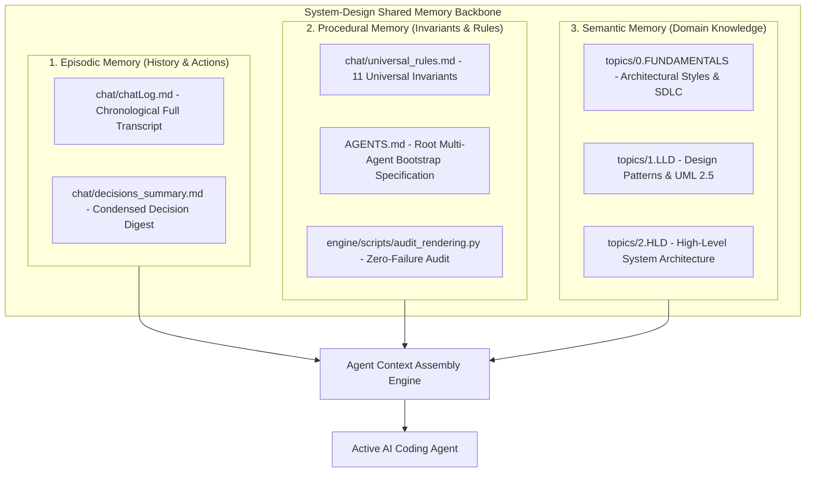
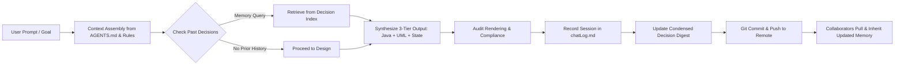

# Upcoming Updates & Roadmap: Shared Agent Memory System (`Upcoming Updates.md`)

A centralized architecture specification, implementation roadmap, and milestone tracker for establishing a production-grade **Shared Agent Memory System** in **System-Design**.

---

## 🧠 1. Executive Summary & Vision

As this repository scales across **0.FUNDAMENTALS**, **1.LLD**, and **2.HLD**, AI agents (and human engineers) need continuous access to past architectural decisions, formatting constraints, domain models, and session context without exhausting LLM context windows or re-prompting from scratch.

This roadmap details the design and deployment of a **Git-backed, Multi-Tier Shared Agent Memory Architecture** that enables any collaborator, team member, or AI coding assistant (Antigravity, Cursor, Claude Code, GitHub Copilot) to inherit identical context, procedural constraints, and domain knowledge immediately upon cloning the repository.

---

## 🏛️ 2. The 3-Tier Agent Memory Framework

The system partitions memory into three complementary tiers:

### 1. Episodic Memory (What Was Done and Decided)
* **Full Transcript**: [`chat/chatLog.md`](../chat/chatLog.md) records every prompt, internal reasoning trace, tool invocation, and generated output.
* **Compacted Decision Summaries**: Lightweight summaries capturing high-level architectural consensus (e.g., choice of concurrency model, 3-tier mapping protocol) to prevent prompt token bloat.

### 2. Procedural Memory (How the Agent Must Behave)
* **Universal Directives**: [`chat/universal_rules.md`](../chat/universal_rules.md) acts as hard operational guardrails (HITL confirmations, continuous session logging, strict rendering audits, single root README constraint).
* **Multi-Agent Entry Point**: Root `AGENTS.md` automatically ingested by agents during workspace initialization.
* **Automated Enforcement**: Single-pass linear scripts ([`engine/scripts/audit_rendering.py`](../engine/scripts/audit_rendering.py)) guaranteeing formatting compliance.

### 3. Semantic Memory (What the Project Knows)
* Verified domain manuals, diagrams, and code artifacts under `topics/` that serve as grounded, hallucination-free reference data.

---

## 🔄 3. Memory Lifecycle & Synchronization Flow

---

## 🛠️ 4. Technical Implementation Specifications

### Pillar 1: Root Universal Bootstrap (`AGENTS.md`)
* **Objective**: Provide a unified configuration file at the repository root that every major AI coding assistant recognizes out of the box.
* **Contents**:
  * Pointers to operational rules in [`chat/universal_rules.md`](../chat/universal_rules.md).
  * System architecture summary from [`architecture/architecture.md`](../architecture/architecture.md).
  * Canonical folder conventions from [`architecture/folderstructure.md`](../architecture/folderstructure.md).
  * Pre-commit verification command: `python engine/scripts/audit_rendering.py --all`.

### Pillar 2: Log Compaction & Architectural Decision Records (ADRs)
* **Objective**: Keep context lean as `chatLog.md` grows over time.
* **Mechanism**:
  * Maintain raw chronological transcripts in `chat/chatLog.md` for historical auditing.
  * Generate a compact `chat/decisions_summary.md` indexing key decisions, patterns established, and structural milestones with direct anchor links.

### Pillar 3: Semantic Retrieval & Memory Search CLI
* **Objective**: Allow agents and developers to query historical discussions and domain topics on demand via CLI without loading entire directories into prompt tokens.
* **Script**: `engine/scripts/search_memory.py`
* **Features**:
  * Fast lexical (BM25) and local vector search across all markdown manuals and session logs.
  * Direct terminal output returning topic paths, line numbers, and matching excerpts.

### Pillar 4: Git as the Distributed Sync Backbone
* **Objective**: Completely decentralized, zero-infrastructure memory sharing.
* **Workflow**:
  1. Agent completes turn and updates logs/indexes.
  2. Workspace is committed and pushed to `origin/main` on GitHub.
  3. Any team member running `git pull origin main` immediately has identical agent memory without configuring external servers or databases.

---

## 🎯 5. Core Use Cases

| Use Case | Target Audience | Concrete Value in `System-Design` |
|---|---|---|
| **Multi-Tool Agent Continuity** | Individual Developer | Switch seamlessly between Antigravity, Cursor, Claude Code, and terminal CLI without losing context or re-explaining the 11 universal rules. |
| **Team & Contributor Onboarding** | Collaborative Teams | When another engineer or study partner clones the repo, their AI assistant automatically adheres to the 3-tier mapping, quotes Mermaid labels properly, and runs audit scripts. |
| **Anti-Duplication & Architectural Consistency** | Curriculum Expansion | When designing new topics (e.g., Factory Pattern, URL Shortener), the agent cross-references past patterns to ensure unified visual and code standards. |
| **Historical Decision Auditing** | Code & Architecture Reviewers | Easily trace the exact rationale, trade-offs analyzed, and prompt evolution for every technical decision. |

---

## 📋 6. Roadmap Milestones & Implementation Checklist

### Phase 1: Foundational Memory Layer & Bootstrap
- [ ] Create root `AGENTS.md` universal bootstrap referencing `chat/universal_rules.md` and repository topology.
- [ ] Create `chat/decisions_summary.md` indexing major technical decisions from Sessions 01 through 47.
- [ ] Verify multi-agent loading in Antigravity, Cursor, and Claude Code.

### Phase 2: Search & Retrieval Subsystem
- [ ] Implement `engine/scripts/search_memory.py` for keyword and semantic querying across `chat/` and `topics/`.
- [ ] Integrate memory query flags into agent workflows to allow surgical retrieval during new topic creation.

### Phase 3: Domain Curriculum & Output Expansion
- [ ] Expand **0.FUNDAMENTALS**: Software Architecture Modeling perspectives and SDLC breakdowns.
- [ ] Expand **1.LLD**: Complete remaining GoF Design Patterns (Structural & Behavioral families) conforming to 3-tier mapping.
- [ ] Expand **2.HLD**: Seed foundational distributed systems topics (Distributed Caching, Rate Limiter, Load Balancers) with Mermaid topologies.

### Phase 4: Continuous Verification & Governance
- [ ] Maintain 100% pass rate on `python engine/scripts/audit_rendering.py --all` across all markdown files.
- [ ] Ensure exhaustive session recording in `chat/chatLog.md` for every prompt and tool action.
