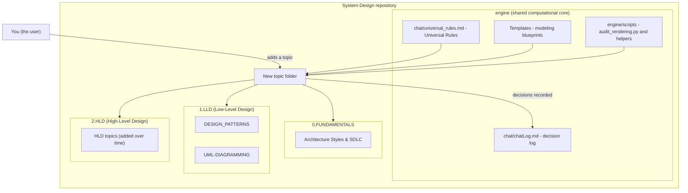
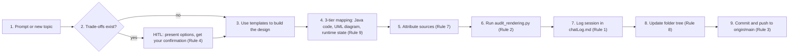
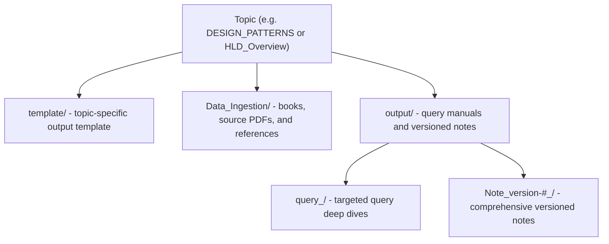

# How This Project Works (Graphical Overview)

> **Source Attribution**: Derived from `chat/universal_rules.md` (Universal Rules and canonical folder structure), `engine/` computational core, and the repository layout of `0.FUNDAMENTALS/`, `1.LLD/`, and `2.HLD/`.

## 1. Big Picture: Engine and Topics

`engine/` is the shared computational core. Every LLD and HLD topic follows its operational rules, templates, scripts, and logs.

## 2. Lifecycle of One Task (Rules in Action)

## 3. Inside a Topic Folder

Every topic workspace contains its own dedicated template, data ingestion resources, and structured outputs:

## 4. Current Repository Map

| Path | Role |
|---|---|
| `engine/` | Shared computational core: scripts, tools, and query hubs |
| `chat/` | Operational rules (`universal_rules.md`) and session history (`chatLog.md`) |
| `architecture/` | System architecture models and canonical folder structure |
| `topics/0.FUNDAMENTALS/` | Core architecture fundamentals, SDLC, tech stack selection |
| `topics/1.LLD/` | Low-level design: Design Patterns, UML Diagramming |
| `topics/2.HLD/` | High-level design: System architecture, scaling |
| `README.md` | Single root project overview and master output catalog |
| `index.md` | Master Navigation Catalog indexing all topics, queries, and notes |
| `outline.md` | Single Master Topic Outline consolidating all curricula |

