# Animated Diagram Style Guide

This repository uses standalone, animated SVG diagrams. The reference diagram is [`animated_images/ui-api-backend-flow.svg`](../animated_images/ui-api-backend-flow.svg).



---

### Why SVG

GitHub and GitBook markdown do not run HTML `<script>` tags, JavaScript, or external files, but they do display SVG images. CSS animations inside an SVG play seamlessly when the file is embedded as an image:

```markdown

```

> **Warning**: The diagram will **not** animate if the SVG code is pasted directly inline into the markdown. Always embed it using image syntax or an `` tag.

---

### Style Rules

#### 1. Format & Dimensions

| Rule | Specification |
| :--- | :--- |
| **File Type** | Standalone SVG with an embedded `<style>` block |
| **Prohibited** | HTML elements, JavaScript, external files, CSS variables |
| **Dimensions** | `width="680"`, `viewBox="0 0 680 H"`, 20px padding below the last element |
| **Accessibility** | `<title>` and `<desc>` as the first children, `role="img"` on the root `<svg>` element |

#### 2. Typography

| Rule | Specification |
| :--- | :--- |
| **Font Stack** | `-apple-system, "Segoe UI", Helvetica, Arial, sans-serif` |
| **Font Sizes** | `14px` (titles, font-weight 500) and `12px` (subtitles, labels) only |
| **Text Styling** | Sentence case; subtitles must be 5 words or fewer |
| **Alignment** | `text-anchor="middle"` and `dominant-baseline="central"` inside all boxes |

#### 3. Boxes, Color & Arrows

| Rule | Specification |
| :--- | :--- |
| **Primary Boxes** | Rounded rectangles: `rx="8"`, `120px` wide, `20px` gap between boxes, `0.5px` stroke |
| **Analogy Boxes** | Same rounded shape, dashed stroke (`stroke-dasharray="4 3"`), `36px` tall |
| **Color Palettes** | 2 or 3 cohesive color families (Gray, Teal, Purple). Light fill, darker border, darkest text of the same family |
| **Theme Adaptability** | `@media (prefers-color-scheme: dark)` block with dark fills, light borders, and light text for seamless Dark Mode support |
| **Arrows** | `1.5px` stroke with a small open arrowhead, `16px` long between boxes |
| **Traffic Lanes** | Dashed `1px` lines above (Request flow) and below (Response flow) the boxes |

#### 4. Animation Mechanics

| Rule | Specification |
| :--- | :--- |
| **Technique** | CSS `@keyframes`, animating strictly `opacity` and `transform` |
| **Loop Cycle** | Exactly one `12s` loop, `linear`, `infinite` |
| **Request Packet** | Amber circle moving along the top lane, pausing at each box |
| **Response Packet** | Green circle returning along the bottom lane |
| **Active Highlight** | `2.5px` amber outline that fades in on the currently active box |
| **Step Captions** | One dynamic caption line under the diagram that transitions at each step |
| **Accessibility** | Animations wrapped in `@media (prefers-reduced-motion: no-preference)`, static caption otherwise |

---

### Layout Math & Positioning Invariants

For `N` boxes, with box `i` starting at index 0:

- **Box X position**: `100 + 140 * i` (Width: 120, Gap: 20)
- **Box Center X**: `160 + 140 * i`
- **Packet `translateX` stops**: `0`, `140`, `280`, and so on, up to `140 * (N - 1)`
- **Keyframe Synchronization**: Update the keyframe percentages so the packet arrival and box highlight outline agree on timing.
- **Topology Changes**: Whenever a box is added, update the lane endpoints, highlight rectangles, and captions accordingly.

---

### Generation Prompt Template for AI Tools

Attach `animated_images/ui-api-backend-flow.svg` as the style reference and apply this prompt:

```text
Use the attached ui-api-backend-flow.svg as the style reference. Create a new standalone SVG for this flow: [describe your steps]. Follow these rules exactly:

Format:
- Pure SVG with embedded <style>. No HTML, JavaScript, external files or CSS variables. Must render in GitHub / GitBook README via .
- width 680, viewBox "0 0 680 H", with 20px padding below the last element.
- Add <title> and <desc>, and role="img" on the root element.

Typography:
- Font stack: -apple-system, "Segoe UI", Helvetica, Arial, sans-serif.
- Only two sizes: 14px (weight 500 for titles) and 12px for subtitles and labels. Sentence case. Subtitles max 5 words.

Boxes and color:
- Rounded rects (rx 8), 0.5px strokes, 120px wide, 20px gaps, text centered with dominant-baseline="central".
- Use 2 or 3 color families that match the reference (gray, teal, purple). Light fill, darker border, darkest text of the same color. Add a prefers-color-scheme: dark block with dark fills and light text.
- Dashed rounded boxes for analogy items. Thin 1.5px arrows between boxes.

Animation:
- CSS keyframes only, animating opacity and transform. One 12s loop.
- A small circle (request) moves along a dashed lane above the boxes, stopping at each box. A second circle (response) returns along a lane below.
- The active box gets a 2.5px amber outline that fades in and out. A caption under the diagram changes at each step.
- Wrap animations in @media (prefers-reduced-motion: no-preference) and show a static caption otherwise.
- Keep all box positions, packet movement distances and keyframe percentages consistent with each other.

Output:
- Save as animated_images/<name>.svg. Do not change the style, only the text, the number of boxes and the step captions.
```

---

### Verification Checklist

- [ ] Opens in a web browser and the CSS animation loops smoothly.
- [ ] No text is cut off or overlapping inside the boxes.
- [ ] The packet stops exactly at the center of each box.
- [ ] The highlight outline matches the packet position at every step.
- [ ] Looks sharp and fully legible in both Light and Dark themes.
- [ ] Contains no `<script>`, no `<foreignObject>`, and no external links.
- [ ] Displays correctly when embedded via Markdown image syntax on GitHub and GitBook.
