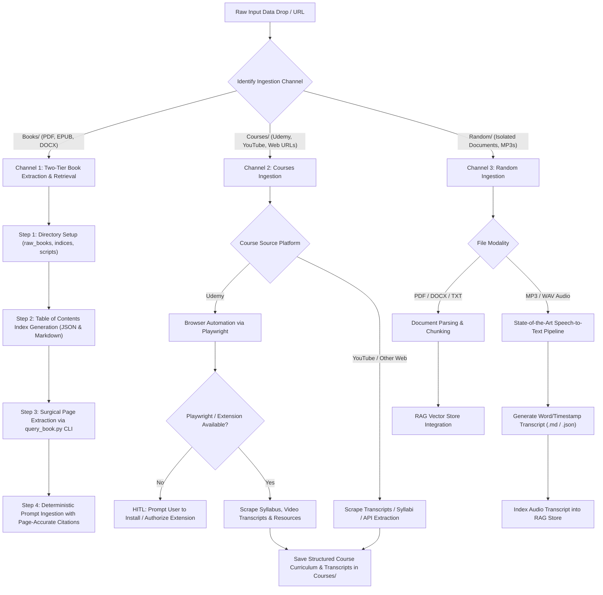

# Project Engine Specification & Automated Workflow Logic

This document specifies the core autonomous capabilities, architectural rules, automated tree generation logic, and multi-source data ingestion pipelines executed by the AI Agent. The engine acts as the computational and operational core of the project.

---

## 1. Engine Objective & Scope
The Project Engine governs:
1. Automated scaffolding, directory introspection, and tree generation across `topics/`.
2. Multi-modal, source-aware data ingestion pipelines (Books, Online Courses, and Isolated Random Sources).
3. Retrieval-Augmented Generation (RAG) vectorization and semantic index management.
4. Audio transcription pipelines and browser-automated web scraping protocols.

---

## 2. Topic Hierarchy & Automated Leaf-Node Scaffolding Logic

### 2.1 The Topology Model
The `topics/` root directory hosts user-defined knowledge domains structured as arbitrary multi-level subfolder trees:

```
topics/
└── <topic_name>/
    ├── outline_<topic_name>.md          <-- Topic Manifest & Terminal Leaf Definition
    └── [Intermediate Subfolders...]
        └── <last_subfolder>/            <-- Terminal Leaf Node
            ├── Data_Ingestion/
            │   ├── Books/
            │   │   ├── raw_books/
            │   │   ├── indices/
            │   │   └── scripts/
            │   ├── Courses/
            │   └── Random/
            ├── template/
            │   └── template.md          <-- User custom template
            └── output/
                ├── query_<topic_name>/
                └── Note_version-#_<topic_name>/
```

### 2.2 Terminal Leaf Discovery Protocol via Outline Manifest
1. **Manifest File Naming Convention**:
   - For every immediate subfolder under `topics/` (e.g., `topics/<topic_name>/`), there exists an outline manifest file named:
     `outline_<topic_name>.md`
2. **User Specification in Manifest**:
   - The user defines the path or name of the **last subfolder (terminal leaf node)** within this `outline_<topic_name>.md` file.
3. **Agent Introspection Procedure**:
   - **Step 1**: Identify all top-level topic directories in `topics/`.
   - **Step 2**: Inspect `topics/<topic_name>/outline_<topic_name>.md`.
   - **Step 3**: Parse the designated terminal leaf node target path from the outline file.
   - **Step 4**: Traverse to the specified terminal leaf node directory.

### 2.3 Automated Scaffolding Rules (Terminal Leaf Invariants)
Inside the identified terminal leaf subfolder, the agent automatically ensures the following directories and files exist:
1. `Data_Ingestion/`:
   - `Books/` (`raw_books/`, `indices/`, `scripts/`)
   - `Courses/`
   - `Random/`
2. `template/`:
   - `template.md` (User-defined custom template file: utilized when the user provides custom structures, boilerplate formats, or note-taking patterns)
3. `output/`: Dedicated repository for generated manuals, answers, and study notes.
   - `query_<topic_name>/`: Houses on-demand answers, problem solutions, and surgical Q&A deliverables.
   - `Note_version-#_<topic_name>/`: Houses structured versioned knowledge notes, synthesis manuals, and topic roadmaps (e.g., `Note_version-1_<topic_name>/`, `Note_version-2_<topic_name>/`).

---

## 3. Source-Aware Data Ingestion Pipelines

Data ingestion operates under 3 distinct modality channels based on where the source data originates:



---

## 4. Ingestion Channel Specifications

### 4.1 Channel 1: Books Ingestion (Two-Tier Deterministic Retrieval Architecture)
- **Target Folder**: `Data_Ingestion/Books/`
- **Core Principle**: Ingest large reference books and documentation (PDFs, EPUBs, DOCX) for deterministic, hallucination-free retrieval with zero context bloating, token efficiency, and page-accurate citations instead of reading full books into context.

#### Step 1: Directory Setup
Inside `Data_Ingestion/Books/`, establish the following structure separating raw reference assets, pre-computed indices, and extraction tooling:
```
Data_Ingestion/Books/
├── raw_books/                 # Houses original reference volumes (e.g., book1.pdf, book2.pdf)
├── indices/                   # Fast, zero-token structural lookup
│   ├── toc_book1.json         # Machine-readable JSON outline mapping {"title": str, "page": int}
│   └── table_of_contents.md   # Markdown outline mapping chapters/sections to page numbers
└── scripts/
    └── query_book.py          # Standalone Python CLI utility using pypdf
```

#### Step 2: Implementation of the Extraction CLI (`query_book.py`)
A standalone, robust Python CLI utility (`scripts/query_book.py`) using `pypdf` enforcing:
1. **UTF-8 Console Safety**: Auto-reconfigure standard output encoding to UTF-8 to prevent Windows terminal crashes (`cp1252` encoding errors).
2. **Resilient Path Resolution**: Recursively locate PDF assets across `Data_Ingestion/Books/raw_books/` and topic paths.
3. **Surgical Page Range Slicing (`extract` subcommand)**:
   - Accept `--book <id>`, `--start <page>`, `--end <page>`, and optional `--output <file>`.
   - Extract text only within the requested interval.
   - Tag each page with a clear header: `--- [Page X] ---`.
4. **Keyword Proximity Search (`search` subcommand)**:
   - Accept `--book <id>`, `--query <string>`, and `--limit <count>`.
   - Case-insensitively scan pages and return match snippets within a ±150 character window around each occurrence, indicating the exact page number.

**CLI Invocation Syntax:**
```bash
python scripts/query_book.py extract --book 1 --start 45 --end 50 --output snippet.txt
python scripts/query_book.py search --book 1 --query "dynamic programming" --limit 5
```

#### Step 3: Structural Index Generation (TOC Mapping)
1. Read the Table of Contents or outline of the raw books.
2. Generate `Data_Ingestion/Books/indices/toc_book<N>.json`:
   ```json
   [
     {"title": "Chapter 1: Foundations", "page": 12},
     {"title": "1.1 Core Concepts", "page": 15}
   ]
   ```
3. Generate `Data_Ingestion/Books/indices/table_of_contents.md` as an easily scannable human/agent markdown manual mapping chapters, subtopics, and exact 0-indexed page intervals.

#### Step 4: Agent Operating Protocol (System Guidelines)
The agent must adhere to the following mandatory rules for books:
1. **Never read raw PDFs directly**: Prohibit dumping entire PDF files into the prompt.
2. **Lookup-First Rule**: The agent must inspect `table_of_contents.md` or `toc_book.json` first to locate the relevant chapter and page range.
3. **Surgical Ingestion**: The agent must execute `query_book.py extract` for only the specific 2–5 page range needed to answer or implement the user's request.
4. **Permanent Page Attribution**: Any algorithm, proof, or solution derived from the book must cite the volume and exact page numbers in its metadata docstring.

---

### 4.2 Channel 2: Courses Ingestion (Playwright Browser Automation & Web Scraping)
- **Target Folder**: `Data_Ingestion/Courses/`
- **Objective**: Scrape course curricula, module outlines, lecture transcripts, and companion resources when given a course URL (e.g., Udemy, YouTube, Coursera).
- **Udemy Scraping & Browser Automation Workflow**:
  1. **Playwright Driver**: Agent invokes the Playwright browser automation tool (`browser_navigate`, `browser_snapshot`, `browser_click`).
  2. **Extension Check & Human-in-the-Loop (HITL)**:
     - If the required browser extension or authenticated session (e.g. Udemy login/extension) is missing or unverified, the agent **pauses immediately and triggers HITL**:
       > **[HITL Alert]**: "Udemy scraping requires an active session or extension. Please install/authorize the required browser extension or complete login in the opened browser window before proceeding."
     - Only resumes extraction once the user confirms readiness.
  3. **Extraction**: Extract course title, section headers, lecture names, video duration, and auto-generated transcripts/captions.
  4. **Storage**: Save extracted data under `Data_Ingestion/Courses/<Course_Title>/` as:
     - `curriculum.md`: Full syllabus breakdown.
     - `transcripts/`: Per-lecture transcript files.

---

### 4.3 Channel 3: Random Ingestion (Isolated Documents & Audio Transcription)
- **Target Folder**: `Data_Ingestion/Random/`
- **Objective**: Process arbitrary isolated files dropped by the user (PDFs, Word documents, text notes, and MP3 audio files).

#### A. Documents (PDF, DOCX, TXT, MD)
- **Action**: Ingest into the topic's RAG system.
- Extract raw text, generate embeddings, and store them in the topic's vector index so that ad-hoc papers, blogs, and cheat-sheets are immediately queryable.

#### B. Audio Files (MP3, WAV, M4A)
- **Action**: High-accuracy Speech-to-Text (STT) transcription.
- **Best-in-Class Audio-to-Transcript Engine**:
  - **Primary STT Engine**: **OpenAI Whisper (Large-v3 / Medium)** or **Google Cloud Speech-to-Text / Gemini Multimodal Audio**.
    - High accuracy across technical terminology, accents, and varying background noise.
    - Automatic punctuation and sentence casing.
    - Timestamp generation (SRT/VTT and Markdown format).
- **Processing Steps**:
  1. Detect audio file placed in `Data_Ingestion/Random/`.
  2. Run the STT pipeline to generate:
     - `<audio_filename>_transcript.md`: Formatted readable Markdown transcript with speaker labels and timestamped sections.
     - `<audio_filename>_transcript.json`: Raw structured transcript with segment-level time offsets.
  3. Ingest the generated transcript text into the topic's RAG vector index for seamless semantic search.

---

## 5. Template Management Logic (`template/template.md`)
- **Location**: Generated inside each terminal leaf subfolder under `template/template.md`.
- **Purpose**: Exclusively dedicated to user-created custom templates.
- **Rule of Use**: 
  - If the user provides or specifies a custom layout, format, or architectural blueprint for the topic, the agent must reference and apply the template defined in `template/template.md`.
  - If the user has not defined a custom template, this file remains available as the designated blueprint repository and default agentic styles are applied.

---

## 6. Execution Interface & Automated Agent Directives

1. **Trigger Condition**: Whenever files are placed into `Data_Ingestion/` subfolders, a custom template is supplied, or a course URL is provided, the agent inspects the input.
2. **Channel Routing**:
   - `.pdf`, `.epub` inside `Books/` -> Run Channel 1 (Book RAG Indexing).
   - URLs provided for `Courses/` -> Run Channel 2 (Playwright Scraping with HITL verification).
   - `.pdf`, `.docx`, `.txt` inside `Random/` -> Run Channel 3A (Document RAG Indexing).
   - `.mp3`, `.wav`, `.m4a` inside `Random/` -> Run Channel 3B (Whisper / Audio STT -> Transcript Generation -> RAG Indexing).
   - Custom template defined in `template/template.md` -> Enforce user template schema across topic outputs.
3. **Traceability**: All ingestion status, extraction metrics, and HITL checkpoints must be documented in `chat/chatLog.md`.
