# Master Topic Outline (`outline.md`)

This document is the **single consolidated topic curriculum and learning syllabus** for the entire **System-Design** repository, maintained under **Universal Rule 15**. It consolidates all learning roadmaps, domain syllabi, and architectural modules across **0.FUNDAMENTALS**, **1.LLD**, and **2.HLD**.

---

## 🧭 Repository Navigation Quick Links

- **Repository Overview & Deliverables**: [`README.md`](README.md)
- **Master Navigation Catalog (Queries & Notes)**: [`index.md`](index.md)
- **Operational Rules & Invariants**: [`chat/universal_rules.md`](chat/universal_rules.md)
- **Full Activity Transcript**: [`chat/chatLog.md`](chat/chatLog.md)

---

## 🏛️ Syllabus Architecture Overview

```mermaid
flowchart TD
    ROOT["System-Design Master Curriculum"]
    
    ROOT --> F0["0.FUNDAMENTALS"]
    ROOT --> L1["1.LLD (Low-Level Design)"]
    ROOT --> H2["2.HLD (High-Level Design)"]

    F0 --> F_REQ["System Requirements Engineering"]
    F0 --> F_SDLC["Software Development Lifecycle (SDLC)"]
    F0 --> F_ARCH["Software Architecture & Modeling"]
    F0 --> F_BACK["Science of Language Frameworks (Backend)"]
    F0 --> F_FRONT["Science of Design Systems (Frontend)"]
    F0 --> F_STACK["Technology Stack Selection Guide"]
    F0 --> F_API["API Architecture and Design"]

    L1 --> L_PAT["Design Patterns & Anti-Patterns"]
    L1 --> L_UML["UML 2.5 Metamodels & Modeling"]

    H2 --> H_DIST["Distributed Systems Foundations"]
    H2 --> H_INGRESS["Load Balancing & Traffic Ingress"]
    H2 --> H_STORAGE["Distributed Storage & Sharding"]
    H2 --> H_CACHE["Distributed Caching Architectures"]
    H2 --> H_STREAM["Messaging & Stream Processing"]
    H2 --> H_RESIL["Resilience & Observability"]
    H2 --> H_CASE["Industrial Case Studies & Deep Dives"]
```

---

## 📚 0. FUNDAMENTALS (Core Engineering Foundations)

### Module 0.1: System Requirements Engineering
- **Directory**: [`topics/0.FUNDAMENTALS/System Requirements/`](topics/0.FUNDAMENTALS/System%20Requirements/)
- **Deliverable**: [`System_Requirements_Engineering.md`](topics/0.FUNDAMENTALS/System%20Requirements/System_Requirements_Engineering.md)
- **Core Syllabi**:
  1. **Requirement Taxonomies**: Functional Requirements (FR), Non-Functional Requirements (NFR / Quality Attributes), Constraints & Boundaries.
  2. **Specification Standards**: Writing unambiguous Acceptance Criteria (Gherkin syntax: Given-When-Then), Input/Output contracts, invariant preconditions.
  3. **Non-Functional Vector**: Latency, Throughput (QPS), High Availability (99.999% SLA), Disaster Recovery (RPO / RTO), Security & Compliance (GDPR, HIPAA, SOC2).
  4. **Engineering Scoping**: Sizing calculations, capacity planning, cost estimation, back-of-the-envelope estimation.

### Module 0.2: Software Development Lifecycle (SDLC)
- **Directory**: [`topics/0.FUNDAMENTALS/Software Development Lifecycle/`](topics/0.FUNDAMENTALS/Software%20Development%20Lifecycle/)
- **Core Syllabi**:
  1. **Methodologies**: Waterfall, V-Model, Agile Scrum, Kanban, Extreme Programming (XP).
  2. **Requirements & RFC Process**: Writing effective Product Requirement Documents (PRDs) and Requests for Comments (RFCs).
  3. **Architecture & Design Phase**: Interface-first design, API contracts (OpenAPI, Protobuf), Architectural Decision Records (ADRs).
  4. **Quality Engineering & Verification**: The Testing Pyramid (Unit, Integration, Contract, E2E), Static analysis, SonarQube, mutation testing.
  5. **CI/CD & Operational Release**: Blue-Green deployments, Canary rollouts, Feature flags, SRE metrics (SLI, SLO, SLA, MTTR, MTTD).

### Module 0.3: Software Architecture and Modeling
- **Directory**: [`topics/0.FUNDAMENTALS/Software Architecture and Modeling/`](topics/0.FUNDAMENTALS/Software%20Architecture%20and%20Modeling/)
- **Sub-Modules**:
  * **1. Architecture Styles** ([`1.ARCHITECTURE/1. Architecture Styles/`](topics/0.FUNDAMENTALS/Software%20Architecture%20and%20Modeling/1.ARCHITECTURE/1.%20Architecture%20Styles/)):
    - Foundational Topologies: Monolithic Layered, Modular Monolith, Pipeline (Pipes and Filters), Microkernel (Plugin Architecture), Service-Based, Event-Driven, Microservices, Space-Based, Service-Oriented (SOA).
    - Taxonomy Clarifications: Architectural Styles vs Patterns vs Design Patterns (MVC/MVT classification).
  * **2. Architecture Patterns** ([`1.ARCHITECTURE/2. Architecture Patterns/`](topics/0.FUNDAMENTALS/Software%20Architecture%20and%20Modeling/1.ARCHITECTURE/2.%20Architecture%20Patterns/)):
    - Outputs: [`001_software_architecture_patterns_antipatterns_and_pitfalls.md`](topics/0.FUNDAMENTALS/Software%20Architecture%20and%20Modeling/1.ARCHITECTURE/2.%20Architecture%20Patterns/output/query_Architecture_Patterns/001_software_architecture_patterns_antipatterns_and_pitfalls.md), [`002_architectural_styles_vs_architecture_patterns_vs_design_patterns.md`](topics/0.FUNDAMENTALS/Software%20Architecture%20and%20Modeling/1.ARCHITECTURE/2.%20Architecture%20Patterns/output/query_Architecture_Patterns/002_architectural_styles_vs_architecture_patterns_vs_design_patterns.md), [`003_complete_architectural_patterns_catalog.md`](topics/0.FUNDAMENTALS/Software%20Architecture%20and%20Modeling/1.ARCHITECTURE/2.%20Architecture%20Patterns/output/query_Architecture_Patterns/003_complete_architectural_patterns_catalog.md)
    - 24 Enterprise Patterns: CQRS, Event Sourcing, BFF (Backend for Frontend), Saga (Orchestration vs Choreography), Outbox Pattern, Strangler Fig.
    - Anti-Patterns & Pitfalls: Architecture Sinkhole, Groundhog Day, Conway's Law silos, Global Coupling.
  * **3. Architecture Modeling & Viewpoints** ([`2.ARCHITECTURE_MODELING/`](topics/0.FUNDAMENTALS/Software%20Architecture%20and%20Modeling/2.ARCHITECTURE_MODELING/)):
    - Kruchten 4+1 View Model (Logical, Development, Process, Physical, Scenarios).
    - C4 Model (Context, Container, Component, Code).
    - Viewpoints & Perspectives Framework (Structural, Behavioral, Information, Security, Operational).

### Module 0.4: Science of Language Frameworks [Backend]
- **Directory**: [`topics/0.FUNDAMENTALS/Science of Language Frameworks [Backend]/`](topics/0.FUNDAMENTALS/Science%20of%20Language%20Frameworks%20[Backend]/)
- **Core Syllabi**:
  1. **Runtime Mechanics & Execution Models**: Thread-per-request vs Event Loop (Reactor / Proactor), Virtual threads (Java Project Loom), Goroutines, async/await runtimes.
  2. **Memory & Garbage Collection**: JVM generational GC (G1, ZGC), Go concurrent mark-sweep, Rust compile-time RAII and ownership/borrowing.
  3. **Framework Ecosystems**: Java (Spring Boot, Quarkus, Micronaut), Go (Gin, Fiber, net/http), Node.js (NestJS, Fastify), Python (FastAPI, Django), Rust (Axum, Actix-web).
  4. **Transport Protocols & APIs**: TCP/UDP, HTTP/1.1 vs HTTP/2 vs HTTP/3 (QUIC), gRPC, GraphQL, WebSockets, SSE.
  5. **Data Access & Drivers**: ORM vs raw SQL, connection pooling (HikariCP), prepared statements, transaction boundaries (`@Transactional`), caching integration.
  6. **Resilience & Production Readiness**: Circuit breakers (Resilience4j), rate limiters, bulkhead isolation, distributed tracing (OpenTelemetry), health probes.

### Module 0.5: Science of Design Systems [Front End]
- **Directory**: [`topics/0.FUNDAMENTALS/Design System [Front End]/`](topics/0.FUNDAMENTALS/Design%20System%20[Front%20End]/)
- **Core Syllabi**:
  1. **Design Tokens & Visual Primitives**: Global tokens, semantic tokens, component tokens, Style Dictionary, cross-platform export.
  2. **Component Architecture & Composition**: Atomic Design (Atoms, Molecules, Organisms, Templates, Pages), polymorphic components, headless components, compound components.
  3. **State Management & Data Flow**: Component state (React hooks, Vue refs, Svelte runes), global client state (Zustand, Redux Toolkit), server cache state (TanStack Query, SWR).
  4. **Accessibility (a11y) & Usability**: WCAG 2.1 / 2.2 Level AA/AAA, ARIA roles, focus trapping, screen reader testing.
  5. **Packaging & Governance**: Storybook, component workbenches, visual regression testing (Playwright, Chromatic), Monorepo tooling (Turborepo, Nx).

### Module 0.6: Technology Stack Selection Guide
- **Directory**: [`topics/0.FUNDAMENTALS/Select Technology Stack/`](topics/0.FUNDAMENTALS/Select%20Technology%20Stack/)
- **Deliverable**: [`Technology_Stack_Selection_Guide.md`](topics/0.FUNDAMENTALS/Select%20Technology%20Stack/Technology_Stack_Selection_Guide.md)
- **Core Syllabi**:
  1. **Selection Philosophy**: Constraint satisfaction, risk management, total cost of ownership (TCO).
  2. **The 5-Dimension Evaluation Vector**: Workload characteristics (I/O vs CPU), Access patterns (ACID vs BASE), Latency/Throughput SLAs, Developer velocity vs Type safety, Operational maturity.
  3. **Multi-Criteria Decision Matrix (MCDM)**: Weighted scoring methodology, proof-of-concept (PoC) spikes, ADR documentation.

### Module 0.7: API Architecture and Design
- **Directory**: [`topics/0.FUNDAMENTALS/API Architecture and Design/`](topics/0.FUNDAMENTALS/API%20Architecture%20and%20Design/)
- **Deliverables**:
  - Comprehensive Note: [`API_Architecture_and_Design.md`](topics/0.FUNDAMENTALS/API%20Architecture%20and%20Design/output/Note_version-1_API_Architecture_and_Design/API_Architecture_and_Design.md)
  - Query Manual: [`001_api_communication_patterns_taxonomy_and_architectural_mechanics.md`](topics/0.FUNDAMENTALS/API%20Architecture%20and%20Design/output/query_API_Architecture_and_Design/001_api_communication_patterns_taxonomy_and_architectural_mechanics.md)
- **Ingested Course Sources**: [`Udemy: Fundamentals of Backend Engineering (Curriculum)`](topics/0.FUNDAMENTALS/API%20Architecture%20and%20Design/Data_Ingestion/Courses/Udemy-Fundamentals%20of%20Backend%20Engineering/curriculum.md) by Hussein Nasser
- **Core Syllabi**:
  1. **Protocols & Transport**: TCP/UDP, HTTP/1.1, HTTP/2 (multiplexing, HPACK), HTTP/3 QUIC (UDP binary framing, 0-RTT, connection migration), REST, gRPC (Protobuf IDL), GraphQL (DataLoader), WebSockets, SSE.
  2. **Contract-First Specifications**: OpenAPI 3.1 / Swagger, AsyncAPI, Protobuf `.proto`, URI modeling, safe & idempotent HTTP methods, RFC 7807 Problem Details.
  3. **Advanced Behavioral Patterns**: Pagination (Offset vs Keyset/Cursor), Distributed Idempotency Keys (`Idempotency-Key` + Redis), Versioning (URI path vs custom header vs content negotiation).
  4. **Low-Level Design (LLD)**: Controller-Service-Repository architecture, DTO mapping, Fluent Client SDKs, Interceptors, 3-tier Java 21 implementation.
  5. **High-Level Design (HLD) & Edge**: API Gateways (Envoy, Kong), Distributed Rate Limiting (Token Bucket, Leaky Bucket, Sliding Window Counter via Redis/Lua), Backend-for-Frontend (BFF).
  6. **Security & Observability**: OAuth 2.0 (PKCE, Client Credentials), OIDC, JWT vs sessions, mTLS, W3C Trace Context (OpenTelemetry).

### Module 0.8: Computer Networking for Distributed Systems
- **Directory**: [`topics/0.FUNDAMENTALS/Networking/`](topics/0.FUNDAMENTALS/Networking/)
- **Deliverable**: [`Networking.md`](topics/0.FUNDAMENTALS/Networking/output/Note_version-1_Networking/Networking.md)
- **Ingested Course Sources**: [`Udemy: Fundamentals of Network Engineering (Curriculum)`](topics/0.FUNDAMENTALS/Networking/Data_Ingestion/Courses/Udemy-Fundamentals%20of%20Network%20Eng/curriculum.md) by Hussein Nasser
- **Core Syllabi**:
  1. **Layer Abstractions**: OSI 7-Layer vs. TCP/IP 4-Layer models, packet encapsulation, and MTU/MSS fragmentation.
  2. **Layer 2 (Data Link)**: Ethernet frames, MAC addressing, Address Resolution Protocol (ARP), broadcast domains.
  3. **Layer 3 (Network Layer)**: IPv4 vs. IPv6 headers, CIDR subnetting, NAT / PAT, ICMP, and global routing (BGP, Anycast, OSPF).
  4. **Layer 4 (Transport Layer)**: TCP connection lifecycle (3-way handshake, sliding window flow control, CUBIC/BBR congestion control, TIME_WAIT socket exhaustion, Nagle's algorithm) vs. UDP vs. QUIC.
  5. **Layer 7 & Services**: DNS resolution hierarchy (Root, TLD, Authoritative, Anycast), TLS 1.3 cryptographic handshake, HTTP protocols.
  6. **Kernel & Socket Programming**: BSD Sockets API, kernel buffers (`SO_RCVBUF`, `SO_SNDBUF`), I/O multiplexing (`select`, `poll`, `epoll`, `kqueue`, `io_uring`).
  7. **Cloud Networking Topologies**: Virtual Private Clouds (VPCs), Public/Private subnets, Internet/NAT Gateways, Overlay networks (VXLAN), L4 vs. L7 Load Balancing.
  8. **Security & Observability**: Network firewalls, SYN flood defenses (`syncookies`), DDoS mitigation, packet capture (`tcpdump`, Wireshark), and diagnostic CLI tooling (`ping`, `traceroute`, `ss`, `dig`).

---

## 🧩 1. LLD (Low-Level Design & Object-Oriented Modeling)

### Module 1.1: Software Design Patterns
- **Directory**: [`topics/1.LLD/DESIGN_PATTERNS/`](topics/1.LLD/DESIGN_PATTERNS/)
- **Outputs**: [`design_patterns.md`](topics/1.LLD/DESIGN_PATTERNS/output/query_DESIGN_PATTERNS/design_patterns.md), [`001_head_first_design_patterns_and_antipatterns.md`](topics/1.LLD/DESIGN_PATTERNS/output/query_DESIGN_PATTERNS/001_head_first_design_patterns_and_antipatterns.md)
- **Core Syllabi**:
  1. **Creational Patterns**: Singleton (Bill Pugh, Enum, Double-Checked Locking), Factory Method, Abstract Factory, Builder, Prototype.
  2. **Structural Patterns**: Adapter, Decorator, Facade, Composite, Proxy, Bridge, Flyweight.
  3. **Behavioral Patterns**: Strategy, Observer, Command, Template Method, Iterator, State, Chain of Responsibility, Mediator, Memento, Visitor, Interpreter.
  4. **Concurrency Patterns**: Thread Pool, Producer-Consumer, Read-Write Lock, Semaphore, Active Object.
  5. **Anti-Patterns & Misuse Traps**: Over-engineering, God Object, Spaghetti Code, Golden Hammer, Premature Optimization.

### Module 1.2: UML 2.5 Diagramming & Software Modeling
- **Directory**: [`topics/1.LLD/UML-DIAGRAMMING/`](topics/1.LLD/UML-DIAGRAMMING/)
- **Outputs**: [`001_uml_2_5_taxonomy`](topics/1.LLD/UML-DIAGRAMMING/output/query_UML-DIAGRAMMING/001_uml_2_5_taxonomy_structural_vs_behavioral.md), [`002_sequence_diagram`](topics/1.LLD/UML-DIAGRAMMING/output/query_UML-DIAGRAMMING/002_sequence_diagram_and_object_interactions.md)
- **Core Syllabi**:
  1. **OMG UML 2.5 Metamodels**: Taxonomy of all 14 official UML diagrams.
  2. **Structural Modeling**:
     - Class Diagrams (multiplicities, visibility, association, aggregation, composition, inheritance).
     - Component & Package Diagrams (subsystems, ports, interfaces).
     - Object & Deployment Diagrams (runtime instances, execution nodes).
  3. **Behavioral Modeling**:
     - Sequence Diagrams (lifelines, sync/async messages, combined fragments: alt, opt, loop, par).
     - State Machine Diagrams (states, transitions, guards, entry/exit actions, orthogonal states).
     - Activity Diagrams (control flow, decision nodes, concurrency fork/join, swimlanes).
     - Use Case Diagrams (actors, system boundary, include/extend relationships).
  4. **Mandatory 3-Tier Multi-Representation**:
     - Layer 1: Concrete Java 21 Object-Oriented Code.
     - Layer 2: Formal Mermaid / PlantUML Models.
     - Layer 3: Runtime Execution State (JVM Heap/Stack maps).

---

## 🌐 2. HLD (High-Level Design & Distributed Systems)

### Module 2.1: Distributed Systems Core Foundations & Theoretical Invariants
- **Directory**: [`topics/2.HLD/1.DISTRIBUTED_FOUNDATIONS/`](topics/2.HLD/1.DISTRIBUTED_FOUNDATIONS/)
- **Core Syllabi**:
  1. **Performance & Scalability Invariants**: Vertical vs. Horizontal Scaling, Latency vs. Throughput, Tail Latency amplification in microservices (`p50`, `p90`, `p99`, `p99.9`), Little's Law, High Availability math (SLO, SLA, SLI, MTBF, MTTR, calculating "Five Nines" 99.999% availability).
  2. **Theoretical Guarantees & Laws**: CAP Theorem (Consistency vs. Availability vs. Partition Tolerance in network partitions), PACELC Theorem (Latency vs. Consistency in normal states), ACID vs. BASE, the 8 Fallacies of Distributed Computing.
  3. **Time, Clocks & Ordering**: Physical clock drift, Network Time Protocol (NTP), Google TrueTime (GPS + Atomic clocks in Spanner), Logical Clocks (Lamport Timestamps, Vector Clocks for causality tracking and version vectors).
  4. **Consensus & Coordination Protocols**: Raft Consensus (Leader Election, Log Replication, Safety Invariants), Paxos, ZooKeeper (ZAB Protocol), etcd, Quorums (`W + R > N`), Split-Brain prevention, Fencing Tokens.

### Module 2.2: Traffic Ingress, Edge Networking & Load Balancing
- **Directory**: [`topics/2.HLD/2.LOAD_BALANCING_TRAFFIC_INGRESS/`](topics/2.HLD/2.LOAD_BALANCING_TRAFFIC_INGRESS/)
- **Core Syllabi**:
  1. **Edge Routing & Global Traffic Management**: Global Server Load Balancing (GSLB), GeoDNS, Latency-Based Routing, Anycast BGP Routing, Content Delivery Networks (CDNs, edge POPs, origin shielding, edge workers).
  2. **Layer 4 vs. Layer 7 Load Balancing**: Transport-layer packet forwarding (IP + Port, TCP/UDP, Maglev/Katran/IPVS) vs. Application-layer content routing (HTTP headers, URL paths, cookies, TLS termination via Envoy/Nginx/ALB).
  3. **Load Balancing Routing Topologies**: Reverse Proxy mode, NAT mode, Direct Server Return (DSR) for asymmetric request/response traffic optimization.
  4. **Routing Algorithms**: Round Robin, Weighted Round Robin, IP Hash, Least Connections, Weighted Least Response Time (TTFB), Consistent Hashing (Virtual Nodes), Power of Two Random Choices (P2C).
  5. **High Availability & Clustering**: Active-Passive failover (VRRP / Keepalived with Floating Virtual IP), Active-Active with BGP Anycast + ECMP switches, health checking (active vs. passive, flap damping).
  6. **API Gateways & Reverse Proxies**: Path-based routing, authentication/authorization validation, distributed tracing header injection, SSL/TLS offloading.
  7. **Distributed Rate Limiting & Congestion Control**: Token Bucket, Leaky Bucket, Fixed Window, Sliding Window Counter (multi-region Redis + Lua scripts), concurrency limits, load shedding.

### Module 2.3: Distributed Storage, Sharding & Replication
- **Directory**: [`topics/2.HLD/3.DISTRIBUTED_STORAGE_CACHING/`](topics/2.HLD/3.DISTRIBUTED_STORAGE_CACHING/)
- **Core Syllabi**:
  1. **Database Selection Framework**: Relational (PostgreSQL, MySQL) vs. Document (MongoDB) vs. Key-Value (Redis, DynamoDB) vs. Wide-Column (Cassandra, ScyllaDB) vs. Graph (Neo4j) vs. Time-Series (TimescaleDB).
  2. **Data Partitioning (Sharding)**: Range-based vs. Hash-based partitioning, Consistent Hashing (Virtual Nodes), resharding mechanics, hotspot mitigation (celebrity key problem).
  3. **Replication Topologies**: Single-Leader (Active-Passive with synchronous/asynchronous WAL streaming), Multi-Leader (Active-Active with conflict resolution via Last-Write-Wins and CRDTs), Leaderless (Dynamo-style with Sloppy Quorums, Hinted Handoff, Read Repair).
  4. **Storage Engine Internals**: LSM-Trees (Log-Structured Merge-Trees: MemTable, SSTables, Bloom Filters, Compaction in Cassandra/RocksDB) vs. B+ Trees (Page cache, in-place updates in InnoDB/PostgreSQL).
  5. **Distributed Transactions & Data Integrity**: Two-Phase Commit (2PC) vs. Three-Phase Commit (3PC), Saga Pattern (Choreography vs. Orchestration with compensating actions), Transactional Outbox Pattern, Change Data Capture (CDC / Debezium).

### Module 2.4: Distributed Caching Architectures
- **Directory**: [`topics/2.HLD/3.DISTRIBUTED_STORAGE_CACHING/`](topics/2.HLD/3.DISTRIBUTED_STORAGE_CACHING/)
- **Core Syllabi**:
  1. **Multi-Tier Cache Placement**: Browser / Client Cache -> Edge CDN -> API Gateway Cache -> Application Local Cache (Caffeine) -> Distributed Cluster (Redis, Memcached).
  2. **Cache Access Patterns**: Cache-Aside (Lazy Loading), Read-Through, Write-Through, Write-Behind (Write-Back), Refresh-Ahead.
  3. **Eviction Policies**: LRU (Least Recently Used), LFU (Least Frequently Used), FIFO, Segmented LRU, Adaptive Replacement Cache (ARC).
  4. **Distributed Cache Failure Modes & Mitigations**: Cache Stampede / Thundering Herd (probabilistic early expiration XFetch, distributed locks), Cache Penetration (Bloom Filters, null caching), Cache Breakdown, Cache Avalanche (randomized jittered TTLs).
  5. **Distributed Locking**: Redis Redlock algorithm, ZooKeeper ephemeral zNodes, database advisory locks.

### Module 2.5: Asynchronous Messaging & Real-Time Stream Processing
- **Directory**: [`topics/2.HLD/4.STREAMING_ASYNCHRONOUS_SYSTEMS/`](topics/2.HLD/4.STREAMING_ASYNCHRONOUS_SYSTEMS/)
- **Core Syllabi**:
  1. **Message Queues vs. Distributed Commit Logs**: Point-to-Point Task Queues (RabbitMQ, SQS) vs. Partitioned Append-Only Logs (Apache Kafka, Apache Pulsar), AMQP exchanges, dead-letter queues (DLQ), zero-copy transfer (`sendfile`).
  2. **Event Sourcing & CQRS**: Storing immutable sequences of state-change events vs. CRUD, synchronizing command write-models with materialized query read-models.
  3. **Real-Time Stream Analytics**: Apache Flink, Spark Streaming, Kafka Streams, windowing primitives (Tumbling, Sliding, Session windows), handling late-arriving data with Watermarks.
  4. **Message Delivery Guarantees & Idempotency**: At-Most-Once vs. At-Least-Once vs. Exactly-Once processing, distributed deduplication, idempotent consumers.

### Module 2.6: Distributed Resilience, Fault Tolerance & Security
- **Directory**: [`topics/2.HLD/5.DISTRIBUTED_RESILIENCE_OBSERVABILITY/`](topics/2.HLD/5.DISTRIBUTED_RESILIENCE_OBSERVABILITY/)
- **Core Syllabi**:
  1. **Resilience & Fault Tolerance Patterns**: Circuit Breaker (Closed, Open, Half-Open states via Resilience4j/Envoy), Bulkhead isolation (thread pool and socket pool partitioning), Timeouts, Exponential Backoff with full jitter, graceful degradation and fallbacks.
  2. **Zero-Trust Security**: OAuth 2.0 / OIDC, JWT signature verification (RS256 vs. HS256), mutual TLS (mTLS) with SPIFFE/SPIRE certificates, secrets management (HashiCorp Vault).

### Module 2.7: Distributed Observability & Operational Telemetry
- **Directory**: [`topics/2.HLD/5.DISTRIBUTED_RESILIENCE_OBSERVABILITY/`](topics/2.HLD/5.DISTRIBUTED_RESILIENCE_OBSERVABILITY/)
- **Core Syllabi**:
  1. **The 3 Pillars of Observability**: Distributed Tracing (OpenTelemetry, Jaeger, W3C TraceContext context propagation), Metrics (Prometheus, Grafana, RED method for services, USE method for infrastructure), Structured Centralized Logging (ELK / EFK, OpenSearch, correlation IDs).
  2. **Health Checking & Chaos Engineering**: Deep vs. shallow health probes, canary deployments, blue-green deployments, Chaos Engineering (Chaos Monkey, latency and packet drop injection).

### Module 2.8: Canonical Real-World Distributed System Case Studies
- **Directory**: [`topics/2.HLD/6.SYSTEM_DESIGN_CASE_STUDIES/`](topics/2.HLD/6.SYSTEM_DESIGN_CASE_STUDIES/)
- **Core Syllabi**:
  1. **URL Shortening Service (TinyURL / Bitly)**: Base62 encoding, Key Generation Service (KGS), 100:1 read/write ratio, multi-region caching, global redirection.
  2. **Distributed Unique ID Generator**: Twitter Snowflake (64-bit ID composition: timestamp + worker ID + sequence), clock drift mitigations, UUIDv7.
  3. **Distributed Rate Limiter**: Multi-region Redis clusters, sliding window log vs. counter, Lua scripts, token bucket edge filters.
  4. **Social Media Feed System (Twitter / Instagram)**: Fan-out on Write (push) vs. Fan-out on Read (pull) vs. Hybrid celebrity model, timeline caching, home timeline generation.
  5. **Real-Time Chat & Messaging (WhatsApp / Discord)**: WebSocket gateway clusters, presence servers, message ordering, end-to-end encryption, ephemeral channels.
  6. **Global Video Streaming Platform (Netflix / YouTube)**: Ingestion chunking, multi-bitrate HLS/DASH transcoding pipelines, 2-tier CDN edge caching, adaptive bitrate streaming.
  7. **Flash Sale / High-Concurrency Ticketing (Ticketmaster / Amazon Prime Day)**: High-concurrency Redis distributed locks, in-memory stock reservation, queue throttling, overselling prevention.
  8. **Ride-Sharing & Geospatial Matching (Uber / Lyft)**: Geospatial indexing (Quadtree, Google S2, Uber H3), real-time driver-rider matching engine, WebSocket telemetry.
  9. **Distributed Financial Ledger (Stripe / Banking)**: Double-entry bookkeeping, strict idempotency keys, zero-data-loss ACID state machines, fraud scoring pipeline.
  10. **Distributed Web Crawler & Search (Google Search)**: Distributed BFS crawl frontier, URL deduplication (Bloom filters), inverted indexing, PageRank, distributed parsing.
  11. **Cloud File Storage & Sync (Dropbox / Google Drive)**: Chunk-based block storage, content-addressable storage (SHA-256), delta synchronization algorithms, metadata databases.
  12. **Distributed Key-Value Store (DynamoDB / Cassandra Clone)**: Consistent hashing ring, SSTables, LSM trees, hinted handoff, gossip protocol, quorum reads/writes.
