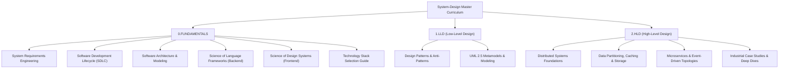

# Master Topic Outline (`outline.md`)

This document is the **single consolidated topic curriculum and learning syllabus** for the entire **System-Design** repository, maintained under **Universal Rule 15**. It consolidates all learning roadmaps, domain syllabi, and architectural modules across **0.FUNDAMENTALS**, **1.LLD**, and **2.HLD**.

---

## 🧭 Repository Navigation Quick Links

- **Repository Overview & Deliverables**: [`README.md`](README.md)
- **Master Navigation Catalog (Queries & Notes)**: [`index.md`](index.md)
- **Operational Rules & Invariants**: [`chat/universal_rules.md`](chat/universal_rules.md)
- **Full Activity Transcript**: [`chat/chatLog.md`](chat/chatLog.md)

---

## 🏛️ Syllabus Architecture Overview

---

## 📚 0. FUNDAMENTALS (Core Engineering Foundations)

### Module 0.1: System Requirements Engineering
- **Directory**: [`topics/0.FUNDAMENTALS/System Requirements/`](topics/0.FUNDAMENTALS/System%20Requirements/)
- **Deliverable**: [`System_Requirements_Engineering.md`](topics/0.FUNDAMENTALS/System%20Requirements/System_Requirements_Engineering.md)
- **Core Syllabi**:
  1. **Requirement Taxonomies**: Functional Requirements (FR), Non-Functional Requirements (NFR / Quality Attributes), Constraints & Boundaries.
  2. **Specification Standards**: Writing unambiguous Acceptance Criteria (Gherkin syntax: Given-When-Then), Input/Output contracts, invariant preconditions.
  3. **Non-Functional Vector**: Latency, Throughput (QPS), High Availability (99.999% SLA), Disaster Recovery (RPO / RTO), Security & Compliance (GDPR, HIPAA, SOC2).
  4. **Engineering Scoping**: Sizing calculations, capacity planning, cost estimation, back-of-the-envelope estimation.

### Module 0.2: Software Development Lifecycle (SDLC)
- **Directory**: [`topics/0.FUNDAMENTALS/Software Development Lifecycle/`](topics/0.FUNDAMENTALS/Software%20Development%20Lifecycle/)
- **Core Syllabi**:
  1. **Methodologies**: Waterfall, V-Model, Agile Scrum, Kanban, Extreme Programming (XP).
  2. **Requirements & RFC Process**: Writing effective Product Requirement Documents (PRDs) and Requests for Comments (RFCs).
  3. **Architecture & Design Phase**: Interface-first design, API contracts (OpenAPI, Protobuf), Architectural Decision Records (ADRs).
  4. **Quality Engineering & Verification**: The Testing Pyramid (Unit, Integration, Contract, E2E), Static analysis, SonarQube, mutation testing.
  5. **CI/CD & Operational Release**: Blue-Green deployments, Canary rollouts, Feature flags, SRE metrics (SLI, SLO, SLA, MTTR, MTTD).

### Module 0.3: Software Architecture and Modeling
- **Directory**: [`topics/0.FUNDAMENTALS/Software Architecture and Modeling/`](topics/0.FUNDAMENTALS/Software%20Architecture%20and%20Modeling/)
- **Sub-Modules**:
  * **1. Architecture Styles** ([`1.ARCHITECTURE/1. Architecture Styles/`](topics/0.FUNDAMENTALS/Software%20Architecture%20and%20Modeling/1.ARCHITECTURE/1.%20Architecture%20Styles/)):
    - Foundational Topologies: Monolithic Layered, Modular Monolith, Pipeline (Pipes and Filters), Microkernel (Plugin Architecture), Service-Based, Event-Driven, Microservices, Space-Based, Service-Oriented (SOA).
    - Taxonomy Clarifications: Architectural Styles vs Patterns vs Design Patterns (MVC/MVT classification).
  * **2. Architecture Patterns** ([`1.ARCHITECTURE/2. Architecture Patterns/`](topics/0.FUNDAMENTALS/Software%20Architecture%20and%20Modeling/1.ARCHITECTURE/2.%20Architecture%20Patterns/)):
    - 24 Enterprise Patterns: CQRS, Event Sourcing, BFF (Backend for Frontend), Saga (Orchestration vs Choreography), Outbox Pattern, Strangler Fig.
    - Anti-Patterns & Pitfalls: Architecture Sinkhole, Groundhog Day, Conway's Law silos, Global Coupling.
  * **3. Architecture Modeling & Viewpoints** ([`2.ARCHITECTURE_MODELING/`](topics/0.FUNDAMENTALS/Software%20Architecture%20and%20Modeling/2.ARCHITECTURE_MODELING/)):
    - Kruchten 4+1 View Model (Logical, Development, Process, Physical, Scenarios).
    - C4 Model (Context, Container, Component, Code).
    - Viewpoints & Perspectives Framework (Structural, Behavioral, Information, Security, Operational).

### Module 0.4: Science of Language Frameworks [Backend]
- **Directory**: [`topics/0.FUNDAMENTALS/Science of Language Frameworks [Backend]/`](topics/0.FUNDAMENTALS/Science%20of%20Language%20Frameworks%20[Backend]/)
- **Core Syllabi**:
  1. **Runtime Mechanics & Execution Models**: Thread-per-request vs Event Loop (Reactor / Proactor), Virtual threads (Java Project Loom), Goroutines, async/await runtimes.
  2. **Memory & Garbage Collection**: JVM generational GC (G1, ZGC), Go concurrent mark-sweep, Rust compile-time RAII and ownership/borrowing.
  3. **Framework Ecosystems**: Java (Spring Boot, Quarkus, Micronaut), Go (Gin, Fiber, net/http), Node.js (NestJS, Fastify), Python (FastAPI, Django), Rust (Axum, Actix-web).
  4. **Transport Protocols & APIs**: TCP/UDP, HTTP/1.1 vs HTTP/2 vs HTTP/3 (QUIC), gRPC, GraphQL, WebSockets, SSE.
  5. **Data Access & Drivers**: ORM vs raw SQL, connection pooling (HikariCP), prepared statements, transaction boundaries (`@Transactional`), caching integration.
  6. **Resilience & Production Readiness**: Circuit breakers (Resilience4j), rate limiters, bulkhead isolation, distributed tracing (OpenTelemetry), health probes.

### Module 0.5: Science of Design Systems [Front End]
- **Directory**: [`topics/0.FUNDAMENTALS/Design System [Front End]/`](topics/0.FUNDAMENTALS/Design%20System%20[Front%20End]/)
- **Core Syllabi**:
  1. **Design Tokens & Visual Primitives**: Global tokens, semantic tokens, component tokens, Style Dictionary, cross-platform export.
  2. **Component Architecture & Composition**: Atomic Design (Atoms, Molecules, Organisms, Templates, Pages), polymorphic components, headless components, compound components.
  3. **State Management & Data Flow**: Component state (React hooks, Vue refs, Svelte runes), global client state (Zustand, Redux Toolkit), server cache state (TanStack Query, SWR).
  4. **Accessibility (a11y) & Usability**: WCAG 2.1 / 2.2 Level AA/AAA, ARIA roles, focus trapping, screen reader testing.
  5. **Packaging & Governance**: Storybook, component workbenches, visual regression testing (Playwright, Chromatic), Monorepo tooling (Turborepo, Nx).

### Module 0.6: Technology Stack Selection Guide
- **Directory**: [`topics/0.FUNDAMENTALS/Select Technology Stack/`](topics/0.FUNDAMENTALS/Select%20Technology%20Stack/)
- **Deliverable**: [`Technology_Stack_Selection_Guide.md`](topics/0.FUNDAMENTALS/Select%20Technology%20Stack/Technology_Stack_Selection_Guide.md)
- **Core Syllabi**:
  1. **Selection Philosophy**: Constraint satisfaction, risk management, total cost of ownership (TCO).
  2. **The 5-Dimension Evaluation Vector**: Workload characteristics (I/O vs CPU), Access patterns (ACID vs BASE), Latency/Throughput SLAs, Developer velocity vs Type safety, Operational maturity.
  3. **Multi-Criteria Decision Matrix (MCDM)**: Weighted scoring methodology, proof-of-concept (PoC) spikes, ADR documentation.

---

## 🧩 1. LLD (Low-Level Design & Object-Oriented Modeling)

### Module 1.1: Software Design Patterns
- **Directory**: [`topics/1.LLD/DESIGN_PATTERNS/`](topics/1.LLD/DESIGN_PATTERNS/)
- **Outputs**: [`design_patterns.md`](topics/1.LLD/DESIGN_PATTERNS/output/query_DESIGN_PATTERNS/design_patterns.md), [`001_head_first_design_patterns_and_antipatterns.md`](topics/1.LLD/DESIGN_PATTERNS/output/query_DESIGN_PATTERNS/001_head_first_design_patterns_and_antipatterns.md)
- **Core Syllabi**:
  1. **Creational Patterns**: Singleton (Bill Pugh, Enum, Double-Checked Locking), Factory Method, Abstract Factory, Builder, Prototype.
  2. **Structural Patterns**: Adapter, Decorator, Facade, Composite, Proxy, Bridge, Flyweight.
  3. **Behavioral Patterns**: Strategy, Observer, Command, Template Method, Iterator, State, Chain of Responsibility, Mediator, Memento, Visitor, Interpreter.
  4. **Concurrency Patterns**: Thread Pool, Producer-Consumer, Read-Write Lock, Semaphore, Active Object.
  5. **Anti-Patterns & Misuse Traps**: Over-engineering, God Object, Spaghetti Code, Golden Hammer, Premature Optimization.

### Module 1.2: UML 2.5 Diagramming & Software Modeling
- **Directory**: [`topics/1.LLD/UML-DIAGRAMMING/`](topics/1.LLD/UML-DIAGRAMMING/)
- **Outputs**: [`001_uml_2_5_taxonomy`](topics/1.LLD/UML-DIAGRAMMING/output/query_UML-DIAGRAMMING/001_uml_2_5_taxonomy_structural_vs_behavioral.md), [`002_sequence_diagram`](topics/1.LLD/UML-DIAGRAMMING/output/query_UML-DIAGRAMMING/002_sequence_diagram_and_object_interactions.md)
- **Core Syllabi**:
  1. **OMG UML 2.5 Metamodels**: Taxonomy of all 14 official UML diagrams.
  2. **Structural Modeling**:
     - Class Diagrams (multiplicities, visibility, association, aggregation, composition, inheritance).
     - Component & Package Diagrams (subsystems, ports, interfaces).
     - Object & Deployment Diagrams (runtime instances, execution nodes).
  3. **Behavioral Modeling**:
     - Sequence Diagrams (lifelines, sync/async messages, combined fragments: alt, opt, loop, par).
     - State Machine Diagrams (states, transitions, guards, entry/exit actions, orthogonal states).
     - Activity Diagrams (control flow, decision nodes, concurrency fork/join, swimlanes).
     - Use Case Diagrams (actors, system boundary, include/extend relationships).
  4. **Mandatory 3-Tier Multi-Representation**:
     - Layer 1: Concrete Java 21 Object-Oriented Code.
     - Layer 2: Formal Mermaid / PlantUML Models.
     - Layer 3: Runtime Execution State (JVM Heap/Stack maps).

---

## 🌐 2. HLD (High-Level Design & Distributed Systems)

### Module 2.1: Distributed Systems Core Foundations
- **Directory**: [`topics/2.HLD/HLD_Overview/`](topics/2.HLD/HLD_Overview/)
- **Outputs**: [`HLD_Overview.md`](topics/2.HLD/HLD_Overview/output/Note_version-1_HLD_Overview/HLD_Overview.md)
- **Core Syllabi**:
  1. **System Invariants**: Scalability (Vertical vs Horizontal), Availability, Fault Tolerance, Latency vs Throughput.
  2. **Theoretical Guarantees**: CAP Theorem (Consistency, Availability, Partition Tolerance), PACELC Theorem, BASE Properties.
  3. **Consensus & Coordination**: Paxos, Raft, Zab (ZooKeeper), Leader Election, Distributed Clock Synchronization (NTP, Lamport timestamps, Vector clocks).

### Module 2.2: Distributed Storage, Caching & Data Partitioning
- **Core Syllabi**:
  1. **Data Partitioning Strategies**: Range-based partitioning, Hash-based partitioning, Consistent Hashing (Virtual Nodes).
  2. **Replication Topologies**: Single-Leader (Active-Passive), Multi-Leader (Active-Active), Leaderless (Dynamo-style, Quorum reads/writes: `W + R > N`).
  3. **Distributed Caching**: Cache Aside, Read-Through, Write-Through, Write-Behind (Write-Back), Eviction policies (LRU, LFU, FIFO, ARC).
  4. **Cache Invalidation & Consistency**: Thundering Herd problem, Cache Penetration, Cache Breakdown, Cache Avalanche, Distributed Locks (Redis Redlock, ZooKeeper ephemeral nodes).

### Module 2.3: Microservices, Integration & Asynchronous Topologies
- **Core Syllabi**:
  1. **Edge Infrastructure**: API Gateways (Rate limiting, authentication, SSL termination, request routing), Reverse Proxies (Nginx, Envoy), Load Balancers (L4 vs L7, round-robin, least connections, consistent hash).
  2. **Communication & Messaging**: Message Queues (RabbitMQ, SQS), Distributed Commit Logs (Apache Kafka, Apache Pulsar), Event Brokers vs Task Queues.
  3. **Distributed Transactions**: 2-Phase Commit (2PC), 3-Phase Commit (3PC), Saga Pattern (Choreography vs Orchestration), Transactional Outbox Pattern, Change Data Capture (CDC / Debezium).

### Module 2.4: Real-World Distributed System Case Studies
- **Core Syllabi**:
  1. **URL Shortening Service** (TinyURL): Base62 encoding, KGS (Key Generation Service), distributed uniqueness, caching strategy.
  2. **Rate Limiting Engine**: Token Bucket, Leaky Bucket, Fixed Window Counter, Sliding Window Log, Sliding Window Counter (Redis + Lua).
  3. **Distributed Unique ID Generator**: Twitter Snowflake, UUIDv4 vs UUIDv7, Ticket Servers.
  4. **High-Throughput Chat / Messaging System** (WhatsApp / Discord): WebSockets, long polling, presence servers, message ordering, fan-out architecture.
  5. **Notification System**: Priority queues, multi-channel dispatch (Push, SMS, Email), idempotency, deduplication.
  6. **Video Streaming Architecture** (YouTube / Netflix): Transcoding pipelines (HLS, DASH), Content Delivery Networks (CDNs), adaptive bitrate streaming.
