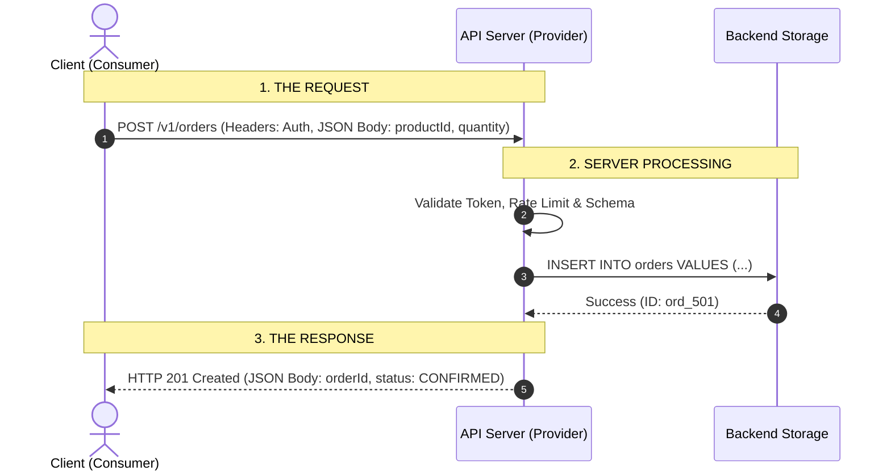
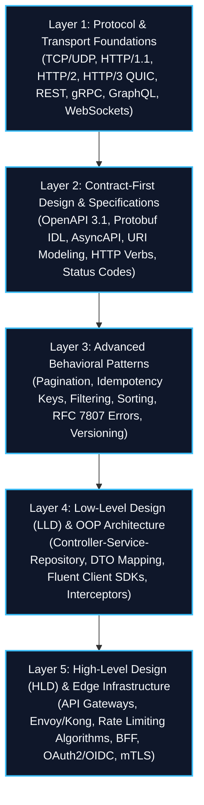
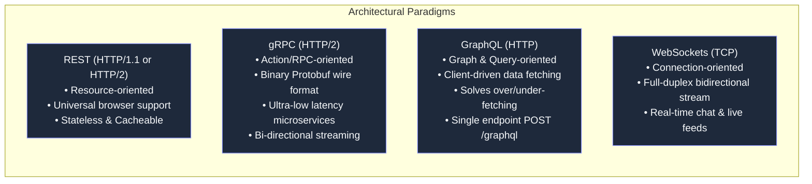
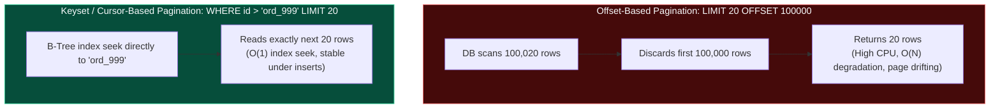
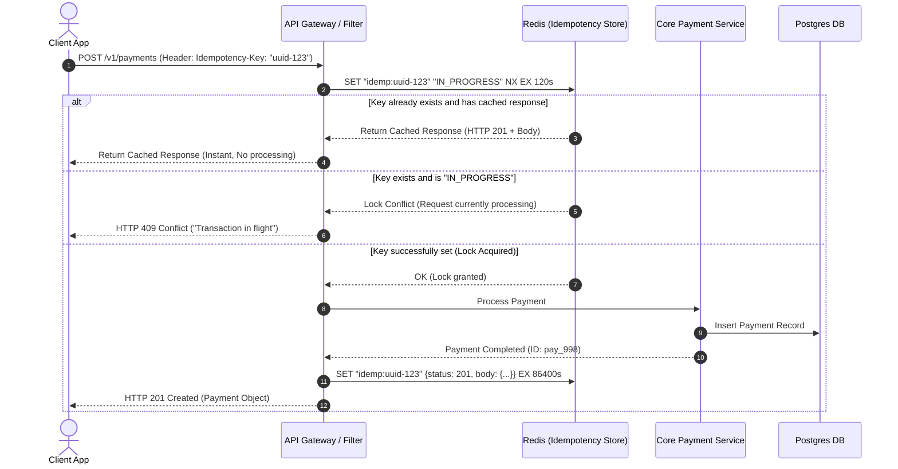
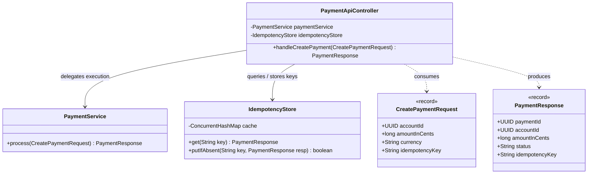
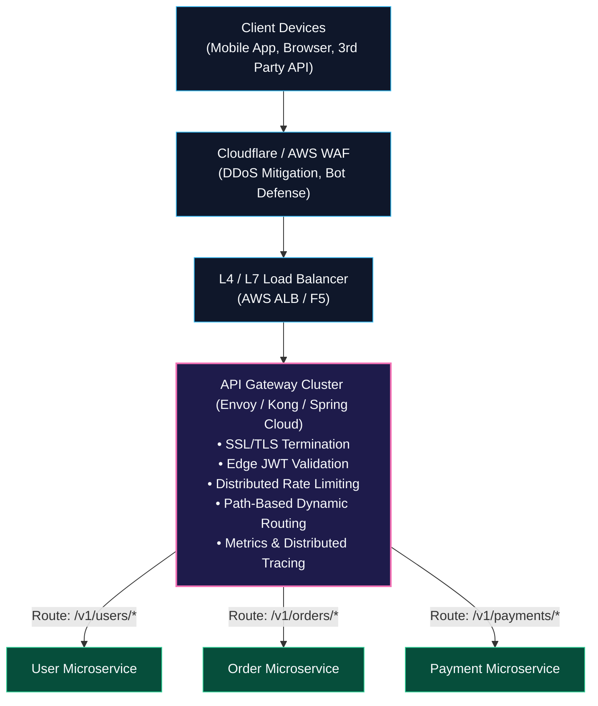

# API Architecture and Engineering: The Definitive Unified Guide

> **Scope**: A unified, end-to-end master curriculum covering the entire lifecycle of APIs across protocols, contract specifications, low-level object-oriented implementation, high-level distributed gateway topologies, and enterprise security.

---

## 1. Fundamentals: What is an API and What Can It Do?

### 1.1. What is an API? (First Principles & Mental Models)

At its most fundamental level, an **Application Programming Interface (API)** is a formal, standardized contract that defines how two distinct software components communicate, exchange data, and invoke capabilities over a defined boundary.

Just as a User Interface (UI) enables a **human** to interact with a computer program (via buttons, text fields, and visual layouts), an API enables a **program** to interact with another program (via functions, methods, network endpoints, and data payloads).

#### The 3 Canonical Mental Models of an API:
1. **The Restaurant Waiter Analogy**:
   - The **Customer (Client)** sits at a table and wants food, but is not allowed into the kitchen.
   - The **Kitchen (Server / Backend / Database)** prepares the food according to proprietary recipes.
   - The **Waiter (The API)** provides a menu (the API contract / endpoints), takes the customer's order (the API request), carries it to the kitchen, and delivers the prepared dish back to the customer (the API response).
2. **The Universal Wall Socket Analogy**:
   - You plug a lamp, laptop charger, or vacuum into a 120V/240V AC wall outlet.
   - The plug and socket adhere to a strict physical and electrical standard (dimensions, pin layout, voltage).
   - The device does not need to know whether the electricity came from a nuclear plant, hydroelectric dam, or solar panel—the socket interface decouples the power consumer from the power generator.
3. **The Secure Bank Teller Window**:
   - Customers cannot walk into the bank vault to grab their cash directly.
   - Instead, they approach a teller window (the API boundary), present their ID (authentication / credentials), hand over a withdrawal slip (structured request payload), and receive their funds (authorized response).


---

### 1.2. What Can an API Do? (Core Capabilities & Functional Roles)

In modern software architecture, APIs perform six foundational responsibilities:

| Capability / Function | What the API Does | Concrete Real-World Example |
| :--- | :--- | :--- |
| **1. Data Access & Abstraction (CRUD Operations)** | Provides controlled, structured access to create, read, update, and delete state without exposing direct database ports or table schemas. | An e-commerce mobile app retrieves order history via `GET /v1/orders` without needing PostgreSQL connection strings or SQL knowledge. |
| **2. Business Logic Execution & Workflows** | Triggers complex multi-step algorithms, financial settlements, state machines, or data processing pipelines. | Calling `POST /v1/payments/checkout` deducts inventory, calculates regional sales taxes, debits credit card funds, and schedules fulfillment. |
| **3. Decoupling & Polyglot Interoperability** | Bridges completely different programming languages, runtime environments, operating systems, and deployment lifecycles. | A machine learning model written in Python (PyTorch) is invoked via a gRPC API by a high-performance backend written in Go or Java. |
| **4. Third-Party Integration & Monetization** | Allows organizations to package internal capabilities as commercial software-as-a-service (SaaS) products for developers worldwide. | Stripe processes global payments via API; Twilio delivers SMS messages via API; OpenAI generates text embeddings via API. |
| **5. Security, Access Governance & Guardrails** | Enforces identity verification, role-based access control (RBAC), rate limits, sensitive data masking (PII/PCI-DSS), and payload sanitization. | An API gateway blocks malicious SQL injection payloads and rate-limits abusive clients to 100 requests per minute before they reach backend servers. |
| **6. Asynchronous Notification & Event Dispatching** | Notifies remote clients when long-running tasks complete or system events occur via Webhooks and event streams. | GitHub sends a Webhook `POST` payload to Jenkins CI/CD whenever a developer pushes a git commit to the repository. |

---

### 1.3. Anatomy of an API Request and Response Cycle

Every API exchange operates through a standardized request-response lifecycle:



#### Anatomy of a Request:
1. **Endpoint / URI**: The network address identifying the target resource (e.g. `https://api.domain.com/v1/orders`).
2. **HTTP Verb / Method**: The intended action (`GET` = Read, `POST` = Create, `PUT` = Replace, `PATCH` = Modify, `DELETE` = Remove).
3. **Headers**: Metadata describing the request (`Authorization: Bearer <token>`, `Content-Type: application/json`, `Accept: application/json`, `Idempotency-Key: <uuid>`).
4. **Parameters**:
   - **Path Parameters**: Identifying specific instances (`/orders/{orderId}`).
   - **Query Parameters**: Modifying presentation (`/orders?status=active&page=2&limit=20`).
5. **Request Body / Payload**: The data payload transmitted to the server (serialized in JSON, Protobuf, XML).

#### Anatomy of a Response:
1. **HTTP Status Code**: Standard 3-digit status conveying outcome category:
   - `2xx (Success)`: Request succeeded (`200 OK`, `201 Created`, `204 No Content`).
   - `3xx (Redirection)`: Resource moved (`301 Moved Permanently`, `304 Not Modified`).
   - `4xx (Client Error)`: Problem in client input (`400 Bad Request`, `401 Unauthorized`, `403 Forbidden`, `404 Not Found`, `429 Too Many Requests`).
   - `5xx (Server Error)`: Crash or failure on provider side (`500 Internal Server Error`, `502 Bad Gateway`, `503 Service Unavailable`, `504 Gateway Timeout`).
2. **Response Headers**: Metadata returned by the server (`Content-Type`, `Cache-Control`, `RateLimit-Remaining`).
3. **Response Body**: The result dataset or standardized RFC 7807 error object.

---

### 1.4. Taxonomy of APIs: Categorization by Access Scope & Communication Mode

#### A. By Accessibility / Audience:
- **Private / Internal APIs**: Built strictly for internal communication across teams and microservices. Not accessible from the public Internet.
- **Partner APIs**: Selectively exposed to trusted B2B enterprise partners with dedicated VPNs, IP whitelists, or mutual TLS authentication.
- **Public / Open APIs**: Published for external third-party software developers with public documentation and self-service API key generation.
- **Composite APIs**: Orchestration endpoints that execute a sequence of multiple underlying microservice calls and aggregate the result into a single response payload.

#### B. By Communication & Execution Mode:
- **Synchronous Request-Response**: The calling client blocks or waits until the server processes the request and returns a response (e.g. REST, gRPC unary, GraphQL).
- **Asynchronous / Fire-and-Forget**: The client sends a request and receives an immediate `202 Accepted` receipt. The long-running job executes in the background, and results are pushed back via **Webhooks** or polled via a status endpoint.
- **Bi-directional Streaming / Event Streams**: Continuous, persistent streams of real-time data over an open TCP socket (e.g. WebSockets, gRPC streaming, SSE).

---

## 2. The 5 Architectural Layers of API Engineering

An **Application Programming Interface (API)** is not merely an HTTP endpoint; it is the **formal invariant contract** that decouples software components, enforces boundary encapsulation, and enables distributed computing.

To master APIs for System Design, an engineer must understand the **5 architectural layers**:



---

## 3. Layer 1: Protocol & Transport Foundations

### 2.1. The Evolution of Wire Protocols: HTTP/1.1 vs HTTP/2 vs HTTP/3 (QUIC)

Modern API performance is bounded by the underlying transport protocol:

| Metric / Feature                      | HTTP/1.1 (1997)                                  | HTTP/2 (2015)                                                 | HTTP/3 QUIC (2022)                                                                           |
| :------------------------------------ | :----------------------------------------------- | :------------------------------------------------------------ | :------------------------------------------------------------------------------------------- |
| **Transport Layer**             | TCP                                              | TCP                                                           | UDP (via QUIC)                                                                               |
| **Data Framing**                | Textual (ASCII lines)                            | Binary Framing (Frames & Streams)                             | Binary Framing (QUIC Streams)                                                                |
| **Connection Model**            | 1 request per TCP socket (or pipelining)         | Multiplexed (Multiple streams over 1 TCP socket)              | Multiplexed (Multiple independent streams over UDP)                                          |
| **Head-of-Line (HoL) Blocking** | Severe at application level                      | Solved at application layer, but persists at TCP packet level | **Completely Eliminated** (Packet loss on 1 stream does not stall other streams)       |
| **Connection Handshake**        | TCP handshake + TLS handshake (2-3 RTT)          | TCP + TLS 1.3 (1-2 RTT)                                       | QUIC Handshake (0-RTT or 1-RTT connection resumption)                                        |
| **Header Compression**          | None (Redundant headers sent per request)        | HPACK (Indexed table + Huffman coding)                        | QPACK (Optimized for out-of-order UDP delivery)                                              |
| **Connection Migration**        | Bound to IP + Port (Fails on Wi-Fi to 5G switch) | Bound to IP + Port (Fails on network switch)                  | **Connection ID (CID)**: Seamless migration across Wi-Fi/Cellular without reconnecting |

### 2.2. Architectural Paradigms: REST vs. gRPC vs. GraphQL vs. WebSockets



#### A. REST (Representational State Transfer) & Richardson Maturity Model

REST, formalized by Roy Fielding, treats system capabilities as stateful resources manipulated through standard HTTP semantics.

- **Level 0 (The Swamp of POX)**: Single URI (`/api`), single HTTP method (`POST`) carrying RPC payloads.
- **Level 1 (Resources)**: Individual URIs for individual entities (`/orders`, `/customers/123`).
- **Level 2 (HTTP Verbs)**: Standard HTTP verbs utilized correctly (`GET` to read, `POST` to create, `PUT` to replace, `DELETE` to remove) with semantic status codes (`200 OK`, `201 Created`, `404 Not Found`).
- **Level 3 (HATEOAS - Hypermedia as the Engine of Application State)**: Responses include hypermedia link relations (`_links`) guiding client state transitions dynamically without out-of-band documentation.

#### B. gRPC & Protocol Buffers

gRPC is Google's open-source RPC framework built on HTTP/2:

- **Interface Definition Language (IDL)**: Defines strong contracts in `.proto` files compiled into strongly-typed code in Java, Go, Python, C++, etc.
- **Protobuf Serialization**: Binary encoding using Varints and field tags. Up to 7x faster serialization and 80% smaller payloads than JSON.
- **Streaming Modes**: Unary (Request-Response), Server Streaming, Client Streaming, and Bidirectional Streaming.

#### C. GraphQL: Schema-Driven Queries

Designed by Meta to solve the mobile network over-fetching (retrieving 50 fields when only 2 are needed) and under-fetching (requiring 5 consecutive round-trips to populate one screen):

- **Schema & Resolvers**: Strongly typed schema defining `Query`, `Mutation`, and `Subscription`.
- **The N+1 Problem**: A query fetching 100 orders and their authors can trigger 1 query for orders + 100 queries for authors. **Mitigation**: DataLoader batching and memoization caches.

#### D. WebSockets & Server-Sent Events (SSE)

- **WebSockets (`ws://`, `wss://`)**: Initial HTTP 101 Upgrade handshake transitions socket into a persistent, bidirectional binary/text TCP stream. Best for gaming, chat, and collaborative tools.
- **Server-Sent Events (SSE)**: Standard HTTP connection (`text/event-stream`) where the server pushes unidirectional event streams to the browser. Simpler than WebSockets, supports automatic reconnects, and works natively over HTTP/2.

---

## 4. Layer 2: Contract-First Design & Specifications

### 3.1. Contract-First vs. Code-First Philosophy

- **Code-First**: Developers write controller code and auto-generate Swagger docs via reflection. **Pitfall**: Leaks internal implementation details, tightly couples client to backend changes, and prevents parallel frontend-backend development.
- **Contract-First (Industry Best Practice)**: The API contract is written and reviewed in **OpenAPI 3.1** or **Protobuf IDL** *before* a single line of backend code is created. Mock servers (e.g. Prism) run immediately, allowing frontend teams to build against the contract simultaneously.

### 3.2. RESTful URI Modeling & Invariant HTTP Methods

```
Canonical Pattern: https://api.enterprise.com/v1/{resource}/{resource-id}/{sub-resource}
```

1. **Use Plural Nouns for Resources**: `/orders` instead of `/getOrder` or `/order`.
2. **Keep URIs Free of Action Verbs**: Actions belong in the HTTP verb, not the URI path.
   - ❌ `POST /orders/createNewOrder`
   - ✅ `POST /orders`
3. **Sub-Resource Nesting (Max 2 Levels Deep)**:
   - ✅ `GET /orders/8842/items`
   - ❌ `GET /regions/us/customers/42/orders/8842/items/12/taxes` (Flatten to `GET /items/12/taxes`).

#### HTTP Verb Safety and Idempotency Matrix

| Verb                  | Meaning                        | Safe (No Side Effects)? | Idempotent `f(f(x)) = f(x)`? |            Cacheable?            |
| :-------------------- | :----------------------------- | :---------------------: | :----------------------------: | :------------------------------: |
| **`GET`**     | Retrieve resource              |      **YES**      |         **YES**         |          **YES**          |
| **`HEAD`**    | Retrieve headers only          |      **YES**      |         **YES**         |          **YES**          |
| **`OPTIONS`** | Inspect supported methods      |      **YES**      |         **YES**         |                No                |
| **`PUT`**     | Completely replace resource    |           No           |         **YES**         |                No                |
| **`PATCH`**   | Partially update resource      |           No           |        No (Conditional)        |                No                |
| **`DELETE`**  | Remove resource                |           No           |         **YES**         |                No                |
| **`POST`**    | Create child / trigger process |           No           |          **NO**          | Only with explicit cache headers |

---

## 5. Layer 3: Advanced Behavioral Design Patterns

### 4.1. Pagination Strategies: Offset vs. Keyset (Cursor)



1. **Offset-Based (`?page=5&limit=20` or `?offset=100&limit=20`)**:
   - **Pros**: Easy to implement, allows jumping directly to arbitrary pages (e.g. "Go to Page 42").
   - **Cons**: Severe database performance penalty (`O(N)` row scan). Vulnerable to **page drift** (new inserts cause items to appear twice across page boundaries).
2. **Keyset / Cursor-Based (`?cursor=eyJpZCI6ODg0Mn0=&limit=20`)**:
   - **Pros**: Constant time lookup (`O(log N)` B-Tree seek). Completely immune to page drift during active writes.
   - **Cons**: Cannot jump to arbitrary distant pages (must traverse sequentially forward/backward).

### 4.2. Distributed Idempotency Key Architecture

Network failures during a `POST /payments` request leave clients unsure if the transaction succeeded. If the client retries, the user might be charged twice.

**The Solution: The Idempotency Key Pattern**:



### 4.3. API Versioning Strategies

| Strategy                      | Example                                     | Trade-Offs & Best Use Case                                                                                                               |
| :---------------------------- | :------------------------------------------ | :--------------------------------------------------------------------------------------------------------------------------------------- |
| **URI Path Versioning** | `GET /v1/ordersGET /v2/orders`            | **Most Popular / Industry Standard** (Stripe, Twilio). Highly visible, easy to route via API Gateways, trivial to test in browser. |
| **Query Parameter**     | `GET /orders?version=2`                   | Simple, but can conflict with business query parameters and CDN caching rules.                                                           |
| **Custom Header**       | `X-API-Version: 2`                        | Clean URIs, but invisible in browser address bar; requires sophisticated gateway routing.                                                |
| **Content Negotiation** | `Accept: application/vnd.company.v2+json` | Purest REST implementation; high cognitive load for client developers, complicates CDN caching.                                          |

### 4.4. Standardized Error Contracts: RFC 7807 (Problem Details)

Never return plain text or ad-hoc JSON errors (`{"error": "bad request"}`). Implement **IETF RFC 7807**:

```json
{
  "type": "https://api.enterprise.com/errors/insufficient-funds",
  "title": "Insufficient Funds",
  "status": 403,
  "detail": "Account balance of 42.50 USD is lower than transaction cost 100.00 USD.",
  "instance": "/v1/accounts/acc_991/transactions/tx_123",
  "invalid_params": [
    {
      "name": "amount",
      "reason": "Amount exceeds current available credit limit"
    }
  ]
}
```

---

## 6. Layer 4: Low-Level Design (LLD) & 3-Tier Modeling Standard

### 5.1. Tier 1: Concrete Java 21 Backend OOP Implementation

The following implementation showcases a production-ready, thread-safe idempotent API Controller and Filter in Java 21:

```java
package com.enterprise.api.controller;

import java.util.UUID;
import java.util.concurrent.ConcurrentHashMap;
import java.util.concurrent.TimeUnit;

// 1. Immutable Data Transfer Objects (DTOs)
public record CreatePaymentRequest(
    UUID accountId,
    long amountInCents,
    String currency,
    String idempotencyKey
) {}

public record PaymentResponse(
    UUID paymentId,
    UUID accountId,
    long amountInCents,
    String status,
    String idempotencyKey
) {}

// 2. In-Memory Thread-Safe Distributed Idempotency Cache Simulator
public class IdempotencyStore {
    private final ConcurrentHashMap<String, PaymentResponse> cache = new ConcurrentHashMap<>();

    public PaymentResponse get(String key) {
        return cache.get(key);
    }

    public boolean putIfAbsent(String key, PaymentResponse response) {
        return cache.putIfAbsent(key, response) == null;
    }
}

// 3. Domain Service
public class PaymentService {
    public PaymentResponse process(CreatePaymentRequest request) {
        // Core business logic: ledger debit, fraud check, payment gateway dispatch
        UUID generatedPaymentId = UUID.randomUUID();
        return new PaymentResponse(
            generatedPaymentId,
            request.accountId(),
            request.amountInCents(),
            "SETTLED",
            request.idempotencyKey()
        );
    }
}

// 4. API Controller enforcing layer boundaries & idempotency
public class PaymentApiController {
    private final PaymentService paymentService;
    private final IdempotencyStore idempotencyStore;

    public PaymentApiController(PaymentService paymentService, IdempotencyStore idempotencyStore) {
        this.paymentService = paymentService;
        this.idempotencyStore = idempotencyStore;
    }

    public PaymentResponse handleCreatePayment(CreatePaymentRequest request) {
        String key = request.idempotencyKey();
        if (key != null && !key.isBlank()) {
            PaymentResponse existing = idempotencyStore.get(key);
            if (existing != null) {
                // Return cached response without re-processing (Pure Idempotency)
                return existing;
            }
        }

        PaymentResponse newlySettled = paymentService.process(request);
        if (key != null && !key.isBlank()) {
            idempotencyStore.putIfAbsent(key, newlySettled);
        }
        return newlySettled;
    }
}
```

### 5.2. Tier 2: Formal UML Modeling



### 5.3. Tier 3: Runtime Heap & State Architecture

```
JVM Heap Execution Snapshot:
================================================================================
Thread: [http-nio-8080-exec-4]
Stack Frame: PaymentApiController.handleCreatePayment()
  ├── Local Ref 'request' ──────────────> [CreatePaymentRequest Object @0x7f88]
  │                                        ├── accountId: 442b1029-...
  │                                        ├── amountInCents: 50000
  │                                        └── idempotencyKey: "idem_tx_9981"
  │
IdempotencyStore Memory Graph:
  └── ConcurrentHashMap [Table size: 64]
       └── Node (hash: 0x9a4b) ─────────> Key: "idem_tx_9981"
                                         Value: [PaymentResponse Object @0x82b1]
                                                 ├── paymentId: 77a0-99b1-...
                                                 └── status: "SETTLED"
================================================================================
```

---

## 7. Layer 5: High-Level Design (HLD) & Edge Infrastructure

### 6.1. The API Gateway Topology

In modern distributed microservices, clients **never** call internal microservices directly. Instead, all traffic terminates at the **API Gateway**:



### 6.2. Distributed Rate Limiting Algorithms Compared

API Gateways protect downstream microservices from denial of service and noisy neighbors using rate limiters:

| Algorithm                        | How It Works                                                                         | Advantages                                                                                | Disadvantages                                                                                                 |
| :------------------------------- | :----------------------------------------------------------------------------------- | :---------------------------------------------------------------------------------------- | :------------------------------------------------------------------------------------------------------------ |
| **Token Bucket**           | Tokens refill at constant rate `R` up to capacity `C`. Requests consume 1 token. | Allows sudden bursts up to capacity `C`; memory efficient.                              | Tuning token refill rate under high concurrency requires atomic locks.                                        |
| **Leaky Bucket**           | Requests enter a FIFO queue; processed at fixed constant outflow rate.               | Perfectly smooths traffic spikes; prevents downstream overload.                           | Drops requests when buffer is full; increases latency for burst traffic.                                      |
| **Fixed Window**           | Counts requests in fixed time windows (e.g. 100 req/min).                            | Trivial to implement via Redis `INCR` + `EXPIRE`.                                     | **Boundary Spike Flaw**: 100 requests at 00:59 + 100 requests at 01:00 = 200 requests within 2 seconds. |
| **Sliding Window Counter** | Blends previous window count with current window elapsed percentage.                 | Prevents boundary spikes; extremely memory efficient (stores only 2 integers per client). | Slight approximation error (assumes requests in previous window were uniformly distributed).                  |

#### Production Implementation: Redis + Lua Sliding Window Counter

```lua
-- KEYS[1]: rate:user_123:current_window
-- KEYS[2]: rate:user_123:prev_window
-- ARGV[1]: max_requests (e.g. 100)
-- ARGV[2]: current_window_elapsed_percentage (0.0 to 1.0)

local current = redis.call('GET', KEYS[1]) or 0
local prev = redis.call('GET', KEYS[2]) or 0
local estimated_count = tonumber(prev) * (1.0 - tonumber(ARGV[2])) + tonumber(current)

if estimated_count < tonumber(ARGV[1]) then
    redis.call('INCR', KEYS[1])
    return 1 -- Request Allowed
else
    return 0 -- Rate Limit Exceeded (HTTP 429)
end
```

### 6.3. Backend-for-Frontend (BFF) Pattern

Instead of building one monolithic "universal" API that serves Mobile, Desktop Web, and IoT devices simultaneously, the **Backend-for-Frontend (BFF)** pattern deploys small, dedicated edge services tailored specifically to each frontend:

- **Mobile BFF**: Aggregates 10 microservice calls into 1 lightweight payload, strips unused fields to save cellular bandwidth, and optimizes for high latency.
- **Web BFF**: Emits rich, multi-panel payloads, renders server-side HTML/React components, and leverages high-bandwidth broadband connections.

---

## 8. Layer 6: Security, Governance & Observability

### 7.1. Authentication & Authorization Protocols

1. **OAuth 2.0 (RFC 6749)**: Authorization framework delegation protocol.
   - **Authorization Code Flow with PKCE**: Mandatory for Single Page Apps (SPA) and Native Mobile Apps (mitigates authorization code interception attacks).
   - **Client Credentials Flow**: Used for machine-to-machine (M2M) service authentication without user involvement.
2. **OpenID Connect (OIDC)**: Identity layer built on top of OAuth 2.0 issuing standardized **ID Tokens** (JWTs) containing identity claims (`sub`, `email`, `roles`).
3. **JSON Web Tokens (JWT) vs Opaque Sessions**:
   - **JWT (Stateless)**: Cryptographically signed (RS256 / EdDSA). Gateways verify signature locally using public key (JWKS) with zero database lookups.
   - **The Revocation Dilemma**: Stateless JWTs cannot be invalidated immediately if a user is compromised. **Mitigation**: Short expiration lifetimes (5–15 minutes) paired with stateful refresh tokens stored in Redis.
4. **Mutual TLS (mTLS)**: Enforces bidirectional cryptographic verification where both client and server present X.509 certificates. Primary standard for service-mesh intra-cluster communication.

### 7.2. Distributed Observability: OpenTelemetry & W3C Trace Context

To trace an API request across 20 distributed microservices, APIs propagate standard **W3C Trace Context** HTTP headers:

- `traceparent`: `00-4bf92f3577b34da6a3ce929d0e0e4736-00f067aa0ba902b7-01`
  - `00`: Protocol version.
  - `4bf92f35...`: Distributed Global Trace ID (constant across entire request lifecycle).
  - `00f067aa...`: Parent Span ID (identifies the immediate upstream calling node).
  - `01`: Trace flags (Sampling active).

---

## 9. Master Synthesis Matrix: Technology Comparison

| Dimension                     | REST                                                           | gRPC                                                                | GraphQL                                                               | WebSockets                                                   |
| :---------------------------- | :------------------------------------------------------------- | :------------------------------------------------------------------ | :-------------------------------------------------------------------- | :----------------------------------------------------------- |
| **Protocol**            | HTTP/1.1 or HTTP/2                                             | Strictly HTTP/2                                                     | HTTP/1.1 or HTTP/2                                                    | TCP (after HTTP 101 Upgrade)                                 |
| **Payload Encoding**    | Text (JSON, XML)                                               | Binary (Protocol Buffers)                                           | Text (JSON)                                                           | Text (JSON) or Raw Binary                                    |
| **Data Schema**         | Optional (OpenAPI)                                             | **Mandatory** (`.proto` IDL)                                | **Mandatory** (GraphQL Schema)                                  | Custom application-level                                     |
| **Client Code Gen**     | Third-party (openapi-generator)                                | **Built-in First-Class** (protoc)                             | Third-party (GraphQL Code Gen)                                        | Manual implementation                                        |
| **Network Overhead**    | Moderate (Verbose JSON headers)                                | **Ultra-Low** (Binary serialization)                          | Moderate (JSON payload + query overhead)                              | Minimal (2–10 byte frame headers)                           |
| **Over/Under Fetching** | Common challenge                                               | Common challenge                                                    | **Completely Eliminated**                                       | N/A (Streamed data)                                          |
| **Caching Support**     | **Built-in First-Class** (HTTP Cache-Control)            | Custom application caching                                          | Difficult (Usually POST requests)                                     | N/A (Stateful connection)                                    |
| **Streaming Support**   | Chunked transfer / SSE                                         | **Native Bi-directional Streaming**                           | Subscriptions (via WS or SSE)                                         | **Native Bi-directional Streaming**                    |
| **Best Use Case**       | Public APIs, CRUD web services, enterprise partner integration | High-throughput internal microservices, low-latency mobile backends | Complex composite web applications, mobile screens aggregating graphs | Real-time chat, multiplayer gaming, financial ticker streams |

---

## 🔗 Related Master Curricula

- [`System_Requirements_Engineering.md`](<../../System%20Requirements/System_Requirements_Engineering.md>): Functional and non-functional vectors (SLA, latency, QPS capacity planning).
- [`001_architectural_styles_catalog_and_comparative_analysis.md`](<../../Software%20Architecture%20and%20Modeling/1.ARCHITECTURE/1.%20Architecture%20Styles/output/query_Architecture_Styles/001_architectural_styles_catalog_and_comparative_analysis.md>): Monolithic vs distributed styles.
- [`001_software_architecture_patterns_antipatterns_and_pitfalls.md`](<../../Software%20Architecture%20and%20Modeling/1.ARCHITECTURE/2.%20Architecture%20Patterns/output/query_Architecture_Patterns/001_software_architecture_patterns_antipatterns_and_pitfalls.md>): Enterprise integration patterns.
- [`HLD_Overview.md`](../../../2.HLD/HLD_Overview/output/Note_version-1_HLD_Overview/HLD_Overview.md): Large-scale distributed systems and consensus.
