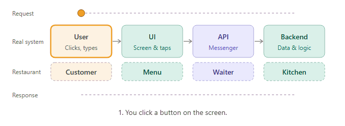

---

#### The 3 Canonical Mental Models of an API:

To truly understand why APIs exist, examine these three real-world analogies:

1. **The Restaurant Waiter Analogy**:

   - The **Customer (Client)** sits in the dining room and wants dinner. However, the customer is strictly forbidden from walking into the kitchen to grab ingredients or turn on the industrial stoves.
   - The **Kitchen (Server / Database)** stores raw ingredients and secret recipes. It knows how to cook, but cannot be disrupted by hundreds of untrained customers wandering around.
   - The **Waiter (The API)** provides a printed menu (the **API Documentation / Contract**), takes the customer's specific order (the **Request**), carries it to the kitchen, and brings back the plated meal (the **Response**). If the customer orders something not on the menu, the waiter immediately rejects it with an error.
2. **The Universal Wall Socket Analogy**:

   - You plug a vacuum cleaner, a smartphone charger, or a microwave into a 120V/240V AC wall outlet.
   - The plug and socket adhere to an exact physical and electrical specification (pin shape, spacing, voltage, frequency).
   - Your smartphone does not need to know whether the electricity was generated by a nuclear reactor, a wind turbine, or a coal power plant. The wall socket decouples the device needing power from the complex infrastructure generating it.
3. **The Secure Bank Teller Window**:

   - Customers cannot walk into a bank vault and pick up stacks of 100-dollar bills.
   - Instead, they approach a bulletproof teller window (the **API Boundary**). They show their official ID (Authentication / Credentials), submit a structured withdrawal slip with their account number and desired amount (Request Payload), and the teller verifies their balance and hands over the authorized funds (Response).

### 1.2. What Can an API Do? (Deep-Dive into the 6 Core Capabilities with Diagrams)

In modern software engineering, an API is far more than a simple data pipeline. APIs perform **six foundational operational responsibilities**. Below, each capability is analyzed through its problem statement, operational mechanics, real-world example, and architectural diagram.

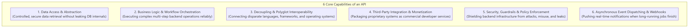

---

#### Capability 1: Data Access & Abstraction (Controlled CRUD Without Direct Database Access)

* **The Problem Without an API**:
  If a mobile app or frontend website connected directly to a backend PostgreSQL or MongoDB database over the public internet:

  1. The client code would contain plaintext database passwords, allowing anyone who inspects the app bundle to steal or erase the entire database.
  2. Every time a backend engineer renames a database column or table, millions of mobile apps would immediately crash.
  3. Every mobile device would open a direct TCP database connection, rapidly exceeding PostgreSQL's connection limit (`max_connections = 100`) and crashing the database.
* **How the API Solves This**:
  The API acts as an **abstraction barrier**. Clients make standard HTTP requests (`GET /v1/orders/123`). The API server authenticates the caller, validates their permission, manages an internal connection pool to the database, executes the optimized SQL query, maps the relational rows into a clean JSON structure, and returns only the fields the client is permitted to see.

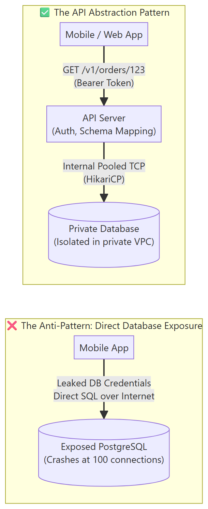

---

* **Concrete Real-World Example**:
  An e-commerce mobile application fetches a user's recent orders via `GET /v1/users/me/orders`. The app developer does not know or care whether the backend stores data in PostgreSQL, DynamoDB, or an SAP mainframe. If the company migrates its database engine next year, the mobile app code remains 100% untouched.

#### Capability 2: Business Logic & Workflow Orchestration (Complex Operations)

* **The Problem Without an API**:
  A customer purchasing a product is never just a simple database write. A checkout operation requires calculating state sales taxes, verifying warehouse inventory, charging a credit card via a payment gateway, creating an order record, sending a confirmation email, and notifying the shipping warehouse. If the client app executed these steps individually, a dropped mobile connection halfway through would leave the customer charged without an order created!
* **How the API Solves This**:
  The API provides a single, atomic endpoint (`POST /v1/checkout`). The client triggers the entire workflow with one call. The API server orchestrates the steps transactionally: if the credit card charge fails, it immediately rolls back the inventory reservation and returns a clear error to the user.

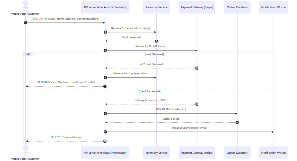

---

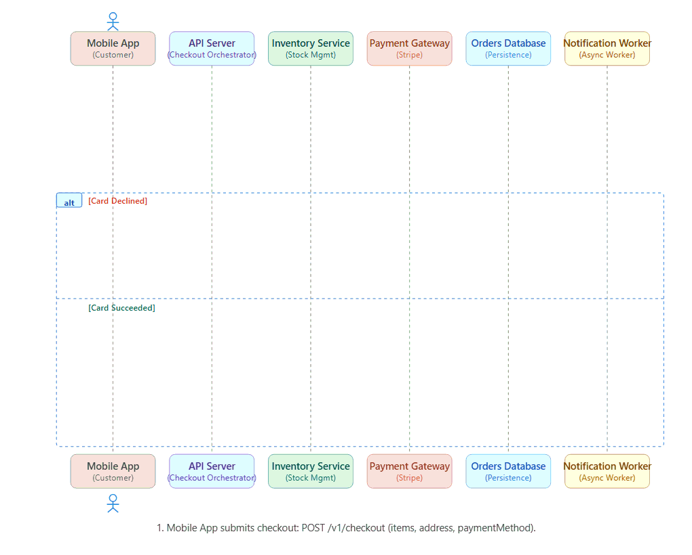

---

* **Concrete Real-World Example**:
  When you order an Uber, your phone invokes `POST /v1/rides/request`. That single API call calculates the upfront fare based on traffic algorithms, locates nearby active drivers using spatial geospatial indexing, alerts drivers via real-time sockets, and pre-authorizes your payment card.

#### Capability 3: Decoupling & Polyglot Interoperability (Language Independence)

* **The Problem Without an API**:
  Large software systems cannot be built with a single programming language:

  - Machine learning models are written in **Python** using PyTorch and CUDA.
  - Ultra-high throughput network services are written in **Go** or **Rust**.
  - Complex banking enterprise rules are written in **Java** or **C#**.
  - Modern web user interfaces are written in **TypeScript / React**.
    A Python program cannot natively call a Go function residing in a different operating system's memory address space.
* **How the API Solves This**:
  APIs establish a universal **wire protocol contract** (such as JSON over HTTP/2 or Protocol Buffers over gRPC). Because every operating system and programming language knows how to send network packets and serialize bytes, software written in completely incompatible languages can collaborate seamlessly.

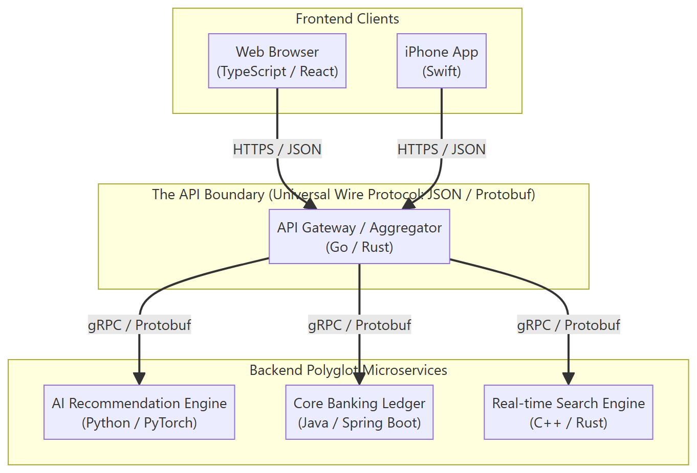

---

* **Concrete Real-World Example**:
  A modern AI application uses a Next.js (TypeScript) web frontend. When the user asks a question, the web frontend calls an API Gateway written in Go. The Go gateway invokes a deep learning model running in Python on an NVIDIA GPU cluster via a high-performance gRPC API.

#### Capability 4: Third-Party Integration & Monetization (APIs as Products)

* **The Problem Without an API**:
  If every company that wanted to accept online credit card payments had to build physical relationships with Visa, Mastercard, and global banks, 99% of startups would never launch.
* **How the API Solves This**:
  Specialized organizations package complex, proprietary capabilities into public APIs, transforming internal software into commercial **Software-as-a-Service (SaaS)** products. Developers around the globe integrate these capabilities with a few lines of code, paying per API request.

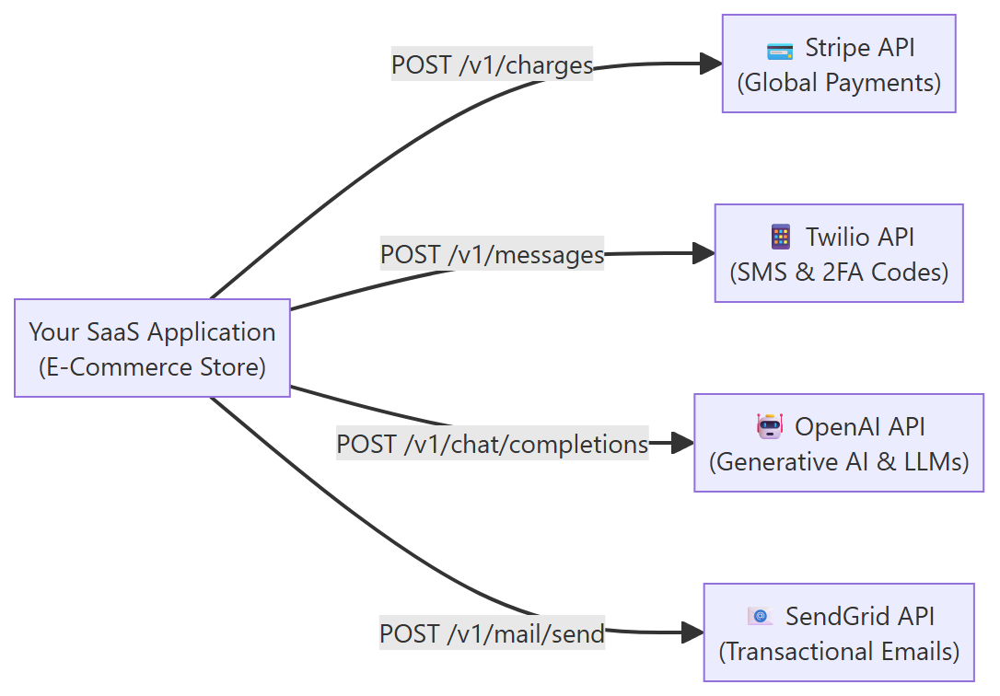

---

* **Concrete Real-World Example**:
  - **Stripe**: Handles credit card compliance (PCI-DSS) and bank settlements via API.
  - **Twilio**: Delivers SMS verification codes to cell phones across 180 countries via API.
  - **OpenAI**: Exposes multi-billion parameter neural networks via API.

#### Capability 5: Security, Guardrails & Policy Enforcement

* **The Problem Without an API**:
  If internal backend services were exposed directly to the internet, any malicious script could launch a Distributed Denial of Service (DDoS) attack, inject raw SQL syntax into database queries, flood servers with millions of unauthorized requests, or steal private customer identities.
* **How the API Solves This**:
  An API layer acts as a strict **security border control**. Before any request reaches the backend business code, the API gateway validates the cryptographic signature of the user's access token, checks whether the client has exceeded their allowed rate limit (e.g. max 100 requests per minute), scrubs inputs to prevent SQL Injection (SQLi) or Cross-Site Scripting (XSS), and masks sensitive data (such as social security numbers) before returning responses.

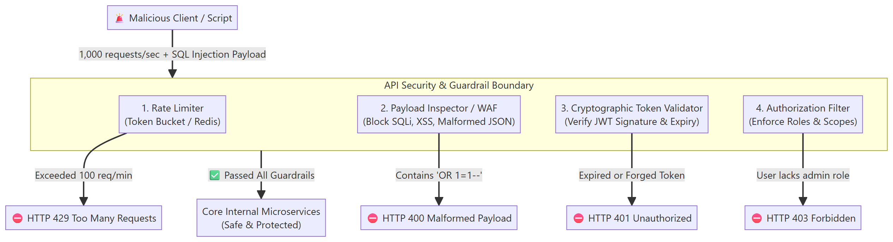

---

#### Capability 6: Asynchronous Event Dispatching & Webhooks (Reverse APIs)

* **The Problem Without an API**:
  Some operations take minutes or hours to finish (e.g. rendering a 4K video, processing a batch of 50,000 payroll payments, or waiting for a user to sign a legal contract). If a client app held an HTTP connection open waiting for the job to complete, the network connection would time out (`504 Gateway Timeout`) and server thread pools would become completely exhausted.
* **How the API Solves This**:
  The API decouples the request from execution:

  1. The client triggers the job via `POST /v1/video/render`.
  2. The server responds immediately with `HTTP 202 Accepted` and a unique `job_id`.
  3. When the background worker finally finishes rendering the video 10 minutes later, the API server **reverses the role**: it acts as a client and sends an asynchronous HTTP POST request (**a Webhook**) directly to a server URL provided by the client.

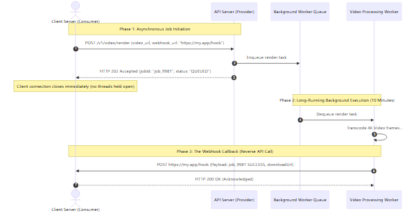

---

### 1.3. Anatomy of an API Request and Response Cycle

Every standard API interaction operates as an exchange between a **Client (Consumer)** and a **Server (Provider)**:

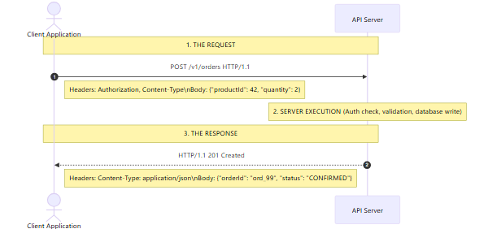

---

#### The 5 Components of an API Request:

1. **Endpoint (URI / URL)**: The network address pointing to the resource.
   - Example: `https://api.store.com/v1/customers/8842/orders`
2. **HTTP Method (Verb)**: The operational intent.
   - `GET`: Read / retrieve data.
   - `POST`: Create a new resource or trigger a process.
   - `PUT`: Completely replace an existing resource.
   - `PATCH`: Partially modify an existing resource.
   - `DELETE`: Remove a resource.
3. **Headers**: Metadata describing the payload and calling context.
   - `Authorization: Bearer eyJhbGciOi...`: Proof of identity.
   - `Content-Type: application/json`: Declares the format of the request body.
   - `Accept: application/json`: Tells the server what format the client understands.
   - `Idempotency-Key: 9b1deb4d...`: Prevents duplicate executions on network retries.
4. **Parameters**:
   - **Path Parameters**: Identify specific resource instances (`/users/{userId}`).
   - **Query Parameters**: Filter, sort, or paginate results (`/orders?status=shipped&limit=20`).
5. **Request Body (Payload)**: The data submitted to the server (serialized in JSON, XML, or Protobuf).

#### The 3 Components of an API Response:

1. **HTTP Status Code**: A standardized 3-digit number conveying the outcome:
   - `2xx (Success)`: Everything worked (`200 OK`, `201 Created`, `204 No Content`).
   - `3xx (Redirection)`: Client must take additional action (`301 Moved Permanently`, `304 Not Modified`).
   - `4xx (Client Error)`: The client sent an invalid request (`400 Bad Request`, `401 Unauthorized`, `403 Forbidden`, `404 Not Found`, `429 Too Many Requests`).
   - `5xx (Server Error)`: The backend crashed or timed out (`500 Internal Server Error`, `502 Bad Gateway`, `503 Service Unavailable`, `504 Gateway Timeout`).
2. **Response Headers**: Metadata from the server (`Content-Type`, `Cache-Control`, `RateLimit-Remaining`).
3. **Response Body**: The requested data or structured error details.

### 1.4. Categorization by Access Scope (Private, Partner, Public, Composite)

APIs are categorized by who is permitted to access them and where they reside in the network topology:

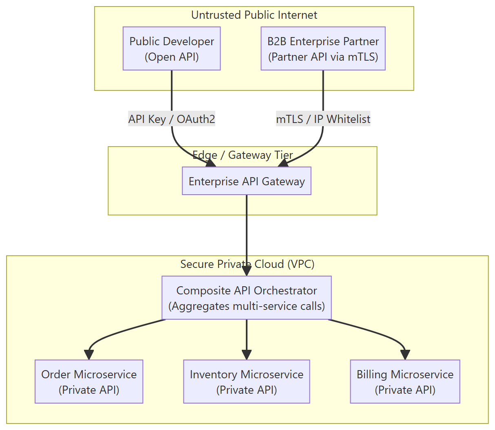

---

1. **Private / Internal APIs**:
   - Reside strictly inside private Virtual Private Clouds (VPCs). Never exposed to the public internet. Used for microservice-to-microservice communication.
2. **Partner APIs**:
   - Selectively exposed to trusted B2B enterprise partners. Require specialized onboarding, mutual TLS (mTLS) authentication, and static IP whitelisting.
3. **Public / Open APIs**:
   - Published for external software developers worldwide. Feature self-service registration, interactive documentation (Swagger UI), and monetized rate tiers.
4. **Composite APIs**:
   - Specialized orchestrators that execute a sequence of multiple internal microservice calls and aggregate the results into a single payload, saving mobile clients multiple network round-trips.

### 1.5. Synchronous vs. Asynchronous Communication Topologies

APIs manage compute workloads across two distinct execution modes:

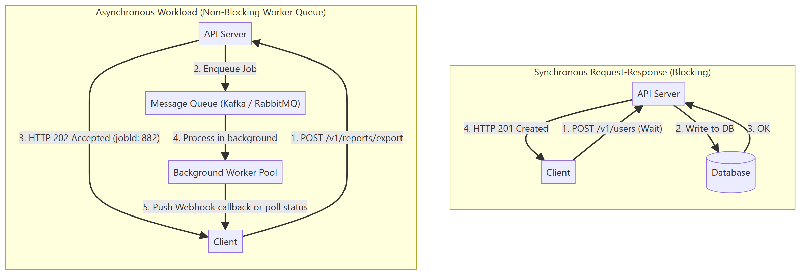

---

* **Synchronous Workload**: The client thread blocks and waits until the server completes processing and returns the response. Ideal for fast, deterministic reads and writes (< 200 milliseconds).
* **Asynchronous Workload**: For long-running operations (file imports, video transcoding, PDF generation), the API server enqueues the task in a message broker (RabbitMQ/Kafka) and returns an immediate `HTTP 202 Accepted`. This releases the client connection immediately, preventing thread starvation and gateway timeouts.

### 1.6. The Master Architectural Map: Who Talks to Whom in Modern Systems?

For a beginner stepping into backend and systems engineering, looking at modern distributed architectures can feel like walking into a massive airport with hundreds of gates, conveyor belts, security checkpoints, and control towers.

To master APIs, you must understand **who is talking to whom**, **what language (protocol) they are speaking**, and **why they are talking in the first place**.

#### 1.6.1. The Mental Model: The Modern Distributed City

Think of a modern software system as a **secure walled city**:

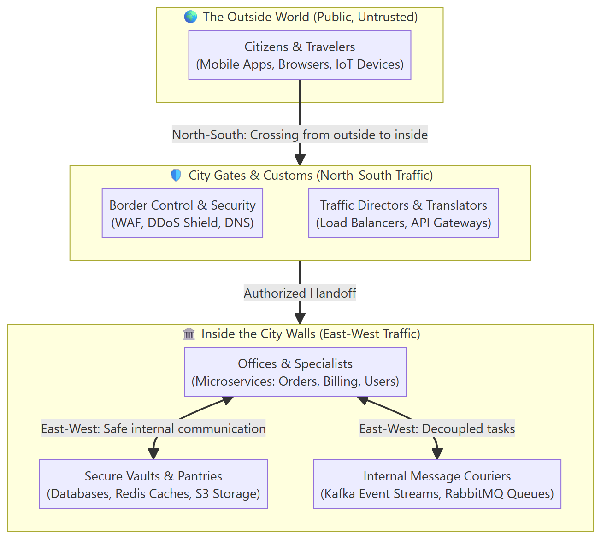

---

#### The Two Fundamental Directions of Network Traffic:

1. **North–South Traffic (Entering & Exiting the City)**:
   - **What it is**: Traffic traveling between an external client (a user on a smartphone or browser) and the backend datacenter.
   - **Characteristics**: Untrusted, travels over the public internet, uses standard public protocols (HTTPS, WebSockets), requires heavy security checks (TLS termination, DDoS shields, JWT validation).
2. **East–West Traffic (Moving Within the City)**:
   - **What it is**: Traffic traveling horizontally between servers, microservices, caches, and databases located inside the private datacenter.
   - **Characteristics**: Highly trusted, runs on private high-speed fiber networks (Virtual Private Cloud - VPC), optimized for ultra-low latency (< 2 milliseconds), and often speaks compact binary protocols (gRPC, Redis RESP, database native protocols).

#### 1.6.2. The Global Architectural Topology

Below is the complete architectural layout showing all 6 tiers of a production enterprise system:

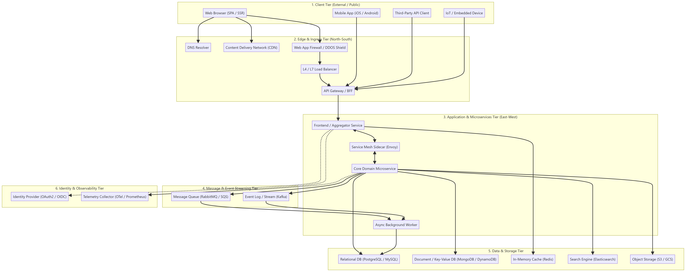

---

#### 1.6.3. Deep Dive: The 10 Software Communication Boundaries

In production software engineering, communication occurs across **ten distinct boundaries**. Below, each boundary is explained with beginner intuition, a dedicated visual diagram, and a comprehensive technical reference table.

---

##### Category 1: Client ↔ Edge & Network Ingress (North–South Ingress)

* **The Beginner Intuition**:
  When you type `https://api.example.com` on your phone, your phone has no idea which physical machine in the world hosts that API. First, it must ask the **DNS Resolver** for the IP address. Then, before reaching your server, the request passes through a **Content Delivery Network (CDN)** for fast cached images, a **Web Application Firewall (WAF)** to block hackers, and a **Load Balancer** that distributes millions of incoming connections across server clusters.

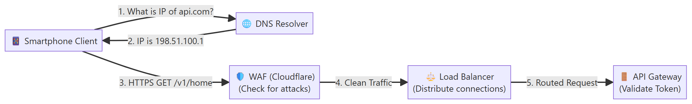

---

| Source Component                    | Target Component                                       | Purpose & Responsibility                                                                         | Protocols & Mechanisms                                | Interaction Pattern                     |
| :---------------------------------- | :----------------------------------------------------- | :----------------------------------------------------------------------------------------------- | :---------------------------------------------------- | :-------------------------------------- |
| **Client (Browser / OS)**     | **DNS Resolver**                                 | Resolves domain names (`api.example.com`) to IP addresses.                                     | DNS over UDP/TCP (Port 53), DoH (DNS over HTTPS), DoT | Request-Response                        |
| **Web Browser**               | **CDN (Content Delivery Network)**               | Fetches cached static assets (HTML, CSS, JS, images, media).                                     | HTTP/1.1, HTTP/2, HTTP/3 (QUIC) over TLS              | Request-Response                        |
| **Client (Browser / Mobile)** | **WAF / DDoS Shield (Cloudflare / AWS Shield)**  | Inspects traffic for SQLi, XSS, botnets, and rate abuse before reaching origin servers.          | HTTPS, QUIC, TLS Handshake                            | Request-Response / Filter               |
| **Client (Browser / Mobile)** | **Layer 4 Load Balancer (NLB / HAProxy / IPVS)** | Distributes raw TCP/UDP streams across reverse proxies without application inspection.           | TCP SYN/ACK, UDP, Anycast BGP routing                 | Connection Forwarding (SYN proxy / DSR) |
| **Client (Browser / Mobile)** | **Layer 7 Load Balancer / Reverse Proxy**        | Terminates TLS, handles HTTP/2 framing, compresses responses, and forwards to upstream clusters. | HTTP/1.1, HTTP/2, TLS 1.3                             | Request-Response                        |
| **Client (Browser / Mobile)** | **API Gateway / Ingress Controller**             | Authenticates tokens, verifies rate limits, and routes to backend microservices.                 | REST (JSON/HTTPS), gRPC-Web, GraphQL                  | Synchronous Request-Response            |
| **Web Browser**               | **Backend Server**                               | Real-time bi-directional messaging (chat, collaborative canvas, financial tickers).              | WebSockets (RFC 6455) via HTTP `Upgrade`            | Full-Duplex Bi-directional              |
| **Web Browser**               | **Backend Server**                               | Real-time server push for notifications, feeds, and live logs.                                   | Server-Sent Events (SSE) via `text/event-stream`    | Half-Duplex Push (Unidirectional)       |
| **Browser Peer A**            | **Browser Peer B**                               | Direct browser-to-browser media/data streaming without routing payloads through servers.         | WebRTC (SRTP/SCTP over UDP), ICE/STUN/TURN signaling  | Peer-to-Peer Streaming                  |
| **IoT / Embedded Device**     | **MQTT Broker / IoT Gateway**                    | Low-overhead telemetry reporting and device control for resource-constrained sensors.            | MQTT over TCP/WebSockets, CoAP over UDP               | PubSub / Push                           |

---

##### Category 2: Edge ↔ Application Services (Crossing the Perimeter)

* **The Beginner Intuition**:
  Once a request successfully clears the front gates (API Gateway), it enters the private network. The API Gateway decides which internal service should handle the request: should it go to the **Order Service**, the **User Service**, or a specialized **Backend-for-Frontend (BFF)** that formats the response specifically for mobile screens?

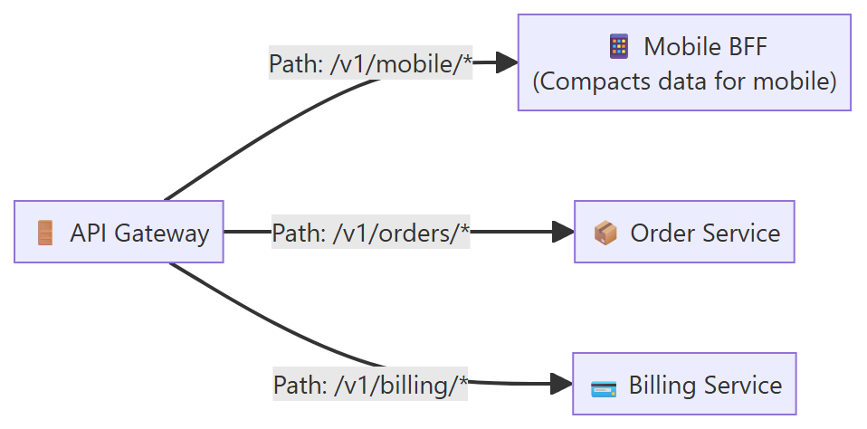

---

| Source Component                        | Target Component                      | Purpose & Responsibility                                                                              | Protocols & Mechanisms                                     | Interaction Pattern |
| :-------------------------------------- | :------------------------------------ | :---------------------------------------------------------------------------------------------------- | :--------------------------------------------------------- | :------------------ |
| **API Gateway**                   | **Backend For Frontend (BFF)**  | Routes frontend-specific requests (e.g. Mobile BFF vs. Desktop BFF) for tailored payload aggregation. | HTTP/2, gRPC over internal mTLS                            | Request-Response    |
| **API Gateway**                   | **Core Microservices**          | Dispatches authenticated client requests directly to target domain service endpoints.                 | gRPC (HTTP/2 with Protobuf), REST/HTTP                     | Request-Response    |
| **Reverse Proxy (Nginx / Envoy)** | **Monolith Application Server** | Forwards decrypted HTTP requests to backend application runtime processes.                            | HTTP/1.1 (Keep-Alive), FastCGI, uWSGI, Unix Domain Sockets | Request-Response    |

---

##### Category 3: Service ↔ Service (East–West Microservices)

* **The Beginner Intuition**:
  In a microservices architecture, a single user click requires multiple internal services to work together. When the **Order Service** needs to know if an item is in stock, it calls the **Inventory Service** directly using high-speed internal calls (**gRPC**), looking up the current IP address of the Inventory Service using a **Service Registry** (like Consul or Kubernetes CoreDNS).

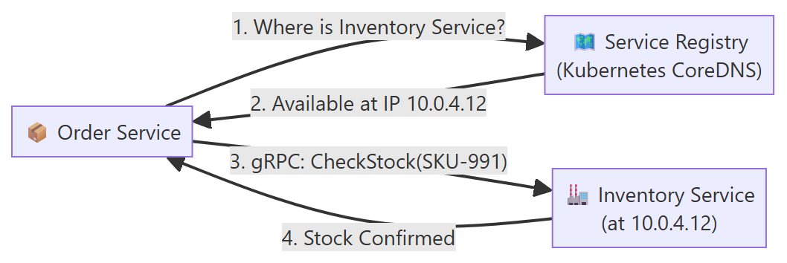

---

| Source Component         | Target Component                                           | Purpose & Responsibility                                                                              | Protocols & Mechanisms                           | Interaction Pattern          |
| :----------------------- | :--------------------------------------------------------- | :---------------------------------------------------------------------------------------------------- | :----------------------------------------------- | :--------------------------- |
| **Microservice A** | **Microservice B**                                   | Direct synchronous RPC for immediate domain operations (e.g., Order Service calls Inventory Service). | gRPC (Protobuf), REST (HTTP/JSON), Apache Thrift | Synchronous Request-Response |
| **Microservice**   | **Service Registry (Consul / Eureka / K8s CoreDNS)** | Dynamic service discovery: queries IP addresses of healthy service instances.                         | DNS SRV records, HTTP REST polling, gRPC watch   | Request-Response / Watch     |
| **Microservice A** | **Microservice B (Event-Driven)**                    | Asynchronous decoupled integration; notifying other services of internal domain state changes.        | CloudEvents over HTTP, Internal Webhooks         | Asynchronous Fire-and-Forget |

---

##### Category 4: Service ↔ Mesh Sidecar / Local Agent (Intra-Node)

* **The Beginner Intuition**:
  Imagine if every software engineer had to write code for encryption, retries, timeout management, and distributed tracing inside their microservice. It would lead to massive duplication and bugs! Instead, engineers attach a **"Sidecar" helper proxy** (like Envoy in Istio) right next to each microservice container on the same machine. The microservice just sends plain traffic to `localhost`, and the Sidecar automatically encrypts it, logs trace headers, and handles retries.

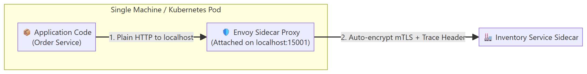

---

| Source Component                           | Target Component                                      | Purpose & Responsibility                                                                                  | Protocols & Mechanisms                                                               | Interaction Pattern          |
| :----------------------------------------- | :---------------------------------------------------- | :-------------------------------------------------------------------------------------------------------- | :----------------------------------------------------------------------------------- | :--------------------------- |
| **Application Container**            | **Service Mesh Sidecar (Envoy / Linkerd)**      | Intercepts egress traffic to transparently inject mTLS encryption, tracing headers, and circuit breakers. | Localhost loopback (`127.0.0.1`), Unix Domain Sockets (UDS), `iptables` redirect | Transparent In-line Proxying |
| **Mesh Control Plane (Istio Pilot)** | **Data Plane Sidecar (Envoy)**                  | Distributes routing tables, cluster configurations, and security policies dynamically.                    | Envoy xDS API (gRPC streaming over mTLS)                                             | Long-lived Push / Watch      |
| **Application Process**              | **Observability Daemon (OTel / Datadog Agent)** | Flushes collected metrics, logs, and distributed trace spans to a local node collector.                   | OpenTelemetry Protocol (OTLP over gRPC/HTTP), StatsD over UDP                        | Fire-and-forget Batch Push   |

---

##### Category 5: Service ↔ Data Storage & Caching (The Persistence Tier)

* **The Beginner Intuition**:
  Microservices don't remember state permanently in RAM. When they need to save or retrieve records, they speak to specialized storage engines:
  - **Relational Databases (PostgreSQL)** for ACID financial transactions.
  - **In-Memory Caches (Redis)** for sub-millisecond hot lookups.
  - **Search Engines (Elasticsearch)** for fuzzy text matching.
  - **Object Stores (AWS S3)** for storing files, images, and videos.

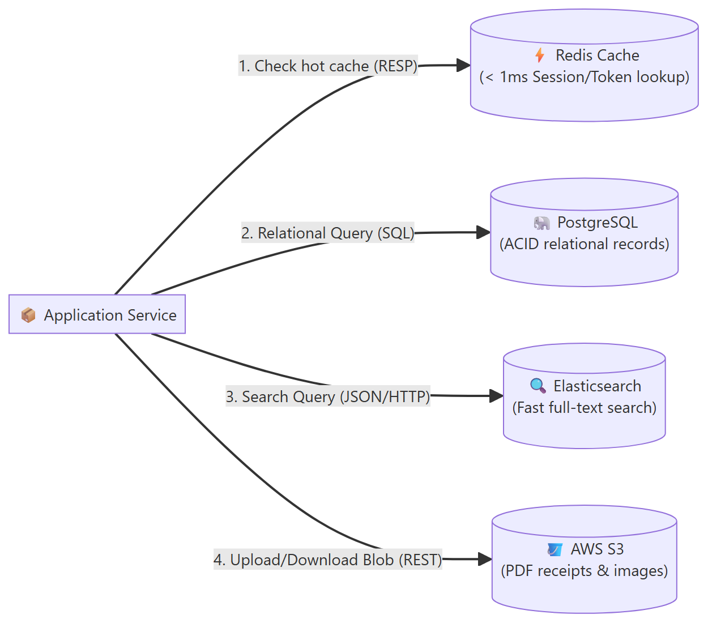

---

| Source Component              | Target Component                                        | Purpose & Responsibility                                                                         | Protocols & Mechanisms                                                                     | Interaction Pattern                   |
| :---------------------------- | :------------------------------------------------------ | :----------------------------------------------------------------------------------------------- | :----------------------------------------------------------------------------------------- | :------------------------------------ |
| **Application Service** | **Relational Database (PostgreSQL / MySQL)**      | Executes ACID transactional queries, schema joins, and data writes via connection pools.         | Database Wire Protocols (PostgreSQL FE/BE Protocol, MySQL Client/Server Protocol over TCP) | Request-Response (Pooled)             |
| **Application Service** | **NoSQL Database (MongoDB, Cassandra, DynamoDB)** | High-throughput document retrieval or partitioned key-value reads/writes.                        | MongoDB Wire Protocol, Cassandra CQL Native Protocol over TCP, AWS SigV4 over HTTPS        | Request-Response                      |
| **Application Service** | **In-Memory Cache (Redis / Memcached)**           | Low-latency sub-millisecond retrieval of hot sessions, token caches, and rate-limiting counters. | RESP (Redis Serialization Protocol over TCP), Memcached Binary Protocol                    | Synchronous Request-Response          |
| **Application Service** | **Search Engine (Elasticsearch / OpenSearch)**    | Full-text indexing, fuzzy searching, and multi-dimensional aggregations.                         | REST API (JSON over HTTP/2)                                                                | Request-Response                      |
| **Application Service** | **Object Storage (AWS S3, Google Cloud Storage)** | Uploading and downloading unstructured blobs, media assets, documents, and backups.              | REST API over HTTPS (AWS S3 REST API)                                                      | Chunked Streaming / Multi-part Upload |

---

##### Category 6: Service ↔ Asynchronous Messaging & Event Streams

* **The Beginner Intuition**:
  If every service called every other service directly, a single slow service would cause the whole company's system to grind to a halt. Instead, services use **Message Brokers** like RabbitMQ or Kafka. When an order is placed, the Order Service publishes an event: `"Order #123 Placed"`. It doesn't wait around; it goes back to serving users. Independent background workers pick up the message whenever they are ready.

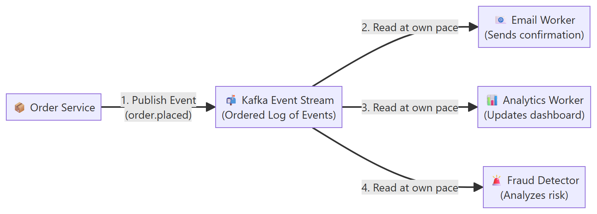

---

| Source Component                    | Target Component                                   | Purpose & Responsibility                                                                    | Protocols & Mechanisms                      | Interaction Pattern                             |
| :---------------------------------- | :------------------------------------------------- | :------------------------------------------------------------------------------------------ | :------------------------------------------ | :---------------------------------------------- |
| **Producer Service**          | **Message Queue (RabbitMQ, ActiveMQ, SQS)**  | Submits discrete transactional tasks to be executed by background workers.                  | AMQP 0-9-1, AMQP 1.0, STOMP over TCP, HTTPS | Asynchronous Push (Producer to Broker)          |
| **Message Broker (RabbitMQ)** | **Consumer Worker**                          | Pushes queued task messages to waiting worker processes as worker capacity allows.          | AMQP Push (Server to Consumer)              | Worker Push / Acknowledgment (`ACK`/`NACK`) |
| **Producer Service**          | **Event Stream (Apache Kafka, AWS Kinesis)** | Appends ordered domain events to distributed partitioned commit logs.                       | Kafka Binary Protocol over TCP              | Batched Push                                    |
| **Consumer Service / Worker** | **Event Stream (Kafka)**                     | Consumer groups continuously poll log partitions at their own pace using committed offsets. | Kafka Fetch API over TCP                    | Long-Polling (Consumer Pull)                    |
| **Publisher Service**         | **Cloud Pub/Sub (SNS / Google PubSub)**      | Broadcasts fan-out events to multiple diverse subscriber topics.                            | gRPC, REST HTTPS                            | PubSub Broadcast                                |

---

##### Category 7: Data Store ↔ Data Store (Internal Replication & Storage Clustering)

* **The Beginner Intuition**:
  What happens if the hard drive holding your database suddenly dies? To prevent data loss, database servers talk directly to other database servers behind the scenes! The **Primary Database** writes changes to an append-only log (Write-Ahead Log - WAL) and continuously streams those bytes to **Read Replicas**. In distributed databases, nodes use voting protocols (**Raft** or **Paxos**) to agree on transactions.

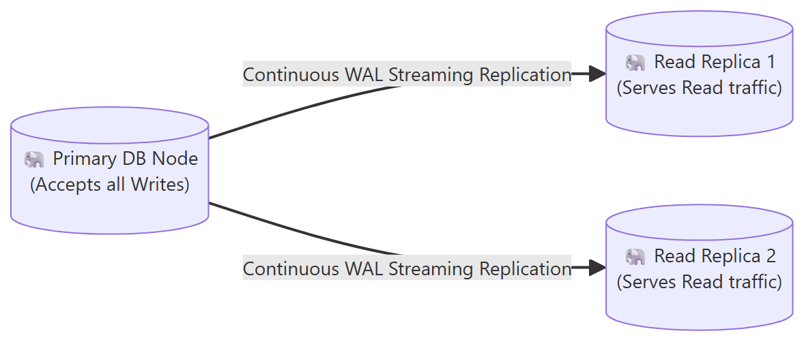

---

| Source Component                | Target Component                               | Purpose & Responsibility                                                                             | Protocols & Mechanisms                                               | Interaction Pattern                |
| :------------------------------ | :--------------------------------------------- | :--------------------------------------------------------------------------------------------------- | :------------------------------------------------------------------- | :--------------------------------- |
| **Primary Database Node** | **Read-Replica Database Node**           | Synchronizes data mutations via write-ahead log (WAL) shipping or binary log streaming.              | PostgreSQL Physical/Logical Streaming Replication, MySQL Binlog dump | Asynchronous or Synchronous Stream |
| **Database Node A**       | **Database Node B (Distributed DB)**     | Elects cluster leaders and agrees on transaction commits in distributed systems (CockroachDB, etcd). | Raft Consensus Protocol, Paxos over gRPC/TCP                         | Consensus Heartbeat & Quorum Vote  |
| **Database Node A**       | **Database Node B (Dynamo-style DB)**    | Detects node failures and exchanges cluster membership state (Cassandra, ScyllaDB).                  | Gossip Protocol over UDP/TCP                                         | Epidemic Gossip Push/Pull          |
| **Primary Cache**         | **Replica Cache (Redis Master-Replica)** | Full initial state synchronization via RDB snapshot followed by continuous command streaming.        | Redis Replication Protocol over TCP                                  | Snapshot Transfer + Command Stream |

---

##### Category 8: Intra-Host & Low-Level Process Communication (Same Machine)

* **The Beginner Intuition**:
  Not all communication goes over a Wi-Fi or Ethernet cable. When your Java or Go program runs on a Linux server, it must talk to the **Operating System Kernel** to read files or open network sockets. It does this through **System Calls (`syscall`)**. Multiple programs running on the same server can exchange data at lightning speed using **Unix Domain Sockets** or **Shared Memory** without ever touching the network card!

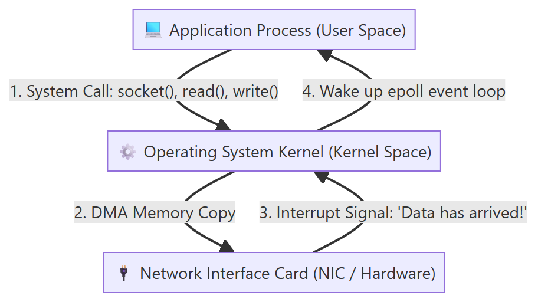

---

| Source Component             | Target Component                       | Purpose & Responsibility                                                                                  | Protocols & Mechanisms                                                                                  | Interaction Pattern                      |
| :--------------------------- | :------------------------------------- | :-------------------------------------------------------------------------------------------------------- | :------------------------------------------------------------------------------------------------------ | :--------------------------------------- |
| **User Space Process** | **Operating System Kernel**      | Requests hardware resources, network I/O, disk writes, and process scheduling.                            | System Calls (`syscall`: `epoll_wait`, `read`, `write`, `socket`) via CPU software interrupts | Synchronous Trap to Kernel Space         |
| **Process A**          | **Process B (Local IPC)**        | High-speed local message passing without network stack overhead.                                          | Unix Domain Sockets (UDS), Linux Named Pipes (FIFOs)                                                    | Streaming Byte Buffer                    |
| **Process A**          | **Process B (Zero-Copy IPC)**    | Ultra-low latency data exchange by mapping identical physical RAM pages into both virtual address spaces. | Shared Memory (`shm_open`, `mmap`) with POSIX Semaphores / Mutexes                                  | Direct Memory Read/Write (Zero-Copy)     |
| **Parent Process**     | **Child Process**                | Process lifecycle control, graceful reload, and termination signalling.                                   | POSIX Signals (`SIGTERM`, `SIGKILL`, `SIGHUP`, `SIGCHLD`)                                       | Asynchronous Hardware Interrupt / Signal |
| **Thread A**           | **Thread B (Same Process)**      | Inter-thread coordination within an application runtime.                                                  | Shared Process Heap, Mutexes, Locks, Condition Variables, Go Channels                                   | Memory Synchronization / Memory Barrier  |
| **CPU / Kernel**       | **Network Interface Card (NIC)** | Offloads packet processing and moves packet buffers between hardware and RAM.                             | DMA (Direct Memory Access), Ring Buffers, PCIe Bus, eBPF / XDP                                          | Kernel Interrupt / Polling Driver (NAPI) |

---

##### Category 9: Security, Identity & Governance Infrastructure

* **The Beginner Intuition**:
  How does the API Gateway know that a user's login token is real without asking the main database on every single click? The system uses an **Identity Provider** (like Auth0, Okta, or Keycloak). The Identity Provider cryptographically signs a JSON Web Token (JWT). The API server fetches the public verification keys (**JWKS**) once, caches them, and verifies tokens instantly in memory!

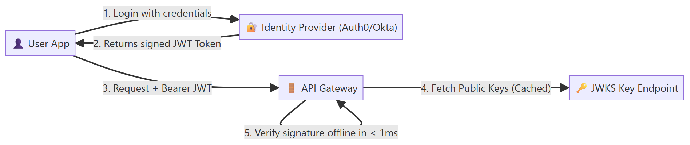

---

| Source Component                | Target Component                                          | Purpose & Responsibility                                                                     | Protocols & Mechanisms                                                         | Interaction Pattern          |
| :------------------------------ | :-------------------------------------------------------- | :------------------------------------------------------------------------------------------- | :----------------------------------------------------------------------------- | :--------------------------- |
| **Client / Service**      | **Identity Provider (Auth0, Okta, Keycloak)**       | Authenticates user identity and obtains signed JWT access and ID tokens.                     | OAuth 2.0 Authorization Code Grant with PKCE, OpenID Connect (OIDC) over HTTPS | Request-Response             |
| **API Gateway / Service** | **JWKS Endpoint (Identity Provider)**               | Fetches public cryptographic keys to verify incoming JWT signatures offline.                 | HTTPS GET (`/.well-known/jwks.json`)                                         | Periodic Polling with Cache  |
| **Application Service**   | **Secret Vault (HashiCorp Vault, AWS Secrets)**     | Dynamically retrieves database credentials, private keys, and encryption secrets at startup. | HTTPS REST API, gRPC over mTLS with IAM authentication                         | Request-Response             |
| **API Gateway / Service** | **Policy Decision Point (Open Policy Agent - OPA)** | Verifies fine-grained authorization (RBAC / ABAC) before executing an action.                | OPA REST API / embedded WebAssembly (Wasm)                                     | Synchronous Request-Response |

---

##### Category 10: Cross-Organization & External Integrations

* **The Beginner Intuition**:
  No enterprise builds everything from scratch. Modern applications connect to external software vendors over the public internet:
  - You call **Stripe's API** to process credit cards.
  - You call **Twilio's API** to send SMS text messages.
  - When a customer pays an invoice on Stripe, Stripe calls your **Webhook endpoint** to tell your backend that the payment succeeded.

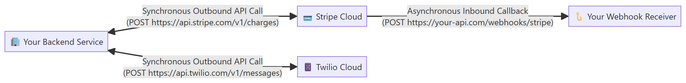

---

| Source Component                        | Target Component                                        | Purpose & Responsibility                                                                   | Protocols & Mechanisms                                         | Interaction Pattern                   |
| :-------------------------------------- | :------------------------------------------------------ | :----------------------------------------------------------------------------------------- | :------------------------------------------------------------- | :------------------------------------ |
| **Internal Backend Service**      | **Third-Party SaaS API (Stripe, Twilio, OpenAI)** | Processes credit card payments, sends SMS notifications, or generates LLM completions.     | REST / JSON over HTTPS, Server-Sent Events                     | Synchronous Request-Response / Stream |
| **Third-Party Provider (Stripe)** | **Internal Webhook Consumer**                     | Notifies your system asynchronously when an external event completes (e.g., invoice paid). | Webhooks (HTTPS POST with HMAC SHA-256 signature verification) | Asynchronous Callback Push            |
| **Internal Email Worker**         | **External Mail Server (SMTP Relay / SendGrid)**  | Transmits transactional emails to user mailboxes.                                          | SMTP over TLS (Port 587/465), SendGrid Web API                 | Push / Relay                          |

#### 1.6.4. The Complete End-to-End Story: The 3-Second Life of an "Order Coffee" Request

To tie all 10 communication boundaries together into one clear mental picture, trace what happens under the hood when a user taps **"Order Caramel Macchiato"** on a mobile app:

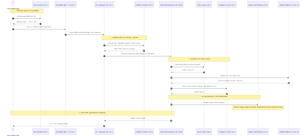

---

By understanding this 5-stage lifecycle, a beginner can see how **every single component** in the 10 categories has a specific, vital role in making modern applications fast, secure, and resilient.

## 2. Part 2: Network Transport & Low-Level Communication Protocols

### 2.1. Backend Communication Design Patterns (Hussein Nasser Model)

> **Source**: Enriched with core networking, socket models, and communication design patterns from *Fundamentals of Backend Engineering* by Hussein Nasser (Udemy).

In backend engineering, choosing how two software components communicate across the network dictates the system's latency, scalability, throughput, and failure resilience.

Below, all **nine canonical communication patterns** are analyzed in depth, covering first-principles intuition, low-level mechanics, wire protocol headers, failure modes, and architectural diagrams.

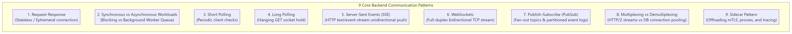

---

#### 2.1.1. Pattern 1: Request-Response (The Foundation)

* **Mental Model & Real-World Analogy**:
  The classic walkie-talkie conversation: you press the button, speak your message, and say "Over!". You wait silently until the other party speaks their response.
* **How It Works Under the Hood**:

  1. The client prepares a request: it creates an in-memory object and **serializes** it into a wire format (JSON, XML, or Protobuf).
  2. The client transmits the bytes over a transport connection (typically TCP or UDP).
  3. **The Boundary Problem**: The underlying transport layer (TCP) has **no concept of a message or request**—TCP is merely an infinite, continuous stream of raw bytes. To know where a request begins and ends, the application protocol must define an explicit boundary:
     - In HTTP/1.1: Request headers end with a double carriage-return newline (`\r\n\r\n`), and the body boundary is defined by the `Content-Length: <bytes>` header or `Transfer-Encoding: chunked`.
     - In HTTP/2: Data is split into discrete binary **Frames** with length prefixes.
  4. The server receives the raw byte stream from the OS kernel socket buffer, **parses** the boundaries, and **deserializes** the payload into a server-side object.
  5. The server executes business logic (e.g. database query, calculation).
  6. The server serializes the result and writes the response bytes back to the socket.
  7. The client parses and deserializes the response.

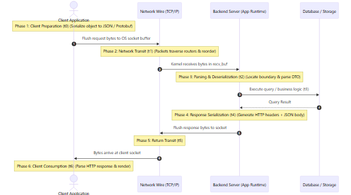

---

* **The Resumable Chunked Upload Pattern**:
  In standard request-response, uploading a 5-gigabyte file in a single request is fragile: if the mobile network drops at 99%, the entire transfer fails and must start from byte 0.

  - *The Pro Solution*: Chunk the file into numbered slices (e.g. 5 MB each). The client sends each chunk in a separate request (`POST /v1/files/upload?chunk=3&total=1000`). If chunk 3 fails, only chunk 3 is retried, enabling robust, resumable uploads.
* **Where Request-Response Falls Short**:
  Request-response requires the client to initiate every interaction. The server cannot proactively send data when an event happens. For live notifications, chat, or long-running tasks, pure request-response becomes inefficient.

#### 2.1.2. Pattern 2: Synchronous vs. Asynchronous Workloads

* **Mental Model & Real-World Analogy**:
  - **Synchronous**: Standing at the coffee counter waiting for the barista to brew your espresso. You cannot leave or do anything else until the cup is handed to you.
  - **Asynchronous**: Ordering a large pizza. The cashier hands you a receipt with an order number and says: "We will call your number when it is baked." You sit down, read a book, or check your phone while the pizza cooks in the background.

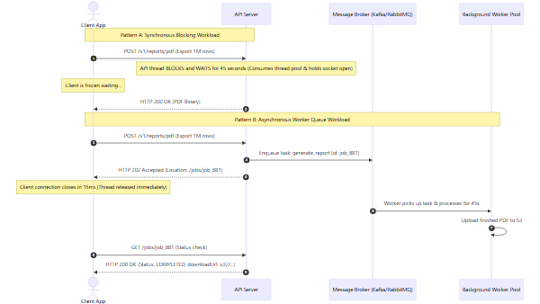

---

* **The Synchronous Thread Starvation Trap**:
  If an API server uses synchronous blocking workers (such as Tomcat with 200 threads) and handles requests that take 30 seconds to finish, a sudden influx of 250 concurrent requests will completely consume all 200 threads. Any new incoming request—even a simple 5ms health check (`GET /health`)—will be queued and eventually rejected with **`HTTP 504 Gateway Timeout`** or **`HTTP 503 Service Unavailable`**.
* **The Production Rule**:

  - Tasks taking **< 200 milliseconds**: Synchronous request-response is optimal.
  - Tasks taking **> 1 second** (video transcoding, report generation, bulk emails): Must be offloaded to an asynchronous message broker with an immediate **`HTTP 202 Accepted`** response.

#### 2.1.3. Pattern 3: Short Polling (Periodic Inquiries)

* **Mental Model & Real-World Analogy**:
  A child in the backseat of a car asking: *"Are we there yet? ... Are we there yet? ... Are we there yet?"* every 5 seconds. Most of the answers are *"No"*, wasting energy and breath.
* **How It Works Under the Hood**:
  The client establishes an internal timer (e.g. `setInterval(checkStatus, 2000)`). Every 2 seconds, the client sends an HTTP GET request to the server:

  1. Request 1 (T = 0s): `GET /v1/notifications` → Server queries database → Returns `[]` (empty array).
  2. Request 2 (T = 2s): `GET /v1/notifications` → Server queries database → Returns `[]`.
  3. Request 3 (T = 4s): `GET /v1/notifications` → Server queries database → Returns `[{"id": 1, "text": "New message"}]`.

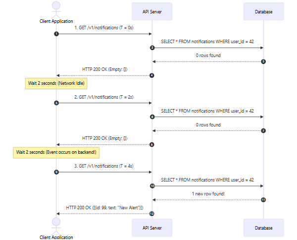

---

* **Why Short Polling Fails at Scale**:
  1. **Massive Handshake Waste**: In HTTP/1.1 without keep-alive, each poll opens a new TCP connection (3-way handshake) and TLS negotiation (1-2 RTT), consuming substantial CPU on load balancers.
  2. **Database Query Stampede**: If 100,000 active mobile users poll every 2 seconds, the backend database is hammered with **50,000 queries per second**, 99.9% of which return zero rows.
  3. **High Latency**: If an event occurs 10 milliseconds after Request 1, the client will not see it until Request 2 fires (up to a 2-second delay).

#### 2.1.4. Pattern 4: Long Polling (The Hanging GET)

* **Mental Model & Real-World Analogy**:
  Calling a busy restaurant to see if a table is ready. Instead of hanging up and calling back every minute, the host says: *"Stay on the line. Don't hang up. As soon as a table opens, I'll speak into the receiver."*
* **How It Works Under the Hood**:

  1. Client sends an HTTP request: `GET /v1/notifications`.
  2. The server receives the request and checks for new data:
     - If data is available immediately: The server responds with `HTTP 200 OK`.
     - If **no data** is available: The server **does not return an empty response**. Instead, it **suspends the request and holds the TCP socket open**.
  3. The server sets an internal timeout timer (typically 30 to 60 seconds).
  4. If an event occurs while the socket is held, the server immediately flushes the response payload down the open connection.
  5. If the timeout expires before any event occurs, the server responds with an empty `HTTP 204 No Content` or `HTTP 200 OK (empty)`.
  6. In both cases, as soon as the client receives the response, it **immediately opens another long-polling request**, repeating the cycle.

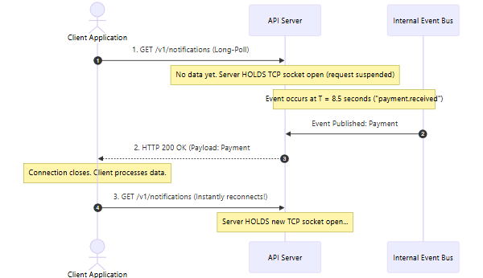

---

* **The Browser 6-Connection Limit Trap**:
  Under HTTP/1.1, web browsers enforce a maximum of **6 concurrent TCP connections per domain**. If a user opens 6 browser tabs of your web app and each tab opens a long-polling connection, all 6 available sockets for that domain become occupied. Any subsequent standard API call (`fetch('/v1/user')` or `POST /checkout`) is put in a **"Stalled" state** by the browser, completely freezing the web application.

#### 2.1.5. Pattern 5: Server-Sent Events (SSE - Unidirectional HTTP Push)

* **Mental Model & Real-World Analogy**:
  A stock ticker tape or subscribing to a live radio station. Once you tune in, news and stock prices flow continuously in one direction from the studio to your device. You cannot use the radio to broadcast back to the studio.
* **How It Works Under the Hood**:

  1. The client opens a standard HTTP connection with the header `Accept: text/event-stream`.
  2. The server responds with `HTTP 200 OK` and:

     ```http
     Content-Type: text/event-stream
     Cache-Control: no-cache
     Connection: keep-alive
     ```
  3. The server **never closes the HTTP response body**. Instead, it keeps the TCP socket open and writes structured text chunks down the wire whenever an event occurs.
  4. Each event adheres to the standardized W3C SSE format:

     ```http
     id: 8842
     event: stockTick
     data: {"symbol": "GOOG", "price": 178.50}

     ```

     *(Note: Every event chunk must end with a double newline `\n\n`)*.

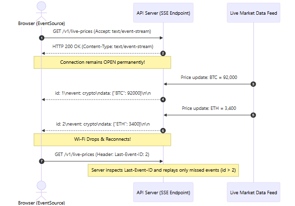

---

* **Why Engineers Love SSE**:
  1. **Zero Custom Handshake**: It is pure HTTP. Works seamlessly through enterprise firewalls, reverse proxies, and load balancers.
  2. **Native Browser Reconnection**: Browsers feature a built-in `EventSource` JavaScript API that automatically reconnects if the network drops, transmitting the `Last-Event-ID` header so the server can replay missed events.
  3. **HTTP/2 Multiplexing Superpower**: Unlike long polling, over HTTP/2, an SSE stream consumes only **one logical stream** over an existing shared TCP connection, completely immune to the 6-connection limit.

#### 2.1.6. Pattern 6: WebSockets (Full-Duplex Bidirectional Streams)

* **Mental Model & Real-World Analogy**:
  A private, dedicated telephone line. Once the call is connected, both people can speak, listen, and interrupt each other simultaneously in real time.
* **How It Works Under the Hood**:

  1. **The HTTP Upgrade Handshake**: The connection begins as a standard HTTP/1.1 GET request:
     ```http
     GET /chat HTTP/1.1
     Host: server.example.com
     Upgrade: websocket
     Connection: Upgrade
     Sec-WebSocket-Key: dGhlIHNhbXBsZSBub25jZQ==
     Sec-WebSocket-Version: 13
     ```
  2. **The Protocol Switch**: If the server supports WebSockets, it calculates a cryptographic hash of the `Sec-WebSocket-Key` and responds with:
     ```http
     HTTP/1.1 101 Switching Protocols
     Upgrade: websocket
     Connection: Upgrade
     Sec-WebSocket-Accept: s3pPLMBiTxaQ9kYGzzhZRbK+xOo=
     ```
  3. **The Raw TCP Frame Stream**: The HTTP parser is completely detached from the socket. The underlying TCP socket remains open indefinitely in **full-duplex mode**.
  4. Both client and server can transmit binary or UTF-8 text frames at any millisecond with **only 2 to 10 bytes of framing overhead** per message (compared to 500–1,000 bytes of headers on every HTTP request).

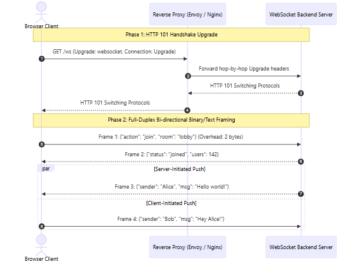

---

* **The Stateful Server Clustering Challenge**:
  Because WebSockets maintain persistent, stateful TCP sockets in the server's local RAM:
  - If User A connects to Server 1, and User B connects to Server 2, Server 1 cannot deliver User A's message to User B directly.
  - **The Solution**: All WebSocket backend servers must be connected to a shared **Redis Pub/Sub** or Kafka cluster. When Server 1 receives a message, it publishes it to Redis, which broadcasts it to Server 2 to reach User B.

#### 2.1.7. Pattern 7: Publish-Subscribe (PubSub & Event Streaming)

* **Mental Model & Real-World Analogy**:
  A major newspaper publisher. The printing press prints 500,000 copies of the daily paper. The journalists have no idea who the subscribers are, where they live, or what time they wake up to read the paper.
* **How It Works Under the Hood**:

  1. **Producers (Publishers)** emit messages to a central **Message Broker** (e.g. Apache Kafka, RabbitMQ, Google Cloud Pub/Sub) targeted at a specific **Topic** (e.g. `orders.v1.created`).
  2. The Producer does **not wait** for consumer services to process the event; once the broker acknowledges receipt, the producer moves on.
  3. **Consumers (Subscribers)** register interest in specific topics.
  4. The Broker handles **Fan-Out**: a single published event is delivered to multiple independent consumer services simultaneously.

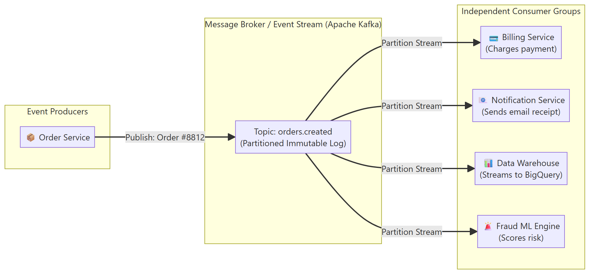

---

* **Push vs. Pull Delivery**:
  - **RabbitMQ (Broker Push)**: The broker actively pushes queued messages to connected worker sockets until the worker's prefetch limit is reached.
  - **Kafka (Consumer Pull)**: Events are appended to an immutable disk log. Consumers continuously **poll** the log at their own pace, tracking their progress using committed numeric offsets. If the Notification Service crashes for an hour, it simply resumes reading from its last offset without losing any data!

#### 2.1.8. Pattern 8: Multiplexing vs. Demultiplexing

* **Mental Model & Real-World Analogy**:
  - **Multiplexing**: An HOV carpool lane on a highway. Instead of 4 people driving 4 separate cars (occupying 4 lanes of road space), all 4 share 1 car over 1 lane.
  - **Demultiplexing**: A busy post office where hundreds of letters arrive in one mail truck, and the sorting room distributes them into 50 separate post office boxes.

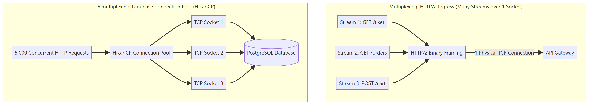

---

* **Multiplexing (Frontend Ingress)**:
  In HTTP/1.1, fetching 20 images required opening 20 separate TCP connections or queueing them sequentially. In HTTP/2, the client splits requests into discrete binary frames marked with a **Stream ID**. All streams travel interleaved across **a single physical TCP connection**, saving memory, CPU handshakes, and port allocation.
* **Demultiplexing (Backend Database Connection Pools)**:
  Because relational databases (PostgreSQL, MySQL) execute queries synchronously over individual TCP connections (one query per socket at a time), a backend cannot send 5,000 queries over one database socket simultaneously. Instead, backends use a **Connection Pool** (like HikariCP) that keeps a fixed pool (e.g. 50 warm connections) open, taking concurrent incoming API requests and **demultiplexing** them across the available pool sockets.

#### 2.1.9. Pattern 9: The Sidecar Pattern (Decoupled Infrastructure Proxy)

* **Mental Model & Real-World Analogy**:
  A high-ranking diplomat traveling with a professional bodyguard and translator. The diplomat focuses entirely on negotiating foreign policy, while the bodyguard handles airport security, identity verification, armored transportation, and translation transparently.
* **How It Works Under the Hood**:
  In modern cloud-native architectures (Kubernetes, Service Mesh), cross-cutting networking concerns (mTLS mutual authentication, distributed tracing, retries, circuit breaking, rate limiting) are completely removed from application business logic.

  - A dedicated proxy container (e.g. **Envoy**) is deployed in the exact same Kubernetes Pod or virtual machine alongside the application container, sharing the same `localhost` loopback interface.
  - Outbound traffic: When the application makes an HTTP call to another microservice, Linux `iptables` rules silently intercept the packets and redirect them to `localhost:15001` (the Envoy sidecar).
  - The sidecar terminates mTLS, injects W3C `traceparent` headers, applies circuit-breaker thresholds, encrypts the connection, and transmits it over the wire to the destination sidecar.

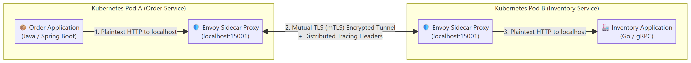

---

#### 2.1.10. Master Communication Patterns Decision Matrix

| Pattern                              | Underlying Transport                   | Duplex Direction                       | Connection Lifecycle                      | Server Resource Overhead                                | Typical Latency                         | Best Use Case                                                                     |
| :----------------------------------- | :------------------------------------- | :------------------------------------- | :---------------------------------------- | :------------------------------------------------------ | :-------------------------------------- | :-------------------------------------------------------------------------------- |
| **Request-Response**           | HTTP/1.1, HTTP/2, HTTP/3               | Half-Duplex (Pull)                     | Ephemeral / Keep-Alive                    | Low (Stateless servers)                                 | 20–100ms                               | Standard CRUD REST APIs, database queries, file downloads.                        |
| **Async Worker Queue**         | HTTP + Message Broker (Kafka/RabbitMQ) | Decoupled Push/Pull                    | Ephemeral HTTP + Long-lived broker worker | Low on API servers; high buffer capacity in broker      | Asynchronous (seconds to minutes)       | Long-running tasks, video encoding, financial settlements, batch exports.         |
| **Short Polling**              | Standard HTTP                          | Half-Duplex (Pull)                     | Repeated ephemeral connections            | **Extremely High** (Massive redundant handshakes) | High (Bounded by poll interval T)       | Quick prototypes, status checks with very low user concurrency.                   |
| **Long Polling**               | Standard HTTP                          | Half-Duplex (Pull hold)                | Held TCP socket per event                 | Moderate (Sockets held open in kernel memory)           | Low (Instant delivery on event)         | Real-time notifications when WebSockets/SSE are blocked by corporate proxies.     |
| **Server-Sent Events (SSE)**   | HTTP (`text/event-stream`)           | Unidirectional (Server Push)           | Single persistent HTTP connection         | Low (Natively multiplexed over HTTP/2)                  | **Sub-millisecond**               | Stock ticker feeds, AI streaming tokens (ChatGPT LLM responses), live news feeds. |
| **WebSockets**                 | TCP (Upgraded from HTTP 101)           | **Full-Duplex** (Bi-directional) | Persistent long-lived TCP socket          | Moderate to High (Stateful memory tracking in RAM)      | **Sub-millisecond**               | Multiplayer gaming, live interactive chat, collaborative whiteboards (Figma).     |
| **Publish-Subscribe (PubSub)** | TCP / AMQP / Kafka Protocol            | Decoupled Fan-Out                      | Persistent cluster connections            | Scales horizontally via topic partitions                | Low (< 5ms)                             | Inter-microservice event notifications, audit logging, data pipelines.            |
| **Multiplexing (HTTP/2)**      | TCP (Binary Framing)                   | Multiple Streams over 1 Socket         | Single physical TCP connection            | Very Low (Consolidates connection state)                | Low (Zero handshake latency per stream) | Modern web applications loading 50+ API assets simultaneously.                    |
| **Sidecar Pattern**            | Localhost / UDS / mTLS                 | Intercepted in-line proxy              | Local loopback + inter-mesh mTLS          | Moderate (Small memory footprint per sidecar)           | Sub-millisecond local hop               | Enterprise microservices, zero-trust mTLS encryption, service mesh observability. |

### 2.2. The Browser 6-Connection Limit Trap & HTTP/1.1 Stalling

In HTTP/1.1, modern browsers (Chrome, Firefox, Safari) enforce a strict limit of **maximum 6 concurrent TCP connections per origin (domain)**:

* If a web application opens long-polling connections or SSE streams across multiple browser tabs, all 6 sockets become occupied.
* Any subsequent user action triggering standard API requests (`fetch('/api/v1/user')` or `axios.post('/checkout')`) will enter a **"Stalled" state** in the browser network waterfall, completely freezing the user interface until a held socket closes.
* **Remediation**: Migrate to **HTTP/2** (which multiplexes hundreds of logical streams over a single physical TCP socket, eliminating the 6-connection barrier) or use domain sharding.

### 2.3. Stateful vs. Stateless API Backends

* **Stateless Backend**: Every API request contains all credentials and contextual state required for execution (e.g. self-contained JWT token).
  - *Advantage*: Any server instance behind a round-robin load balancer can serve any request; effortless horizontal autoscaling.
* **Stateful Backend**: Server stores session state in local memory; clients must be routed to the exact same server via **Sticky Sessions (Session Affinity)** on the load balancer.
  - *Disadvantage*: If Server A crashes, all connected users lose their active session; uneven traffic distribution creates hotspot servers.

### 2.4. Transport Protocol Evolution: HTTP/1.1 vs. HTTP/2 vs. HTTP/3 (QUIC)

Modern API performance is bounded by the underlying transport protocol:

| Metric / Feature                      | HTTP/1.1 (1997)                                  | HTTP/2 (2015)                                                 | HTTP/3 QUIC (2022)                                                                           |
| :------------------------------------ | :----------------------------------------------- | :------------------------------------------------------------ | :------------------------------------------------------------------------------------------- |
| **Transport Layer**             | TCP                                              | TCP                                                           | UDP (via QUIC)                                                                               |
| **Data Framing**                | Textual (ASCII lines)                            | Binary Framing (Frames & Streams)                             | Binary Framing (QUIC Streams)                                                                |
| **Connection Model**            | 1 request per TCP socket (or pipelining)         | Multiplexed (Multiple streams over 1 TCP socket)              | Multiplexed (Multiple independent streams over UDP)                                          |
| **Head-of-Line (HoL) Blocking** | Severe at application level                      | Solved at application layer, but persists at TCP packet level | **Completely Eliminated** (Packet loss on 1 stream does not stall other streams)       |
| **Connection Handshake**        | TCP handshake + TLS handshake (2-3 RTT)          | TCP + TLS 1.3 (1-2 RTT)                                       | QUIC Handshake (0-RTT or 1-RTT connection resumption)                                        |
| **Header Compression**          | None (Redundant headers sent per request)        | HPACK (Indexed table + Huffman coding)                        | QPACK (Optimized for out-of-order UDP delivery)                                              |
| **Connection Migration**        | Bound to IP + Port (Fails on Wi-Fi to 5G switch) | Bound to IP + Port (Fails on network switch)                  | **Connection ID (CID)**: Seamless migration across Wi-Fi/Cellular without reconnecting |

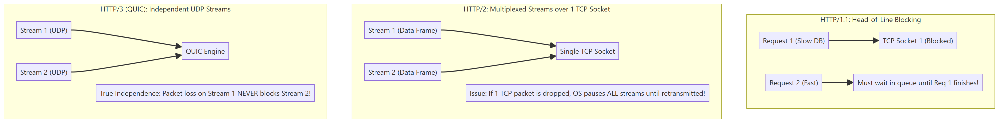

---

### 2.5. Low-Level TCP Mechanics & The 200ms Latency Trap (Nagle's Algorithm)

> **Source**: Hussein Nasser, *Fundamentals of Backend Engineering*, Section 3 ("Protocols") and Section 5 ("Nagle's Algorithm").

#### Nagle's Algorithm & Delayed ACK (The 200ms Latency Spike)

By default, the operating system TCP stack uses **Nagle's Algorithm** to reduce network congestion:

* If an application writes small packets to a socket (smaller than Maximum Segment Size, MSS ~1460 bytes), TCP buffers the data until previously transmitted packets are acknowledged (`ACK`), or until enough data accumulates to fill an entire MSS frame.
* Meanwhile, the receiving server uses **Delayed ACK**: it waits up to **200 milliseconds** before sending an ACK, hoping to piggyback the ACK on outbound response data.
* **The Deadly Clash**: When an API client sends a small JSON payload or request headers, Nagle buffers the packet waiting for an ACK. The server holds the ACK waiting for more data. **Result: An artificial 40ms to 200ms latency stall on every API call!**
* **Production Solution**: Every high-throughput, low-latency API backend must set the socket option **`TCP_NODELAY = 1`** (disabling Nagle's algorithm) to force immediate socket transmission.

#### Connection Pooling as Demultiplexing

Because databases (e.g. PostgreSQL, MySQL) process queries synchronously over single TCP connections, backends use a **Connection Pool** (e.g. HikariCP) to keep multiple hot TCP connections open, demultiplexing concurrent HTTP API requests across the pool.

### 2.6. The Latency Spectrum of HTTPS & 0-RTT Replay Vulnerabilities

> **Source**: Hussein Nasser, *Fundamentals of Backend Engineering*, Section 4 ("Many ways to HTTPS").

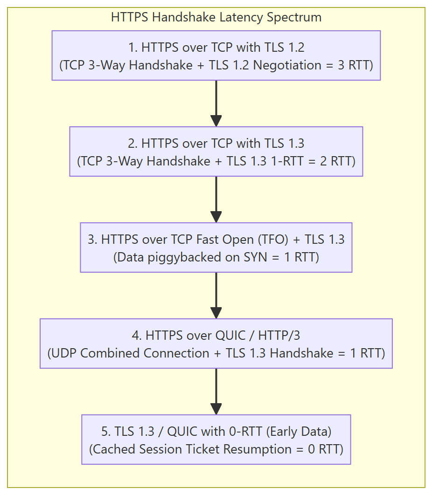

---

#### The Critical Security Dilemma: 0-RTT Early Data and Replay Attacks

In TLS 1.3 and QUIC, a returning client can transmit encrypted application data in the very first network packet (`ClientHello`) using a pre-shared session key (**0-RTT Early Data**):

* **The Vulnerability**: Because early data packets are sent before a fresh cryptographic handshake is completed, an eavesdropping adversary can capture the 0-RTT packet and **replay it** against the server multiple times.
* **The Golden Architectural Rule**:
  - ✅ **ALLOWED in 0-RTT**: Purely safe and idempotent requests (`GET /v1/products/123`, `HEAD /status`).
  - ❌ **STRICTLY FORBIDDEN in 0-RTT**: Non-idempotent state mutations (`POST /v1/payments`, `POST /v1/transfers`). Gateways must reject 0-RTT early data for state-changing endpoints with `HTTP 425 Too Early`.

## 3. Part 3: Architectural Paradigms (Choosing the Right Tool)

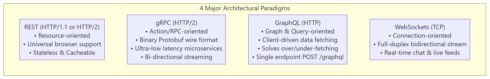

---

### 3.1. REST & Richardson Maturity Model

REST (Representational State Transfer), formalized by Roy Fielding, treats system capabilities as stateful resources manipulated through standard HTTP semantics.

* **Level 0 (The Swamp of POX)**: Single URI (`/api`), single HTTP method (`POST`) carrying RPC payloads.
* **Level 1 (Resources)**: Individual URIs for individual entities (`/orders`, `/customers/123`).
* **Level 2 (HTTP Verbs)**: Standard HTTP verbs utilized correctly (`GET` to read, `POST` to create, `PUT` to replace, `DELETE` to remove) with semantic status codes (`200 OK`, `201 Created`, `404 Not Found`).
* **Level 3 (HATEOAS - Hypermedia as the Engine of Application State)**: Responses include hypermedia link relations (`_links`) guiding client state transitions dynamically without out-of-band documentation.

```json
{
  "orderId": "ord_8842",
  "status": "PROCESSING",
  "totalAmount": 99.50,
  "_links": {
    "self": { "href": "/v1/orders/ord_8842" },
    "cancel": { "href": "/v1/orders/ord_8842/cancel", "method": "POST" },
    "customer": { "href": "/v1/customers/cust_101" }
  }
}
```

### 3.2. gRPC & Protocol Buffers (Binary High-Performance RPC)

gRPC is Google's open-source RPC framework built on HTTP/2:

* **Interface Definition Language (IDL)**: Defines strong contracts in `.proto` files compiled into strongly-typed code in Java, Go, Python, C++, etc.
* **Protobuf Serialization**: Binary encoding using Varints and field tags. Up to 7x faster serialization and 80% smaller payloads than JSON.
* **4 Streaming Modes**:
  1. Unary (Standard Request-Response)
  2. Server Streaming (Single request, stream of responses)
  3. Client Streaming (Stream of requests, single response)
  4. Bidirectional Streaming (Independent concurrent streams over 1 socket)

### 3.3. GraphQL: Schema-Driven Querying & The N+1 Problem

Designed by Meta to solve mobile network over-fetching and under-fetching:

* **Schema & Resolvers**: Strongly typed schema defining `Query`, `Mutation`, and `Subscription`.
* **Solving Over-Fetching**: A mobile app requests only `{ user { id name } }` instead of fetching a massive 50-field JSON user record.
* **The N+1 Database Problem**: A query fetching 100 orders and their authors can trigger 1 query for orders + 100 queries for authors (101 database round-trips!).
* **Mitigation**: **DataLoader batching and memoization caches**, which collect IDs within a single event loop tick and execute a single SQL query: `SELECT * FROM authors WHERE id IN (...)`.

### 3.4. WebSockets & Server-Sent Events (SSE)

* **WebSockets (`ws://`, `wss://`)**: Initial HTTP 101 Upgrade handshake transitions the TCP socket into a persistent, bidirectional binary/text frame stream. Best for multiplayer gaming, live chat, and collaborative whiteboards.
* **Server-Sent Events (SSE)**: Standard HTTP connection (`text/event-stream`) where the server pushes unidirectional event streams to the browser. Simpler than WebSockets, supports automatic reconnects natively, and works seamlessly over HTTP/2.

### 3.5. Master Synthesis Matrix: Technology Comparison

| Dimension                     | REST                                                | gRPC                                                         | GraphQL                                            | WebSockets                                                   |
| :---------------------------- | :-------------------------------------------------- | :----------------------------------------------------------- | :------------------------------------------------- | :----------------------------------------------------------- |
| **Protocol**            | HTTP/1.1 or HTTP/2                                  | Strictly HTTP/2                                              | HTTP/1.1 or HTTP/2                                 | TCP (after HTTP 101 Upgrade)                                 |
| **Payload Encoding**    | Text (JSON, XML)                                    | Binary (Protocol Buffers)                                    | Text (JSON)                                        | Text (JSON) or Raw Binary                                    |
| **Data Schema**         | Optional (OpenAPI)                                  | **Mandatory** (`.proto` IDL)                         | **Mandatory** (GraphQL Schema)               | Custom application-level                                     |
| **Client Code Gen**     | Third-party (openapi-generator)                     | **Built-in First-Class** (protoc)                      | Third-party (GraphQL Code Gen)                     | Manual implementation                                        |
| **Network Overhead**    | Moderate (Verbose JSON headers)                     | **Ultra-Low** (Binary serialization)                   | Moderate (JSON payload + query overhead)           | Minimal (2–10 byte frame headers)                           |
| **Over/Under Fetching** | Common challenge                                    | Common challenge                                             | **Completely Eliminated**                    | N/A (Streamed data)                                          |
| **Caching Support**     | **Built-in First-Class** (HTTP Cache-Control) | Custom application caching                                   | Difficult (Usually POST requests)                  | N/A (Stateful connection)                                    |
| **Streaming Support**   | Chunked transfer / SSE                              | **Native Bi-directional Streaming**                    | Subscriptions (via WS or SSE)                      | **Native Bi-directional Streaming**                    |
| **Best Use Case**       | Public APIs, CRUD web services, partner integration | High-throughput internal microservices, low-latency backends | Complex composite web applications, mobile screens | Real-time chat, multiplayer gaming, financial ticker streams |

## 4. Part 4: Contract-First Design, Data Modeling & SerDe

### 4.1. Contract-First vs. Code-First Philosophy

* **Code-First**: Developers write controller code and auto-generate Swagger docs via reflection. **Pitfall**: Leaks internal implementation details, tightly couples client to backend changes, and prevents parallel frontend-backend development.
* **Contract-First (Industry Best Practice)**: The API contract is written and reviewed in **OpenAPI 3.1** or **Protobuf IDL** *before* a single line of backend code is created. Mock servers (e.g. Prism) run immediately, allowing frontend teams to build against the contract simultaneously.

### 4.2. RESTful URI Modeling & Semantic HTTP Verbs

```
Canonical Pattern: https://api.enterprise.com/v1/{resource}/{resource-id}/{sub-resource}
```

1. **Use Plural Nouns for Resources**: `/orders` instead of `/getOrder` or `/order`.
2. **Keep URIs Free of Action Verbs**: Actions belong in the HTTP verb, not the URI path.
   - ❌ `POST /orders/createNewOrder`
   - ✅ `POST /orders`
3. **Sub-Resource Nesting (Max 2 Levels Deep)**:
   - ✅ `GET /orders/8842/items`
   - ❌ `GET /regions/us/customers/42/orders/8842/items/12/taxes` (Flatten to `GET /items/12/taxes`).

#### HTTP Verb Safety and Idempotency Matrix

| Verb                  | Meaning                        | Safe (No Side Effects)? | Idempotent `f(f(x)) = f(x)`? |            Cacheable?            |
| :-------------------- | :----------------------------- | :---------------------: | :----------------------------: | :------------------------------: |
| **`GET`**     | Retrieve resource              |      **YES**      |         **YES**         |          **YES**          |
| **`HEAD`**    | Retrieve headers only          |      **YES**      |         **YES**         |          **YES**          |
| **`OPTIONS`** | Inspect supported methods      |      **YES**      |         **YES**         |                No                |
| **`PUT`**     | Completely replace resource    |           No           |         **YES**         |                No                |
| **`PATCH`**   | Partially update resource      |           No           |        No (Conditional)        |                No                |
| **`DELETE`**  | Remove resource                |           No           |         **YES**         |                No                |
| **`POST`**    | Create child / trigger process |           No           |          **NO**          | Only with explicit cache headers |

### 4.3. Data Interchange Formats: JSON vs. XML vs. Protobuf

| Dimension                  | JSON (JavaScript Object Notation)              | XML (Extensible Markup Language)                        | Protocol Buffers (Protobuf)                                              |
| :------------------------- | :--------------------------------------------- | :------------------------------------------------------ | :----------------------------------------------------------------------- |
| **Encoding**         | Human-readable Text                            | Human-readable Text (Tags & Attributes)                 | Compact Binary Framing                                                   |
| **Schema Standard**  | JSON Schema (Draft 2020-12)                    | XSD (XML Schema Definition)                             | `.proto` Interface Definition Language (IDL)                           |
| **Parsing Overhead** | Low to Moderate (Standardized CPU parsers)     | **High** (Complex DOM/SAX tree traversal)         | **Ultra-Low** (Pre-compiled zero-copy deserialization)             |
| **Payload Size**     | Moderate (Repeats field keys in every payload) | **Heavy** (Extensive opening/closing tags)        | **Smallest** (Field tags replace strings on wire; 60–80% smaller) |
| **Primary Domain**   | Public REST APIs, Mobile/Web Backends          | Enterprise Legacy, SOAP Services, Financial (ISO 20022) | High-throughput internal microservices (gRPC)                            |

#### HTTP Content Negotiation

Clients and servers negotiate payload format dynamically using standard HTTP headers:

* `Content-Type`: Declares the format of the payload currently sent in the request or response (e.g. `Content-Type: application/json; charset=utf-8`).
* `Accept`: Declares which format the client is willing to receive from the server (e.g. `Accept: application/json, application/xml;q=0.5`).
* If the server cannot satisfy the requested format, it returns **`HTTP 406 Not Acceptable`**.

### 4.4. Serializer and Deserializer (SerDe) Architecture & Security

Serialization and Deserialization are the bidirectional transformation engines that sit between in-memory language runtime objects and external network wire formats.

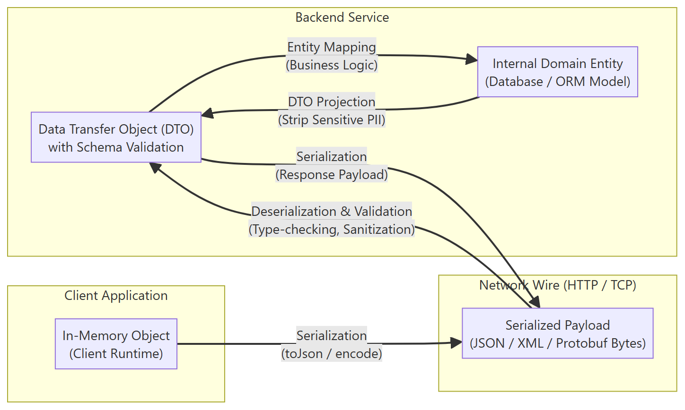

---

#### Engineering Invariants of API SerDe:

1. **Never Expose Internal ORM Entities**: Always deserialize incoming requests into dedicated **Data Transfer Objects (DTOs)** and project outgoing data via response DTOs. Exposing database entities directly introduces **Mass Assignment Vulnerabilities** (e.g. an attacker injecting `"is_admin": true` in a user update request).
2. **Strict Schema & Type Validation**: Deserializers must reject unknown properties or type mismatches early, returning **`HTTP 422 Unprocessable Content`** or **`HTTP 400 Bad Request`** with detailed field-level error messages before touching business logic.
3. **Deserialization Security (RCE Defense)**: Never enable polymorphic default typing in deserializers (such as unsafe Jackson `enableDefaultTyping()` or Python `pickle`), which allows attackers to instantiate arbitrary Java/Python gadget classes on the server and trigger Remote Code Execution (RCE).

### 4.5. The 5 Data Passing Channels in APIs

APIs provide 5 distinct mechanisms to transmit data from the caller to the server. Choosing the correct mechanism preserves HTTP semantics and enables caching:

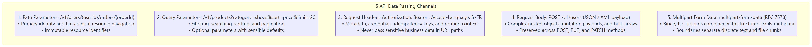

---

| Channel                       | Best For                                                     | Invariant Rule                                                                                          |
| :---------------------------- | :----------------------------------------------------------- | :------------------------------------------------------------------------------------------------------ |
| **Path Parameters**     | Resource identification (`/orders/{id}`)                   | Must be stable, URL-encoded, and never contain PII (e.g. use UUIDs instead of email addresses).         |
| **Query Parameters**    | Filtering, sorting, cursor pagination (`?page=2&limit=50`) | Must not alter resource identity; safe to log in server access logs (do not put passwords/tokens here). |
| **Request Headers**     | Auth, correlation, caching, content negotiation              | Case-insensitive; standard headers preferred over legacy `X-` prefixes.                               |
| **Request Body**        | Complex payloads, creates, updates                           | Prohibited on `GET` and `DELETE` requests in standard HTTP caching specifications.                  |
| **Multipart Form Data** | Media uploads with metadata                                  | Requires streaming parsers to prevent loading multi-gigabyte files into server RAM.                     |

## 5. Part 5: Production-Grade Behavioral & Operational Patterns

### 5.1. Pagination Strategies: Offset vs. Keyset (Cursor)

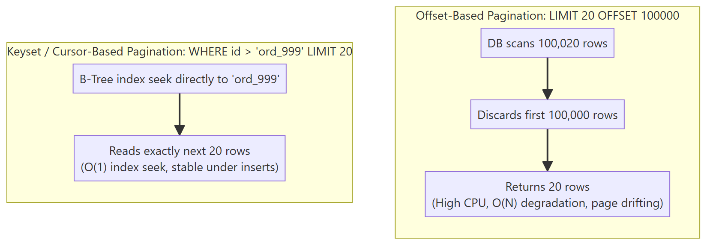

---

1. **Offset-Based (`?page=5&limit=20` or `?offset=100&limit=20`)**:
   - **Pros**: Easy to implement, allows jumping directly to arbitrary pages (e.g. "Go to Page 42").
   - **Cons**: Severe database performance penalty (`O(N)` row scan). Vulnerable to **page drift** (new inserts cause items to appear twice across page boundaries).
2. **Keyset / Cursor-Based (`?cursor=eyJpZCI6ODg0Mn0=&limit=20`)**:
   - **Pros**: Constant time lookup (`O(log N)` B-Tree seek). Completely immune to page drift during active writes.
   - **Cons**: Cannot jump to arbitrary distant pages (must traverse sequentially forward/backward).

### 5.2. Distributed Idempotency Key Architecture

Network failures during a `POST /payments` request leave clients unsure if the transaction succeeded. If the client retries, the user might be charged twice.

**The Solution: The Idempotency Key Pattern**:

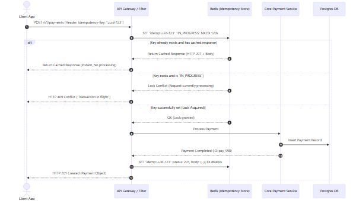

---

### 5.3. API Versioning Strategies

| Strategy                      | Example                                     | Trade-Offs & Best Use Case                                                                                                               |
| :---------------------------- | :------------------------------------------ | :--------------------------------------------------------------------------------------------------------------------------------------- |
| **URI Path Versioning** | `GET /v1/ordersGET /v2/orders`            | **Most Popular / Industry Standard** (Stripe, Twilio). Highly visible, easy to route via API Gateways, trivial to test in browser. |
| **Query Parameter**     | `GET /orders?version=2`                   | Simple, but can conflict with business query parameters and CDN caching rules.                                                           |
| **Custom Header**       | `X-API-Version: 2`                        | Clean URIs, but invisible in browser address bar; requires sophisticated gateway routing.                                                |
| **Content Negotiation** | `Accept: application/vnd.company.v2+json` | Purest REST implementation; high cognitive load for client developers, complicates CDN caching.                                          |

### 5.4. Standardized Error Contracts: RFC 7807 (Problem Details)

Never return plain text or ad-hoc JSON errors (`{"error": "bad request"}`). Implement **IETF RFC 7807**:

```json
{
  "type": "https://api.enterprise.com/errors/insufficient-funds",
  "title": "Insufficient Funds",
  "status": 403,
  "detail": "Account balance of 42.50 USD is lower than transaction cost 100.00 USD.",
  "instance": "/v1/accounts/acc_991/transactions/tx_123",
  "invalid_params": [
    {
      "name": "amount",
      "reason": "Amount exceeds current available credit limit"
    }
  ]
}
```

### 5.5. Multi-Tier API Caching & Conditional Revalidation

High-performance APIs minimize network payload and database load using a multi-tiered caching topology:

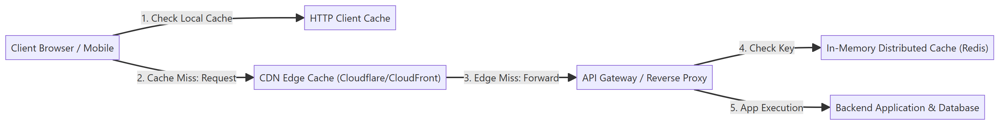

---

#### Core HTTP Caching Directives (`Cache-Control`)

* `public`: Response may be cached by any intermediate node (CDNs, proxies, browsers).
* `private`: Response is user-specific; may only be stored in private client caches (e.g. browser), never in shared CDNs.
* `no-cache`: Cache may store the response, but **must revalidate with the origin server** via conditional requests before serving it.
* `no-store`: Prohibits storing the response anywhere under any circumstances (mandatory for sensitive banking/PII endpoints).
* `max-age=<seconds>`: Maximum relative time the response is considered fresh.
* `s-maxage=<seconds>`: Overrides `max-age` specifically for shared caches (CDNs).
* `stale-while-revalidate=<seconds>`: Allows serving a stale cached response immediately while asynchronously fetching an updated version in the background.

#### Validation Caching with ETags and Conditional Requests

When a resource is cached, the server returns an **Entity Tag (ETag)** representing a hash of the resource state:

```http
HTTP/1.1 200 OK
ETag: "686897696a7c76edd82"
Cache-Control: public, max-age=3600, no-cache
```

On subsequent requests, the client sends a conditional request:

```http
GET /v1/products/8842 HTTP/1.1
If-None-Match: "686897696a7c76edd82"
```

1. If the resource has **not changed**, the server returns **`HTTP 304 Not Modified`** with **zero payload body**, saving database queries and network bandwidth.
2. If the resource has changed, the server returns **`HTTP 200 OK`** with the updated payload and a new `ETag`.

### 5.6. Localization and Internationalization (i18n)

Production APIs serving global client applications must decouple presentation language, formatting, and time from internal business logic:

1. **Language Negotiation via `Accept-Language`**:
   - Clients send their language preference with quality factors:
     ```http
     Accept-Language: es-MX, es;q=0.9, en-US;q=0.8, en;q=0.7
     ```
   - The backend resolves the closest matching resource bundle, falling back to a default system locale if no match exists.
2. **Currencies & Number Formatting**:
   - Never store formatted currency strings (e.g. `$100.00`). Return the raw integer minor unit alongside the **ISO 4217 currency code**:
     ```json
     { "amount": 10000, "currency": "USD" }
     ```
3. **Timezones & Timestamps**:
   - APIs must store and transmit all timestamps in **UTC in ISO 8601 format** (`2026-11-17T01:25:00Z`).
   - Clients may transmit a `Time-Zone` or `X-Timezone` header (e.g. `Time-Zone: America/New_York`) when request processing requires business day calculations.

### 5.7. Large File Upload & Blob Streaming Architecture

Streaming large file uploads (video, high-res images, archives) directly through application API servers causes thread pool exhaustion, high memory pressure, and gateway timeouts.

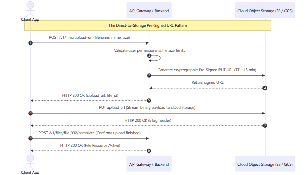

---

#### Upload Invariants:

1. **Never Buffer in RAM**: If an API server must proxy file uploads, enforce streaming chunked transfers directly to disk or upstream storage rather than reading the entire payload into a byte array in memory.
2. **Validate MIME Types via Magic Bytes**: Never trust the client's `Content-Type` header or file extension. Inspect the initial file header bytes (magic numbers) on the server to prevent malicious executable uploads.

### 5.8. Batching, Bulk Operations & Transactional APIs

When client workflows require modifying dozens or hundreds of resources, firing individual HTTP requests introduces massive network latency round-trips:

1. **Atomic Bulk Endpoint**:

   - `POST /v1/orders/batch`
   - Either all items in the batch succeed or the entire batch rolls back transactionally (`HTTP 200 OK` or `HTTP 400 Bad Request`).
2. **Partial Execution with `HTTP 207 Multi-Status` (RFC 4918)**:

   - For high-volume ingestions where independent failures should not fail the entire batch:

   ```json
   {
     "status": 207,
     "results": [
       { "id": "item_1", "status": 201, "data": { "created_at": "..." } },
       { "id": "item_2", "status": 422, "error": { "code": "DUPLICATE_SKU", "message": "SKU already exists" } },
       { "id": "item_3", "status": 201, "data": { "created_at": "..." } }
     ]
   }
   ```

### 5.9. Webhooks & Reverse APIs (Outbound Event Callbacks)

A Webhook is an **inversion of the API request model**: instead of the client continuously polling the API, the API server acts as an HTTP client that sends an asynchronous POST request to a client-configured URL when an event occurs.

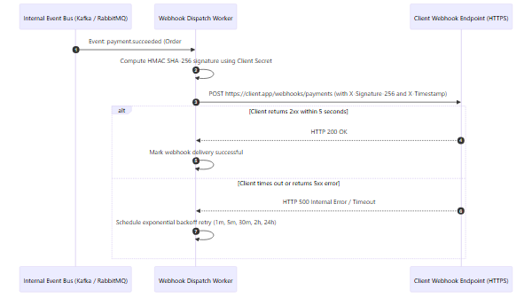

---

#### Webhook Security Invariants:

1. **HMAC SHA-256 Signatures**: Include an `X-Signature-256` header calculated as `HMAC_SHA256(timestamp + "." + payload, shared_secret)`. This guarantees payload integrity and authenticates the sender.
2. **Replay Attack Defense**: Include an `X-Timestamp` header. The receiver must reject requests older than 5 minutes to prevent replay attacks.
3. **Strict Timeout Enforcements**: Dispatch workers must set a strict connection and read timeout (e.g. 5 seconds) to prevent slow external client servers from exhausting worker thread pools.

## 6. Part 6: Low-Level Implementation (LLD) & Operating System Execution

### 6.1. Tier 1: Concrete Java 21 Backend OOP Implementation

The following implementation showcases a production-ready, thread-safe idempotent API Controller and Filter in Java 21:

```java
package com.enterprise.api.controller;

import java.util.UUID;
import java.util.concurrent.ConcurrentHashMap;
import java.util.concurrent.TimeUnit;

// 1. Immutable Data Transfer Objects (DTOs)
public record CreatePaymentRequest(
    UUID accountId,
    long amountInCents,
    String currency,
    String idempotencyKey
) {}

public record PaymentResponse(
    UUID paymentId,
    UUID accountId,
    long amountInCents,
    String status,
    String idempotencyKey
) {}

// 2. In-Memory Thread-Safe Distributed Idempotency Cache Simulator
public class IdempotencyStore {
    private final ConcurrentHashMap<String, PaymentResponse> cache = new ConcurrentHashMap<>();

    public PaymentResponse get(String key) {
        return cache.get(key);
    }

    public boolean putIfAbsent(String key, PaymentResponse response) {
        return cache.putIfAbsent(key, response) == null;
    }
}

// 3. Domain Service
public class PaymentService {
    public PaymentResponse process(CreatePaymentRequest request) {
        // Core business logic: ledger debit, fraud check, payment gateway dispatch
        UUID generatedPaymentId = UUID.randomUUID();
        return new PaymentResponse(
            generatedPaymentId,
            request.accountId(),
            request.amountInCents(),
            "SETTLED",
            request.idempotencyKey()
        );
    }
}

// 4. API Controller enforcing layer boundaries & idempotency
public class PaymentApiController {
    private final PaymentService paymentService;
    private final IdempotencyStore idempotencyStore;

    public PaymentApiController(PaymentService paymentService, IdempotencyStore idempotencyStore) {
        this.paymentService = paymentService;
        this.idempotencyStore = idempotencyStore;
    }

    public PaymentResponse handleCreatePayment(CreatePaymentRequest request) {
        String key = request.idempotencyKey();
        if (key != null && !key.isBlank()) {
            PaymentResponse existing = idempotencyStore.get(key);
            if (existing != null) {
                // Return cached response without re-processing (Pure Idempotency)
                return existing;
            }
        }

        PaymentResponse newlySettled = paymentService.process(request);
        if (key != null && !key.isBlank()) {
            idempotencyStore.putIfAbsent(key, newlySettled);
        }
        return newlySettled;
    }
}
```

### 6.2. Tier 2: Formal UML Modeling

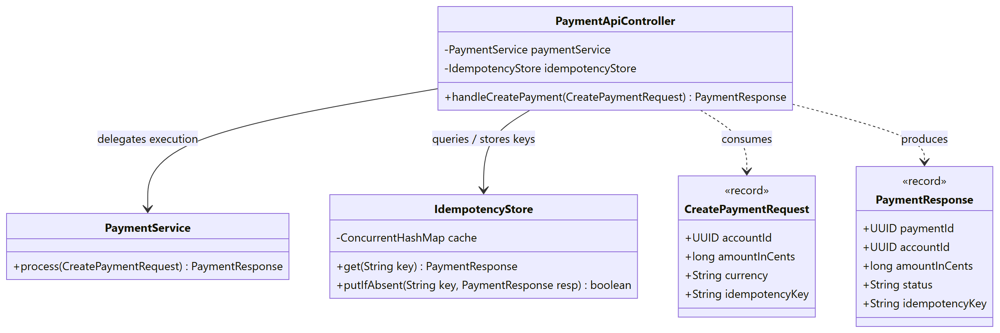

---

### 6.3. Tier 3: Runtime Heap & State Architecture

```
JVM Heap Execution Snapshot:
================================================================================
Thread: [http-nio-8080-exec-4]
Stack Frame: PaymentApiController.handleCreatePayment()
  ├── Local Ref 'request' ──────────────> [CreatePaymentRequest Object @0x7f88]
  │                                        ├── accountId: 442b1029-...
  │                                        ├── amountInCents: 50000
  │                                        └── idempotencyKey: "idem_tx_9981"
  │
IdempotencyStore Memory Graph:
  └── ConcurrentHashMap [Table size: 64]
       └── Node (hash: 0x9a4b) ─────────> Key: "idem_tx_9981"
                                         Value: [PaymentResponse Object @0x82b1]
                                                 ├── paymentId: 77a0-99b1-...
                                                 └── status: "SETTLED"
================================================================================
```

### 6.4. Backend OS Kernel & Socket Execution Patterns (Hussein Nasser Model)

> **Source**: Hussein Nasser, *Fundamentals of Backend Engineering*, Section 5 ("Backend Execution Patterns").

When thousands of API clients connect simultaneously, how does the operating system kernel accept connections without crashing?

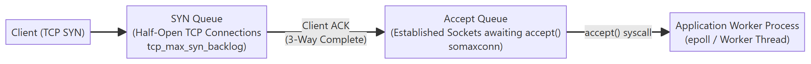

---

#### The 4 Canonical Execution Threading Models:

1. **Single Listener, Acceptor, and Reader**: Single thread accepts the socket and reads data. Simplest design (e.g. basic Node.js single-thread execution), but CPU-bound tasks block all incoming requests.
2. **Single Listener, Acceptor with Worker Thread Pool (Tomcat Model)**: Dedicated listener thread accepts sockets and offloads them to a fixed worker thread pool (`maxThreads=200`). Each active request blocks one thread. Vulnerable to thread starvation when backend microservices experience latency.
3. **Event-Driven Non-Blocking I/O (`epoll` / `kqueue` / IOCP)**: Utilized by Nginx, Netty, Node.js, Envoy. Sockets are registered in non-blocking mode with the kernel event loop. When bytes arrive in the kernel socket buffer (`recv_buf`), the kernel notifies the event loop, enabling a single thread to handle 100,000 concurrent API connections.
4. **Socket Sharding (`SO_REUSEPORT`)**: Multiple isolated backend processes bind to the exact same IP and Port. The Linux kernel load-balances incoming TCP connections directly across processes, eliminating the single acceptor thread lock bottleneck.

## 7. Part 7: High-Level Design (HLD) & Edge Infrastructure

### 7.1. The API Gateway Topology

In modern distributed microservices, clients **never** call internal microservices directly. Instead, all traffic terminates at the **API Gateway**:

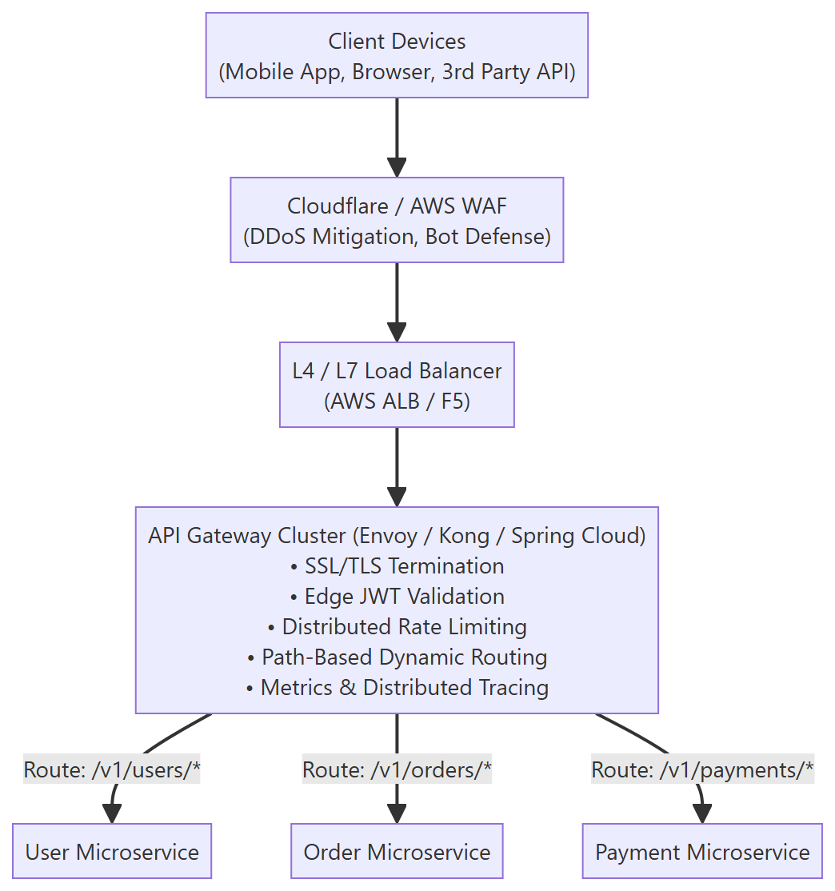

---

### 7.2. Distributed Rate Limiting Algorithms Compared

API Gateways protect downstream microservices from denial of service and noisy neighbors using rate limiters:

| Algorithm                        | How It Works                                                                         | Advantages                                                                                | Disadvantages                                                                                                 |
| :------------------------------- | :----------------------------------------------------------------------------------- | :---------------------------------------------------------------------------------------- | :------------------------------------------------------------------------------------------------------------ |
| **Token Bucket**           | Tokens refill at constant rate `R` up to capacity `C`. Requests consume 1 token. | Allows sudden bursts up to capacity `C`; memory efficient.                              | Tuning token refill rate under high concurrency requires atomic locks.                                        |
| **Leaky Bucket**           | Requests enter a FIFO queue; processed at fixed constant outflow rate.               | Perfectly smooths traffic spikes; prevents downstream overload.                           | Drops requests when buffer is full; increases latency for burst traffic.                                      |
| **Fixed Window**           | Counts requests in fixed time windows (e.g. 100 req/min).                            | Trivial to implement via Redis `INCR` + `EXPIRE`.                                     | **Boundary Spike Flaw**: 100 requests at 00:59 + 100 requests at 01:00 = 200 requests within 2 seconds. |
| **Sliding Window Counter** | Blends previous window count with current window elapsed percentage.                 | Prevents boundary spikes; extremely memory efficient (stores only 2 integers per client). | Slight approximation error (assumes requests in previous window were uniformly distributed).                  |

#### Production Implementation: Redis + Lua Sliding Window Counter

```lua
-- KEYS[1]: rate:user_123:current_window
-- KEYS[2]: rate:user_123:prev_window
-- ARGV[1]: max_requests (e.g. 100)
-- ARGV[2]: current_window_elapsed_percentage (0.0 to 1.0)

local current = redis.call('GET', KEYS[1]) or 0
local prev = redis.call('GET', KEYS[2]) or 0
local estimated_count = tonumber(prev) * (1.0 - tonumber(ARGV[2])) + tonumber(current)

if estimated_count < tonumber(ARGV[1]) then
    redis.call('INCR', KEYS[1])
    return 1 -- Request Allowed
else
    return 0 -- Rate Limit Exceeded (HTTP 429)
end
```

### 7.3. Backend-for-Frontend (BFF) Pattern

Instead of building one monolithic "universal" API that serves Mobile, Desktop Web, and IoT devices simultaneously, the **Backend-for-Frontend (BFF)** pattern deploys small, dedicated edge services tailored specifically to each frontend:

* **Mobile BFF**: Aggregates 10 microservice calls into 1 lightweight payload, strips unused fields to save cellular bandwidth, and optimizes for high latency.
* **Web BFF**: Emits rich, multi-panel payloads, renders server-side HTML/React components, and leverages high-bandwidth broadband connections.

### 7.4. Reverse Proxying & Load Balancing In-Depth (Hussein Nasser Model)

> **Source**: Hussein Nasser, *Fundamentals of Backend Engineering*, Section 6 ("Proxying and Load Balancing").

#### Forward Proxy vs. Reverse Proxy

* **Forward Proxy**: Sits in front of the **client**. Conceals client identity, bypasses corporate firewalls, caches outbound web content.
* **Reverse Proxy**: Sits in front of the **backend servers**. Protects internal microservices, terminates TLS, enforces authentication, and routes requests.

#### Layer 4 vs. Layer 7 Load Balancing: The Deep Technical Trade-Off

| Technical Property           | Layer 4 Load Balancer (Transport)                                                    | Layer 7 Load Balancer (Application)                                           |
| :--------------------------- | :----------------------------------------------------------------------------------- | :---------------------------------------------------------------------------- |
| **Protocol Awareness** | IP and Port only (TCP/UDP segments). Does not parse HTTP or JSON.                    | Full HTTP/1.1, HTTP/2, HTTP/3, gRPC, WebSocket awareness.                     |
| **TLS Decryption**     | **None** (Passes encrypted TLS packets directly to backends).                  | **Mandatory** (Terminates TLS, decrypts payload to inspect headers).    |
| **Routing Decisions**  | Round-robin, least-connections based strictly on TCP connection.                     | Path-based (`/orders` vs `/search`), header-based, cookie-based.          |
| **Performance & CPU**  | **Ultra-Fast & Low Memory** (Pure packet rewriting via NAT/DSR).               | Slower & Higher Memory (Buffers packets, decrypts TLS, parses headers).       |
| **Connection Sticky**  | **Strictly sticky per TCP connection**. All segments on socket go to 1 server. | **Load balances per individual HTTP request**, even over 1 TCP socket!  |
| **Security Risk**      | Agnostic: Cannot inspect payloads for SQLi or malicious headers.                     | **Centralized Security**: Blocks malicious payloads, manages WAF rules. |

### 7.5. WebSocket Reverse Proxying & Hop-by-Hop Transitions

To proxy WebSockets through an L7 reverse proxy (e.g. Nginx, Envoy):

1. Client sends HTTP request with `Upgrade: websocket` and `Connection: Upgrade`.
2. Reverse proxy must recognize that these are **hop-by-hop headers** (which are normally stripped by proxies) and explicitly forward them to the backend server.
3. Once the backend replies with `HTTP 101 Switching Protocols`, the proxy switches from HTTP parsing mode to **raw TCP tunneling mode**, keeping the connection alive indefinitely without triggering HTTP idle timeouts.

### 7.6. HTTP Request Smuggling Vulnerabilities

When a frontend L7 proxy and a backend server disagree on the boundaries of an HTTP request (e.g. frontend parses `Content-Length`, backend prioritizes `Transfer-Encoding: chunked`), an attacker can hide a secondary API request inside the payload of the first request. The backend server executes the smuggled request under the identity of the next innocent user on that connection!

## 8. Part 8: Security, Governance & Observability

### 8.1. Authentication (AuthN) vs. Authorization (AuthZ)

API security establishes two distinct cryptographic and logical boundaries:

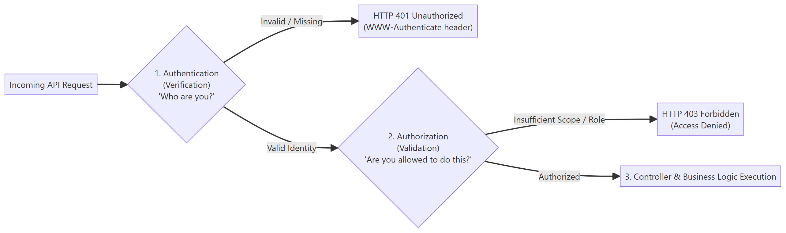

---

| Security Dimension            | Authentication (AuthN - Verification)                                                 | Authorization (AuthZ - Validation)                                                                                |
| :---------------------------- | :------------------------------------------------------------------------------------ | :---------------------------------------------------------------------------------------------------------------- |
| **Core Question**       | *"Who is making this API request?"*                                                 | *"Does this verified caller have permission to perform this action on this resource?"*                          |
| **Verification Medium** | Passwords, API Keys, JWT signatures, mTLS client certificates, biometric passkeys     | Roles (RBAC), Permissions, OAuth 2.0 Scopes (`read:reports`, `write:orders`), Attribute-Based Policies (ABAC) |
| **HTTP Failure Status** | **`HTTP 401 Unauthorized`** (Mandates a `WWW-Authenticate` response header) | **`HTTP 403 Forbidden`** (Identity is known and valid, but caller lacks necessary privileges)             |
| **Common Protocols**    | OpenID Connect (OIDC), HTTP Basic / Bearer, mTLS (RFC 8705)                           | OAuth 2.0 (RFC 6749), Open Policy Agent (OPA), AWS IAM / XACML                                                    |

### 8.2. User Registration & Client Onboarding Lifecycle

APIs expose distinct onboarding channels for human end-users versus automated third-party developer applications:

#### A. End-User Account Registration (`POST /v1/auth/register`)

1. **Payload**: Client submits user credentials (`email`, `password`, `name`).
2. **Password Invariant**: Passwords must **never** be stored in plaintext or fast hashing algorithms (MD5, SHA-256). Backends must enforce adaptive, memory-hard hashing functions: **Argon2id** (winner of the Password Hashing Competition) or **BCrypt** (work factor >= 12).
3. **Verification Token**: The API emits an asynchronous email/SMS containing a cryptographically signed, short-lived activation token (`POST /v1/auth/verify?token=...`).

#### B. Third-Party Developer & Client Application Registration

1. **Dynamic Client Registration (RFC 7591)** or Developer Portal onboarding:
   - Developer registers an external client application, providing redirect URIs and company metadata.
2. **Credential Provisioning**:
   - The API generates a public **Client ID** (`client_id`) and a cryptographically random, high-entropy **Client Secret** (`client_secret`).
   - The `client_secret` is displayed **only once** upon creation and stored hashed on the backend.
3. **Scope Grant Assignment**: The developer requests specific access scopes (e.g. `orders:read`), requiring administrative approval or user consent.

### 8.3. Session Cookie Tokens vs. Stateless Bearer Tokens

| Architectural Dimension      | Stateful Session Cookies (`Set-Cookie`)                                                    | Stateless Bearer Tokens (JWT in `Authorization`)                                            |
| :--------------------------- | :------------------------------------------------------------------------------------------- | :-------------------------------------------------------------------------------------------- |
| **Storage Mechanism**  | Browser Cookie jar (`HttpOnly; Secure; SameSite=Strict`)                                   | Client memory / Secure Storage (iOS Keychain / Android Keystore)                              |
| **Transport Header**   | Automatically attached by browser: `Cookie: session_id=s_882`                              | Explicitly attached by client code: `Authorization: Bearer <jwt>`                           |
| **Server State Cost**  | **Stateful**: Requires fast shared cache (Redis) to look up session data on every call | **Stateless**: Zero database lookups; server verifies signature using public key        |
| **Revocation Speed**   | **Immediate**: Deleting the key in Redis revokes the session instantly                 | **Difficult**: Token remains valid until TTL expires unless checked against a blacklist |
| **Cross-Platform Fit** | Ideal for traditional browser web applications                                               | **Universal**: Standard for Mobile apps, SPA frontends, CLI tools, and microservices    |
| **CSRF Vulnerability** | **High** (Browser attaches cookies automatically on cross-site calls)                  | **Immune** (Browsers never attach custom `Authorization` headers automatically)       |

### 8.4. Cross-Site Request Forgery (CSRF) in API Systems

Cross-Site Request Forgery (CSRF) is an attack where a malicious website tricks a user's browser into executing unwanted actions on a trusted API where the user is currently authenticated.

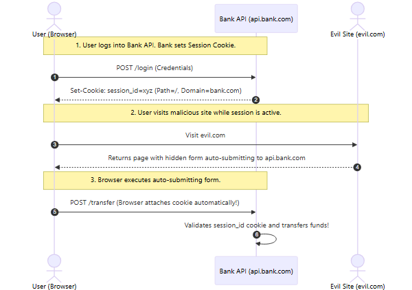

---

#### Why Pure Token-Based APIs Are Immune to CSRF:

* If an API requires identity via the `Authorization: Bearer <token>` header, **CSRF attacks are impossible**.
* Browsers *never* automatically attach custom `Authorization` headers to cross-origin requests. An attacker script on `evil.com` cannot read the victim's token due to the browser's **Same-Origin Policy (SOP)**.

#### Protection for Cookie-Authenticated APIs:

1. **`SameSite=Strict` Cookie Flag**: Tells the browser never to send the cookie on cross-site requests.
2. **Anti-CSRF Synchronizer Tokens (Double-Submit Cookie Pattern)**:
   - Server provides an unguessable CSRF token in a non-HttpOnly cookie or via an initial `GET /csrf-token` call.
   - Client JavaScript reads the token and injects it into a custom header: `X-CSRF-Token: <token>`.
   - The server validates that the header token matches the session expectation before executing any mutating method (`POST`, `PUT`, `DELETE`).

### 8.5. Distributed Observability: OpenTelemetry & W3C Trace Context

To trace an API request across 20 distributed microservices, APIs propagate standard **W3C Trace Context** HTTP headers:

* `traceparent`: `00-4bf92f3577b34da6a3ce929d0e0e4736-00f067aa0ba902b7-01`
  - `00`: Protocol version.
  - `4bf92f35...`: Distributed Global Trace ID (constant across entire request lifecycle).
  - `00f067aa...`: Parent Span ID (identifies the immediate upstream calling node).
  - `01`: Trace flags (Sampling active).

### 8.6. The 10-Stage Journey of an API Request to the Backend

> **Source**: Hussein Nasser, *Fundamentals of Backend Engineering*, Section 7 ("The Journey of a Request to the Backend").


---

### 8.7. Graceful API Connection Shutdown

When deploying new backend versions, servers must never terminate abruptly (which drops in-flight API requests with `502 Bad Gateway`):

1. **Deregistration**: Load balancer stops sending new traffic to the retiring node.
2. **Connection Draining**: The server injects the HTTP header `Connection: close` on all active responses.
3. **Wait Window**: The server waits for active in-flight requests to complete (e.g. 30 seconds).
4. **TCP FIN Teardown**: Sockets exchange standard TCP `FIN` / `ACK` packets to close connections gracefully before the process exits.

## 🔗 Related Master Curricula

- [`System_Requirements_Engineering.md`](<../../System%20Requirements/System_Requirements_Engineering.md>): Functional and non-functional vectors (SLA, latency, QPS capacity planning).
- [`001_architectural_styles_catalog_and_comparative_analysis.md`](<../../Software%20Architecture%20and%20Modeling/1.ARCHITECTURE/1.%20Architecture%20Styles/output/query_Architecture_Styles/001_architectural_styles_catalog_and_comparative_analysis.md>): Monolithic vs distributed styles.
- [`001_software_architecture_patterns_antipatterns_and_pitfalls.md`](<../../Software%20Architecture%20and%20Modeling/1.ARCHITECTURE/2.%20Architecture%20Patterns/output/query_Architecture_Patterns/001_software_architecture_patterns_antipatterns_and_pitfalls.md>): Enterprise integration patterns.
- [`HLD_Overview.md`](../../../2.HLD/HLD_Overview/output/Note_version-1_HLD_Overview/HLD_Overview.md): Large-scale distributed systems and consensus.

[def]: images/ui-api-backend-flow.gif
