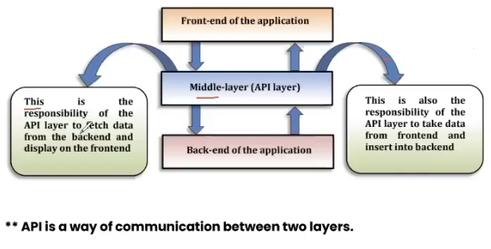

# API Architecture and Design: Overview & Communication Patterns

[https://github.com/AkmKawser/System-Design/blob/main/topics/0.FUNDAMENTALS/API%20Architecture%20and%20Design/output/Note_version-1_API_Architecture_and_Design/API_Architecture_and_Design.md](https://github.com/AkmKawser/System-Design/blob/main/topics/0.FUNDAMENTALS/API%20Architecture%20and%20Design/output/Note_version-1_API_Architecture_and_Design/API_Architecture_and_Design.md)

---

## Backend Communication Design Patterns

## API Architectural Protocols & Patterns

| Protocol / Pattern | Architecture | Methods / Transport Used |
| :--- | :--- | :--- |
| **REST** | Resource-oriented architecture built over standard HTTP infrastructure. | Standard HTTP methods (GET, POST, PUT, DELETE, PATCH) on URIs. |
| **SOAP** | Protocol-based, contract-driven architecture relying on XML schemas & WSDL. | XML envelope payloads predominantly over HTTP or SMTP. |
| **GraphQL** | Query language and client-driven schema architecture. | HTTP POST queries/mutations via a single endpoint. |
| **gRPC** | RPC-based architecture using Protocol Buffers (Protobuf). | Binary transport over HTTP/2 with unary and streaming RPC calls. |
| **WebSockets** | Full-duplex, event-driven socket connection architecture. | HTTP handshake upgrading to a persistent TCP connection for bidirectional messaging. |
