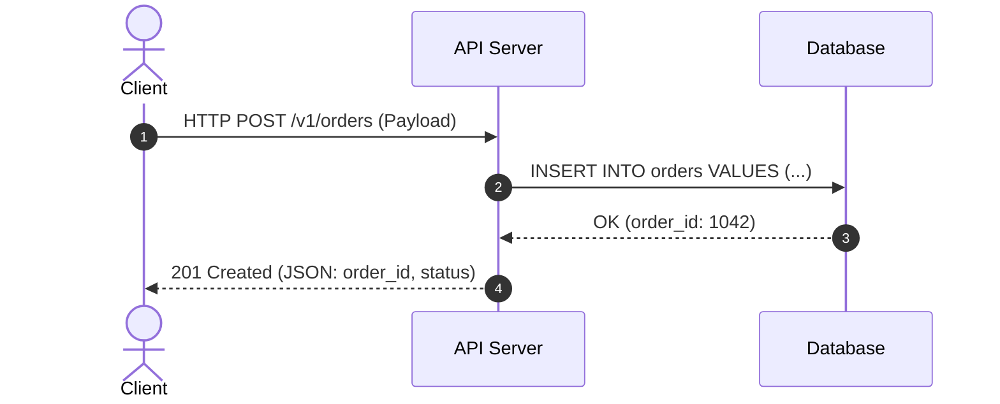
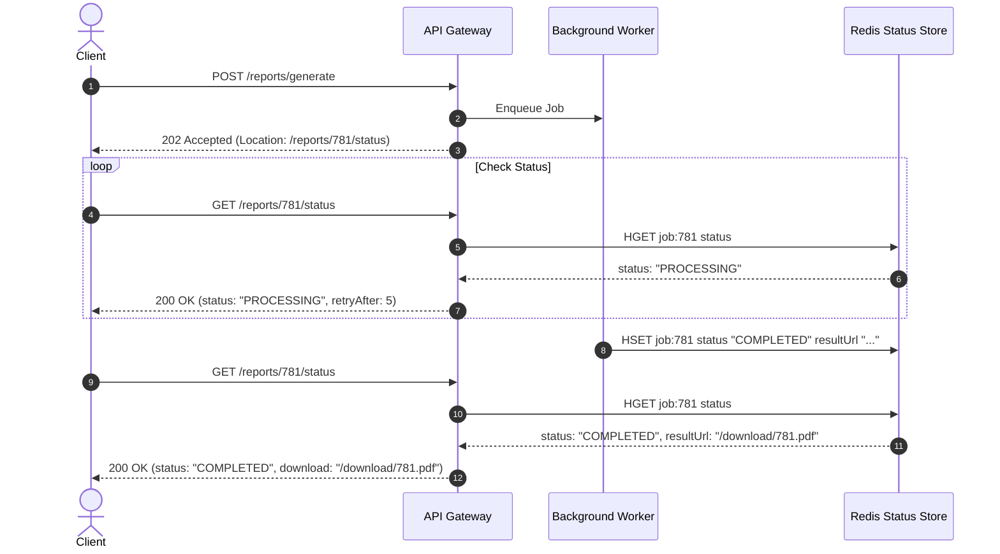
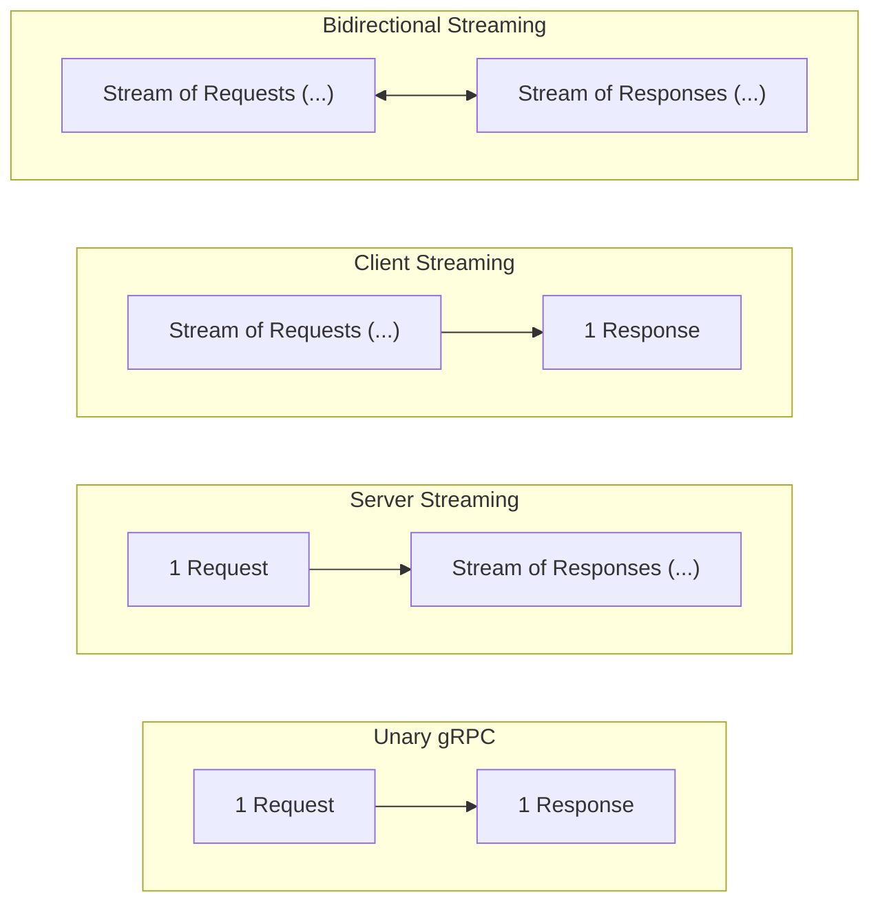
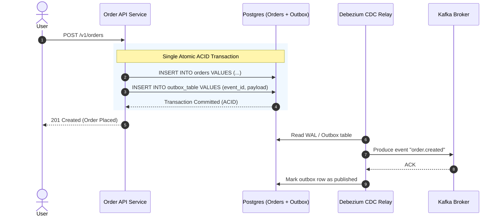
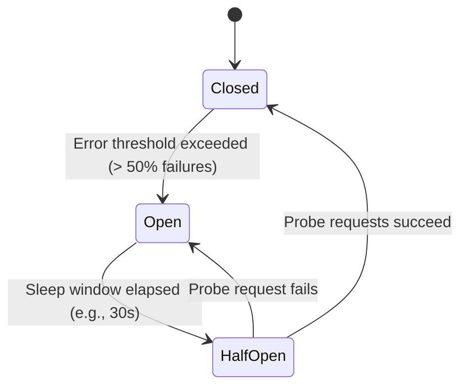

# API Communication Patterns: Taxonomy, Architectural Topologies & Protocol Mechanics

> **Scope**: Foundational and advanced communication design patterns across API engineering, distributed client-server systems, microservice boundaries, and real-time streaming architectures.
> **Cross-Reference**: Ingested course source from [`Udemy: Fundamentals of Backend Engineering (Section 02: Backend Communication Design Patterns)`](../../Data_Ingestion/Courses/Udemy-Fundamentals%20of%20Backend%20Engineering/curriculum.md).

---

## 1. Executive Summary & Taxonomy Matrix

In distributed systems and modern API architecture, a **Communication Pattern** governs the spatial, temporal, and synchronization constraints between interacting parties (clients, edge proxies, microservices, and persistent datastores). Selecting an incorrect communication pattern introduces cascading failures, connection pool starvation, excessive battery consumption on mobile clients, and head-of-line blocking.

```mermaid
flowchart TD
    ROOT["API Communication Patterns"]

    ROOT --> CAT1["1. Request-Reply & Invocational"]
    ROOT --> CAT2["2. Real-Time & Push Models"]
    ROOT --> CAT3["3. Binary & Chunked Streaming"]
    ROOT --> CAT4["4. Decoupled & Event-Driven"]
    ROOT --> CAT5["5. Gateway & Composition"]
    ROOT --> CAT6["6. Connection & Transport Optimization"]
    ROOT --> CAT7["7. Resiliency & Traffic Shaping"]

    CAT1 --> C1_1["Sync Request-Reply"]
    CAT1 --> C1_2["Async 202 Accepted + Polling"]
    CAT1 --> C1_3["Fire-and-Forget"]
    CAT1 --> C1_4["Webhooks / Reverse API"]

    CAT2 --> C2_1["Short Polling"]
    CAT2 --> C2_2["Long Polling"]
    CAT2 --> C2_3["Server-Sent Events (SSE)"]
    CAT2 --> C2_4["WebSockets (Full Duplex)"]
    CAT2 --> C2_5["GraphQL Subscriptions"]

    CAT3 --> C3_1["HTTP/1.1 Chunked Encoding"]
    CAT3 --> C3_2["gRPC Server Streaming"]
    CAT3 --> C3_3["gRPC Client Streaming"]
    CAT3 --> C3_4["gRPC Bidirectional Streaming"]

    CAT4 --> C4_1["Publish-Subscribe (Pub/Sub)"]
    CAT4 --> C4_2["Competing Consumers (Work Queue)"]
    CAT4 --> C4_3["Event-Carried State Transfer"]
    CAT4 --> C4_4["Transactional Outbox"]

    CAT5 --> C5_1["API Gateway Pattern"]
    CAT5 --> C5_2["Backend-for-Frontend (BFF)"]
    CAT5 --> C5_3["API Composition / Aggregator"]
    CAT5 --> C5_4["Scatter-Gather (Fan-Out/Fan-In)"]

    CAT6 --> C6_1["TCP/TLS Connection Pooling"]
    CAT6 --> C6_2["HTTP/2 & HTTP/3 Multiplexing"]
    CAT6 --> C6_3["Sidecar / Service Mesh Proxy"]

    CAT7 --> C7_1["Idempotent Retry with Backoff & Jitter"]
    CAT7 --> C7_2["Circuit Breaker"]
    CAT7 --> C7_3["Bulkhead Isolation"]
    CAT7 --> C7_4["Rate Limiting & Token Bucket"]
```



---

## 2. Request–Reply & Invocational Patterns

### 2.1 Synchronous Request–Reply
- **Mechanism**: The client initiates a TCP/TLS connection, transmits an HTTP/REST request, gRPC Unary invocation, or GraphQL query, and blocks execution awaiting an immediate response (e.g., `200 OK`).
- **Protocol**: HTTP/1.1, HTTP/2, HTTP/3, gRPC Unary.
- **Pros**: Direct mental model; immediate transactional consistency; built-in HTTP error propagation (`4xx`, `5xx`).
- **Cons**: Severe temporal coupling; thread/connection starvation under high latency; prone to cascading timeouts.



### 2.2 Asynchronous Request–Reply (Polling / 202 Accepted)
- **Mechanism**: Used when processing exceeds standard gateway timeouts (e.g., > 10–30 seconds). The client issues a job creation request. The server validates the request, queues the heavy task in an asynchronous execution pool, and immediately returns `202 Accepted` alongside a status check URI in the `Location` header.
- **Protocol**: HTTP/1.1, HTTP/2.
- **Headers**:
  ```http
  HTTP/1.1 202 Accepted
  Location: /api/v1/export-jobs/8849b2
  Retry-After: 30
  ```
- **Pros**: Protects reverse proxies from timeout errors (`504 Gateway Timeout`); stabilizes CPU utilization under burst loads.
- **Cons**: Requires persistent state tracking for job statuses (e.g., Redis, DB); client must handle periodic polling logic.



### 2.3 Fire-and-Forget (One-Way Asynchronous)
- **Mechanism**: The client issues an API call and receives immediate acknowledgment (e.g., `202 Accepted` or `204 No Content`) with zero guarantee or expectation of a computed payload returning over that connection.
- **Use Cases**: Audit trails, analytics telemetry, access logging, metric ingestion.

### 2.4 Webhook (Reverse API / Event Callback)
- **Mechanism**: Instead of the client polling the server, the client registers a publicly reachable webhook URL (`https://client.com/webhooks/payment`). When the state transitions on the server, the server acts as an HTTP client and issues a `POST` request with the event payload to the registered URL.
- **Security Invariant**: The server signs the payload with a shared secret (`HMAC-SHA256`) delivered via header (e.g., `X-Signature-256`), which the receiver verifies prior to processing.
- **Pros**: Zero polling overhead; immediate real-time event notifications across organizational boundaries.
- **Cons**: Requires the client to host an internet-facing endpoint; requires robust retry policies with exponential backoff on delivery failure.

---

## 3. Real-Time & Server-Push Communication Patterns

### 3.1 Comparative Protocol Matrix

| Dimension | Short Polling | Long Polling | Server-Sent Events (SSE) | WebSockets (WS) |
| :--- | :--- | :--- | :--- | :--- |
| **Transport Protocol** | HTTP/1.1 or HTTP/2 | HTTP/1.1 or HTTP/2 | HTTP/1.1 or HTTP/2 (`text/event-stream`) | TCP over WebSocket Frame (RFC 6455) |
| **Directionality** | Client → Server (Pull) | Client → Server (Delayed Pull) | Server → Client (Push Only) | Full-Duplex Bidirectional |
| **Connection Lifespan** | Ephemeral (< 100 ms) | Long-lived per request (30 s) | Persistent streaming connection | Persistent stateful TCP connection |
| **Header Overhead** | High (repeats headers per poll) | Medium (repeats on each event) | Low (headers sent only on initial connect) | Minimal (2–10 bytes framing overhead) |
| **Browser Reconnect** | Manual in application code | Manual in application code | Native automatic reconnection (`EventSource`) | Requires client-side heartbeat / reconnect logic |
| **Proxy / Firewall Traversal** | Seamless (Standard HTTP) | Seamless (Standard HTTP) | Seamless (Standard HTTP) | May be intercepted or blocked by strict proxies |
| **Primary Use Cases** | Simple dashboards, legacy sync | Web chats in restricted networks | LLM token streaming, tickers, live sports | Gaming, collaborative whiteboards, trading |

### 3.2 Server-Sent Events (SSE) Protocol Walkthrough
```http
GET /v1/chat/stream HTTP/1.1
Host: api.example.com
Accept: text/event-stream
Cache-Control: no-cache

HTTP/1.1 200 OK
Content-Type: text/event-stream; charset=utf-8
Transfer-Encoding: chunked
Connection: keep-alive

id: 1
event: token
data: {"text": "Architectural"}

id: 2
event: token
data: {"text": " Communication"}

id: 3
event: complete
data: {"status": "DONE"}
```

### 3.3 WebSocket Full-Duplex Lifecycle
1. **Handshake (HTTP Upgrade)**:
   ```http
   GET /chat HTTP/1.1
   Host: api.example.com
   Upgrade: websocket
   Connection: Upgrade
   Sec-WebSocket-Key: dGhlIHNhbXBsZSBub25jZQ==
   Sec-WebSocket-Version: 13
   ```
2. **Server Confirmation (`101 Switching Protocols`)**:
   ```http
   HTTP/1.1 101 Switching Protocols
   Upgrade: websocket
   Connection: Upgrade
   Sec-WebSocket-Accept: s3pPLMBiTxaQ9kYGzzhZRbK+xOo=
   ```
3. **Data Framing**: Raw binary/text framing runs over the established TCP socket without HTTP headers.

---

## 4. Binary & Chunked Streaming Patterns

### 4.1 HTTP/1.1 Chunked Transfer Encoding
- Allows a server to begin emitting data immediately without knowing the total payload size upfront by setting header `Transfer-Encoding: chunked`.
- The body consists of chunks, each beginning with its hexadecimal byte length, followed by `\r\n`, the chunk payload, and terminating in a `0\r\n\r\n` chunk.

### 4.2 gRPC Streaming Topologies (HTTP/2)
gRPC leverages HTTP/2 multiplexing, binary framing, and Protocol Buffers to offer four distinct invocation modes:



1. **Unary RPC**: Single request payload → Single response payload.
2. **Server Streaming RPC**: Client sends one request (e.g., `QueryAuditLogs(filter)`); server responds with a stream of messages over time.
3. **Client Streaming RPC**: Client streams chunks of a large file or continuous IoT metrics; server responds with a single aggregate confirmation.
4. **Bidirectional Streaming RPC**: Two independent streams operate concurrently over a single HTTP/2 connection with full zero-copy serialization.

---

## 5. Event-Driven & Decoupled API Messaging Patterns

### 5.1 Publish–Subscribe (Pub/Sub)
- **Topological Invariant**: Publishers and Subscribers are completely decoupled in time, location, and synchronization. The API producer emits an event into a topic (e.g., Apache Kafka, Google Cloud Pub/Sub, AWS SNS); multiple consumers independently read and process offsets without backpressure leaking to the producer.

### 5.2 Competing Consumers (Work Queue)
- **Topological Invariant**: A task queue holds jobs where multiple worker nodes compete to process tasks. Each task is consumed and acknowledged by **exactly one worker**, enabling horizontal throughput scaling.

### 5.3 Event-Carried State Transfer (ECST)
- **Topological Invariant**: Events carry the entire domain state snapshot (e.g., complete `CustomerUpdated` entity with addresses and preferences). Downstream consumers update their local projection tables directly, completely eliminating the need to call the upstream Customer API via HTTP.

### 5.4 Transactional Outbox Pattern
- **Problem**: Calling an HTTP API or publishing a message broker event inside a database transaction leads to dual-write inconsistencies (database commits, but broker publish fails, or vice versa).
- **Solution**:
  1. The API service writes the domain entity change and an **Outbox Record** into the same local relational database within a single ACID transaction.
  2. An asynchronous Debezium CDC reader or Outbox Relay polls/tails the database Write-Ahead Log (WAL) and reliably dispatches the messages to Kafka/RabbitMQ with at-least-once delivery guarantees.



---

## 6. Architectural Gateway & Composition Patterns

### 6.1 API Gateway Pattern
- Centralizes cross-cutting edge concerns: TLS termination, request validation, authentication/authorization (JWT validation, OAuth2 token introspection), rate limiting, traffic splitting (Canary/Blue-Green), and reverse proxy routing.

### 6.2 Backend-for-Frontend (BFF)
- Introduces client-tailored orchestration gateways:
  - **Mobile BFF**: Aggregates API calls, strips redundant fields to preserve cellular bandwidth, optimizes image formats (WebP/AVIF), and caches aggressively.
  - **Desktop Web BFF**: Returns rich, multi-tiered payloads optimized for high-resolution desktop viewports.

### 6.3 API Composition (Aggregator) vs. Scatter–Gather
- **API Composition**: One orchestrator receives a client request, calls Service A, Service B, and Service C sequentially or in parallel, merges the responses, and returns a unified JSON schema.
- **Scatter–Gather**: The gateway fans out a request concurrently to `N` provider services with a strict deadline timeout. It gathers all responses received before the timeout, ranks or merges them, and drops responses that arrive late (e.g., flight aggregators querying airlines).

---

## 7. Transport & Connection Optimization Patterns

### 7.1 Connection Pooling
- Tearing down and recreating TCP sockets per API request incurs the cost of:
  1. TCP 3-Way Handshake (`1 RTT`).
  2. TLS 1.3 Cryptographic Handshake (`1 RTT`) or TLS 1.2 (`2 RTT`).
  3. TCP Slow Start throughput throttling.
- **Connection Pooling** maintains a persistent pool of pre-warmed, authenticated sockets reused across concurrent client threads.

### 7.2 Multiplexing: HTTP/1.1 vs. HTTP/2 vs. HTTP/3

```text
HTTP/1.1: 
  [Conn 1]: [Req 1] -> [Resp 1] -> [Req 2] -> [Resp 2] (Head-of-Line Blocking)
  [Conn 2]: [Req 3] -> [Resp 3]

HTTP/2 (Single TCP connection):
  [TCP Stream]: [Frame Req1][Frame Req2][Frame Resp1][Frame Req1][Frame Resp2]
  (Eliminates application-layer HoL blocking; susceptible to TCP packet loss HoL)

HTTP/3 (QUIC over UDP):
  [Independent Streams]: Stream 1 packet loss does NOT stall Stream 2 or Stream 3!
```

---

## 8. Resiliency & Traffic Shaping Patterns

### 8.1 Idempotent Retry with Exponential Backoff and Jitter
- Retrying failed requests blindly causes a **retry storm** that knocks down recovering services.
- **Backoff Formula**:
  ```text
  WaitTime = min(MaxBackoff, BaseInterval * (2 ^ Attempt)) + UniformRandom(0, Jitter)
  ```
- **Mandatory Invariant**: Safe retries must supply an `Idempotency-Key` header so the server does not execute duplicate mutations.

### 8.2 Circuit Breaker State Machine
- Protects upstream systems from thread exhaustion by failing fast when downstream services become unresponsive.



### 8.3 Rate Limiting Algorithms
1. **Token Bucket**: Tokens added at a fixed rate up to capacity; requests consume tokens; handles bursts gracefully.
2. **Leaky Bucket**: Requests enter a queue and are processed at a constant outflow rate; smooths bursts into uniform flow.
3. **Sliding Window Counter**: Hybrid algorithm combining memory efficiency with precision boundary protection using Redis sorted sets (`ZADD`, `ZREMRANGEBYSCORE`).

---

## 9. Architectural Decision Matrix

```text
Do you require real-time, low-latency client interaction?
  ├── Yes
  │     ├── Is the interaction bidirectional (e.g., chat, gaming, collaborative editing)?
  │     │     ├── Yes ──> WebSockets (or gRPC Bidirectional Streaming)
  │     │     └── No  ──> Does the server only push streams to the client?
  │     │                   ├── Text / Token stream (LLM, dashboard) ──> Server-Sent Events (SSE)
  │     │                   └── Heavy binary stream ──> gRPC Server Streaming / HTTP Chunked
  └── No
        ├── Is the operation long-running (> 10-30 seconds)?
        │     ├── Client is a web browser / internal app ──> Asynchronous Request-Reply (202 + Polling)
        │     └── Client is a 3rd-party webhook receiver ──> Webhook Callback (Reverse API)
        ├── Do multiple downstream consumers need to react to state changes?
        │     └── Yes ──> Event-Driven Pub/Sub with Transactional Outbox (Kafka / SQS)
        └── Standard synchronous query or transactional command
              ├── Internal service-to-service ──> gRPC Unary (Protobuf)
              ├── External client-to-backend ──> RESTful API / GraphQL (via API Gateway)
```

---

## 10. Repository Cross-References & Study Links

- **Ingestion Sources**: [`Udemy: Fundamentals of Backend Engineering`](../../Data_Ingestion/Courses/Udemy-Fundamentals%20of%20Backend%20Engineering/curriculum.md)
- **High-Level Design Integration**: [`Module 2.3: Microservices & Messaging`](../../../outline.md#module-23-microservices-integration--asynchronous-topologies)
- **Low-Level Design Patterns**: [`Module 1.1: Software Design Patterns`](../../../1.LLD/DESIGN_PATTERNS/output/query_DESIGN_PATTERNS/design_patterns.md)
- **Underlying Transport Layer**: [`Module 0.8: Computer Networking for Distributed Systems`](../../Networking/output/Note_version-1_Networking/Networking.md)
