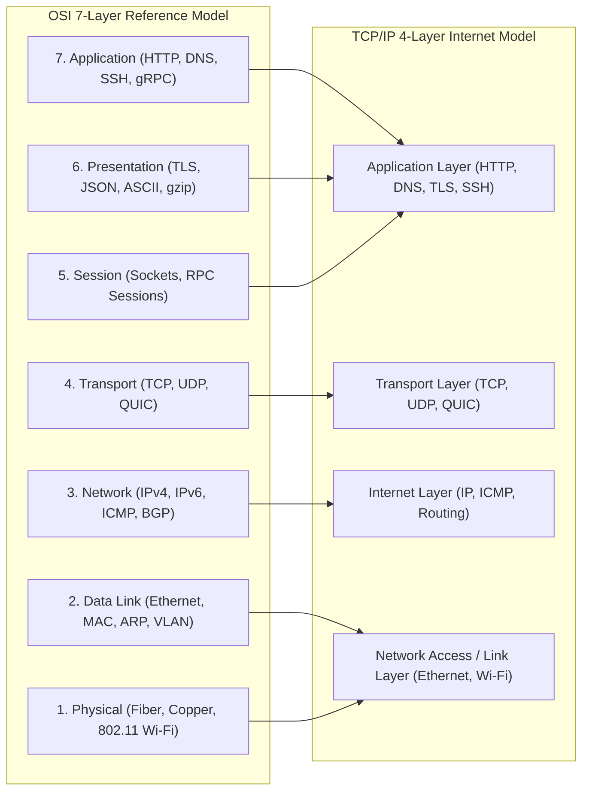
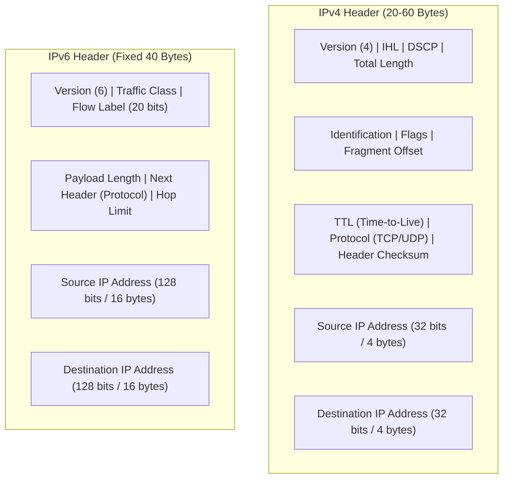
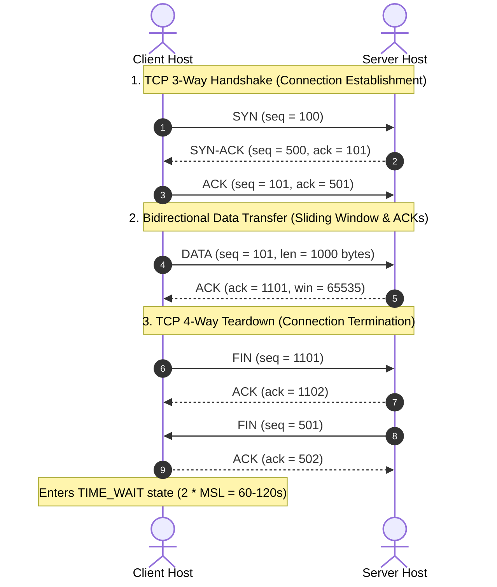
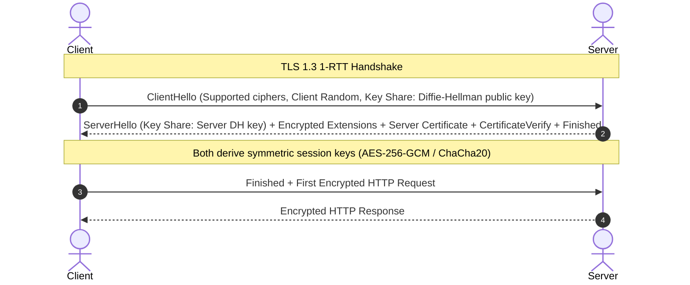
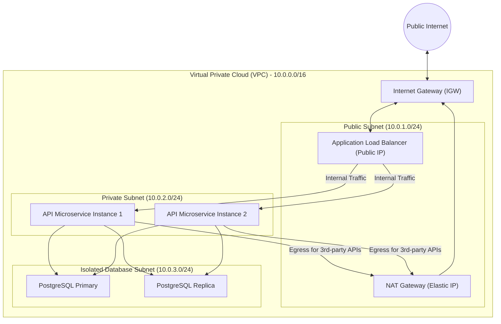

# Computer Networking for Systems & Distributed Architecture

> **Domain**: Computer Networking, Transport Protocols, Cloud Topologies & Systems Engineering  
> **Status**: Comprehensive Master Guide (`Note_version-1_Networking`)  
> **Target Path**: `topics/0.FUNDAMENTALS/Networking/output/Note_version-1_Networking/Networking.md`  
> **Source Attribution**: Derived from IETF RFCs (RFC 791, RFC 793, RFC 9000), Linux Kernel Networking Subsystem, and Distributed Systems Infrastructure Standards.

---

## 1. Executive Summary & First Principles

In software engineering and distributed system design, **Computer Networking** is the physical and logical medium that enables autonomous compute nodes to coordinate state, exchange payloads, and execute distributed workflows.

Every distributed architecture—from microservices and API gateways to globally replicated databases and CDNs—relies on low-level networking invariants:
1. **The Fallacy of the Network**: Networks are asynchronous, lossy, non-deterministic, and subject to packet reordering, latency spikes, and partition events (the fundamental reality governing the CAP theorem).
2. **Layer Encapsulation**: Data generated at the application tier travels down an abstraction stack, wrapped with headers at each boundary (Data -> Segment -> Packet -> Frame -> Physical Bits), and decapsulated at the destination.
3. **End-to-End Argument**: Features such as error detection, reliable delivery, and security cannot be guaranteed solely by intermediate network devices (switches, routers); they must ultimately be validated by the end endpoints.

---

## 2. Layer Models: OSI 7-Layer vs. TCP/IP 4-Layer

Modern networks are modeled through two conceptual frameworks: the theoretical **OSI 7-Layer Model** and the pragmatic **TCP/IP 4-Layer Architecture** that powers the global Internet.



### Packet Encapsulation & Protocol Data Units (PDUs)

As data descends the stack, each layer wraps the payload with its protocol header:

| Stack Layer | Protocol Data Unit (PDU) | Primary Addressing | Key Protocols | Core Responsibility |
| :--- | :--- | :--- | :--- | :--- |
| **Layer 7: Application** | Message / Payload | URL, Hostname, RPC Method | HTTP/1.1–3, DNS, gRPC, SMTP | Application logic & user payload semantics |
| **Layer 4: Transport** | **Segment** (TCP) / **Datagram** (UDP) | Port Numbers (e.g. 443, 53) | TCP, UDP, QUIC, SCTP | Process-to-process multiplexing, flow & congestion control |
| **Layer 3: Network** | **Packet** | IP Address (IPv4: 32-bit, IPv6: 128-bit) | IPv4, IPv6, ICMP, BGP, OSPF | Host-to-host global routing across networks |
| **Layer 2: Data Link** | **Frame** | MAC Address (48-bit hex) | Ethernet (802.3), Wi-Fi (802.11), ARP | Node-to-node hop delivery within a local broadcast domain |
| **Layer 1: Physical** | **Bits** / Signals | Voltage, Light pulses, Radio RF | 100GBASE-LR4, Cat6e, Fiber | Transmission of raw unstructured bitstreams |

---

## 3. Layer 2 (Data Link) & Local Delivery

Layer 2 governs communication across a single physical wire or local area network (LAN) segment without intermediate routers.

### 3.1. MAC Addressing & Ethernet Frames
Every Network Interface Card (NIC) possesses a globally unique, hardware-burned 48-bit **Media Access Control (MAC)** address (e.g. `00:1A:2B:3C:4D:5E`).
- **Ethernet Frame Structure (IEEE 802.3)**:
  - Preamble (7 bytes) + Start Frame Delimiter (1 byte)
  - Destination MAC (6 bytes) + Source MAC (6 bytes)
  - EtherType (2 bytes: e.g. `0x0800` for IPv4, `0x86DD` for IPv6, `0x0806` for ARP)
  - Payload (46 to 1500 bytes)
  - Frame Check Sequence (FCS / CRC-32: 4 bytes)
- **Maximum Transmission Unit (MTU)**: The maximum IP packet size that can be transmitted in an Ethernet frame without fragmentation. The standard Internet MTU is **1,500 bytes**; high-performance data centers use **Jumbo Frames (9,000 bytes)** to reduce CPU interrupt overhead.

### 3.2. Address Resolution Protocol (ARP)
When a host wants to send an IP packet to another host on the same local subnet, it knows the target IP address but needs the physical MAC address:
1. **ARP Request**: Host broadcasts an Ethernet frame (`FF:FF:FF:FF:FF:FF`) asking: *"Who has IP 192.168.1.50? Tell 192.168.1.10."*
2. **ARP Reply**: The target host responds with a unicast frame: *"192.168.1.50 is at 00:1A:2B:3C:4D:5E."*
3. **ARP Cache**: Senders store IP-to-MAC mappings in a local OS cache (`arp -a`) to prevent redundant broadcasts.

---

## 4. Layer 3 (Network Layer) & Global Routing

Layer 3 provides logical host addressing and determines the optimal path across heterogeneous physical networks.

### 4.1. IPv4 vs. IPv6 Architecture



| Dimension | IPv4 | IPv6 |
| :--- | :--- | :--- |
| **Address Length** | 32 bits (4 bytes) ≈ 4.29 billion addresses | 128 bits (16 bytes) ≈ 3.4 × 10^38 addresses |
| **Address Notation** | Dotted Decimal: `192.168.1.1` | Hexadecimal Colons: `2001:0db8:85a3::8a2e:0370:7334` |
| **Header Size** | Variable (20 to 60 bytes with options) | Fixed (40 bytes; extensions via Next Header chain) |
| **Checksum** | Header checksum verified at every intermediate router | Eliminated (relies on L2 CRC and L4 transport checksums) |
| **Fragmentation** | Performed by routers or sending host | **Strictly End-to-End**: intermediate routers never fragment |
| **NAT Necessity** | Mandatory due to address exhaustion | Unnecessary (every device receives a globally routable IP) |

### 4.2. CIDR Subnetting (Classless Inter-Domain Routing)
IP addresses are divided into a **Network Prefix** and a **Host Identifier** using CIDR slash notation:
- Subnet mask `/24`: 24 network bits, 8 host bits (2^8 = 256 IP addresses; 254 usable after reserving network `0` and broadcast `255`).
- Subnet mask `/16`: 16 network bits, 16 host bits (2^16 = 65,536 IP addresses; common for cloud VPCs).
- Subnet mask `/32`: Single host IP address.

### 4.3. Network Address Translation (NAT)
Because IPv4 addresses are exhausted, private networks (RFC 1918: `10.0.0.0/8`, `172.16.0.0/12`, `192.168.0.0/16`) cannot be routed across the public Internet.
- **NAT / PAT (Port Address Translation)**: A NAT Gateway replaces the private source IP and port with its own public IP and an ephemeral port, maintaining a stateful translation table. When the return packet arrives, NAT maps the port back to the internal private IP.

### 4.4. Routing Protocols: BGP & OSPF
- **OSPF (Open Shortest Path First)**: Interior Gateway Protocol (IGP) used *within* an enterprise data center. Computes shortest paths using Dijkstra's algorithm based on link bandwidth.
- **BGP (Border Gateway Protocol)**: The routing protocol of the global Internet. Glues thousands of **Autonomous Systems (AS)** (ISPs, Google, AWS, Cloudflare) together. Uses path-vector routing and policy-based peering rather than raw latency.
- **Anycast BGP**: The same public IP address is announced simultaneously from hundreds of data centers worldwide. Internet routers automatically route client traffic to the topologically closest data center, forming the operational foundation of global DNS and CDNs (Cloudflare, AWS Route 53).

---

## 5. Layer 4 (Transport Layer) Deep Dive

Layer 4 provides end-to-end communication services for applications, introducing **port numbers** (0–65535) to multiplex traffic to specific operating system processes.

### 5.1. TCP vs. UDP vs. QUIC

| Architectural Invariant | TCP (RFC 793) | UDP (RFC 768) | QUIC (RFC 9000) |
| :--- | :--- | :--- | :--- |
| **Connection Model** | Connection-Oriented (3-way handshake) | Connectionless (Fire-and-forget) | Connection-Oriented (Combined 1-RTT with TLS 1.3) |
| **Reliability** | Guaranteed in-order delivery via ACKs & retransmissions | Best-effort; packets may drop, duplicate, or reorder | Guaranteed in-order per stream |
| **Head-of-Line (HoL) Blocking** | **Systemic**: Dropping packet 1 stalls packets 2 and 3 in the socket buffer | None | **Eliminated**: Dropping a packet in Stream A does not stall Stream B |
| **Flow & Congestion Control** | Sliding Window, CUBIC, BBR | None (application must implement) | Pluggable Congestion Control (BBR, CUBIC) at user-space |
| **Connection Migration** | Impossible (bound to 4-tuple IP + Port) | N/A | **Native**: Uses Connection ID (smooth Wi-Fi to 5G switch) |
| **Primary Use Cases** | Web (HTTP/1-2), Database queries, SSH | Real-time gaming, DNS, VoIP, Video streaming | Modern Web (HTTP/3), Mobile edge networks |

### 5.2. TCP Connection Lifecycle Mechanics



#### Key TCP Invariants:
1. **Sliding Window Flow Control**: Prevents a fast sender from overwhelming a slow receiver. The receiver advertises a `win` (Receive Window) indicating available socket buffer memory; the sender never sends more bytes than `win`.
2. **Congestion Control (CUBIC & BBR)**: Prevents senders from congesting intermediate network routers.
   - **CUBIC**: Detects congestion via packet loss; backs off sending rate aggressively.
   - **BBR (Bottleneck Bandwidth and RTT)**: Models max bandwidth and min RTT; sends at the exact capacity of the bottleneck pipe without inducing bufferbloat.
3. **The `TIME_WAIT` State & Port Exhaustion**: The active-closing endpoint must remain in `TIME_WAIT` for 2 Maximum Segment Lifetimes (2 * MSL approx 60s) to absorb delayed duplicate packets. Rapidly opening and closing connections to a backend exhausts ephemeral ports (default range: 32768–60999).
4. **Nagle's Algorithm (`TCP_NODELAY`)**: Buffers small packets until a full MSS (Maximum Segment Size) accumulates or an ACK returns. When combined with receiver **Delayed ACK (40ms)**, it introduces artificial latency spikes; high-performance APIs must explicitly set `TCP_NODELAY = 1`.

---

## 6. Layer 7 & Network Services

### 6.1. Domain Name System (DNS) Resolution Hierarchy
DNS translates human-readable hostnames (`api.production.com`) into routable IP addresses.

```mermaid
flowchart TD
    Client["Client Resolver"] -->|"1. Query api.example.com"| Rec["Recursive Resolver (8.8.8.8 / ISP)"]
    Rec -->|"2. Query ."| Root["Root Nameserver (. )"]
    Root -->>|"3. Refer to .com TLD"| Rec
    Rec -->|"4. Query example.com"| TLD[".com TLD Nameserver"]
    TLD -->>|"5. Refer to Authoritative NS"| Rec
    Rec -->|"6. Query api.example.com"| Auth["Authoritative Nameserver (Cloudflare / Route53)"]
    Auth -->>|"7. A Record: 104.21.42.88 (TTL 300)"| Rec
    Rec -->>|"8. Return IP to Client"| Client
```

#### Essential DNS Record Types:
- **`A` / `AAAA`**: Maps hostname to IPv4 (32-bit) / IPv6 (128-bit) address.
- **`CNAME`**: Canonical Name alias pointing one domain to another (`www.example.com -> example.com`).
- **`ALIAS` / `ANAME`**: Virtual CNAME supported at the zone apex root (`example.com`).
- **`MX`**: Mail exchange servers.
- **`TXT`**: Verification strings (SPF, DKIM, domain ownership).
- **`SRV`**: Service discovery specifying port, weight, and target hostname.

### 6.2. Transport Layer Security (TLS 1.3)
TLS provides authentication, confidentiality, and data integrity over TCP.



* **TLS 1.2 vs. TLS 1.3**: TLS 1.2 required 2 round-trips (2-RTT) before application data could travel; TLS 1.3 optimizes this to **1-RTT** by combining key exchange directly into the `ClientHello`.
* **Forward Secrecy**: Enforces ephemeral Diffie-Hellman keys (`ECDHE`). Even if an attacker steals the server's private RSA key in the future, past recorded encrypted traffic can never be decrypted.

---

## 7. Operating System & Kernel Sockets

At the operating system boundary, application code interfaces with networking hardware via the **BSD Sockets API**.

```mermaid
flowchart TD
    subgraph UserSpace ["User Space (Application Process)"]
        App["Web Server / Worker Thread"]
    end

    subgraph KernelSpace ["Linux Kernel Subsystem"]
        Syscall["System Calls: socket(), bind(), listen(), epoll_wait()"]
        SocketObj["Socket Object & Inode"]
        RecvBuf["Socket Receive Buffer (SO_RCVBUF)"]
        SendBuf["Socket Send Buffer (SO_SNDBUF)"]
        TCPStack["TCP/IP Protocol Engine (IP, Routing, ACKs)"]
        NAPI["NAPI Poll & SoftIRQ (NET_RX_SOFTIRQ)"]
        RingBuf["NIC Ring Buffer (DMA Memory)"]
    end

    subgraph Hardware ["Network Interface Card (NIC)"]
        PhysicalNIC["Physical Ethernet / Fiber Port"]
    end

    App <--> Syscall
    Syscall <--> SocketObj
    SocketObj --> RecvBuf
    SocketObj <-- SendBuf
    RecvBuf <--> TCPStack
    SendBuf <--> TCPStack
    TCPStack <--> NAPI
    NAPI <--> RingBuf
    RingBuf <--> PhysicalNIC
```

### I/O Multiplexing: The Evolution of Concurrency
How does a single server manage 100,000 concurrent client connections without spawning 100,000 blocking OS threads (the C10K problem)?
1. **`select()` / `poll()` (`O(N)` Overhead)**:
   - Application passes an array of `N` file descriptors to the kernel.
   - The kernel iterates through all `N` sockets to find which ones have data ready.
   - Slow and inefficient for large connection pools.
2. **`epoll()` (Linux) / `kqueue()` (BSD/macOS) (`O(1)` Event-Driven)**:
   - Application registers sockets once in a kernel-maintained Red-Black tree.
   - When a packet arrives, the NIC hardware interrupt triggers a kernel callback that places only the active socket on a **Ready List**.
   - `epoll_wait()` returns in `O(1)` time containing exclusively active events, powering high-throughput engines like Nginx, Node.js (libuv), Netty, and Envoy.
3. **`io_uring` (Modern Linux Kernel 5.1+)**:
   - Asynchronous zero-copy I/O using two ring buffers shared between user space and kernel space (Submission Queue and Completion Queue). Eliminates syscall context switching entirely.

---

## 8. Cloud & Enterprise Network Topologies

Distributed cloud systems isolate and route traffic across multi-tenant data center fabrics.



### Architectural Network Components:
1. **Virtual Private Cloud (VPC)**: Logically isolated virtual network defined by an IP address block (CIDR).
2. **Public vs. Private Subnets**:
   - **Public Subnet**: Route table points `0.0.0.0/0` directly to an Internet Gateway (IGW). Instances receive public IPs.
   - **Private Subnet**: No direct path to the Internet. Outbound traffic must pass through a **NAT Gateway** located in a public subnet.
3. **Layer 4 vs. Layer 7 Load Balancing**:
   - **L4 (NLB / HAProxy / IPVS)**: Operates at TCP/UDP level. Routes packets based on IP/Port using Equal-Cost Multi-Path (ECMP) routing without decrypting TLS. Ultra-high throughput (millions of requests/sec).
   - **L7 (ALB / Envoy / Nginx)**: Terminates TLS, parses HTTP headers, inspects cookies, and routes traffic based on URL paths (`/v1/orders` vs `/v1/users`).
4. **Overlay Networks (VXLAN / Geneve)**: Encapsulates Layer 2 Ethernet frames inside Layer 4 UDP packets (`Port 4789`). Enables container platforms (Kubernetes CNI: Calico, Cilium) to route millions of ephemeral pod IP addresses across physical host machines.

---

## 9. Network Security & Threat Mitigation

### 9.1. Common Network Attack Vectors & Defenses
1. **SYN Flood (DDoS)**:
   - *Attack*: Attacker floods server with TCP `SYN` packets from spoofed IPs without sending the final `ACK`. The server's kernel **SYN Queue** fills up, dropping legitimate connections.
   - *Defense*: **SYN Cookies (`syncookies = 1`)**. The server does not allocate memory for half-open sockets; instead, it encodes connection parameters into the `SYN-ACK` sequence number. State is only allocated when the client returns a valid `ACK`.
2. **UDP Amplification & Reflection**:
   - *Attack*: Attacker sends small requests to open public servers (DNS, NTP, Memcached) with the victim's spoofed IP as the source. Servers respond with massive 50x–100x amplified payloads targeting the victim.
   - *Defense*: Anycast BGP scrubbing centers (Cloudflare, AWS Shield) that absorb and rate-limit anomalous UDP volume at edge points of presence.
3. **Man-In-The-Middle (MITM)**:
   - *Attack*: Eavesdropping or altering plaintext traffic on the wire.
   - *Defense*: Mandatory **TLS 1.3** with **HSTS (HTTP Strict Transport Security)** and **Certificate Pinning / CAA DNS records**.

### 9.2. Firewalls & Packet Filtering
- **Stateless Packet Filter**: Inspects packets in isolation (Source IP, Destination IP, Port). Fast, but cannot verify TCP handshake state.
- **Stateful Firewall (Connection Tracking / `conntrack`)**: Tracks TCP state (`NEW`, `ESTABLISHED`, `RELATED`). Automatically allows return traffic for established outbound requests.
- **eBPF / XDP (eXpress Data Path)**: Programmable in-kernel packet filtering running directly inside the network driver before packets hit the Linux kernel network stack. Drops millions of malicious packets per second with virtually zero CPU penalty.

---

## 10. Network Troubleshooting & Observability Suite

Every systems engineer must master the standard command-line diagnostic toolkit:

| Tool | Protocol / Layer | Primary Diagnostic Use Case | Example Invocations |
| :--- | :--- | :--- | :--- |
| **`ping`** | ICMP (Layer 3) | Tests end-to-end host reachability and round-trip latency. | `ping -c 4 8.8.8.8` |
| **`traceroute` / `mtr`** | UDP / ICMP (Layer 3) | Traces hop-by-hop intermediate router path and identifies packet loss points. | `traceroute api.github.com`<br>`mtr -rw 1.1.1.1` |
| **`ss` / `netstat`** | TCP / UDP (Layer 4) | Inspects open sockets, listening ports, process PIDs, and queue backlogs. | `ss -tulpn` (list listening sockets)<br>`ss -s` (socket summary) |
| **`dig` / `nslookup`** | DNS (Layer 7) | Queries DNS records, response times, and authoritative nameservers. | `dig +trace api.stripe.com`<br>`dig @8.8.8.8 example.com A` |
| **`curl`** | HTTP / TLS (Layer 7) | Tests HTTP status codes, headers, TLS certificates, and response timing. | `curl -Iv https://example.com`<br>`curl -w "@format.txt" -o /dev/null -s https://api.com` |
| **`tcpdump`** | Packet Sniffer (L2–L7) | Captures raw packet traces for deep protocol and packet-loss inspection. | `tcpdump -i eth0 port 443 -w trace.pcap`<br>`tcpdump -n -nn -i any icmp` |
| **`iperf3`** | Throughput (L4) | Measures raw maximum TCP and UDP network bandwidth between two servers. | `iperf3 -s` (server)<br>`iperf3 -c 10.0.1.5 -P 4` (client, 4 streams) |

---

## 11. Master Synthesis Matrix: Protocols Across Network Layers

| Layer | Protocol | Underlying Protocol | Typical Header Size | Addressing / Identity | Architectural Purpose |
| :--- | :--- | :--- | :--- | :--- | :--- |
| **L7: Application** | **HTTP/2** | TCP + TLS | Variable (HPACK compressed) | Host + URI Path | Multiplexed web and REST API delivery |
| **L7: Application** | **HTTP/3** | QUIC (UDP) | Variable (QPACK compressed) | Host + URI Path | Ultra-low latency, zero-RTT web streaming |
| **L7: Application** | **DNS** | UDP / TCP Port 53 | 12 bytes header | Domain FQDN | Distributed domain name resolution |
| **L7: Application** | **gRPC** | HTTP/2 | Variable (Protobuf binary) | Service / Method | High-performance internal RPC microservices |
| **L6: Security** | **TLS 1.3** | TCP | Variable (Encrypted payload) | X.509 Certificate | Cryptographic privacy, integrity, and auth |
| **L4: Transport** | **TCP** | IP | 20–60 bytes | 16-bit Port (0–65535) | Reliable, ordered byte stream transmission |
| **L4: Transport** | **UDP** | IP | 8 bytes | 16-bit Port (0–65535) | Low-latency, connectionless datagram dispatch |
| **L4: Transport** | **QUIC** | UDP | Variable | 64-bit Connection ID | Stream multiplexing with native encryption |
| **L3: Network** | **IPv4** | Ethernet | 20–60 bytes | 32-bit IP Address | Global packet addressing and internet routing |
| **L3: Network** | **IPv6** | Ethernet | 40 bytes (Fixed) | 128-bit IP Address | Next-generation global packet addressing |
| **L3: Network** | **ICMP** | IP (Protocol 1) | 8 bytes | IP Address | Network diagnostics, echo reply, errors |
| **L2: Data Link** | **Ethernet** | Physical wire/fiber | 14 bytes header + 4 byte CRC | 48-bit MAC Address | Local frame delivery across physical LAN |
| **L2: Data Link** | **ARP** | Ethernet (0x0806) | 28 bytes | IP to MAC mapping | Resolves IP addresses to physical hardware MACs |

---

## 🔗 Related Master Curricula

- [`API_Architecture_and_Design.md`](<../../API%20Architecture%20and%20Design/output/Note_version-1_API_Architecture_and_Design/API_Architecture_and_Design.md>): API protocols, HTTP verb semantics, contract-first design, and edge gateway architectures.
- [`System_Requirements_Engineering.md`](<../../System%20Requirements/System_Requirements_Engineering.md>): Latency SLAs, bandwidth provisioning, and throughput capacity estimations.
- [`001_architectural_styles_catalog_and_comparative_analysis.md`](<../../Software%20Architecture%20and%20Modeling/1.ARCHITECTURE/1.%20Architecture%20Styles/output/query_Architecture_Styles/001_architectural_styles_catalog_and_comparative_analysis.md>): Network boundaries in monolithic vs distributed architectures.
- [`HLD_Overview.md`](<../../../2.HLD/HLD_Overview/output/Note_version-1_HLD_Overview/HLD_Overview.md>): Scalability, CAP theorem, and distributed consensus across networks.
