# Architectural Styles Catalog & Comparative Analysis

> **Source Attribution**: Derived from ***Fundamentals of Software Architecture: A Modern Engineering Approach*** (2nd Edition, Part II: Chapters 9–19, pp. 154–382) by Mark Richards and Neal Ford (O'Reilly Media).
> **Visual Assets**: Extracted from original publication figures under `Data_Ingestion/Books/images/`.

---

## 1. Architectural Styles: Theoretical Foundations

In software architecture, an **Architectural Style** describes the overarching structural philosophy of a software system. As established by Mark Richards and Neal Ford in Chapter 9 (*Foundations*), an architecture style dictates four foundational dimensions:

1. **Component Topology**: How the system's runtime components, modules, and execution boundaries are physically and logically organized.
2. **Deployment Topology**: The unit of physical deployment—whether the application runs as a single deployable quantum (**Monolith**) or across multiple independently deployed network services (**Distributed**).
3. **Communication Style**: How components interact at runtime—in-memory function/method calls versus distributed network protocols (REST, gRPC, messaging queues).
4. **Data Topology**: Whether storage is centralized into a single shared database or decentralized across individual database instances per domain or service.

### 1.1 The Two Primary Architectural Dimensions

Richards and Ford classify all architectural styles along two foundational orthogonal axes:

1. **Monolithic vs. Distributed Architectures**:
   - **Monolithic (Single Quantum)**: High simplicity, lower development cost, transactional ACID consistency, in-memory performance, but constrained scalability, elasticity, and deployability.
   - **Distributed (Multiple Quanta)**: Extreme scalability, fault isolation, independent deployability, but challenged by the *8 Fallacies of Distributed Computing* (network latency, unreliability, bandwidth, data consistency, transport cost).
2. **Technical vs. Domain Partitioning**:
   - **Technically Partitioned**: Top-level components are organized by technical layers or execution responsibilities (e.g., Presentation -> Business -> Persistence -> Database).
   - **Domain-Partitioned**: Top-level components are organized around business domains, bounded contexts, or workflows (e.g., Order, Customer, Billing, Inventory).

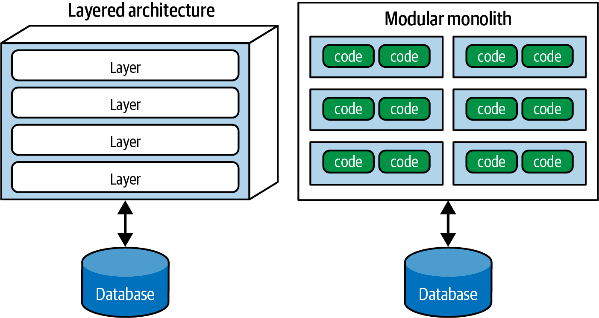

```mermaid
flowchart TD
    subgraph STYLES["Fundamentals of Software Architecture: 9 Foundational Styles"]
        direction TB
        
        subgraph MONO["Monolithic Architectures (Single Quantum)"]
            direction TB
            M1["1. Layered Architecture (Technical Partitioning)"]
            M2["2. Pipeline Architecture / Pipes and Filters (Technical Partitioning)"]
            M3["3. Microkernel Architecture / Plug-in (Technical / Functional)"]
            M4["4. Modular Monolith Architecture (Domain Partitioning)"]
        end
        
        subgraph DIST["Distributed Architectures (Multiple Quanta)"]
            direction TB
            D1["5. Service-Based Architecture (Domain Partitioning - Pragmatic Hybrid)"]
            D2["6. Event-Driven Architecture / EDA (Technical & Decoupled)"]
            D3["7. Space-Based Architecture / Cloud Cache (Technical & High Elasticity)"]
            D4["8. Orchestration-Driven SOA (Technical & Enterprise Taxonomy)"]
            D5["9. Microservices Architecture (Domain Partitioning & High Decoupling)"]
        end
    end

    classDef monoClass fill:#1e293b,stroke:#38bdf8,stroke-width:2px,color:#f8fafc;
    classDef distClass fill:#1e293b,stroke:#10b981,stroke-width:2px,color:#f8fafc;
    class MONO monoClass;
    class DIST distClass;
```

---

## 2. Exhaustive Catalog of All 9 Architecture Styles

---

### Style 1: Layered Architecture Style (Chapter 10)
*Also known as: N-Tier Architecture*

- **Classification**: Monolithic, Technically Partitioned.
- **Topology**: Components are organized into horizontal technical layers. The standard topology consists of:
  1. *Presentation Layer*: Handles UI and HTTP requests.
  2. *Business Layer*: Implements business logic and domain rules.
  3. *Persistence Layer*: Abstracts data access and queries.
  4. *Database Layer*: The underlying database engine.

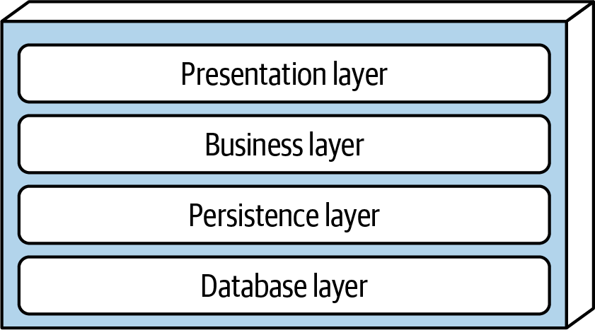

- **Physical Deployment Variants**:
  The layered architecture can be physically deployed across multiple configurations, ranging from a single monolithic deployable unit to multi-tier web, app, and database cluster nodes:

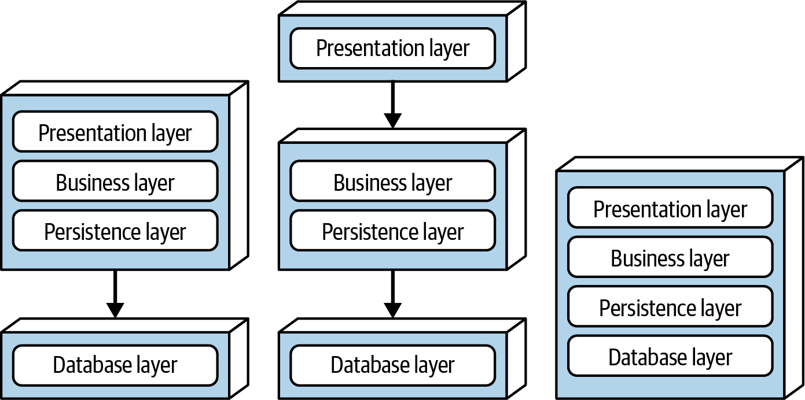

- **Key Concepts**:
  - **Layers of Isolation**: Changes in one layer do not impact other layers; layers can be modified, refactored, or replaced independently.
  - **Closed Layers**: A closed layer requires requests to pass through it to reach the layer below, enforcing structural isolation and separation of concerns.

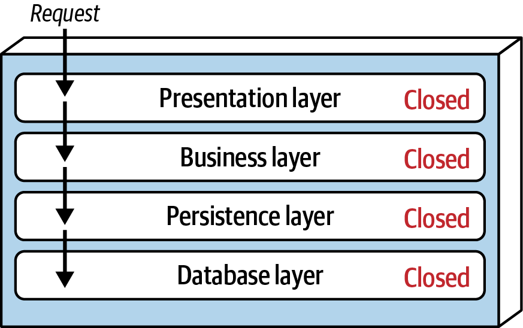

  - **Open Layers**: An open layer allows requests to bypass it (improving performance, e.g., bypassing business logic for read-only lookups).

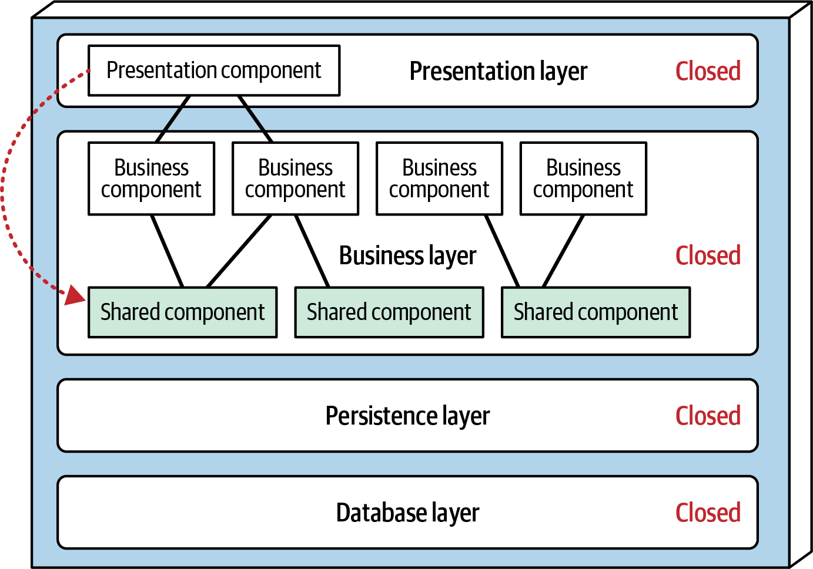

  - **Sinkhole Antipattern**: Requests pass straight through multiple layers without performing any meaningful business logic, causing unnecessary processing overhead.
- **Data Topology**: Single shared monolithic relational database.
- **Primary Strengths**: Low overall cost, high simplicity, familiarity, ease of testing isolated layers via mocks.
- **Primary Weaknesses**: Poor scalability, low elasticity, high deployment risk (whole monolith must be redeployed), slow time-to-market.
- **When to Use**: Small, simple applications or websites; tight budget and time constraints; early-stage systems where requirements are still emerging.
- **When NOT to Use**: Highly scalable applications; complex domains with high evolutionary velocity; systems requiring zero-downtime continuous deployment.
- **Canonical Examples**: Standard Spring Boot/Django MVC web applications, classical enterprise CRUD systems, operating system architectures (Hardware -> Kernel -> System Call -> User).

#### Architecture Characteristics Scorecard:
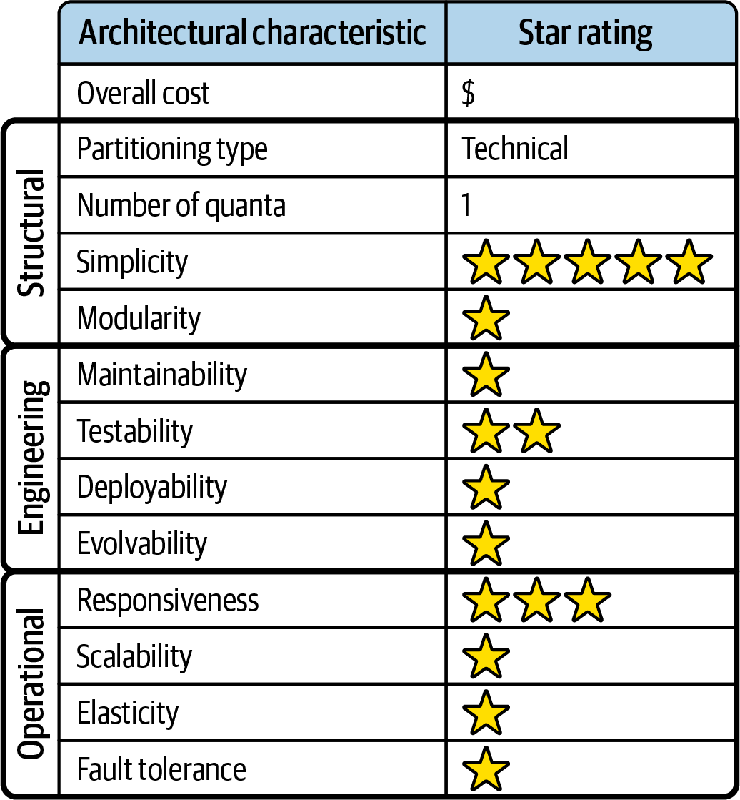

---

### Style 2: The Modular Monolith Architecture Style (Chapter 11)

- **Classification**: Monolithic, Domain-Partitioned.
- **Topology**: Deployed as a single monolithic quantum, but top-level namespaces and packages are strictly organized around **business domains** (inspired by Domain-Driven Design / DDD) rather than technical layers.

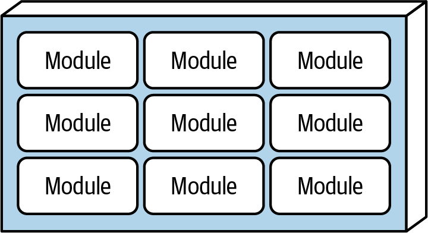

- **Key Concepts**:
  - **Domain Encapsulation**: Each module contains its own internal presentation, business rules, and repository logic.

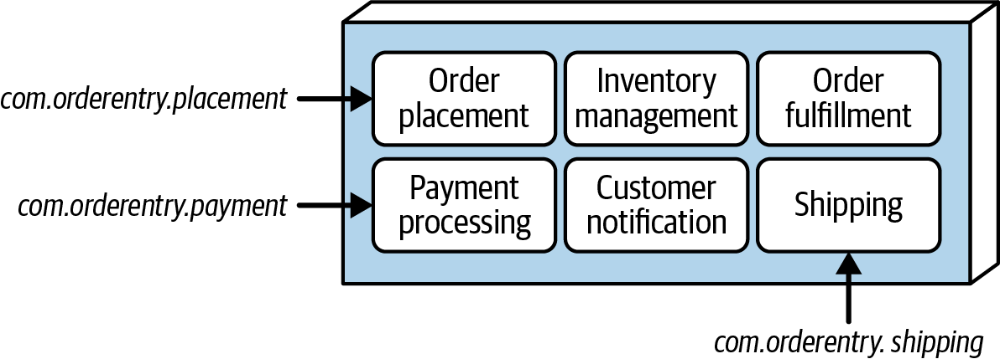

  - **Strict Architectural Boundaries**: Modules communicate through explicit, governed interfaces/contracts, forbidding direct internal cross-module calls.
  - **Data Topologies**: Can be organized as a single shared database or logically partitioned schemas per domain module:

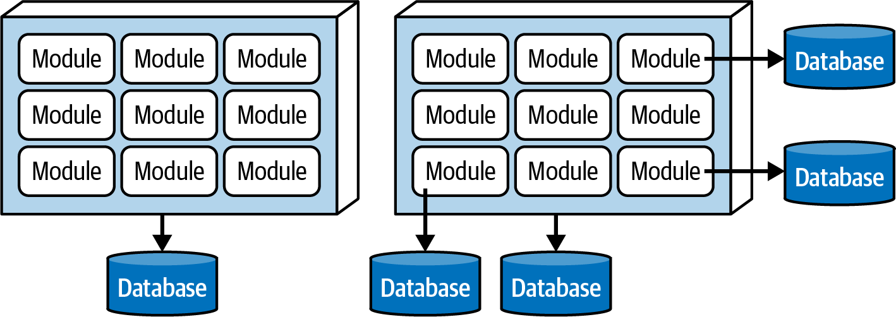

  - **Bridge to Distributed Systems**: Serves as the premier starting point for systems that might need microservices later: domains can be cleanly extracted because data and logic boundaries already exist.
- **Data Topology**: Single database, ideally logically partitioned into distinct schemas or table namespaces corresponding to each domain module.
- **Primary Strengths**: Low operational cost, high modularity, high maintainability, eliminates network latency while preserving domain boundaries.
- **Primary Weaknesses**: Monolithic runtime constraints: single point of failure, memory/CPU scaling bottlenecks, whole-application deployment coupling.
- **When to Use**: Green-field enterprise applications where business boundaries are clear but distributed operational complexity is unnecessary; teams with tight budgets seeking DDD discipline.
- **When NOT to Use**: Systems with drastically asymmetric scaling requirements across domains; large globally distributed teams requiring autonomous CI/CD pipelines.
- **Canonical Examples**: Shopify core architecture, GitHub monolith, modern Ruby on Rails or Spring Boot domain-partitioned architectures.

#### Architecture Characteristics Scorecard:
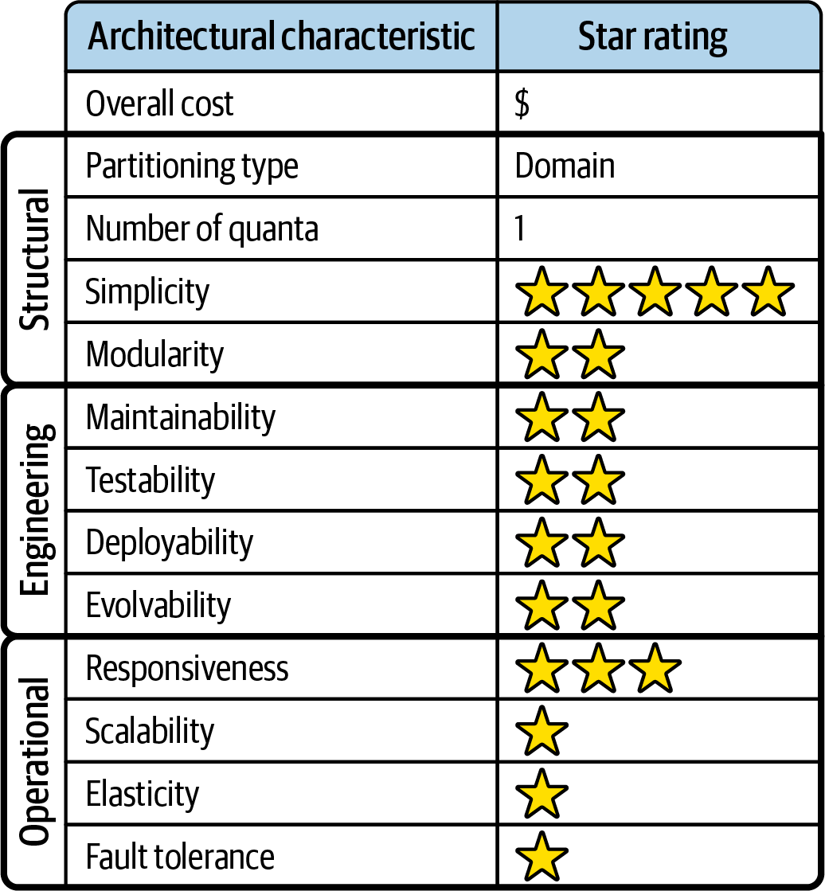

---

### Style 3: Pipeline Architecture Style (Chapter 12)
*Also known as: Pipes and Filters Architecture*

- **Classification**: Monolithic (or Distributed), Technically Partitioned.
- **Topology**: Data flows sequentially through discrete, independent processing elements (Filters) connected by communication channels (Pipes).

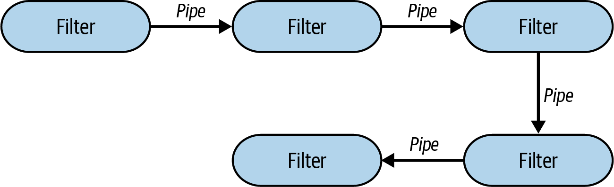

- **Key Concepts**:
  - **Filters**: Self-contained, stateless processing units performing a single transformation or task (e.g., Producer, Transformer, Tester, Consumer).
  - **Pipes**: Unidirectional channels carrying streams of data between filters.
  - **Composability**: Filters can be reordered, added, or removed dynamically without altering other filters.

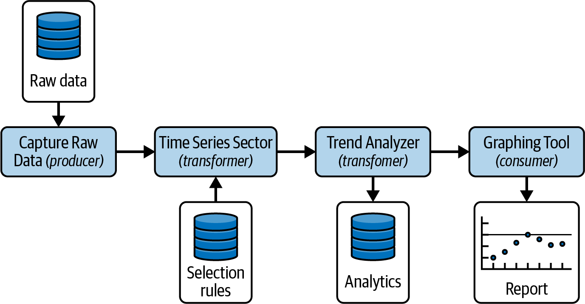

- **Data Topology**: Ephemeral in-memory payloads passed through pipes; individual filters may persist intermediate states to transient databases or object storage.
- **Primary Strengths**: High simplicity, high modularity, deterministic one-way processing, ease of isolated filter testing.
- **Primary Weaknesses**: Poor elasticity and scalability in monolithic implementations; inappropriate for complex interactive request/response cycles.
- **When to Use**: Batch processing pipelines; Extract-Transform-Load (ETL) workflows; compilers and text/stream processing engines; telemetric telemetry ingestion.
- **When NOT to Use**: Complex interactive transactional applications requiring rich bidirectional dialogs with users.
- **Canonical Examples**: Unix shell pipelines (`cat | grep | sort | awk`), Java Streams API, Apache Camel ETL flows, video transcoding pipelines.

#### Architecture Characteristics Scorecard:
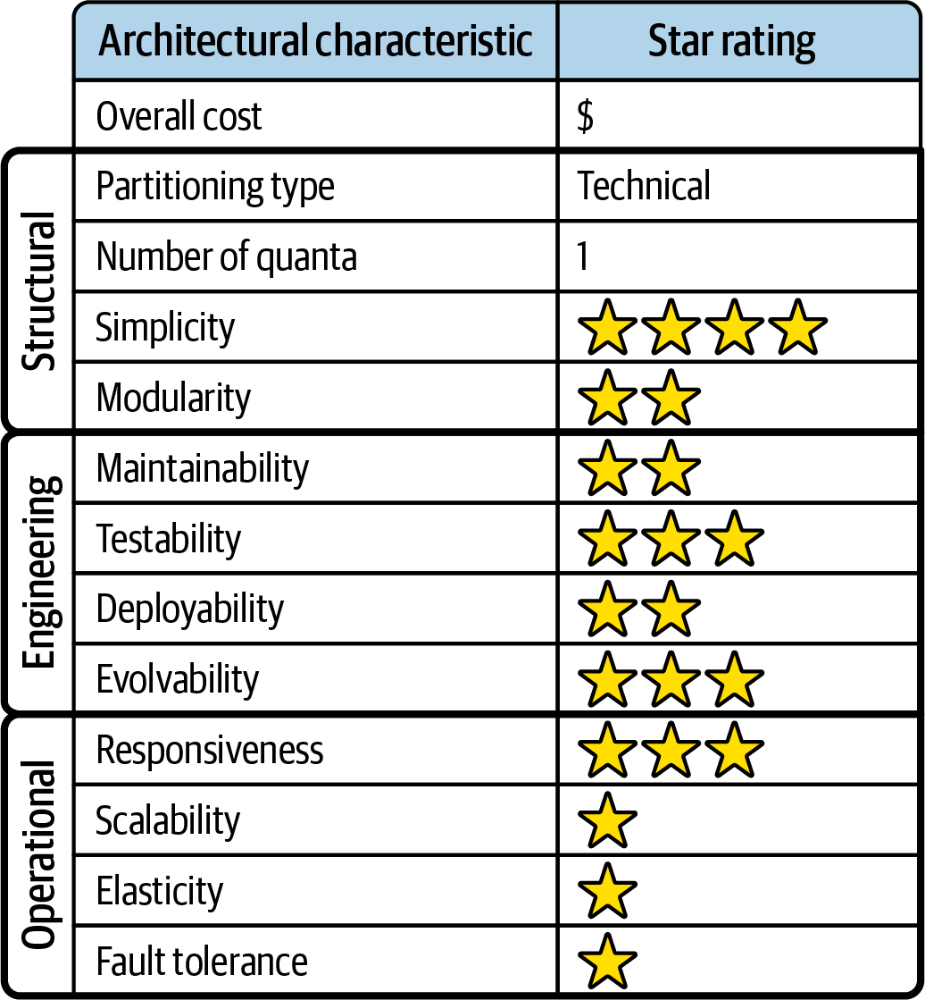

---

### Style 4: Microkernel Architecture Style (Chapter 13)
*Also known as: Plug-in Architecture*

- **Classification**: Monolithic, Technically & Functionally Partitioned.
- **Topology**: Separates minimal operational system capabilities (**Core System**) from specialized domain features (**Plug-in Components**).

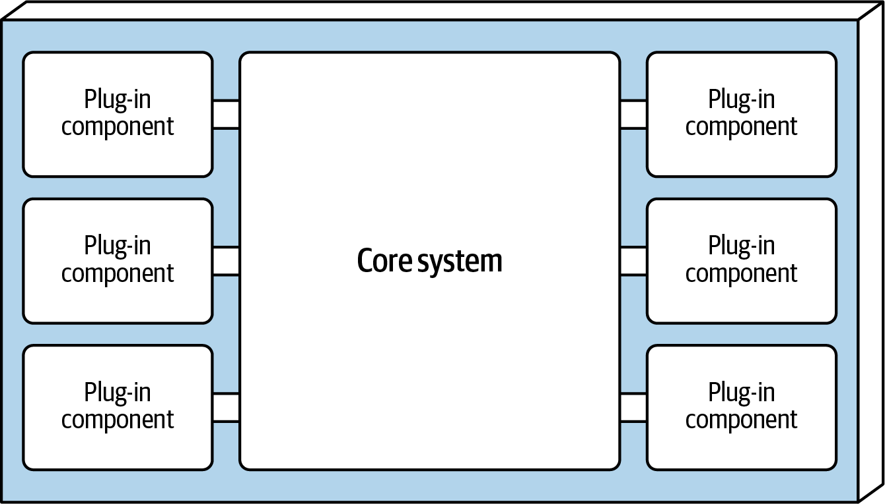

- **Key Concepts**:
  - **Core System**: Minimal viable software required to run the application (lifecycle management, routing, plug-in registry).
  - **Plug-in Components**: Standalone, independent modules containing specialized features, custom algorithms, or third-party adapters.
  - **The Spectrum of Microkern-ality**: Microkernels range from small standalone desktop tools to massive enterprise application platforms:

  - **Plug-in Registry**: Maintains metadata, entry points, and contracts of active plug-ins.
  - **Contracts**: Strict interfaces or schemas (APIs) governing communication between the core and plug-ins.
- **Data Topology**: Core system maintains application configuration and state; plug-ins can manage custom tables or localized state databases.
- **Primary Strengths**: Extreme extensibility, high adaptability, clear boundary enforcement, moderate cost, strong support for packaged software.
- **Primary Weaknesses**: Monolithic core volatility (modifying the core affects all plug-ins); complex inter-plugin dependency management; difficult distributed scalability.
- **When to Use**: Desktop tools; developer tooling; rule engines; product-based packaged software where clients customize business logic.
- **When NOT to Use**: Large web applications requiring dynamic cloud elasticity and massive horizontal distributed scale.
- **Canonical Examples**: VS Code, Eclipse IDE, Jira, Jenkins, Google Chrome/Firefox browser extensions, operating system kernels (Mach, MINIX).

#### Architecture Characteristics Scorecard:
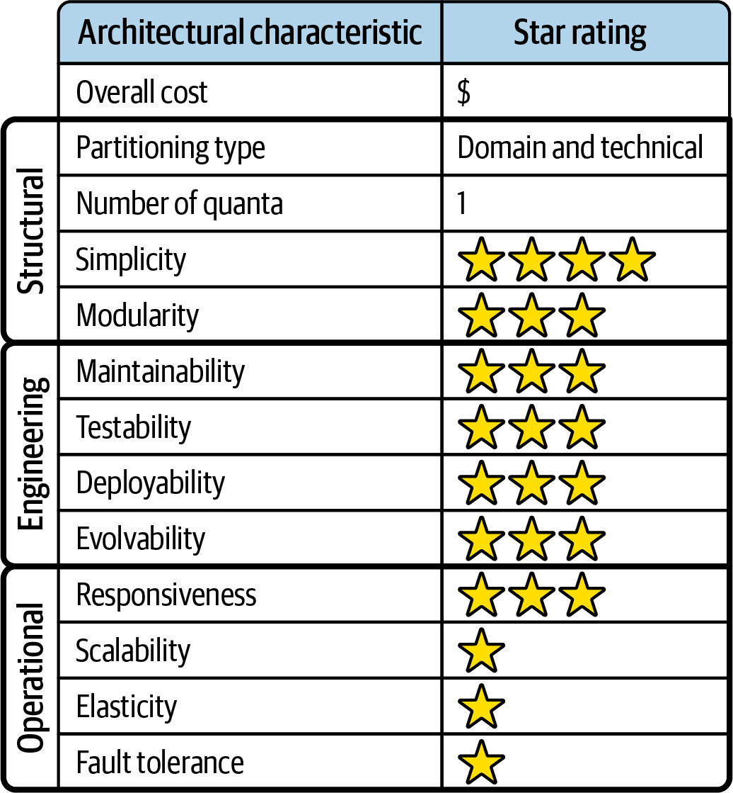

---

### Style 5: Service-Based Architecture Style (Chapter 14)

- **Classification**: Distributed, Domain-Partitioned (Pragmatic Hybrid).
- **Topology**: Consists of a small number (typically 4 to 12) of coarse-grained, independently deployed domain services, fronted by an API Gateway or UI layer, usually sharing a single database.

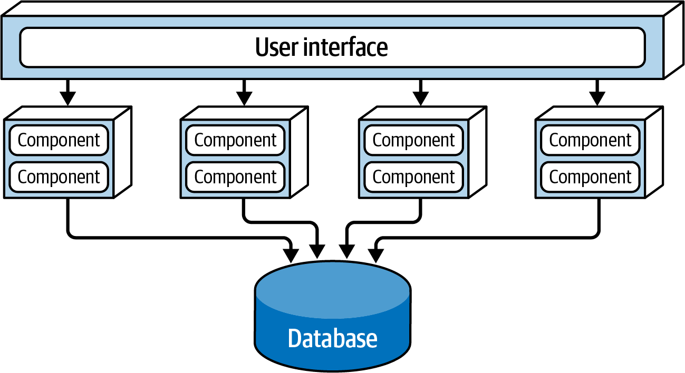

- **Key Concepts**:
  - **Domain Service Design Variants**: Services can be organized with varying levels of granularity depending on domain scale:

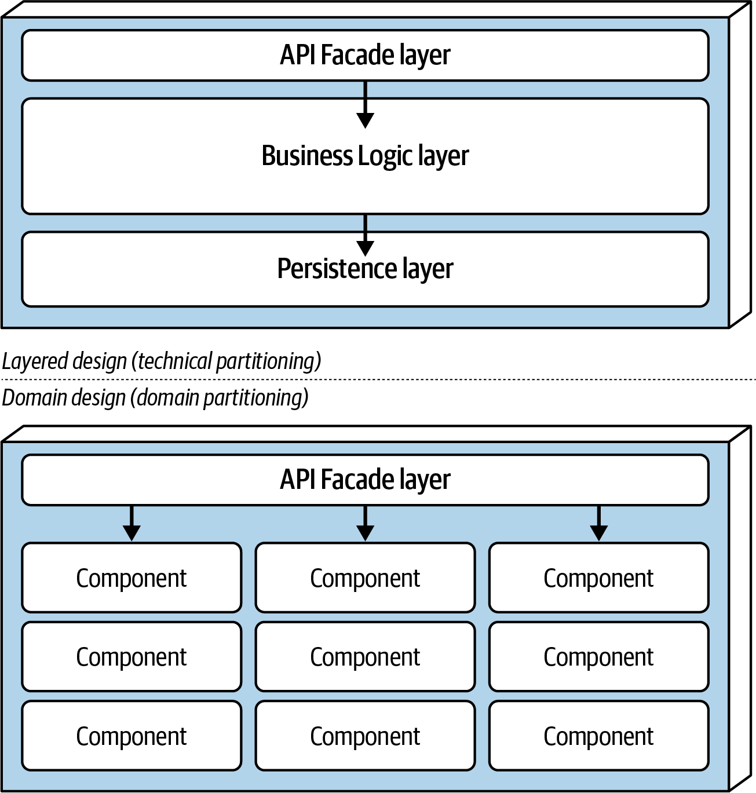

  - **API Gateway Layer**: Manages ingress routing and security for coarse-grained services:

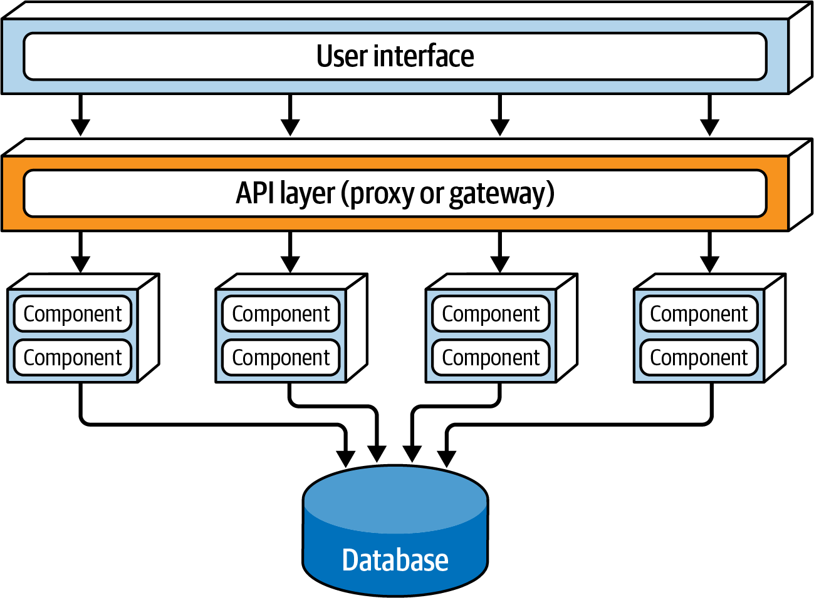

  - **Shared Library Impact**: Using shared libraries across services introduces compile-time coupling that must be carefully governed:

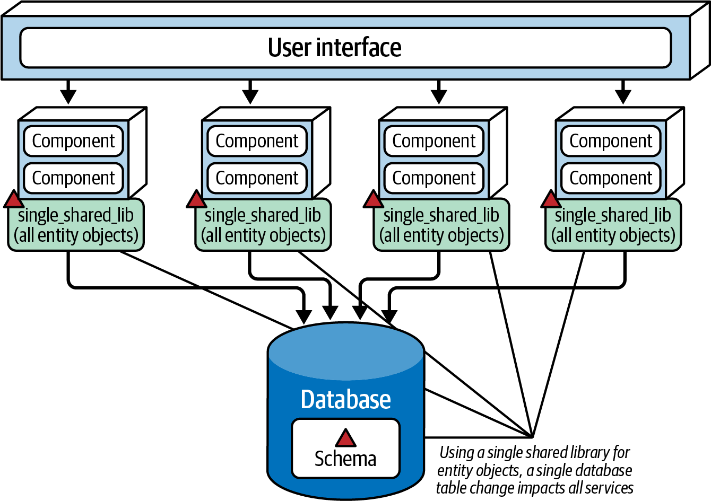

- **Data Topology**: Centrally shared relational database or federated shared database.
- **Primary Strengths**: Exceptional balance between agility, deployability, operational cost, and simplicity; easy migration path from monolithic systems.
- **Primary Weaknesses**: Shared database creates coupling at the data schema level; coarse granularity limits fine-grained independent autoscaling.
- **When to Use**: Modernizing legacy monoliths into distributed systems; medium-to-large business applications needing independent service deployments without microservice overhead.
- **When NOT to Use**: Ultra-high-scale systems where a shared database is the primary bottleneck; organizations with hundreds of autonomous product teams.
- **Canonical Examples**: Enterprise electronic device recycling systems (Going Green case study), e-commerce backends split into Catalog, Orders, and Customers services.

#### Architecture Characteristics Scorecard:
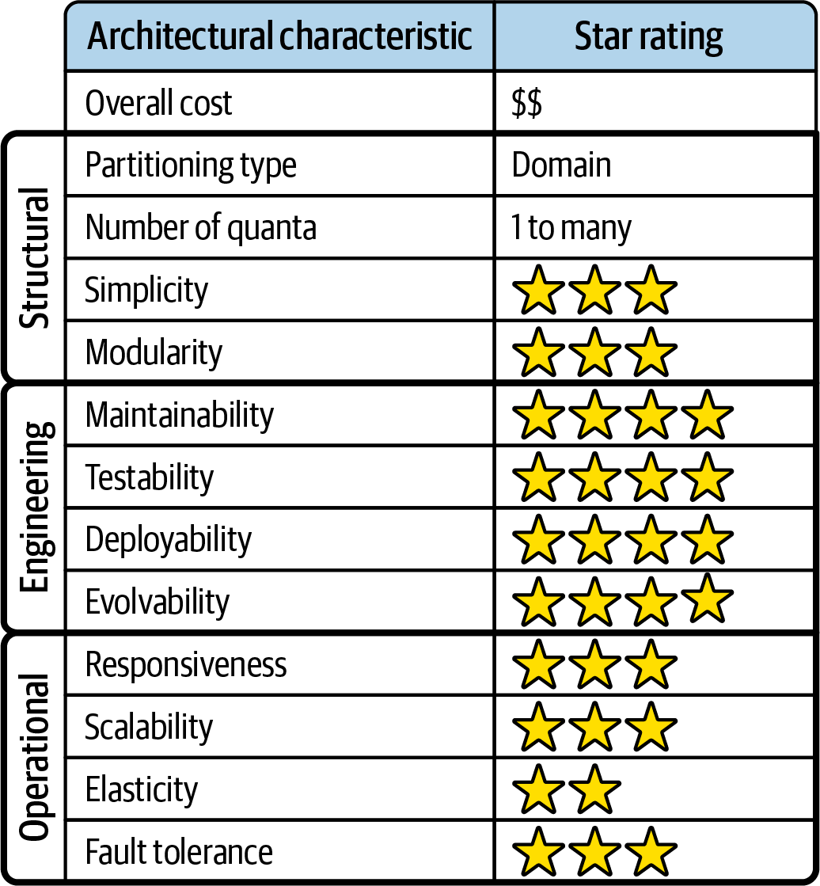

---

### Style 6: Event-Driven Architecture Style (Chapter 15)
*Also known as: EDA / Asynchronous Reactive Architecture*

- **Classification**: Distributed, Technically & Asynchronously Partitioned.
- **Topology**: Decoupled, asynchronous event-processing components reacting to events emitted onto a distributed message fabric.

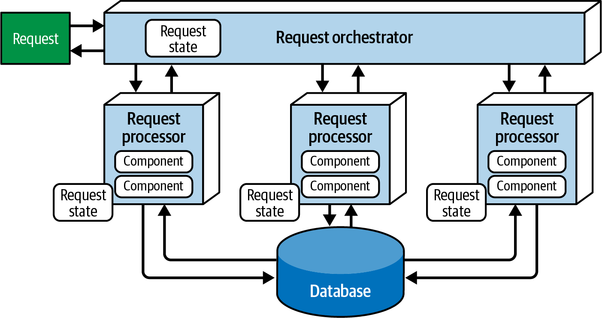

- **Built around Two Primary Topological Patterns**:
  1. **Broker Topology (Choreography)**: Lightweight message router (e.g., Apache Kafka, RabbitMQ) where event processors react and publish follow-up events with no central coordinator:

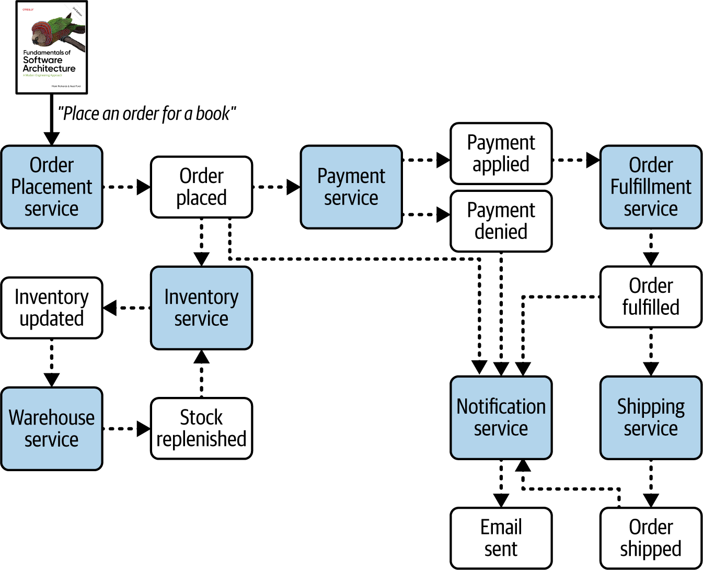

  2. **Mediator Topology (Orchestration)**: A central event mediator coordinates workflow steps by receiving initial events and dispatching processing commands to event consumers:

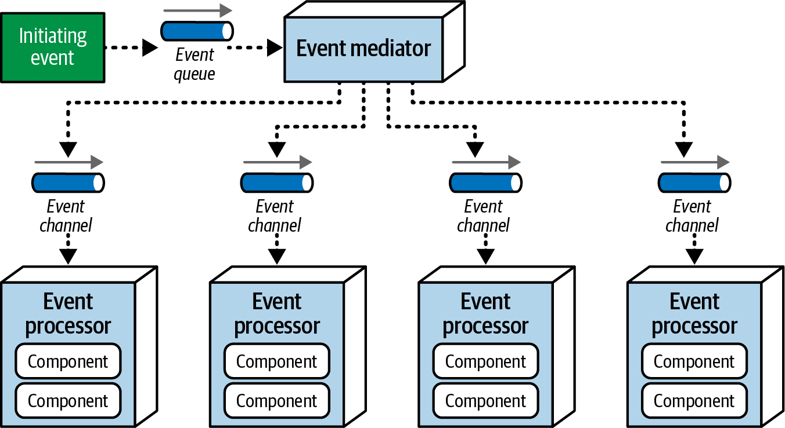

- **Key Concepts**:
  - **Asynchronous Architectural Quanta**: High decoupling creates multiple independently scalable and deployable quanta:

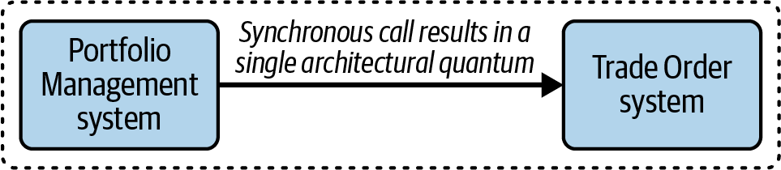

  - **Dynamic Scalability**: Event processors can autoscale dynamically based on queue lag and message volume.
  - **High Performance & Responsiveness**: Immediate response to clients while heavy operations process asynchronously.
- **Data Topology**: Distributed, database-per-service or event-store projections; relies on eventual consistency.
- **Primary Strengths**: Maximum performance, extreme scalability, high elasticity, high fault tolerance, superior adaptability.
- **Primary Weaknesses**: High architectural complexity, non-deterministic workflows, challenging testing/debugging, data consistency dilemmas, event contract versioning overhead.
- **When to Use**: Real-time reactive systems; financial trading engines; IoT sensor telemetry; complex asynchronous business workflows.
- **When NOT to Use**: Synchronous CRUD applications; systems requiring immediate hard ACID transactional guarantees; small, budget-constrained projects.
- **Canonical Examples**: High-frequency financial trading systems, Uber/Lyft driver dispatch engines, Netflix real-time streaming telemetry.

#### Architecture Characteristics Scorecard:
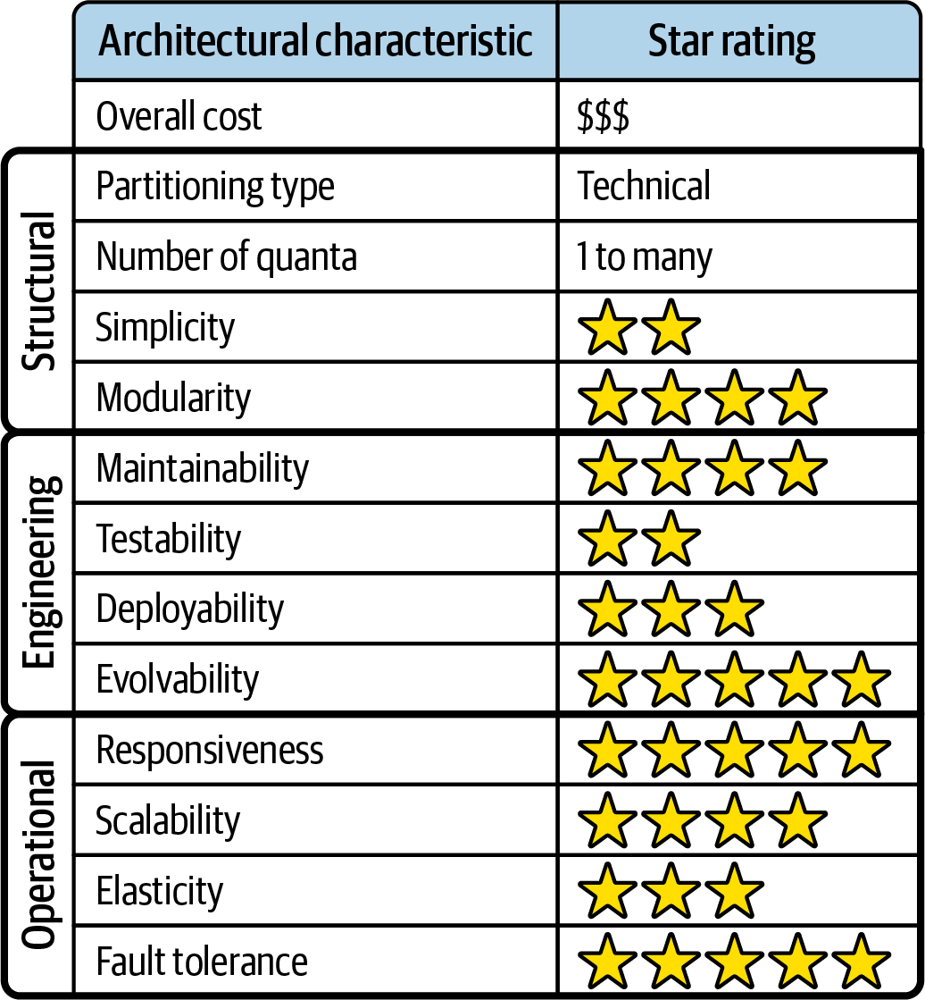

---

### Style 7: Space-Based Architecture Style (Chapter 16)
*Also known as: Cloud Cache / Tuple Space Architecture*

- **Classification**: Distributed, Technically Partitioned (High-Throughput).
- **Topology**: Designed specifically to eliminate the central database as the ultimate scalability bottleneck. Moves all active application data into **in-memory data grids (IMDG)** replicated across processing units.

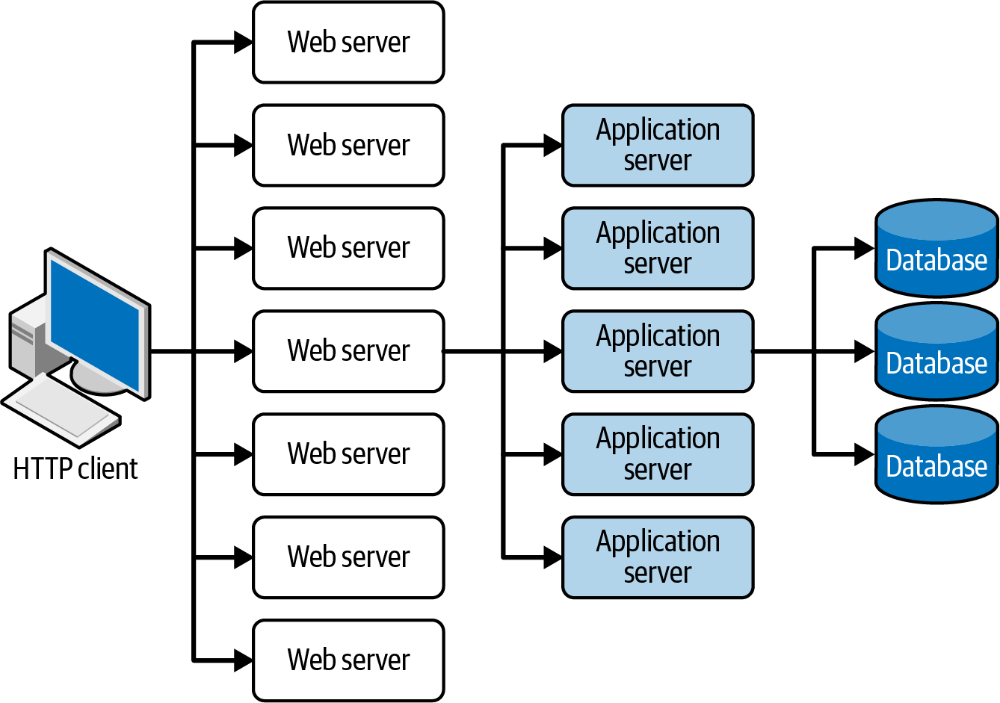

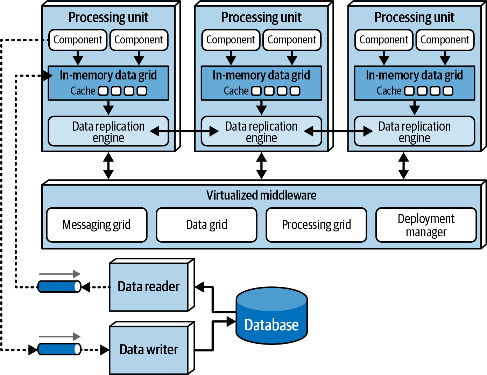

- **Key Concepts**:
  - **Processing Unit (PU)**: Self-contained deployment unit containing business logic and in-memory replicated data cache.
  - **Virtualized Middleware**: Contains Messaging Grid, Data Grid, Processing Grid, and Deployment Manager:

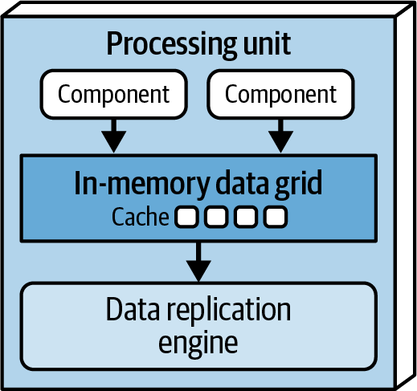

  - **Data Pumps & Writers**: Asynchronously write dirty in-memory data out to persistent relational storage out-of-band:

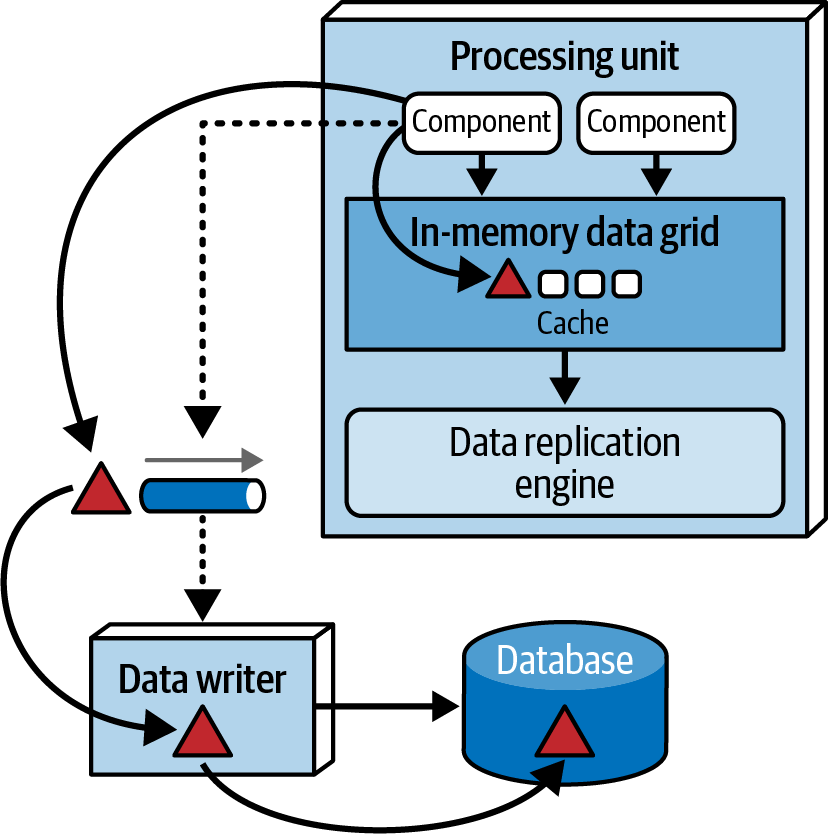

- **Data Topology**: In-memory distributed caching fabric; asynchronous background writes to secondary persistent databases.
- **Primary Strengths**: Industry-highest elasticity, near-infinite scalability, ultra-high throughput and sub-millisecond read/write performance.
- **Primary Weaknesses**: Very high software licensing and cloud infrastructure costs; high complexity; difficult testing; risk of data loss during simultaneous cache cluster crashes.
- **When to Use**: Systems with extreme, unpredictable usage spikes (e.g., 0 to 1,000,000 users in seconds); ticket flash sales; online bidding/auctions.
- **When NOT to Use**: Budget-conscious projects; standard predictable transaction workloads; applications with massive multi-terabyte transactional datasets that cannot fit in RAM.
- **Canonical Examples**: Ticketmaster concert ticket flash sales, airline holiday booking reservation engines, real-time sports betting platforms.

#### Architecture Characteristics Scorecard:
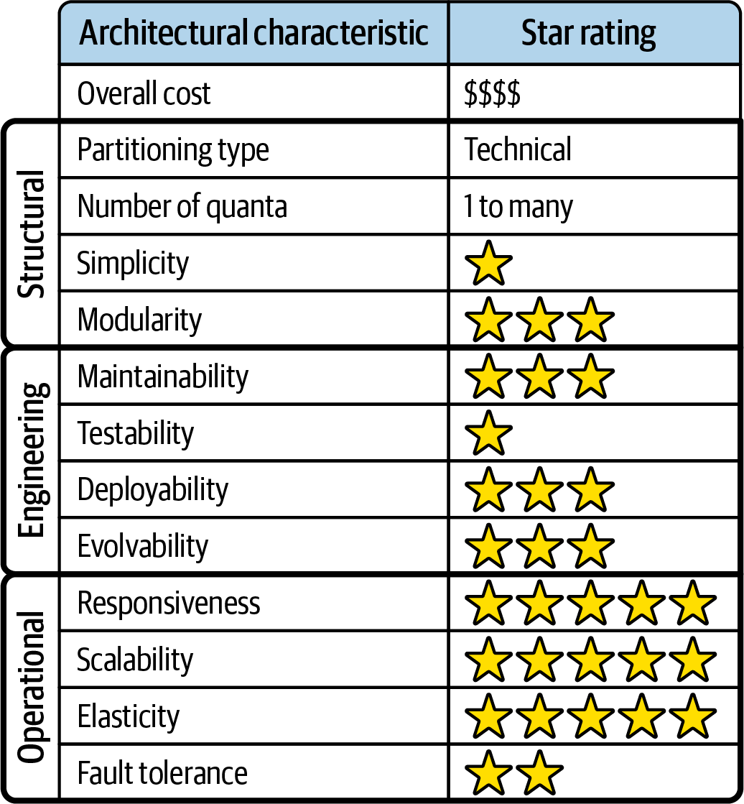

---

### Style 8: Orchestration-Driven Service-Oriented Architecture (Chapter 17)
*Also known as: Traditional Enterprise SOA*

- **Classification**: Distributed, Technically Partitioned (Enterprise Taxonomy).
- **Topology**: Built around strict enterprise taxonomy and centralized integration:
  1. *Business Services*: High-level abstract enterprise domain capabilities.
  2. *Enterprise Services*: Granular shared services implementing enterprise reusable logic.
  3. *Application Services*: Specialized one-off application integrations.
  4. *Enterprise Service Bus (ESB)*: Heavyweight centralized integration hub handling protocol transformation, message routing, and orchestration.

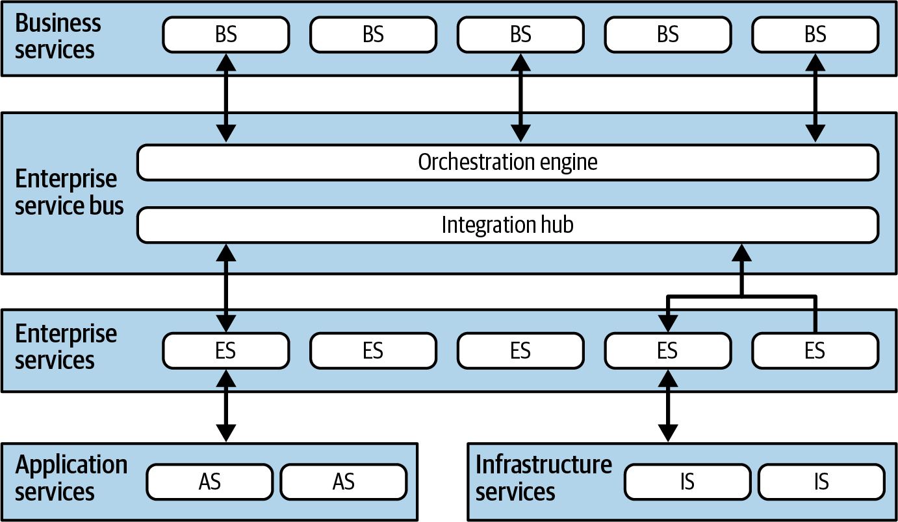

- **Key Concepts**:
  - **ESB Centralization**: Heavy smart-pipes infrastructure coordinating enterprise transactions:

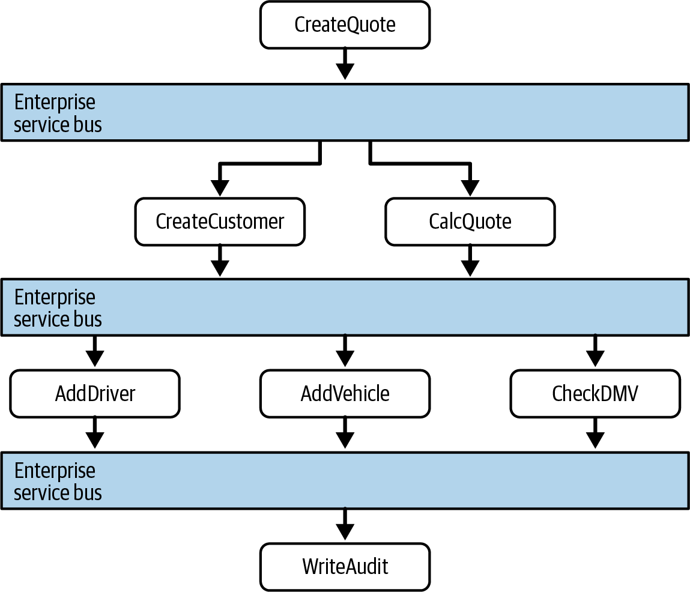

  - **Enterprise Reuse Priority**: Primary design goal was maximal reuse of business services across the entire enterprise.
  - **Coupling Trap**: High degree of coupling created when multiple business units shared and depended upon identical enterprise services.
- **Data Topology**: Enterprise-wide shared relational databases accessed via data services.
- **Primary Strengths**: Comprehensive enterprise governance, shared service reuse across legacy systems.
- **Primary Weaknesses**: Catastrophic operational coupling, single point of failure and bottleneck at the ESB, low agility, sluggish deployment velocity, extremely high cost.
- **When to Use**: Legacy enterprise environments where massive heterogeneous mainframes and ERP systems must be harmonized under strict governance.
- **When NOT to Use**: Modern agile, cloud-native systems; applications prioritizing rapid release cycles and independent team autonomy.
- **Canonical Examples**: Large banking systems and telecommunications backbones built during the late 1990s and early 2000s using IBM WebSphere, Oracle SOA Suite, or TIBCO.

#### Architecture Characteristics Scorecard:
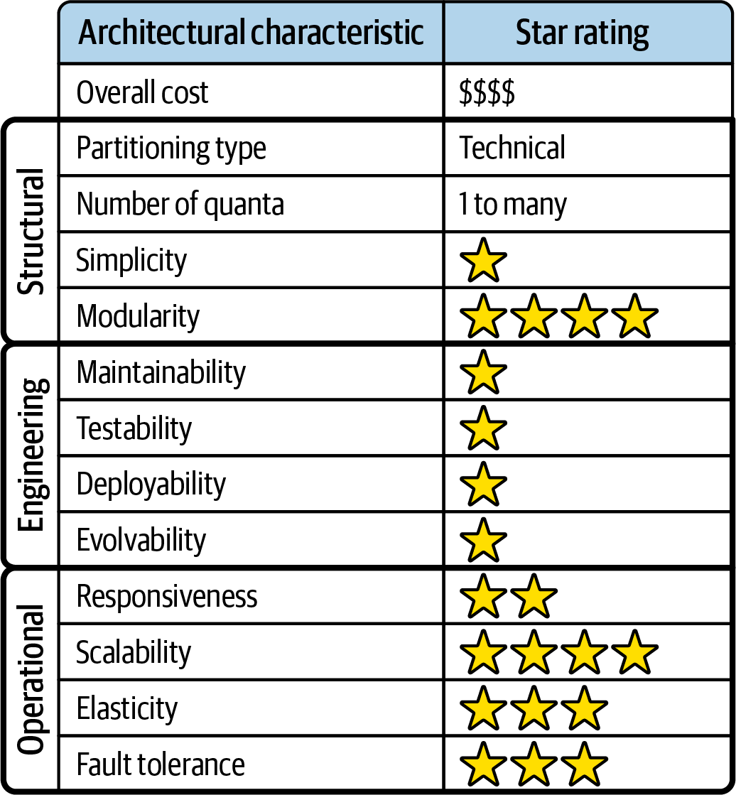

---

### Style 9: Microservices Architecture (Chapter 18)

- **Classification**: Distributed, Domain-Partitioned.
- **Topology**: A fleet of small, decoupled, independently deployable services organized strictly around business capabilities (Bounded Contexts) with decentralized data.

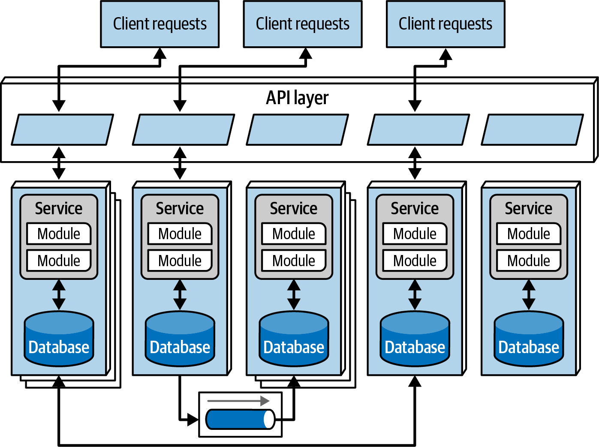

- **Key Concepts**:
  - **Core Philosophies**:
    1. *Bounded Context*: Each microservice represents a complete, cohesive business capability.
    2. *Database-per-Service*: Services completely own their private datastore; direct database access across service boundaries is strictly prohibited:

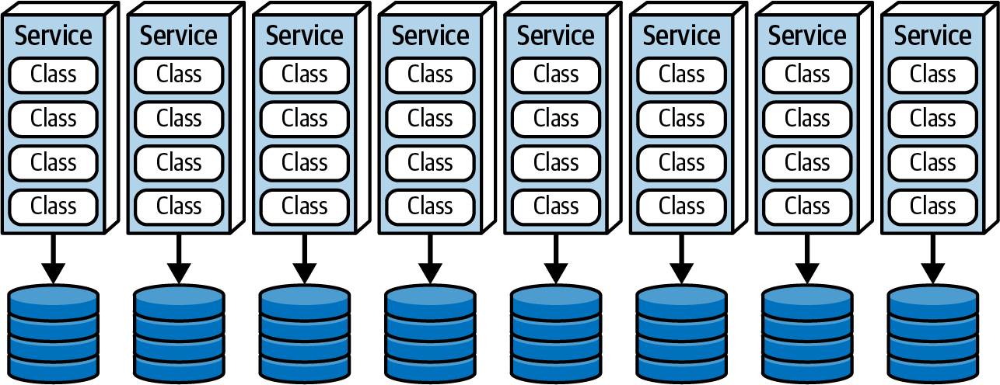

    3. *Smart Endpoints, Dumb Pipes*: Business logic resides entirely within services; communication occurs over simple protocol endpoints (REST, gRPC, lightweight queues).
    4. *Independent Deployability*: Any single microservice can be built, tested, deployed, and scaled without impacting any other service.
  - **Operational Reuse via Service Mesh & Sidecars**:

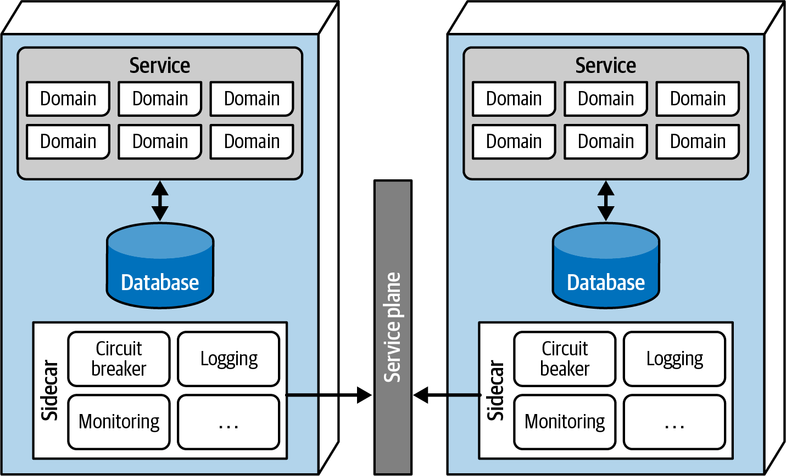

- **Data Topology**: Fully decentralized datastores (polyglot persistence: relational, NoSQL, graph, key-value per service).
- **Primary Strengths**: Unmatched agility, continuous independent deployability, high testability, fault isolation, elastic autoscaling.
- **Primary Weaknesses**: High network latency overhead, complex distributed sagas for transactional consistency, operational complexity requiring mature DevOps/platform engineering.
- **When to Use**: Large organizations with multiple autonomous cross-functional teams; complex domains requiring continuous deployment; systems demanding polyglot technologies and granular autoscaling.
- **When NOT to Use**: Small applications; early-stage startups where domain boundaries are volatile; teams lacking mature automated CI/CD and observability infrastructure.
- **Canonical Examples**: Netflix video streaming and recommendation fleet, Amazon retail platform, Spotify domain services.

#### Architecture Characteristics Scorecard:
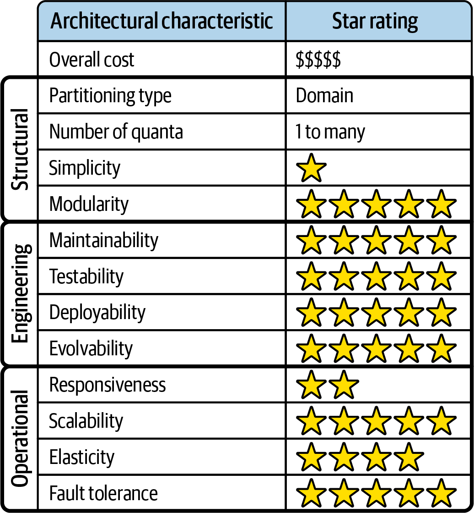

---

## 3. Comprehensive Architecture Styles Matrix

The following table synthesizes the architectural characteristics, partitioning topologies, and trade-off profiles of all 9 styles documented in *Fundamentals of Software Architecture*:

| Architectural Style | Topology Model | Partitioning Model | Number of Quanta | Primary Strengths | Primary Trade-Offs / Weaknesses | Ideal Use Case |
| :--- | :--- | :--- | :---: | :--- | :--- | :--- |
| **Layered** (Ch 10) | Monolithic | Technical | 1 | Simplicity, Low Cost, Layer Isolation | Low Scalability, Slow Deployments, Sinkhole Risk | Simple CRUD applications, internal utilities, startups on strict budgets |
| **Modular Monolith** (Ch 11) | Monolithic | Domain | 1 | Modularity, Domain Alignment, Zero Network Latency | Single Deployment Quantum, Monolithic Scaling Constraints | Enterprise applications wanting DDD discipline without distributed DevOps overhead |
| **Pipeline** (Ch 12) | Monolithic / Distributed | Technical | 1 or Many | High Modularity, Deterministic Flow, Composability | Low Scalability (if mono), Inappropriate for Interactive Dialogs | Data transformations, ETL processing, compilers, media transcoding |
| **Microkernel** (Ch 13) | Monolithic | Technical & Functional | 1 | Extensibility, Customizability, Feature Isolation | Volatile Core Risk, Inter-plugin Coupling, Complex Scaling | Packaged software, IDEs, browser extensions, configurable workflow engines |
| **Service-Based** (Ch 14) | Distributed | Domain | 4–12 | High Agility, Shared DB Simplicity, Independent Deployments | Shared Database Schema Bottleneck, Coarse Granularity | Modernizing monolithic apps into distributed services without full microservice cost |
| **Event-Driven (EDA)** (Ch 15) | Distributed | Technical / Asynchronous | Many | Extreme Performance, Scalability, High Fault Tolerance | Complex Event Governance, Non-deterministic Workflows, Eventual Consistency | Real-time reactive systems, trading platforms, IoT stream processing |
| **Space-Based** (Ch 16) | Distributed | Technical (IMDG Grid) | Many | Near-Infinite Elasticity, Sub-millisecond Latency | High Infrastructure Cost, Extreme Complexity, Cache Sync Risk | Flash-sale ticketing, high-concurrency bidding, travel reservation spikes |
| **Orchestration SOA** (Ch 17) | Distributed | Technical / Enterprise | Many | Enterprise Governance, High Centralized Service Reuse | Heavy ESB Bottleneck, High Coupling, Sluggish Agility | Legacy enterprise integration across heterogeneous legacy platforms |
| **Microservices** (Ch 18) | Distributed | Domain | Many | Continuous Deployability, Fault Isolation, Polyglot Freedom | Distributed Data Consistency, Network Latency, High Operational Overhead | Large enterprise engineering teams, rapidly evolving cloud-native products |

---

## 4. Architectural Style Selection Framework (Chapter 19)

In Chapter 19 (*Choosing the Appropriate Architecture Style*), Richards and Ford present a decision framework based on the **First Law of Software Architecture**:
> *"Everything in software architecture is a trade-off."*

### 4.1 Decision Criteria Checklist
1. **Analyze Domain Drivers**:
   - Is the business domain stable, or is it evolving rapidly?
   - Do different business features have conflicting scaling or throughput requirements?
2. **Prioritize Architectural Characteristics (-ilities)**:
   - Identify the top 3–5 non-functional characteristics that make the system a success (e.g., *Elasticity*, *Fault Tolerance*, *Time-to-Market*, *Cost*).
3. **Evaluate Organizational Constraints**:
   - Assess team topology, DevOps automation maturity, and budget.
   - Do not choose a microservices architecture if the organization cannot automate testing, deployment, and distributed tracing.
4. **Determine Quanta Boundary**:
   - Start with a single quantum (**Modular Monolith**) if domain boundaries are volatile or unknown.
   - Migrate to multiple quanta (**Service-Based** or **Microservices**) as domain boundaries harden and operational pressures demand independent elasticity.
