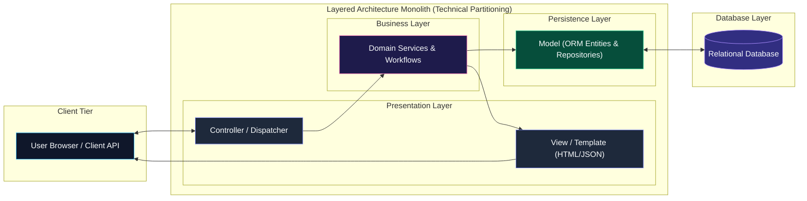

---
title: "MVC and MVT in Software Architecture Classification: Taxonomy, Partitioning, and Trade-Off Analysis"
date: "2026-11-16"
version: "1.0.0"
status: "Complete"
tags:
  - "Software Architecture"
  - "Architecture Styles"
  - "Architectural Patterns"
  - "Design Patterns"
  - "MVC"
  - "MVT"
  - "Layered Architecture"
  - "Technical Partitioning"
  - "Fundamentals of Software Architecture"
---

# MVC and MVT in Software Architecture Classification: Taxonomy, Partitioning, and Trade-Off Analysis

> **Canonical Reference**: Richards, Mark, and Neal Ford. *Fundamentals of Software Architecture: A Modern Engineering Approach*. O'Reilly Media, 2020. Chapters 9 ("Architecture Partitioning") and 10 ("Layered Architecture Style").

---

## 1. Executive Summary & Core Classification Thesis

In software engineering discourse, **Model-View-Controller (MVC)** and **Model-View-Template (MVT)** are frequently colloquially referred to as "architectures." However, when evaluated against the formal taxonomy established by Mark Richards and Neal Ford in *Fundamentals of Software Architecture*, **MVC and MVT are NOT top-level macro-architectural styles**.

Instead, MVC and MVT represent **Presentation & Interaction Design Patterns (or Subsystem Architectural Patterns)** that implement **Technical Top-Level Partitioning** within the **Monolithic Layered Architecture Style**.

```mermaid
flowchart TD
    Monolith["Macro Architectural Style: Monolithic System"] --> Layered["Style: Layered Architecture (Chapter 10)"]
    Layered --> TechPart["Top-Level Partitioning: Technical Partitioning (Chapter 9)"]
    TechPart --> PresTier["Presentation & Interaction Tier"]
    PresTier --> MVC["Pattern: Model-View-Controller (MVC)"]
    PresTier --> MVT["Pattern: Model-View-Template (MVT - Django Variant)"]

    classDef root fill:#0f172a,stroke:#38bdf8,stroke-width:2px,color:#f8fafc;
    classDef style fill:#1e293b,stroke:#818cf8,stroke-width:2px,color:#f8fafc;
    classDef part fill:#334155,stroke:#34d399,stroke-width:2px,color:#f8fafc;
    classDef pat fill:#1e1b4b,stroke:#f472b6,stroke-width:2px,color:#f8fafc;

    class Monolith root;
    class Layered style;
    class TechPart part;
    class PresTier,MVC,MVT pat;
```

---

## 2. The Architectural Hierarchy: Styles vs. Patterns vs. Idioms

To understand where MVC and MVT reside, one must distinguish the three tiers of architectural granularity defined across software engineering literature:

| Hierarchy Level | Scope & Boundary | Definition & Responsibilities | Concrete Examples | Where MVC/MVT Fits |
| :--- | :--- | :--- | :--- | :---: |
| **1. Architectural Style (Macro)** | Entire System / Deployment Units | Defines the macro-topology, physical/logical deployment boundaries, and remote communication paradigms across the enterprise. | Layered, Modular Monolith, Microservices, Event-Driven, Microkernel, Space-Based. | Parent container (**Layered Architecture**) |
| **2. Architectural Pattern (Meso)** | Subsystem / Application Layer | Organizes subcomponents, data flows, and structural responsibilities within a single deployable unit or layer. | CQRS, Event Sourcing, Hexagonal (Ports & Adapters), **MVC**, **MVT**, BFF (Backend-for-Frontend). | **Direct Classification (Meso Pattern)** |
| **3. Design Pattern (Micro)** | In-Memory Class / Object Level | Localized object-oriented design solutions solving specific object creation, composition, and behavioral interaction problems (GoF). | Factory Method, Observer, Strategy, Decorator, Singleton, Adapter. | Constituent components within MVC/MVT |

---

## 3. Direct Analysis of the Canonical Text (*Fundamentals of Software Architecture*)

> [!NOTE]
> **Page Numbering Alignment**: Citations below provide both the **Printed Book Page** (the number printed in the header/footer of the published book) and the corresponding **PDF Reader Page** (the absolute page index in PDF viewers, offset by 24 pages due to introductory front-matter).

### 3.1. Chapter 9: Architecture Partitioning (Print pp. 137–142 / PDF pp. 161–166)

In Chapter 9, Richards and Ford analyze how architects decompose systems into top-level components. They establish the **First Law of Software Architecture** ("*Everything in software is a trade-off*") and define two diametrically opposed strategies for top-level partitioning:
1. **Domain Partitioning**: Components are grouped around business workflows, domains, or bounded contexts (e.g., *Billing*, *Orders*, *Shipping*). This is the foundation of Modular Monoliths and Microservices.
2. **Technical Partitioning**: Components are grouped by technical capabilities and layers of concern (e.g., *Presentation*, *Business Logic*, *Persistence*, *Database*).

The authors explicitly locate MVC on **Print Page 138 (PDF Page 162)**:
> *"Even though the basic concept of layered architecture predates it by decades, the **Model-View-Controller design pattern** (one of the fundamental patterns in Head First Design Patterns by Eric Freeman and Elisabeth Robson (O'Reilly, 2020)), **matches with this architectural pattern, making it easy for developers to understand. Thus, in many organizations, it is the default architecture.**"*

And on **Print Page 142 (PDF Page 166)**:
> *"Technically partitioned architectures separate top-level components based on technical capabilities rather than discrete workflows. **This may manifest as layers inspired by Model-View-Controller separation** or some other ad hoc technical partitioning."*


---

### 3.2. Chapter 10: Layered Architecture Style (Print pp. 153–164 / PDF pp. 177–188)

Chapter 10 details the **Layered Architecture Style** (also known as the *N-Tier Monolith*). It is the canonical implementation of technical top-level partitioning.


The standard layered architecture consists of four logical layers:
1. **Presentation Layer**: Responsible for handling UI and browser communication.
2. **Business Layer**: Responsible for executing domain rules and business workflows.
3. **Persistence Layer**: Responsible for managing data access and abstracting database operations.
4. **Database Layer**: Responsible for physical persistence (tables, documents, indexes).


---

## 4. Architectural Mapping: MVC and MVT within the Layered Monolith

MVC and MVT map directly onto the Presentation, Business, and Persistence layers of the layered architecture:



### 4.1. Classic Model-View-Controller (MVC)

Originated by Trygve Reenskaug in Smalltalk-79 and formalized in web architectures (e.g., Spring MVC, ASP.NET MVC, Ruby on Rails):

- **Model**: Represents application state and business logic data. In the Richards & Ford 4-layer model, the *Model* spans both the **Persistence Layer** (data structures, ORM entities) and the **Business Layer** (business rules on entities).
- **View**: Renders visual representation of state. It resides entirely inside the **Presentation Layer**.
- **Controller**: Intercepts HTTP requests, parses user input, invokes business services, and selects the appropriate View to render. Resides in the **Presentation Layer**.

### 4.2. Model-View-Template (MVT)

Popularized by Python web frameworks such as **Django**:

In MVT, the framework itself acts as the **Controller**. The developer does not write a separate controller class; rather, the web framework handles URL dispatching, middleware filters, and request routing automatically.

- **Model**: Data access layer handled by Django ORM. Corresponds to the **Persistence Layer**.
- **View**: Callback function or class that executes business logic, processes HTTP parameters, and fetches models. Corresponds to the boundary between the **Presentation Layer** and **Business Layer**.
- **Template**: HTML file containing Django Template Language (DTL) or Jinja syntax. Corresponds to the **Presentation / View Layer**.

### 4.3. Comparison Matrix

| Component | Standard 4-Tier Layer (Richards & Ford) | Spring MVC (Java) | Django MVT (Python) | ASP.NET MVC (C#) |
| :--- | :--- | :--- | :--- | :--- |
| **User Interface** | Presentation Layer | JSP / Thymeleaf / React | HTML / Django Template (`.html`) | Razor View (`.cshtml`) |
| **Request Dispatcher** | Presentation Layer | `DispatcherServlet` + `@Controller` | Django Core URL Dispatcher (`urls.py`) | Routing Engine + `Controller` |
| **Application Logic** | Business Layer | `@Service` / Domain Service | View function / class (`views.py`) | Service / Manager classes |
| **Data Mapping** | Persistence Layer | Hibernate / JPA `@Entity` | Django `models.Model` | Entity Framework Core `DbSet` |
| **Physical Storage** | Database Layer | PostgreSQL / MySQL | PostgreSQL / MySQL / SQLite | SQL Server / PostgreSQL |

---

## 5. Architectural Enforcement: ArchUnit Governance

Richards and Ford emphasize that in layered architectures, architects must programmatically enforce **layer isolation** using fitness functions (e.g., ArchUnit in Java, import-linter in Python).

On **Print Pages 159–160 (PDF Pages 183–184)**, they illustrate how technically partitioned Controller-Service-Repository tiers are locked down to prevent layer violation:

```java
// ArchUnit architectural fitness function enforcing technical layer boundaries
@AnalyzeClasses(packages = "com.enterprise.system")
public class LayeredArchitectureTest {

    @ArchTest
    public static final ArchRule layers_must_respect_technical_partitioning = layeredArchitecture()
        .layer("Controller").definedBy("..controller..")
        .layer("Service").definedBy("..service..")
        .layer("Repository").definedBy("..repository..")
        
        .whereLayer("Controller").mayNotBeAccessedByAnyLayer()
        .whereLayer("Service").mayOnlyBeAccessedByLayers("Controller")
        .whereLayer("Repository").mayOnlyBeAccessedByLayers("Service");
}
```

This governance invariant proves that Controllers and Views reside at the uppermost presentation slice of a strictly bounded layered monolith.

---

## 6. Trade-Off Analysis: Richards & Ford Architectural Scorecard

Because MVC and MVT are implementations of the **Layered Architecture Style**, they inherit all the characteristics, trade-offs, and ratings of Chapter 10:


### 6.1. Architectural Star Ratings

| Architectural Characteristic | Rating (1–5 Stars) | Architectural Analysis from Book |
| :--- | :---: | :--- |
| **Overall Cost** | ⭐⭐⭐⭐⭐ | Extremely low barrier to entry; standard tooling and scaffolding in every major framework. |
| **Simplicity** | ⭐⭐⭐⭐⭐ | Intuitive separation of concerns; natural cognitive mapping for development teams. |
| **Maintainability** | ⭐⭐⭐⭐ | High component modularity within layers; changes to UI rarely affect persistence directly. |
| **Testability** | ⭐⭐⭐⭐ | Layers can be mocked or stubbed easily (mocking services in controller tests). |
| **Deployability** | ⭐⭐ | Monolithic release cycle; changing one line in a Model requires redeploying the entire unit. |
| **Scalability** | ⭐ | Monolithic database and shared memory prevent horizontal auto-scaling of isolated features. |
| **Elasticity** | ⭐ | Slow startup times and coarse-grained deployment units make elasticity poor. |
| **Fault Tolerance** | ⭐ | Monolithic process boundary: a fatal crash in the presentation or persistence tier halts the entire system. |

---

## 7. Key Antipatterns and Architectural Pitfalls

Richards and Ford warn architects about specific failure modes inherent in MVC-style technical partitioning:

### 7.1. The Architecture Sinkhole Antipattern (Chapter 10, Print p. 158 / PDF p. 182)
- **Problem**: Requests simply pass through multiple layers as simple passthroughs with zero processing logic (e.g., `Controller` calls `Service.getCustomer()`, which calls `Repository.getCustomer()`, which queries DB).
- **Rule of Thumb**: Richards & Ford state that if **more than 20%** of requests in a system are simple passthroughs, the architecture is suffering from the Sinkhole Antipattern.
- **Remediation**: Opening specific layers (making the Business Layer open) or migrating to a Modular Monolith.

### 7.2. Global Coupling & Domain Fragmentation (Chapter 9, Print p. 142 / PDF p. 166)
- **Problem**: When business workflows change (e.g., adding a customer tax ID), the developer must modify files scattered across every technical layer: `customer_controller.py`, `customer_service.py`, `customer_model.py`, and the database schema.
- **Trade-off**: Technical partitioning maximizes technical cohesion but severely degrades **functional (domain) cohesion**.

### 7.3. Conway's Law Organizational Silos (Chapter 9, Print pp. 138–139 / PDF pp. 162–163)
- Technically partitioned architectures encourage organizations to align teams technically: the "Frontend / UI team" (Views/Templates), the "Backend team" (Controllers/Services), and the "DBA team" (Models/Schemas).
- This structure creates organizational friction and slow delivery pipelines because every single user-facing feature requires cross-department coordination.

---

## 8. Summary Conclusion

When discussing system design:
1. **Never classify MVC or MVT as an Architectural Style.**
2. **Correct Classification**: MVC and MVT are **Presentation / Interaction Design Patterns** that structure the presentation tier of a **Technically Partitioned Layered Architecture Monolith**.
3. **When to Evolve**: If high scalability, independent deployability, or domain-driven bounded contexts are required, architectures must evolve away from technical MVC partitioning toward **Domain Partitioning** (Modular Monolith, Service-Based, or Microservices styles).

---

## 🔗 Related Architecture Manuals
- [`001_architectural_styles_catalog_and_comparative_analysis.md`](001_architectural_styles_catalog_and_comparative_analysis.md): Complete catalog and characteristics scorecards for all 8 architecture styles from Richards & Ford.
- [`002_architectural_styles_vs_architecture_patterns_vs_design_patterns.md`](../query_Architecture_Patterns/002_architectural_styles_vs_architecture_patterns_vs_design_patterns.md): Granularity hierarchy breakdown (Styles vs. Patterns vs. Idioms).
- [`001_software_architecture_patterns_antipatterns_and_pitfalls.md`](../query_Architecture_Patterns/001_software_architecture_patterns_antipatterns_and_pitfalls.md): Comprehensive catalog of 24 architectural patterns, 5 antipatterns, and 3 critical pitfalls.
