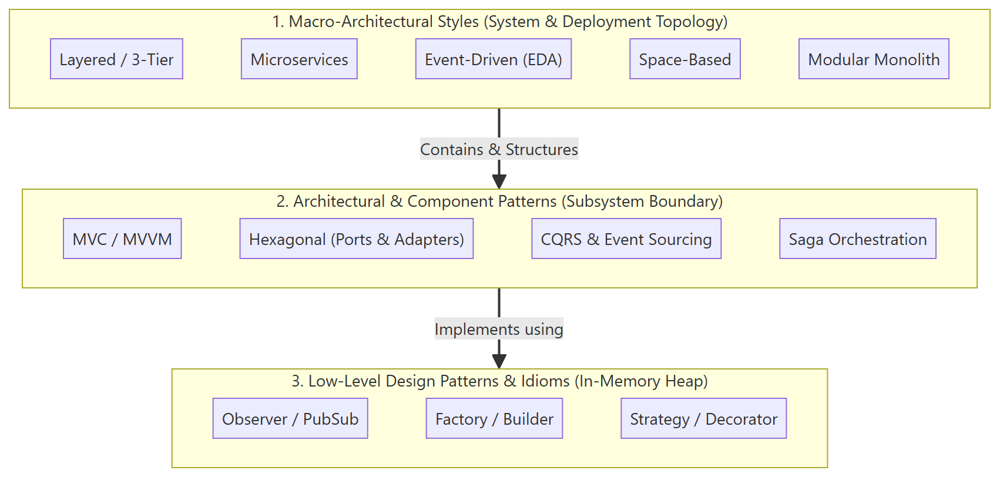
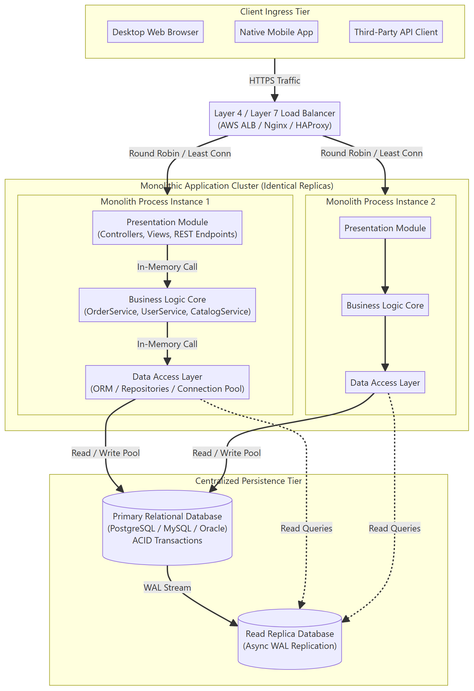
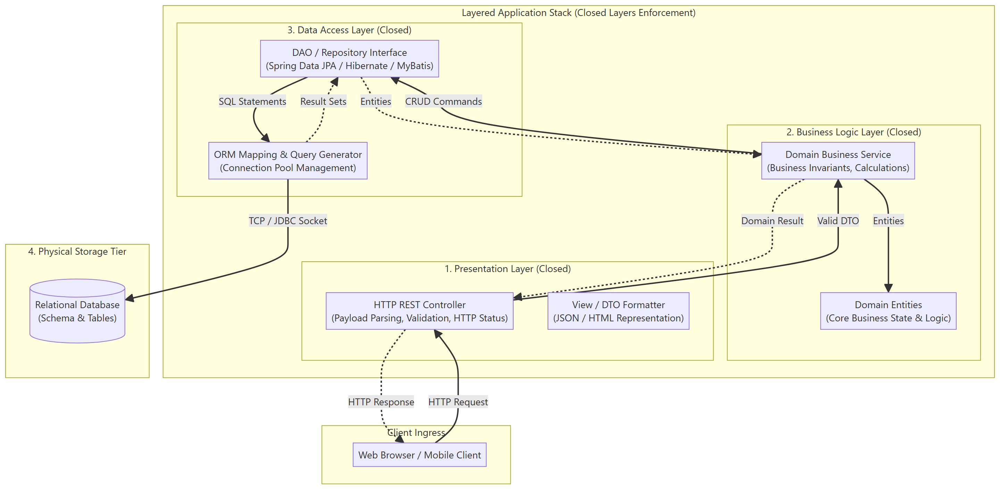
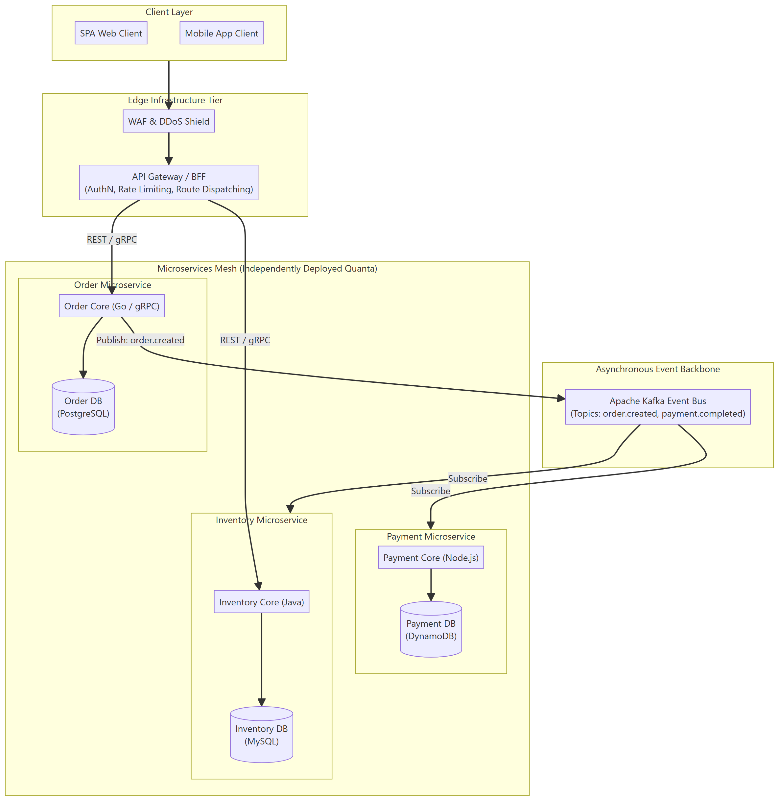
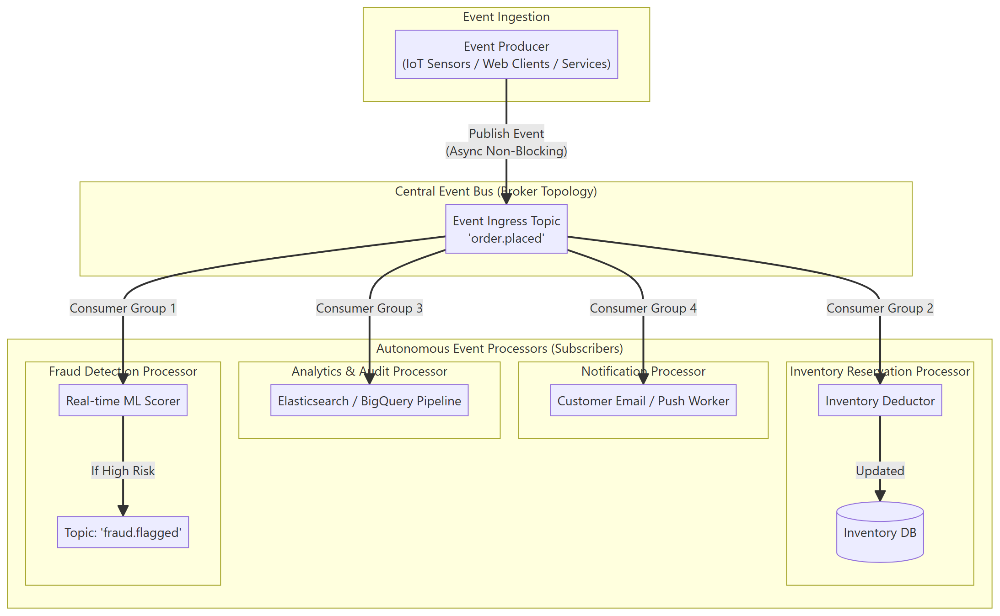
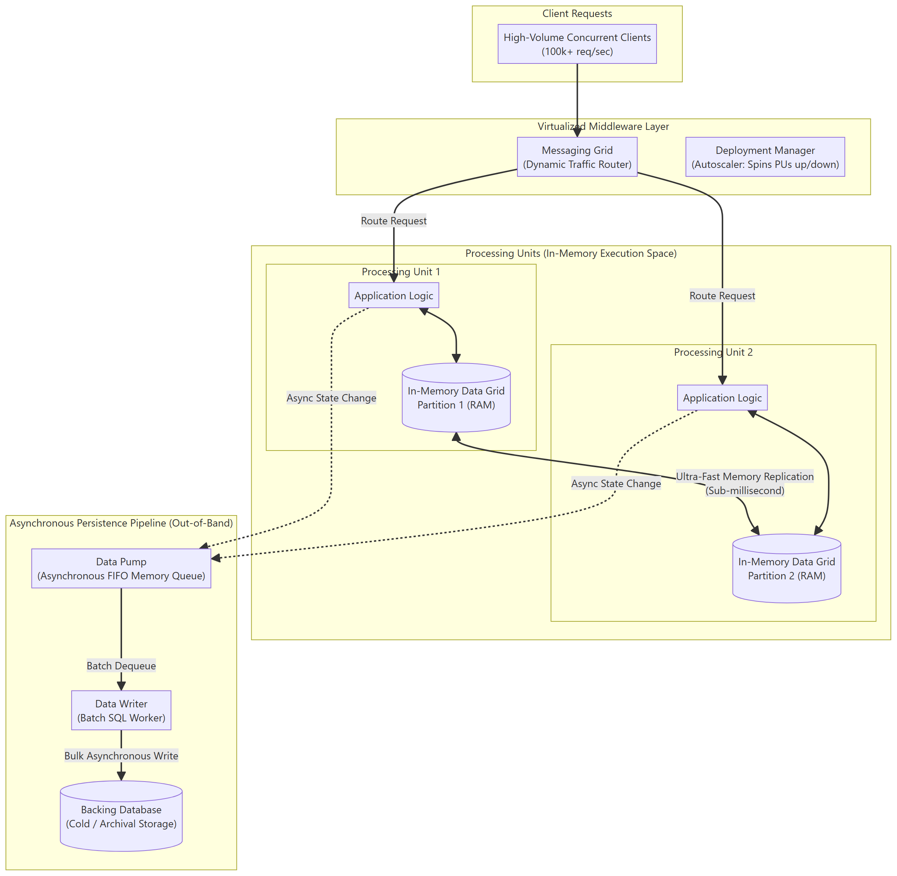
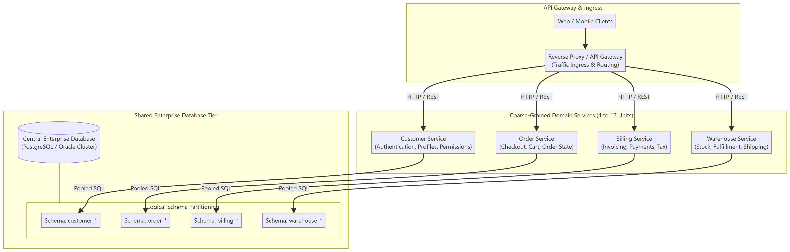
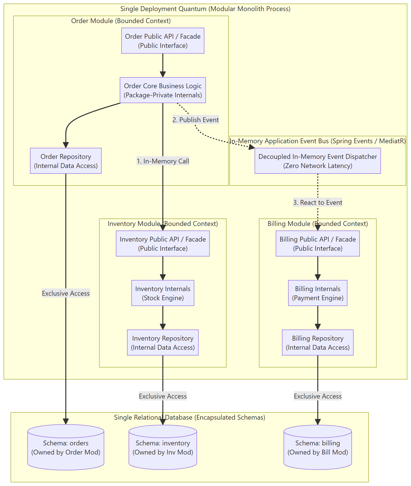
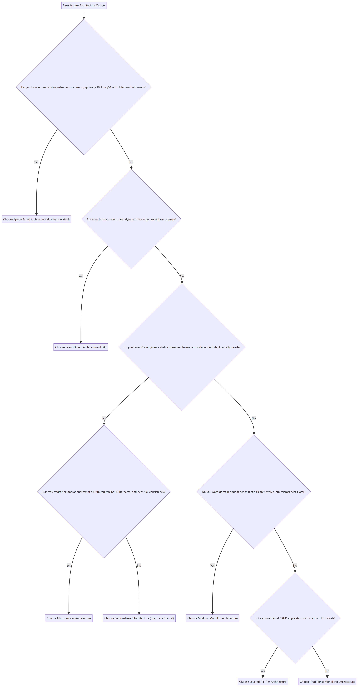

# 1. Architectural Styles: Comprehensive Theory, Mechanics, and Graphical Architecture Catalog

> **Curriculum Alignment**: Deep architectural manual covering the foundational macro-architectural styles defined by software engineering literature (Mark Richards, Neal Ford, Martin Fowler, and IEEE 1471 / ISO/IEC 42010).
> **Scope**: Monolithic Architecture, Layered / 3-Tier Architecture, Microservices Architecture, Event-Driven Architecture (EDA), Space-Based Architecture, Service-Based Architecture, and Modular Monolith.
> **Visual Standards**: All architectural diagrams are structured in balanced vertical/multi-tier layouts (~850px width) and pre-rendered into high-DPI graphical assets following Universal Rule 18 & Rule 19.

## 1. Foundational Architecture Taxonomy: Styles vs. Patterns vs. Idioms

In modern software engineering, architectural concepts span three distinct levels of abstraction and governance:

1. **Architectural Styles (Macro-Architecture)**:
   - Govern the overarching structural philosophy, deployment boundaries, communication topologies, and data distribution across the entire software application or enterprise ecosystem.
   - *Examples*: Monolithic, Layered, Microservices, Event-Driven, Space-Based, Service-Based, Modular Monolith.
2. **Architectural Patterns (Micro-Architecture / Subsystem Topology)**:
   - Govern structural relationships and component interactions *within* a deployment quantum or across specific subsystem boundaries.
   - *Examples*: Model-View-Controller (MVC), Ports & Adapters (Hexagonal), CQRS, Event Sourcing, Circuit Breaker, Saga.
3. **Design Patterns & Idioms (Language / Class Level)**:
   - Govern code-level object creation, structural composition, and runtime behaviors within a single memory heap.
   - *Examples*: Factory, Singleton, Observer, Strategy, Decorator.

---

### The Two Core Dimensions of Architecture Styles

Every architectural style is characterized by its position along two orthogonal axes:
1. **Deployment Quantum (Monolithic vs. Distributed)**:
   - *Monolithic (Single Quantum)*: Presentation, business logic, and data access packaged into a single physical deployable unit. Guarantees in-memory speed and ACID database transactions, but shares runtime failure domains.
   - *Distributed (Multiple Quanta)*: Split across multiple independently deployed services communicating over networks. Unlocks horizontal elasticity and autonomous deployments, but incurs network latency, serialization overhead, and eventual consistency challenges.
2. **Top-Level Partitioning Strategy (Technical vs. Domain)**:
   - *Technical Partitioning*: Components organized by technical responsibility (e.g. Presentation, Business Logic, Persistence).
   - *Domain Partitioning*: Components organized around business capabilities and bounded contexts (e.g. Orders, Inventory, Payments, Shipping).

## 2. In-Depth Architectural Styles Catalog

### 2.1 Monolithic Architecture

#### Conceptual Theory
The **Monolithic Architecture** is the foundational software architecture style where all application components—user interface rendering, business workflow execution, and data persistence operations—are packaged and executed as a **single, unified deployment quantum**. In a monolith, inter-component communication occurs entirely via **in-memory function and method invocations** within a single operating system process and shared heap memory.

While often contrasted unfavorably against microservices in modern industry discourse, the monolith remains one of the most efficient, cost-effective, and high-performance architectural styles when engineered correctly. It completely eliminates network serialization overhead, provides immediate ACID transactional guarantees, and simplifies deployment pipelines.

#### Graphical Architectural Diagram

---

#### Step-by-Step Execution Lifecycle
1. **Client Request Ingress**: A client issues an HTTPS POST request to place an order (`POST /api/v1/orders`).
2. **Traffic Distribution**: The external Load Balancer terminates TLS and forwards the HTTP request to an available monolithic process replica via round-robin or least-connections scheduling.
3. **Internal Module Routing**: The monolithic web runtime (e.g. Spring Boot, ASP.NET, Express) routes the request to `OrderController.placeOrder()`.
4. **Synchronous In-Memory Execution**: `OrderController` executes a direct in-memory method call to `OrderService.process()`. `OrderService` synchronously invokes `InventoryService.reserveStock()` and `PaymentService.chargeCustomer()` within the exact same JVM/CLR thread context.
5. **Atomic Database Transaction**: The persistence layer executes SQL statements across all affected domain tables within a single physical database transaction (`BEGIN TRANSACTION` -> `COMMIT`), ensuring absolute ACID consistency with zero two-phase commit overhead.
6. **Response Generation**: The controller serializes the result into JSON or HTML and returns HTTP 201 Created to the caller in single-digit milliseconds.

#### Physical Runtime & Memory Topology
* **Process Address Space**: All functional capabilities reside within a single Operating System process address space.
* **Heap Architecture**: Objects are allocated on a shared heap. Parameter passing occurs via 64-bit memory reference pointers (`ptr @0x4A10`) without serialization or network I/O.
* **Database Connection Pooling**: Each process instance maintains a local connection pool (e.g., HikariCP) connected to the centralized relational database.
* **Scaling Mechanism**: Horizontal scaling is achieved by duplicating the entire monolith across multiple virtual machines or containers behind a load balancer.

#### Architecture Characteristics Scorecard & Trade-Offs

| Architecture Characteristic | Rating | Evaluation & Technical Justification |
| :--- | :---: | :--- |
| **Partitioning** | **Technical / Mixed** | Typically organized by technical layers, though domain packaging is possible. |
| **Number of Quanta** | **1 (Single)** | Entire system deploys as one binary executable or container. |
| **Simplicity & Development Cost** | ⭐⭐⭐⭐⭐ | Unmatched simplicity; straightforward local setup, debugging, and testing. |
| **Transactional Consistency** | ⭐⭐⭐⭐⭐ | Native ACID transactions directly supported by the relational database. |
| **Performance (Latency)** | ⭐⭐⭐⭐⭐ | Zero network hops between domain services; sub-millisecond in-memory calls. |
| **Scalability** | ⭐⭐ | Must scale the entire application, even if only one module is constrained. |
| **Deployability & Agility** | ⭐⭐ | Any small change requires rebuilding, retesting, and redeploying the entire codebase. |
| **Fault Isolation** | ⭐ | An Out-Of-Memory (OOM) error or CPU spike in one module crashes the entire process. |

### 2.2 Layered / 3-Tier Architecture

#### Conceptual Theory
The **Layered Architecture Style** (traditionally structured as **3-Tier** or **N-Tier**) is the most widely adopted technically-partitioned architecture pattern in software history. It enforces a strict horizontal separation of concerns where software logic is categorized into layers based on technical roles:

1. **Presentation Layer**: Handles user interaction, HTTP request deserialization, input validation, and view rendering (or REST JSON serialization).
2. **Business Logic (Application) Layer**: Implements business policies, validation rules, state transitions, and workflow orchestration.
3. **Data Access (Persistence) Layer**: Encapsulates data retrieval and storage operations, translating domain entities to and from SQL/NoSQL stores.
4. **Database Tier**: The physical storage engine.

#### Key Architectural Principles:
* **Layers of Isolation**: Changes made in one layer do not ripple into other layers, provided the public layer interface remains stable.
* **Closed vs. Open Layers**:
  - *Closed Layer*: A layer that must intercept requests passing through the stack. Requests cannot bypass a closed layer (e.g. Presentation must go through Business to reach Persistence).
  - *Open Layer*: A layer that allows requests to bypass it directly to the layer below (e.g., an optional Shared Services or Auditing layer).
* **The Architecture Sinkhole Anti-Pattern**: Occurs when a request passes through multiple layers with zero business processing (each layer simply delegates down), causing unnecessary call-stack overhead and developer friction.

#### Graphical Architectural Diagram

---

#### Step-by-Step Execution Lifecycle
1. **Ingress Parsing**: The presentation layer receives an HTTP request, parses JSON into a request DTO, and validates mandatory fields (`@NotNull`, `@Size`).
2. **Layer Delegation**: The controller delegates directly to the business layer via a clean service interface. The presentation layer never writes SQL or interacts directly with the database.
3. **Business Rule Evaluation**: The business service retrieves required reference data, verifies domain invariants (e.g. checking customer credit limits), and performs core calculations.
4. **Data Access Abstraction**: The business service passes updated domain objects to the data access layer repository.
5. **Persistence Execution**: The repository maps domain entities to relational tables and dispatches SQL statements over a pooled JDBC connection.
6. **Isolated Upward Unwinding**: The database returns result sets, which the persistence layer wraps into domain objects and passes to the business layer, which passes them to the presentation layer for response serialization.

#### Physical Runtime & Memory Topology
* **Stack Frame Flow**: In a 3-tier architecture, execution proceeds via synchronized JVM thread stack frames: `Controller.handle()` pushes `Service.execute()`, which pushes `Repository.query()`.
* **Layer Isolation in Memory**: Data is transformed across layer boundaries: `Request DTO` -> `Domain Entity` -> `Persistence Record` -> `Response DTO`. This prevents database schema changes from leaking into UI clients.
* **Sinkhole Threshold**: If more than 20% of requests perform simple pass-through delegation without logic, make specific layers *open* to eliminate call overhead.

#### Architecture Characteristics Scorecard & Trade-Offs

| Architecture Characteristic | Rating | Evaluation & Technical Justification |
| :--- | :---: | :--- |
| **Partitioning** | **Technical** | Strictly separated by technical responsibility (Presentation, Business, Data). |
| **Number of Quanta** | **1 to 3** | Can deploy as a single WAR/container or physically separated tiers. |
| **Separation of Concerns** | ⭐⭐⭐⭐⭐ | Clear boundaries; UI developers work independently from database developers. |
| **Testability** | ⭐⭐⭐⭐ | Easy to mock lower layers (mock repositories to unit-test services). |
| **Organizational Cost** | ⭐⭐⭐⭐⭐ | Extremely low cost; aligns naturally with conventional enterprise IT teams. |
| **Agility & Deployability** | ⭐⭐ | Modifying a feature often requires synchronized changes across all 3 layers. |
| **Elasticity** | ⭐⭐ | Tiers can be scaled, but stateful business logic often bottlenecks database connections. |
| **Performance** | ⭐⭐⭐ | Call-stack traversal and object mapping add minor in-process latency. |

### 2.3 Microservices Architecture

#### Conceptual Theory
The **Microservices Architecture Style** is a distributed, **domain-partitioned** architecture where a system is decomposed into a suite of small, autonomous, independently deployable services. Each microservice encapsulates a single business capability bounded by a Domain-Driven Design (**Bounded Context**) and maintains its own private datastore (**Database-per-Service**).

Microservices completely avoid shared databases and monolithic deployments. Services communicate across process and network boundaries using standardized, technology-agnostic protocols—either synchronous (**REST over HTTP/2**, **gRPC**) or asynchronous (**Kafka**, **RabbitMQ**).

#### Key Architectural Principles:
* **High Cohesion & Single Purpose**: A service owns one business domain (e.g. Billing, Fulfillment, Customer Identity).
* **Decentralized Data Management**: Direct cross-service database queries are strictly prohibited. Data synchronization relies on domain events and eventual consistency.
* **Distributed Governance**: Teams are polyglot; they choose the optimal programming language, framework, and database for their specific workload.
* **Fault Tolerance & Resilience**: Failures are isolated using Circuit Breakers (Resilience4j), bulkheads, and timeouts to prevent cascading outages.

#### Graphical Architectural Diagram

---

#### Step-by-Step Execution Lifecycle (Saga Pattern)
1. **Edge Ingress**: Client submits an order via `POST /orders`. The API Gateway validates JWT tokens, applies rate limits, and routes the payload to the `Order Service`.
2. **Local Transaction**: `Order Service` writes a new order record with status `PENDING` into its local PostgreSQL database.
3. **Event Emission (Transactional Outbox)**: In the same atomic database transaction, `Order Service` writes an `OrderCreatedEvent` to an outbox table. A Debezium CDC worker reads the outbox and streams the event to Kafka.
4. **Asynchronous Choreography**:
   - `Payment Service` consumes `OrderCreatedEvent`, authorizes the credit card against Stripe, and emits `PaymentCompletedEvent`.
   - `Inventory Service` consumes `PaymentCompletedEvent`, reserves physical warehouse stock, and emits `StockAllocatedEvent`.
5. **State Finalization**: `Order Service` consumes `StockAllocatedEvent`, updates order status to `CONFIRMED`, and sends a push notification to the client.

#### Physical Runtime & Memory Topology
* **Network & Serialization Overhead**: Every inter-service invocation leaves the process boundary, passing through Linux TCP sockets, network interfaces (NIC), and TLS handshakes, introducing serialization (JSON/Protobuf) latency.
* **Distributed State**: No shared memory exists across services. Data is partitioned across separate database instances.
* **Container Orchestration**: Services run as isolated Linux containers (Kubernetes Pods) with defined CPU/RAM quotas and autoscaling policies (HPA).

#### Architecture Characteristics Scorecard & Trade-Offs

| Architecture Characteristic | Rating | Evaluation & Technical Justification |
| :--- | :---: | :--- |
| **Partitioning** | **Domain** | Highly aligned with domain bounded contexts (DDD). |
| **Number of Quanta** | **Dozens to Hundreds** | Each microservice is an independently deployable physical quantum. |
| **Scalability & Elasticity** | ⭐⭐⭐⭐⭐ | Fine-grained independent scaling; scale only high-traffic services. |
| **Deployability & CI/CD** | ⭐⭐⭐⭐⭐ | Small codebases enable rapid, low-risk, continuous deployments. |
| **Fault Isolation** | ⭐⭐⭐⭐⭐ | Crash in Payment Service does not take down Order or Catalog browsing. |
| **Data Consistency** | ⭐⭐ | Eventual consistency; requires complex distributed sagas instead of ACID. |
| **Operational Simplicity** | ⭐ | High operational tax (Kubernetes, service discovery, distributed tracing). |
| **Cost & Latency** | ⭐⭐ | Significant network hop latency, container overhead, and cloud infrastructure cost. |

### 2.4 Event-Driven Architecture (EDA)

#### Conceptual Theory
The **Event-Driven Architecture Style** is a distributed, asynchronous architectural style wherein system behavior is coordinated entirely through the **production, detection, consumption, and reaction to state-change events**. Instead of sending direct point-to-point synchronous requests ("do this command"), components broadcast domain events ("this fact occurred") to an event channel.

EDA provides the highest level of architectural decoupling: event producers have **zero knowledge** of who consumes the event, how many consumers exist, or what downstream actions will be triggered.

#### Two Foundational Topologies:
1. **Broker Topology**: Lightweight, highly decoupled choreography. An event producer publishes an event to a central broker (e.g. RabbitMQ, Kafka). Independent event processors subscribe to relevant topics, process data, and publish new events without central coordination.
2. **Mediator Topology**: Complex orchestration. A central event mediator (e.g., an orchestration engine or state machine) receives an initial event, coordinates multi-step business transactions, and directs specific processing commands to subordinate event processors.

#### Graphical Architectural Diagram

---

#### Step-by-Step Execution Lifecycle
1. **Event Publication**: An event producer emits a factual domain event (`OrderPlacedEvent`) to the broker topic. The producer's thread does not wait for downstream processing; it resumes immediately.
2. **Channel Distribution**: The event broker appends the event to a partitioned, distributed commit log (or message queue).
3. **Parallel Consumer Dissemination**: The broker delivers the event concurrently to all registered consumer groups.
4. **Autonomous Reaction**:
   - The *Fraud Processor* scores the transaction against ML risk models.
   - The *Inventory Processor* reserves warehouse inventory.
   - The *Notification Processor* queues a customer email.
5. **Downstream Event Cascading**: If fraud is detected, the Fraud Processor publishes `FraudDetectedEvent`, prompting the Payment Processor to halt payment processing.

#### Physical Runtime & Memory Topology
* **Buffering & Backpressure**: Event brokers provide buffer queues (OS page cache / disk-backed logs) that absorb traffic spikes, insulating downstream consumers from crashing under heavy load.
* **Concurrency Model**: Processing units consume events via internal thread pools or non-blocking event loops (Node.js/Go goroutines).
* **Idempotency Requirement**: Because distributed brokers deliver messages with *at-least-once* semantics, every consumer must maintain an idempotency table to discard duplicate events.

#### Architecture Characteristics Scorecard & Trade-Offs

| Architecture Characteristic | Rating | Evaluation & Technical Justification |
| :--- | :---: | :--- |
| **Partitioning** | **Technical / Decoupled** | Highly decoupled producers and consumers communicating via message contracts. |
| **Number of Quanta** | **Multiple** | Each event processor is an independent deployable unit. |
| **Elasticity & Performance** | ⭐⭐⭐⭐⭐ | Asynchronous queues absorb extreme spikes with ultra-low client response latency. |
| **Scalability** | ⭐⭐⭐⭐⭐ | Add new consumers or scale consumer partitions without touching producers. |
| **Fault Tolerance** | ⭐⭐⭐⭐⭐ | If a consumer crashes, messages queue up on the broker; zero data loss. |
| **Testability & Debugging** | ⭐⭐ | Extremely difficult to trace asynchronous distributed event flows and repro bugs. |
| **Data Consistency** | ⭐⭐ | Fully eventual consistency; requires compensating transactions on failures. |
| **System Predictability** | ⭐⭐ | Hard to determine global system state due to dynamic event choreography. |

### 2.5 Space-Based Architecture (SBA)

#### Conceptual Theory
The **Space-Based Architecture Style** (also known as the **Cloud-State** or **In-Memory Data Grid Style**) is engineered specifically to eliminate the single greatest architectural bottleneck in high-volume web computing: **the centralized relational database**.

Under extreme, unpredictable concurrent load (e.g. concert ticket on-sales, Black Friday flash sales, stock trading), traditional architectures crash because concurrent database connections, transaction locks, and disk I/O saturate. Space-Based Architecture solves this by keeping **100% of the active transactional data in-memory** across a distributed cluster of replicated **Processing Units (PUs)**.

#### Core Structural Components (Mark Richards & Neal Ford Taxonomy):
1. **Processing Unit (PU)**: A self-contained application container that combines application code, business logic, and an in-memory replicated data grid partition (e.g., Hazelcast, Apache Ignite).
2. **Virtualized Middleware**:
   - *Messaging Grid*: Routes incoming client requests to available Processing Units without requiring sticky sessions.
   - *Data Grid*: Synchronizes in-memory data across all active Processing Units using high-speed distributed memory replication.
   - *Processing Grid*: Manages parallel job coordination and distributed task clustering.
   - *Deployment Manager*: Dynamically starts and terminates Processing Unit instances based on real-time traffic volume.
3. **Data Pumps**: Dedicated asynchronous FIFO queues that stream in-memory state mutations out-of-band to persistent storage.
4. **Data Writers**: Asynchronous background workers that pull updates from data pumps and write them in bulk batches to the backing database.
5. **Data Readers**: Ingest data from the database into the in-memory data grid during system startup or cache warm-up.

#### Graphical Architectural Diagram

---

#### Step-by-Step Execution Lifecycle
1. **Request Ingress**: Client submits a high-speed trade or ticket reservation request.
2. **Dynamic Routing**: The Messaging Grid dispatches the request to Processing Unit 1.
3. **In-Memory Transaction**: Processing Unit 1 processes the request entirely within local RAM. It updates the in-memory data grid partition with **zero database queries and zero disk I/O**, completing in sub-milliseconds.
4. **Memory Grid Synchronization**: The Data Grid asynchronously replicates the mutated state to all other Processing Units across the internal cluster network.
5. **Out-of-Band Data Pump Enqueue**: Processing Unit 1 pushes the state mutation asynchronously into the Data Pump FIFO queue.
6. **Immediate Client Response**: The client receives an immediate success response (< 2ms total latency).
7. **Asynchronous Disk Flush**: The Data Writer drains the Data Pump queue in bulk batches and persists records to the backing database at a controlled, manageable write cadence.

#### Physical Runtime & Memory Topology
* **RAM-Centric Execution**: Active application state is stored entirely in memory (RAM). Memory addresses are accessed directly via pointers without relational SQL parsing or disk seek latency.
* **Replication Bandwidth**: Requires high-bandwidth, low-latency internal network interconnects (10GbE/40GbE) to sustain distributed in-memory data replication across nodes.
* **Crash Resilience**: If a Processing Unit VM crashes, zero data is lost because the Data Grid maintains replicated memory copies on sibling nodes.

#### Architecture Characteristics Scorecard & Trade-Offs

| Architecture Characteristic | Rating | Evaluation & Technical Justification |
| :--- | :---: | :--- |
| **Partitioning** | **Technical** | Partitioned around in-memory processing units and data grids. |
| **Number of Quanta** | **Variable (Elastic)** | Dynamically scales from 2 to 100+ PUs in response to load spikes. |
| **Elasticity & Scalability** | ⭐⭐⭐⭐⭐ | Unsurpassed elasticity; spin up new PUs with zero risk of database lockouts. |
| **Performance (Throughput/Latency)**| ⭐⭐⭐⭐⭐ | Sub-millisecond read/write latency achieved through 100% in-memory execution. |
| **Resource Cost** | ⭐⭐ | Extremely expensive; requires massive RAM provisioning across all nodes. |
| **Data Loss Risk** | ⭐⭐ | Potential data loss if the entire cluster suffers power loss before the data pump flushes. |
| **Operational Complexity** | ⭐ | Extremely complex distributed memory grid tuning and cache coherency. |

### 2.6 Service-Based Architecture

#### Conceptual Theory
The **Service-Based Architecture Style** is a distributed, **domain-partitioned** architectural style that represents a pragmatic middle ground between the operational simplicity of a monolith and the extreme complexity of microservices.

Instead of splitting a system into dozens of fine-grained microservices with independent databases, Service-Based Architecture decomposes the system into a small number (typically **4 to 12**) of **coarse-grained domain services** that all connect to a **centrally managed, shared database**.

#### Key Architectural Characteristics:
* **Coarse-Grained Services**: Each service owns a major functional area of the enterprise (e.g. Order Processing Service, Billing & Finance Service, Customer Management Service).
* **Shared Database Topology**: All services share a single database cluster (or partitioned schemas within a single cluster). This eliminates distributed two-phase commit transactions and cross-service data duplication.
* **Low Operational Overhead**: Does not require complex service meshes, distributed tracing sidecars, or distributed saga orchestrators.
* **Database Partitioning Evolution**: As domain scale demands, individual tables or schemas can be carved out into dedicated databases without requiring a complete system rewrite.

#### Graphical Architectural Diagram

---

#### Step-by-Step Execution Lifecycle
1. **Unified Routing**: Client makes an API request to `POST /orders/checkout`.
2. **Reverse Proxy Dispatch**: The API Gateway forwards the request to the coarse-grained `Order Service`.
3. **Internal Domain Orchestration**: `Order Service` executes checkout workflows. If it needs customer verification, it calls `Customer Service` via a synchronous REST/gRPC call.
4. **Direct Shared Database Transaction**: When writing order and billing records, services can leverage direct SQL joins or coordinated transactions against their respective schemas within the shared database.
5. **Independent Service Deployment**: If an update is required in `Billing Service`, only the `Billing Service` container is rebuilt and redeployed. The `Order`, `Customer`, and `Warehouse` services experience zero downtime.

#### Physical Runtime & Memory Topology
* **Independent Process Quanta**: Each service runs in its own process/container with dedicated memory and garbage collection. A memory leak in `Customer Service` will not crash `Order Service`.
* **Database Connection Contention**: Because all services share the database, total concurrent database connections must be carefully managed across all service connection pools to prevent connection pool exhaustion.

#### Architecture Characteristics Scorecard & Trade-Offs

| Architecture Characteristic | Rating | Evaluation & Technical Justification |
| :--- | :---: | :--- |
| **Partitioning** | **Domain** | Coarse-grained services organized by business domain. |
| **Number of Quanta** | **4 to 12** | Small number of services; avoids the operational sprawl of microservices. |
| **Operational Feasibility** | ⭐⭐⭐⭐ | Much simpler than microservices; standard monitoring and deployment tools suffice. |
| **Deployability** | ⭐⭐⭐⭐ | Services deploy independently without redeploying the whole system. |
| **Data Consistency** | ⭐⭐⭐⭐ | Shared database allows relational transactions and schema integrity. |
| **Database Scalability** | ⭐⭐ | The shared database remains a single point of failure and scaling bottleneck. |
| **Coupling Risk** | ⭐⭐⭐ | Developers may be tempted to write cross-domain SQL joins, eroding boundaries. |

### 2.7 Modular Monolith

#### Conceptual Theory
The **Modular Monolith Architecture Style** is a modern software architecture pattern that merges the **operational simplicity and in-memory performance of a monolith** with the **strict domain encapsulation and boundary discipline of microservices**.

In a modular monolith, all code compiles and executes within a **single physical deployment quantum** (one process, one container), but the codebase is strictly segregated into independent, domain-driven modules (e.g. Order Module, Payment Module, Customer Module).

#### Key Invariants & Architectural Rules:
1. **Explicit Public APIs & Package-Private Internals**: Each module exposes a single public API interface (Facade). All entity definitions, internal logic, and repositories are encapsulated as `package-private` or internal.
2. **Compile-Time Boundary Enforcement**: Architecture testing frameworks (such as **ArchUnit** in Java or internal packages in Go/C#) enforce that Module A *cannot* directly reference or import internal classes of Module B. Any violation fails the build.
3. **Database Schema Encapsulation**: Although stored in a single database, each module owns its dedicated schema or table prefix. Direct cross-module SQL joins are strictly forbidden.
4. **In-Memory Event Bus**: Inter-module communication occurs via asynchronous in-memory events or synchronous facade calls—never through network hops.
5. **Microservices Evolutionary Pathway**: If a specific module outgrows the monolith, it can be seamlessly extracted into a standalone microservice with near-zero code refactoring because its boundaries are already strictly enforced.

#### Graphical Architectural Diagram

---

#### Step-by-Step Execution Lifecycle
1. **Ingress Call**: Web controller forwards an order placement request to `OrderModuleFacade.createOrder()`.
2. **Synchronous Facade Invocation**: `OrderModule` calls `InventoryModuleFacade.checkAvailability()` via a direct in-memory method call. Execution stays inside the same thread stack frame with zero serialization cost.
3. **Exclusive Persistence**: `OrderRepository` writes to the `orders` schema. It does not touch `inventory` or `billing` tables.
4. **In-Memory Event Dispatch**: `OrderModule` publishes an `OrderPlacedEvent` to the local in-memory event bus (e.g. Spring `ApplicationEventPublisher`).
5. **Decoupled Reaction**: `BillingModule` listens for `OrderPlacedEvent`, captures it asynchronously on a worker thread, charges the payment method, and records transactions in the `billing` schema.

#### Physical Runtime & Memory Topology
* **Single Process Simplicity**: Deploys as a single container or binary. Requires no service mesh, no container orchestration, and zero distributed networking costs.
* **In-Memory Speed**: Communication between modules takes nanoseconds instead of milliseconds.
* **ACID Transactions**: Can span multiple modules within an atomic database transaction when necessary, while retaining the ability to decouple via in-memory events.

#### Architecture Characteristics Scorecard & Trade-Offs

| Architecture Characteristic | Rating | Evaluation & Technical Justification |
| :--- | :---: | :--- |
| **Partitioning** | **Domain** | Strictly partitioned by business bounded contexts. |
| **Number of Quanta** | **1 (Single)** | Deploys as a single physical binary or container. |
| **Maintainability** | ⭐⭐⭐⭐⭐ | Compile-time ArchUnit tests guarantee codebases never degenerate into big balls of mud. |
| **Performance (Latency)** | ⭐⭐⭐⭐⭐ | Nanosecond in-memory function calls; zero network serialization overhead. |
| **Operational Simplicity** | ⭐⭐⭐⭐⭐ | Standard single-app monitoring, single CI/CD pipeline, and easy local dev. |
| **Microservices Ready** | ⭐⭐⭐⭐⭐ | Seamless migration path to microservices if scaling demands it in the future. |
| **Independent Deployability**| ⭐⭐ | Changes in one module still require redeploying the entire modular binary. |
| **All-or-Nothing Scaling** | ⭐⭐ | If the Order module experiences a spike, the entire monolith must be scaled. |

## 3. Master Architectural Styles Comparison Matrix

The following decision matrix evaluates all 7 architectural styles across foundational software engineering quality attributes:

| Architecture Style | Top-Level Partitioning | Deployment Quanta | Scalability | Elasticity | Deployability | Fault Tolerance | Development Simplicity | Overall Cost |
| :--- | :--- | :---: | :---: | :---: | :---: | :---: | :---: | :---: |
| **Monolithic** | Technical / Mixed | 1 | ⭐⭐ | ⭐ | ⭐⭐ | ⭐ | ⭐⭐⭐⭐⭐ | ⭐ (Lowest) |
| **Layered / 3-Tier** | Technical | 1 - 3 | ⭐⭐⭐ | ⭐⭐ | ⭐⭐ | ⭐⭐ | ⭐⭐⭐⭐⭐ | ⭐ |
| **Microservices** | Domain | Dozens+ | ⭐⭐⭐⭐⭐ | ⭐⭐⭐⭐⭐ | ⭐⭐⭐⭐⭐ | ⭐⭐⭐⭐⭐ | ⭐ | ⭐⭐⭐⭐⭐ (Highest) |
| **Event-Driven (EDA)** | Technical / Decoupled | Multiple | ⭐⭐⭐⭐⭐ | ⭐⭐⭐⭐⭐ | ⭐⭐⭐⭐ | ⭐⭐⭐⭐⭐ | ⭐⭐ | ⭐⭐⭐⭐ |
| **Space-Based (SBA)** | Technical (Grid) | Elastic | ⭐⭐⭐⭐⭐ | ⭐⭐⭐⭐⭐ | ⭐⭐⭐ | ⭐⭐⭐⭐ | ⭐ | ⭐⭐⭐⭐⭐ |
| **Service-Based** | Domain | 4 - 12 | ⭐⭐⭐ | ⭐⭐⭐ | ⭐⭐⭐⭐ | ⭐⭐⭐ | ⭐⭐⭐⭐ | ⭐⭐⭐ |
| **Modular Monolith** | Domain | 1 | ⭐⭐⭐ | ⭐⭐ | ⭐⭐⭐ | ⭐⭐ | ⭐⭐⭐⭐ | ⭐⭐ |

## 4. Architectural Selection Framework: When to Choose Which Style

---

### Strategic Decision Rules of Thumb:
1. **Start with a Modular Monolith**: For 90% of new greenfield enterprise systems, the **Modular Monolith** is the optimal starting point. It provides domain isolation and clean boundaries without incurring the catastrophic operational tax of distributed microservices.
2. **Adopt Microservices Only for Organizational Scale**: Migrate from a Modular Monolith to Microservices only when multiple independent engineering teams (20–100+ developers) are blocked by shared deployment pipelines.
3. **Choose Event-Driven for Reactive Workflows**: Adopt EDA when user workflows are fundamentally non-blocking and real-time streaming, telemetry, or notification fan-out is paramount.
4. **Choose Space-Based for Extreme Concurrency**: Reserve Space-Based Architecture for specialized domains (ticketing, auctions, trading) where relational database locks represent a fatal bottleneck.
