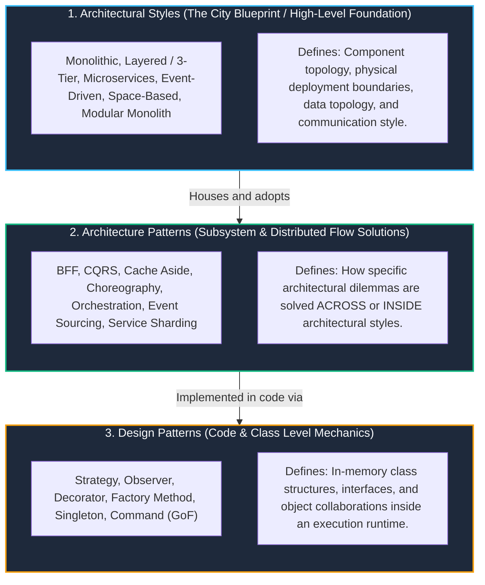

# Architectural Styles vs. Architecture Patterns vs. Design Patterns

> **Source Attribution**: Derived from ***Software Architecture: Patterns, Antipatterns, and Pitfalls*** (Chapter 1: *"Styles Versus Patterns"* & *"Architecture Patterns Versus Design Patterns"*, pp. 13–17) by Mark Richards, Neal Ford, and Raju Gandhi (O'Reilly Media).

---

## 1. The Core Question

> **Question**: *Is an architectural pattern the same as a software architecture like MVC, Monolithic, or 3-Tier?*
> 
> **Answer**: **No, they are fundamentally distinct.** 

In software engineering, systems are structured across three hierarchical layers of abstraction:
1. **Architectural Styles** (The high-level structural philosophy and deployment topology)
2. **Architecture Patterns** (Tactical, reusable subsystem and communication solutions)
3. **Design Patterns** (In-process class and object-level code mechanics)

---

## 2. Architectural Styles (e.g., Monolithic, 3-Tier, Layered, Microservices)

An **Architectural Style** is the overarching **structural framework and philosophy** of your entire application. Only a few dozen styles exist in total.

The style dictates:
1. **Physical Architecture**: Is the system a single deployable unit (**Monolithic**) or many separate deployed services (**Distributed**)?
2. **Component Topology**: Are components organized by technical capability (**Layered / 3-Tier**) or by business domain (**Microservices / Modular Monolith**)?
3. **Communication Boundaries**: Do components call each other via in-memory method invocations (Monolith) or over the network via HTTP/gRPC/message queues (Distributed)?
4. **Data Topology**: A single shared relational database vs. decentralized database-per-service.
5. **Reuse Philosophy**: Monolithic styles favor centralized shared components and libraries; microservice styles favor duplication and independence to eliminate runtime coupling.

> **Examples of Architectural Styles**:
> - **Monolithic Architecture**
> - **Layered / 3-Tier Architecture**
> - **Microservices Architecture**
> - **Event-Driven Architecture (EDA)**
> - **Space-Based Architecture**
> - **Service-Based Architecture**
> - **Modular Monolith**

---

## 3. Architecture Patterns (e.g., CQRS, BFF, Cache Aside, Orchestration)

An **Architecture Pattern** is a **reusable solution to a recurring architectural dilemma** that operates across or within architectural styles. Hundreds of architecture patterns exist.

- **Key Difference**: While you only choose **one or two architectural styles** for a system (e.g., choosing to build a Microservices system), you will apply **dozens of architecture patterns** inside it:
  - Inside a *Microservices* or *Layered* system:
    - *How do you optimize read vs. write workloads?* -> Apply the **CQRS Pattern**.
    - *How do you prevent mobile devices from making 15 separate round-trips over mobile networks?* -> Apply the **Backend for Frontend (BFF) Pattern**.
    - *How do you cache data safely without putting the cache in the critical write path?* -> Apply the **Cache Aside Pattern**.
    - *How do you coordinate a multi-service order fulfillment workflow?* -> Choose between the **Orchestration Pattern** (central controller) or **Choreography Pattern** (reactive events).
  - Notice that the **Orchestration Pattern**, **Cache Aside Pattern**, or **CQRS Pattern** can be applied within a Monolith, a 3-Tier app, or a Microservices fleet alike!

---

## 4. What About MVC (Model-View-Controller)?

**MVC (Model-View-Controller)** is traditionally a **UI Architectural Pattern** (or Compound Design Pattern):
- In desktop, browser, or server-rendered web applications, MVC coordinates the user interface (**View**), business data state (**Model**), and user input processing (**Controller**).
- It is neither a full system architectural style (like Microservices) nor a distributed system pattern (like CQRS); it is a pattern for **organizing presentation and interaction logic within a component or layer**.

---

## 5. Comparative Reference Matrix

| Dimension | Architectural Style (e.g. 3-Tier, Microservices) | Architecture Pattern (e.g. CQRS, BFF, Orchestration) | Design Pattern (e.g. Strategy, Factory Method) |
| :--- | :--- | :--- | :--- |
| **System Scope** | Entire application or enterprise platform | Subsystem, integration boundary, or data flow | Class, interface, or code block |
| **Quantity Applied** | You choose **1 or 2** foundational styles | You apply **dozens** across various components | You write **scores** across classes and packages |
| **Primary Goal** | Define physical boundaries and deployment topology | Solve recurring distributed and data management challenges | Eliminate code duplication and simplify object lifecycles |
| **Context Flexibility**| Narrow context (defines default baseline behavior) | Broad context (applies across many different styles) | Highly localized context (in-process object runtime) |
| **Real-World Analogy** | Choosing between a **Skyscraper** or a **Suburban House** | Designing the **HVAC, Elevators, or Plumbing System** | Choosing the **hinges, screws, and door locks** |

---

## 6. Summary: The Architectural Spectrum

As stated by Richards and Ford in *Software Architecture: Patterns, Antipatterns, and Pitfalls*:

1. **Architectural Styles** provide the overall scaffolding (monolithic vs. distributed, technical layers vs. domain services).
2. **Architecture Patterns** solve specific capability and communication challenges within or across those styles (scalability, reliability, auditability, throughput).
3. **Design Patterns** provide elegant code structures to implement those patterns inside the programming language.
