# 2. Architecture Patterns: Comprehensive Theory, Mechanics, and Graphical Diagrams

> **Canonical Academic & Industry References**:
> - Richards, Mark, and Neal Ford. *Fundamentals of Software Architecture: A Modern Engineering Approach*. O'Reilly Media, 2020.
> - Richards, Mark, Neal Ford, and Raju Gandhi. *Software Architecture: Patterns, Antipatterns, and Pitfalls*. O'Reilly Media, 2024.
> - Fowler, Martin. *Patterns of Enterprise Application Architecture*. Addison-Wesley, 2002.
> - Buschmann, Frank, et al. *Pattern-Oriented Software Architecture (POSA)*, Volumes 1-4. Wiley.
> - Hohpe, Gregor, and Bobby Woolf. *Enterprise Integration Patterns*. Addison-Wesley.

---

## 1. Foundational Architecture Taxonomy & Granularity Spectrum

Before analyzing individual patterns, architects must distinguish the three structural tiers of software engineering:

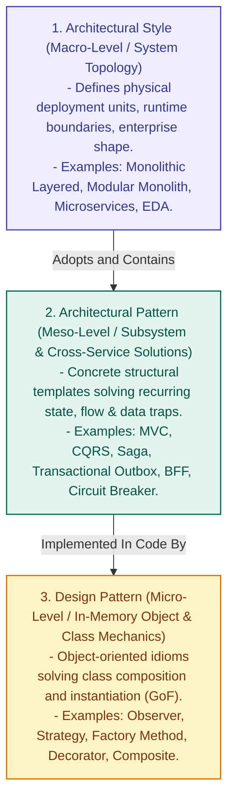

---

## 2. Presentation & Interaction Patterns (UI & Client Tier)

### 2.1 Model-View-Controller (MVC)

#### Conceptual Theory
The Model-View-Controller pattern addresses the fundamental UI dilemma: **tight coupling between visual presentation and business domain logic**. Without separation, modifying visual layouts breaks data validation, and automated unit testing of domain rules requires launching graphics runtimes.

MVC establishes a strict tripartite separation of concerns:
- **Model**: Represents domain state, entity invariants, and business rules. The model is completely unaware of views or controllers.
- **View**: Renders visual representation to the client. In classic GUI MVC (Smalltalk), View observes the Model. In Web MVC (Spring MVC/Rails), View is a stateless template rendered by the Controller.
- **Controller**: Translates incoming user gestures/HTTP requests into domain commands on the Model and selects the appropriate View to render.

#### Graphical Architectural Diagram
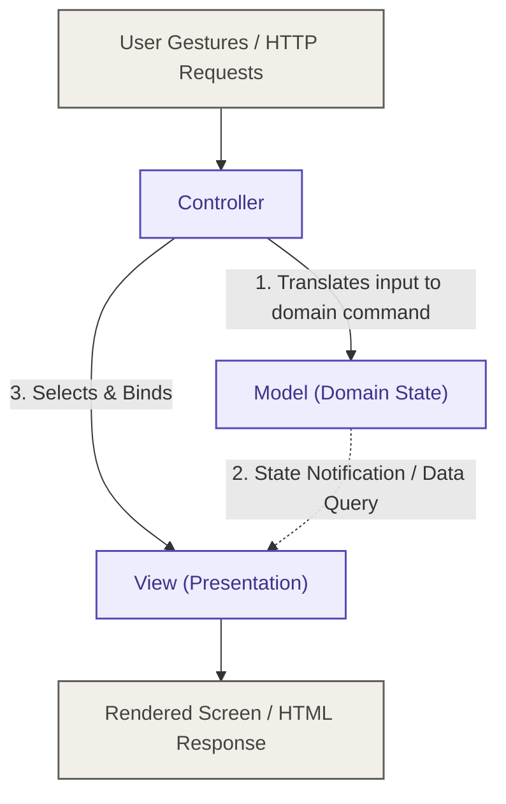

#### Step-by-Step Execution Lifecycle (Web MVC)
1. **Request Ingestion**: The client sends an HTTP `POST /orders` request to the web server.
2. **Routing & Dispatch**: The Front Controller routes the payload to `OrderController.placeOrder()`.
3. **Model Mutation**: The controller deserializes input into a DTO and calls the domain model `OrderService.createOrder()`.
4. **State Commit**: The model validates invariants and persists changes via the persistence tier.
5. **View Selection**: The controller places resulting domain models into the view context (e.g. `ModelAndView`) and selects `order_confirmation.html`.
6. **Response Transmission**: The template engine renders HTML and streams it back to the client.

#### Trade-Off Analysis
- **Strengths**: Clear separation of concerns, high independent testability of domain logic, parallel development between frontend designers and backend engineers.
- **Weaknesses**: Risk of **Fat Controllers** where developers inappropriately stuff persistence calls and business validation into controller methods; high boilerplate overhead for trivial CRUD.
- **Production Stacks**: Spring Boot Web MVC, Ruby on Rails, ASP.NET Core MVC, Laravel.

---

### 2.2 Model-View-ViewModel (MVVM)

#### Conceptual Theory
MVVM was formulated by John Gossman at Microsoft to resolve the excessive boilerplate code in MVC and MVP where developers had to write imperative code to copy data from Model objects into View widgets, and manually write event listeners to copy user changes back into the Model.

MVVM introduces a declarative **Data Binding Engine**. The **ViewModel** acts as an abstraction of the View, exposing observable state properties and commands without holding any direct reference to UI widgets or windows.

#### Graphical Architectural Diagram
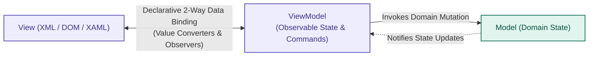

#### Step-by-Step Execution Lifecycle
1. **Binding Initialization**: When the View mounts, it establishes declarative bindings against the ViewModel's observable properties (e.g. `userProfile.fullName`).
2. **User Gesture**: The user types text into an input box.
3. **Automatic View-to-ViewModel Sync**: The data-binding engine automatically updates the ViewModel's in-memory variable without any manual event listener code.
4. **Command Execution**: User clicks Submit. The View fires `vm.submitCommand.execute()`.
5. **Model Synchronization**: The ViewModel invokes domain operations on the Model.
6. **Automatic Model-to-View Sync**: The Model updates state; the ViewModel triggers `PropertyChanged`; the View automatically re-renders the affected widget.

#### Trade-Off Analysis
- **Strengths**: Completely eliminates imperative UI synchronization code; enables full headless unit testing of complex UI behavior by asserting on ViewModel properties.
- **Weaknesses**: Heavy memory footprint of runtime data binders; difficult stack-trace debugging when data-binding expressions fail silently; complex memory leak risk if observers are not unhooked.
- **Production Stacks**: WPF/C#, Android Jetpack (LiveData/StateFlow), Vue.js (Reactivity Engine), Knockout.js.

---

### 2.3 Model-View-Presenter (MVP)

#### Conceptual Theory
MVP originated at Taligent and became standard in enterprise desktop and early Android architectures to achieve **100% testability of UI presentation logic**. 

In MVP, the View is completely **passive (Passive View)**. The View implements an explicit interface containing only dumb setter and getter primitives. The **Presenter** sits strictly in the middle, intercepting view events, executing business logic via the Model, and explicitly commanding the View what to display.

#### Graphical Architectural Diagram
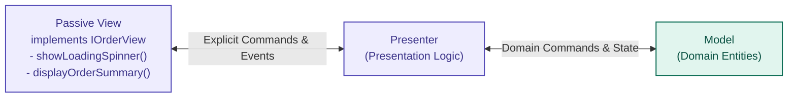

#### Trade-Off Analysis
- **Strengths**: Maximum testability. You can test 100% of presentation flows using mock View interfaces without any graphics window.
- **Weaknesses**: Explosive interface proliferation (every View requires a corresponding `IView` interface); strict 1:1 coupling between Presenter and View.
- **Production Stacks**: Windows Forms enterprise systems, classic Android MVP architectures.

---

### 2.4 Model-View-Intent (MVI)

#### Conceptual Theory
Originating from reactive functional programming (Elm and Cycle.js), MVI solves the problem of **unpredictable state mutations** in rich, asynchronous applications where multiple background threads and user clicks mutate state simultaneously.

MVI enforces strict **Unidirectional Data Flow (UDF)**:
- **Intent**: Represents an immutable intention/event triggered by user action or system event.
- **Model (State Machine)**: Pure functional reducers take the current immutable State and an Intent, outputting a brand-new immutable State.
- **View**: A pure function that renders the single immutable State object (`View = f(State)`).

#### Graphical Architectural Diagram
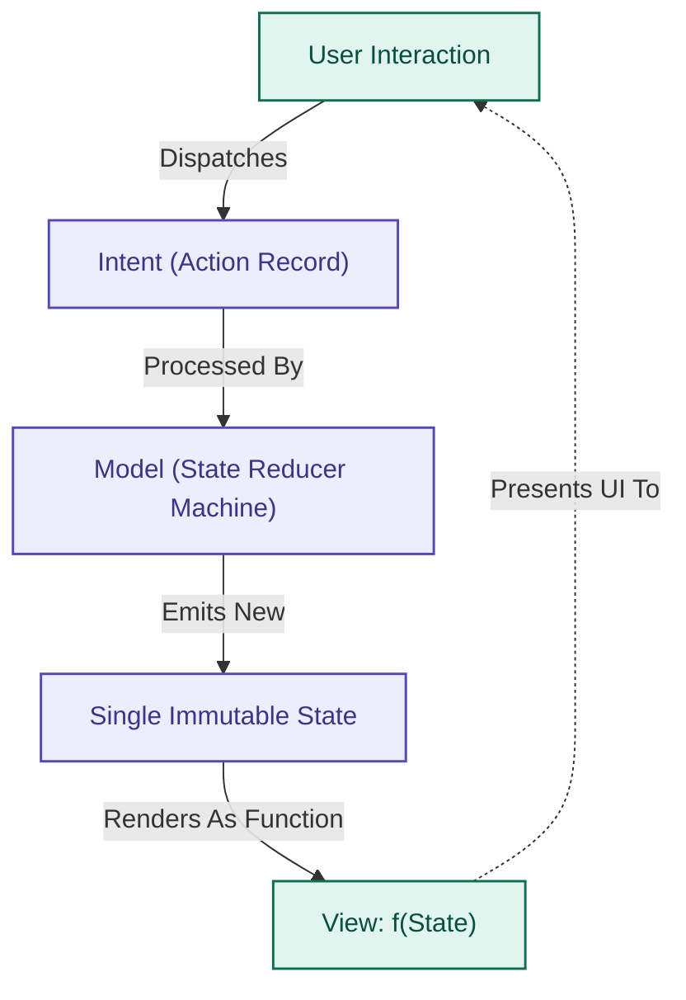

#### Trade-Off Analysis
- **Strengths**: 100% deterministic state machines; effortless time-travel debugging and state playback; zero multi-threading race conditions on state mutations.
- **Weaknesses**: High cognitive complexity; creation of many immutable event/state allocations requiring efficient garbage collection.
- **Production Stacks**: Jetpack Compose, React + Redux Toolkit, Flutter (Bloc/Redux).

---

### 2.5 Front Controller

#### Conceptual Theory
In early web servers, requests were routed directly to individual physical scripts or pages (e.g. `order.php`, `login.asp`). This caused duplicated authentication checks, duplicated logging, and fragmented URL management.

The Front Controller pattern routes **every incoming HTTP request to a single centralized dispatcher component**. The dispatcher executes a pipeline of intercepting filters (security, decompression, metric recording, locale resolution) before delegating to specific action handlers.

#### Graphical Architectural Diagram
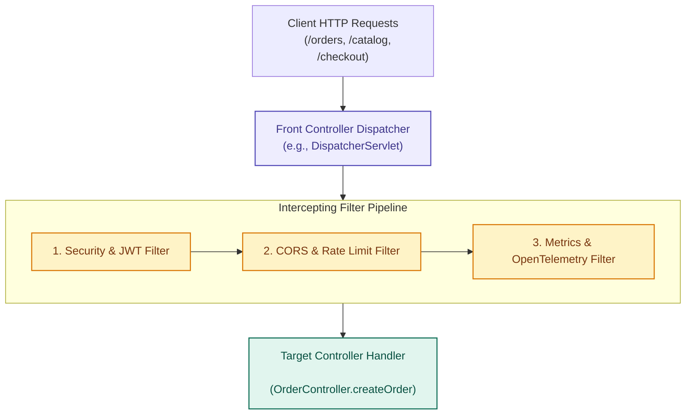

#### Trade-Off Analysis
- **Strengths**: Centralized security, authorization, and telemetry enforcement; unified routing table and error handling.
- **Weaknesses**: Single point of bottleneck; if filter pipelines become overly heavy, request latency increases across all endpoints.
- **Production Stacks**: Spring `DispatcherServlet`, ASP.NET Core Middleware Pipeline, Express.js middleware dispatcher.

---

## 3. Distributed Data & Consistency Patterns

### 3.1 Command Query Responsibility Segregation (CQRS)

#### Conceptual Theory
In traditional enterprise applications, the same data model is used to handle both writes (commands) and reads (queries). This creates structural friction:
- **Relational Normalization vs. Fast Reads**: Normalization is optimal for transaction writes (preventing anomalies), but catastrophic for complex read screens requiring 12 table joins.
- **Asymmetric Load**: Enterprise systems typically experience 90-99% read traffic versus 1-10% write traffic. Scaling the combined model wastes database compute.

CQRS cleanly splits the application into two distinct pipelines:
- **Command Stack**: Optimized exclusively for high-integrity mutations, domain validation, and ACID transactional writes.
- **Query Stack**: Optimized exclusively for high-throughput, denormalized, read-only projections.

#### Graphical Architectural Diagram
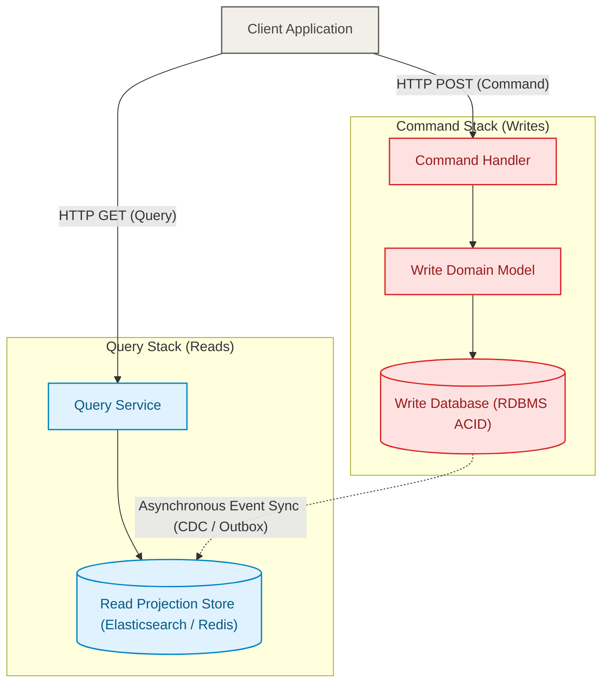

#### Step-by-Step Execution Lifecycle
1. **Command Dispatch**: Client issues `POST /orders` with items and payment details.
2. **Command Validation**: The `CreateOrderCommandHandler` loads the aggregate root, validates business rules (e.g. stock availability), and commits to the Write Database.
3. **Event Generation**: Upon transaction commit, a domain event `OrderCreatedEvent` is published (via Transactional Outbox or Kafka).
4. **Projection Update**: An asynchronous projector consumer processes `OrderCreatedEvent`, denormalizes the order into a fast JSON document, and writes it to Elasticsearch or MongoDB.
5. **Query Lookup**: When a user queries `GET /orders/summary`, the Query Service reads directly from the denormalized read store in sub-10ms latency with zero table joins.

#### Trade-Off Analysis
- **Strengths**: Massive read and write scaling; query models can be reshaped without touching write transactions; enables polyglot persistence (e.g., PostgreSQL for writes, Elasticsearch for reads).
- **Weaknesses**: **Eventual Consistency Lag**: Changes made by commands take milliseconds to seconds to reflect in the query store; dual-model schema maintenance overhead.
- **Production Stacks**: Axon Framework, MediatR (C#), EventStoreDB, Apache Kafka + PostgreSQL + Elasticsearch.

---

### 3.2 Event Sourcing

#### Conceptual Theory
Traditional CRUD architectures store only the **current state** of an entity by destructively overwriting previous state via SQL `UPDATE`. If a customer balance changes from \$100 to \$150, the past history is permanently destroyed unless manual audit logs exist.

Event Sourcing replaces state-based storage with an **immutable, append-only chronological log of domain events**. An entity's current state is never stored as an authoritative record; it is dynamically reconstituted by replaying all historical events from the beginning of time.

#### Graphical Architectural Diagram
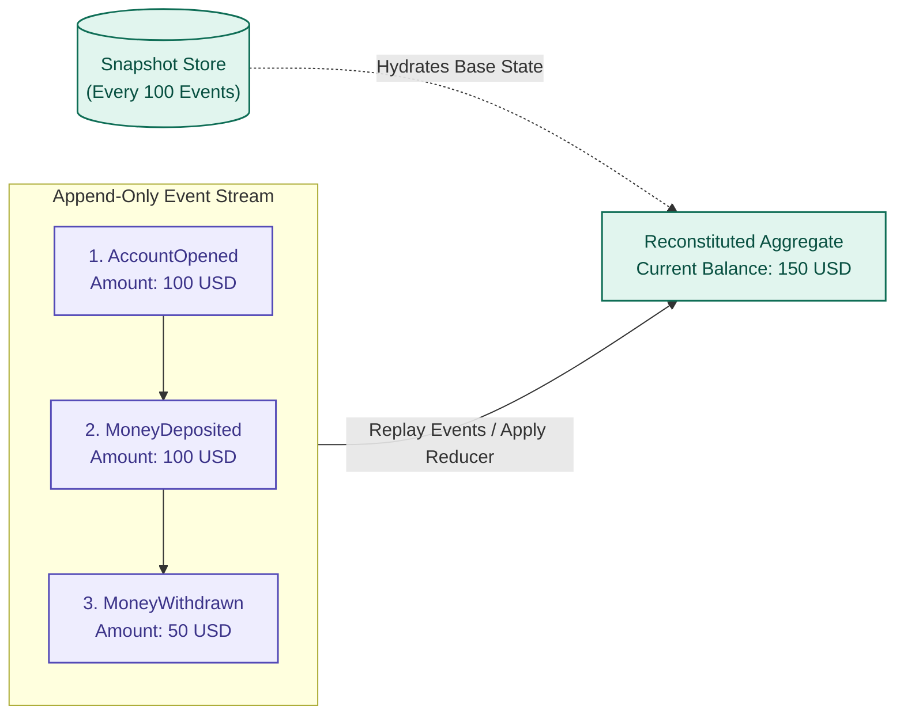

#### Snapshotting Optimization
Replaying 50,000 events to compute a customer's account balance introduces unacceptable latency. Event Sourcing optimizes this via **Snapshotting**:
- Every `N` events (e.g. 100 events), the system calculates the state and writes a snapshot record.
- To reconstitute the aggregate, the system loads the latest snapshot and replays only the events that occurred after the snapshot index.

#### Trade-Off Analysis
- **Strengths**: Complete, tamper-proof audit trail; enables time-travel debugging (reconstructing the exact system state at any historical second); eliminates object-relational impedance mismatch.
- **Weaknesses**: Event schema evolution is notoriously difficult (how to handle events written 5 years ago when models change); replaying without snapshots bottlenecks memory and CPU.
- **Production Stacks**: EventStoreDB, Apache Kafka, Axon Server, Marten (PostgreSQL event store for .NET).

---

### 3.3 Saga Pattern

#### Conceptual Theory
In a distributed microservice architecture, a business transaction often spans multiple distinct service databases (e.g. *Order Service*, *Payment Service*, *Inventory Service*). Traditional Two-Phase Commit (2PC) distributed locking cannot scale because:
1. It is a blocking protocol: network partitions or slow nodes lock database records globally.
2. It violates microservice autonomy and degrades system availability (CAP Theorem).

The Saga Pattern structures a distributed transaction as a **sequence of local transactions**. Each local transaction updates a single database and publishes an event or message. If any step fails, the Saga coordinates **Compensating Transactions** that run in reverse order to semantically undo earlier partial state changes.

#### Graphical Architectural Diagram
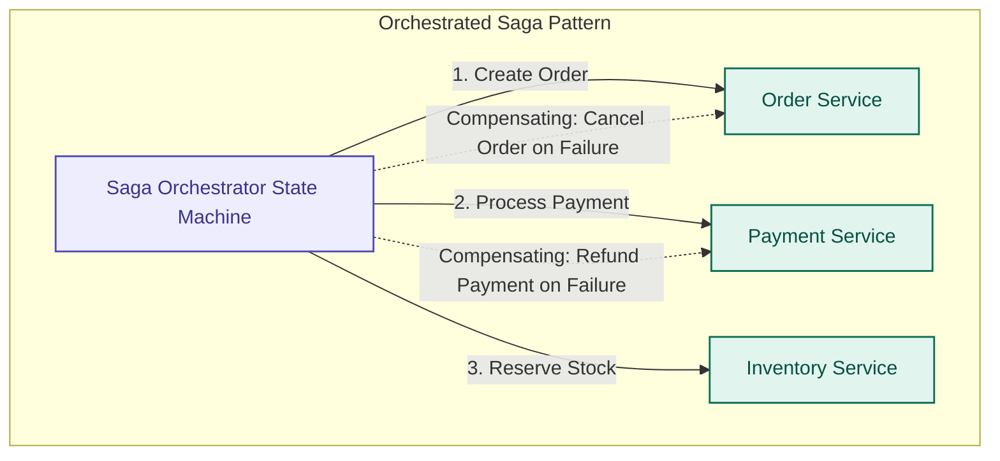

#### Compensation Mechanics
- If step 3 (Inventory Allocation) fails because an item is out of stock, the Orchestrator initiates backward recovery:
  1. Calls `PaymentService.refundPayment()` (Compensating transaction for Step 1).
  2. Calls `OrderService.markOrderCancelled()` (Compensating transaction for Step 0).
- **Critical Requirement**: Compensating transactions must be **strictly idempotent** and cannot fail permanently; transient failures must be retried until resolved.

#### Trade-Off Analysis
- **Strengths**: High scalability without distributed locks; supports long-running transactions spanning minutes or hours.
- **Weaknesses**: Lack of transaction isolation (other concurrent queries can see intermediate uncommitted states); compensating logic can become mathematically complex to write and test.
- **Production Stacks**: Temporal.io, AWS Step Functions, Camunda, MassTransit.

---

### 3.4 Transactional Outbox Pattern

#### Conceptual Theory
Microservices frequently need to update a database entity and notify other services via a message broker. This introduces the catastrophic **Dual-Write Problem**:
- If you commit to the database first and the message broker dies before publishing, downstream services miss critical business events.
- If you publish to the message broker first and the database transaction rolls back, downstream services process phantom operations.

The Transactional Outbox pattern guarantees that database state updates and event publishing occur with **atomic At-Least-Once consistency** by storing outgoing events directly inside an `outbox` table within the same database transaction.

#### Graphical Architectural Diagram
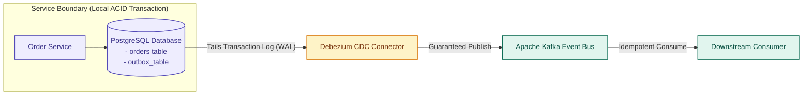

#### Step-by-Step Execution Lifecycle
1. **Atomic Write**: In a single database transaction, the application inserts the domain order and an event record into `outbox_table`. Both commit together, or both abort.
2. **Change Data Capture (CDC)**: A dedicated CDC connector (e.g. Debezium) monitors the database's internal transaction log (PostgreSQL WAL or MySQL Binlog).
3. **Broker Ingestion**: Debezium reads newly committed outbox rows and publishes them to the target Kafka topic.
4. **Idempotent Consumption**: Downstream consumers receive the event and deduplicate via an `event_id` unique constraint.

#### Trade-Off Analysis
- **Strengths**: Eliminates the dual-write bug completely; guarantees zero data loss without slow Two-Phase Commit distributed transactions.
- **Weaknesses**: Introduces CDC infrastructure operational overhead; outbox table requires scheduled truncation/pruning to avoid table bloat.
- **Production Stacks**: Debezium, Kafka Connect, Outbox SDK for Quarkus/Spring, Eventuate Tram.

---

### 3.5 Cache-Aside (Lazy Loading)

#### Conceptual Theory
Relational database I/O bottlenecks under heavy read concurrency. Cache-Aside positions an in-memory key-value cache (Redis, Memcached) alongside the primary datastore, giving the application direct control over caching behavior.

#### Graphical Architectural Diagram
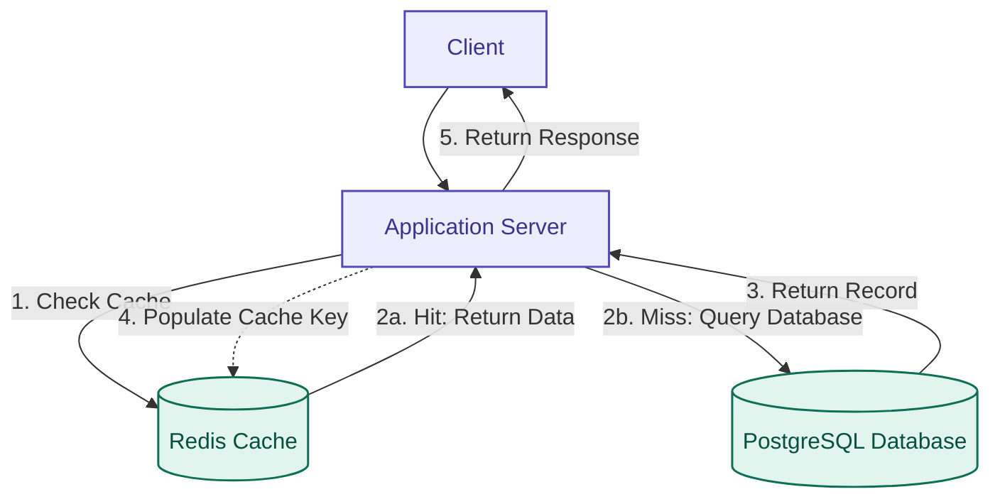

#### Pitfall: The Cache Stampede (Thundering Herd)
When a high-traffic cache key expires, thousands of concurrent requests miss the cache simultaneously and slam the database.
- **Mitigation**: Use **Mutex Locking / Singleflight** so only one thread queries the database and populates the cache while other threads wait.

#### Trade-Off Analysis
- **Strengths**: Resilient (if cache dies, the application still functions by querying the database); data models in cache can differ from database tables.
- **Weaknesses**: Eventual consistency lag; stale data if writes fail to invalidate cache; cold-start latency.
- **Production Stacks**: Redis, Memcached, AWS ElastiCache.

---

### 3.6 Read-Through / Write-Through / Write-Behind

#### Conceptual Theory
Unlike Cache-Aside where the application orchestrates both cache and database, In-Line caching positions the cache directly in the data access path:
- **Read-Through**: Application queries cache. On miss, the cache provider transparently queries the database, caches the result, and returns.
- **Write-Through**: Application writes to cache. The cache provider synchronously commits to database before acknowledging success.
- **Write-Behind (Write-Back)**: Application writes to cache, which acknowledges immediately. The cache asynchronously flushes queued writes to the database in batched intervals.

#### Graphical Architectural Diagram
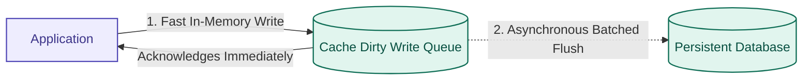

#### Trade-Off Analysis
- **Strengths**: Write-Behind delivers extreme write throughput by absorbing bursts and converting single writes into efficient bulk database batches.
- **Weaknesses**: High risk of data loss in Write-Behind if cache nodes crash before flushing dirty writes to persistent storage.
- **Production Stacks**: Hazelcast, Oracle Coherence, Redis Gears.

---

### 3.7 Service & Database Sharding

#### Conceptual Theory
When a database hits physical vertical hardware boundaries (CPU, RAM, disk I/O limits), data must be partitioned horizontally across independent database instances (**Shards**).

#### Graphical Architectural Diagram
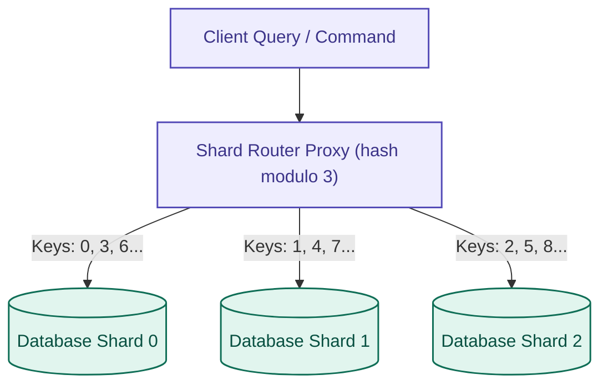

#### Trade-Off Analysis
- **Strengths**: Virtually unlimited horizontal scalability and transaction throughput; local transactions within a single shard remain ACID-compliant.
- **Weaknesses**: **Cross-Shard Joins** become computationally expensive or impossible; **Data Resharding** when adding nodes requires complex data migration pipelines; risk of **Hot Shards** if traffic distribution is skewed.
- **Production Stacks**: Vitess (MySQL scaling), Citus (PostgreSQL scaling), CockroachDB, Spanner.

---

## 4. Edge, Gateway & Ingress Composition Patterns

### 4.1 API Gateway Pattern

#### Conceptual Theory
Exposing internal microservices directly to public clients introduces fatal security and networking anti-patterns: exposing internal service ports, forcing clients to handle dozens of round-trips over cellular networks, and requiring every service to implement duplicate token verification, CORS, and rate limiting.

An API Gateway acts as the **single consolidated entry point (Reverse Proxy)** for all client traffic, decoupling edge ingress concerns from internal domain services.

#### Graphical Architectural Diagram
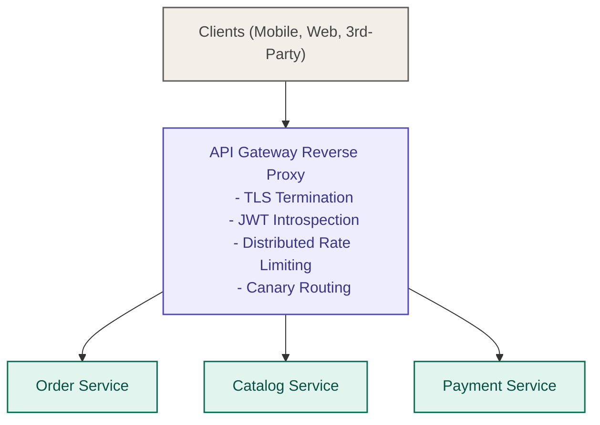

#### Trade-Off Analysis
- **Strengths**: Centralized edge security, unified rate limiting and metrics; eliminates multi-round-trip mobile latency; insulates internal topologies from public contracts.
- **Weaknesses**: Single point of failure if not clustered across availability zones; risk of becoming an Enterprise Service Bus (ESB) antipattern if business logic is stuffed into the gateway.
- **Production Stacks**: Envoy Proxy, Kong, Apache APISIX, AWS API Gateway, Traefik.

---

### 4.2 Backend-for-Frontend (BFF)

#### Conceptual Theory
Formulated by Sam Newman, the BFF pattern addresses conflicting UI requirements across different client form factors:
- **Mobile Clients**: Constrained cellular bandwidth, small screens, high latency penalty. Need lightweight, stripped payloads.
- **Desktop Web Clients**: High-bandwidth fiber connections, large viewports, multi-pane layouts. Need rich, deep JSON graphs.

Instead of building a single bloated generic API Gateway that satisfies no one, BFF creates **dedicated, client-specific gateway services owned by the respective frontend teams**.

#### Graphical Architectural Diagram
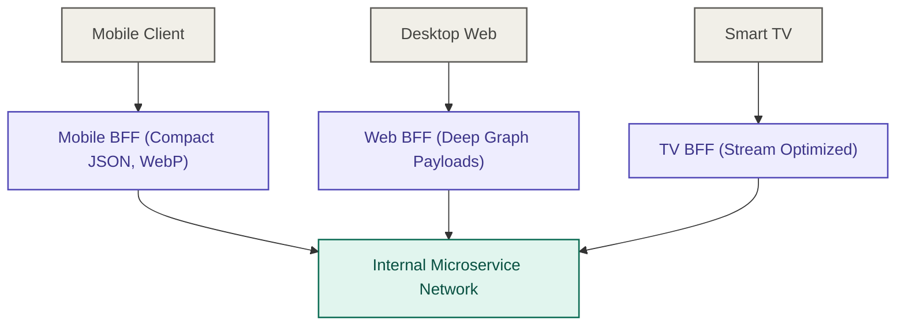

#### Trade-Off Analysis
- **Strengths**: Frontend teams independently deploy and optimize their gateway endpoints without coordinating releases; payload sizes are reduced by up to 80% on mobile.
- **Weaknesses**: Code duplication across multiple BFF codebases; increased operational and deployment footprint.
- **Production Stacks**: Node.js/Fastify BFFs, Apollo GraphQL Federation, Go/Gin micro-gateways.

---

### 4.3 Aggregator / Composition vs. 4.4 Scatter-Gather

#### Conceptual Theory
- **Aggregator Pattern**: A composite service receives a request, calls Services A, B, and C in parallel, merges the response objects into a single JSON schema, and returns it to the client.
- **Scatter-Gather Pattern**: The orchestrator broadcasts a query concurrently to *N* dynamic providers (e.g., flight booking engines, insurance quote vendors) with a **strict deadline timeout**. It aggregates whatever responses arrive before timeout and discards late responses.

#### Graphical Architectural Diagram
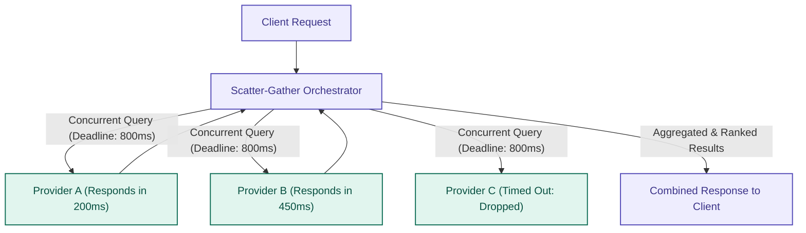

---

### 4.5 Sidecar / Ambassador Pattern

#### Conceptual Theory
In polyglot microservice environments (combining Go, Java, Python, Node.js), writing native libraries in every language for cross-cutting features (mTLS, telemetry, tracing, retries) leads to massive implementation drift and maintenance costs.

The Sidecar pattern deploys a supporting helper container **in the same physical network namespace (Pod / Localhost)** as the main application container. The application communicates only with `localhost`, and the Sidecar handles all network complexity.

#### Graphical Architectural Diagram
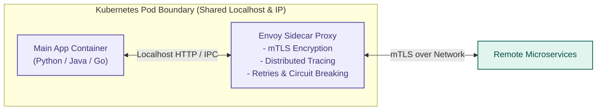

---

### 4.6 Anti-Corruption Layer (ACL)

#### Conceptual Theory
When modernizing legacy systems or integrating with third-party software, legacy data models and naming conventions threaten to leak into the clean domain model of your new services.

An Anti-Corruption Layer acts as a **bidirectional translation firewall**: it translates outbound requests from new domain schemas into legacy RPC/XML protocols, and unmarshalls legacy responses back into clean, modern domain entities.

#### Graphical Architectural Diagram
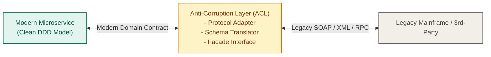

---

## 5. Workflow & Coordination Patterns

### 5.1 Orchestration vs. 5.2 Choreography

#### Conceptual Theory
The defining dilemma of distributed workflows: **Centralized Authority vs. Autonomous Emergence**.

| Feature | Orchestration | Choreography |
| :--- | :--- | :--- |
| **Coordination** | Central Orchestrator | Decentralized Event Bus |
| **Workflow Visibility** | High (Single State Machine) | Low (Implicit across logs) |
| **Coupling** | High to Orchestrator | Loose (Pub/Sub) |
| **Point of Failure** | Single Coordinator Node | Distributed / Resilient |
| **Error Recovery** | Deterministic Compensations | Complex Event Rollbacks |
| **Best For** | Complex Business Workflows | High-Volume Streaming |

---

### 5.3 Pipes and Filters

#### Conceptual Theory
Divides a complex processing task into a series of discrete, independent, reusable components (**Filters**) connected by communication channels (**Pipes**).

#### Graphical Architectural Diagram

- **Strengths**: Exceptional modularity, composability, and pipeline reordering; filters can scale horizontally.
- **Weaknesses**: High serialization/deserialization CPU overhead between pipeline stages.

---

### 5.4 Blackboard Pattern

#### Conceptual Theory
Designed for non-deterministic domains where no closed mathematical algorithm exists (speech recognition, bioinformatics, tactical routing). 
Independent expert components (**Knowledge Sources**) opportunistically inspect a shared memory structure (**Blackboard**), calculate partial hypotheses, and write deductions back until an acceptable solution emerges.

#### Graphical Architectural Diagram
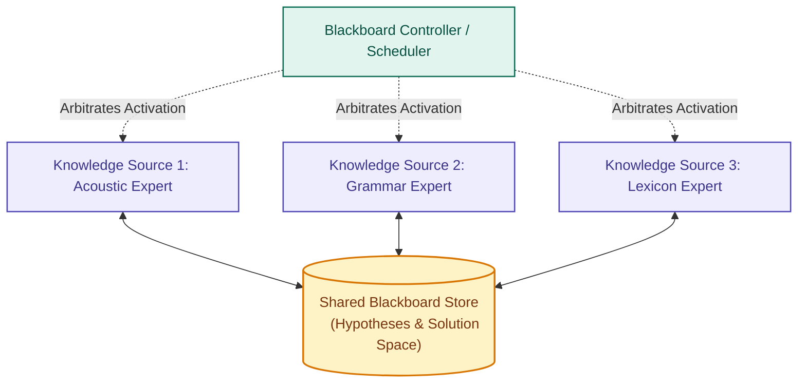

---

## 6. Resiliency & Traffic Shaping Patterns

### 6.1 Circuit Breaker Pattern

#### Conceptual Theory
Michael Nygard formulated the Circuit Breaker pattern to prevent **cascading failures**. When a downstream dependency fails or becomes sluggish, upstream caller threads block waiting for I/O timeouts. Under heavy load, thread pools exhaust rapidly, collapsing the entire system.

The Circuit Breaker wraps remote invocations with a state machine:
- **Closed**: Requests pass normally. Successes and failures are tracked in a sliding window.
- **Open**: Error threshold exceeded (e.g. > 50% failures in 10s). Requests fail fast immediately with fallback responses; network calls are aborted.
- **Half-Open**: Sleep duration expires. Trial probe requests are allowed through to evaluate downstream health.

#### Graphical State Machine Diagram
```mermaid
stateDiagram-v2
    [*] --> Closed
    Closed --> Open: Error threshold exceeded (> 50% failures in window)
    Open --> HalfOpen: Sleep window elapsed (e.g., 30s probe wait)
    HalfOpen --> Closed: Probe requests succeed
    HalfOpen --> Open: Probe request fails
```

#### Trade-Off Analysis
- **Strengths**: Eliminates cascading thread starvation; provides instant degraded responses (graceful degradation) to clients.
- **Weaknesses**: Fallback design complexity; setting optimal failure rate thresholds and sleep windows requires rigorous load testing.
- **Production Stacks**: Resilience4j, Envoy Circuit Breakers, Netflix Hystrix (legacy).

---

### 6.2 Bulkhead Pattern

#### Conceptual Theory
Named after watertight compartments in ocean vessels: if a ship's hull is punctured, water enters only one compartment, preventing the entire vessel from sinking.

In software, Bulkhead **isolates execution resources (thread pools, memory, connection pools)** into isolated compartments. If one downstream service (e.g., Shipping Service) hangs, only its allocated thread pool exhausts; critical services (Checkout, Payment) continue operating unaffected.

#### Graphical Architectural Diagram
```mermaid
flowchart TD
    subgraph ServiceProcess["Application Process"]
        subgraph Pool1["Orders Thread Pool (100)"]
            T1["Thread 1..100 (Healthy)"]
        end
        subgraph Pool2["Catalog Thread Pool (50)"]
            T2["Thread 1..50 (Healthy)"]
        end
        subgraph Pool3["Recommendations Pool (20)"]
            T3["All 20 Exhausted! (Failing Dependency Isolated)"]
        end
    end
    Orders["Orders API"] --> Pool1
    Catalog["Catalog API"] --> Pool2
    Recs["Recommendations API"] --> Pool3

    classDef ok fill:#E1F5EE,stroke:#0F6E56,stroke-width:1.5px,color:#085041
    classDef bad fill:#FEE2E2,stroke:#DC2626,stroke-width:1.5px,color:#991B1B
    class Pool1,Pool2,T1,T2 ok
    class Pool3,T3 bad
```

---

### 6.3 Ambulance / Priority Queue vs. 6.4 Dead Letter Queue (DLQ)

#### Graphical Architectural Diagram
```mermaid
flowchart TD
    subgraph PriorityRouting["Ambulance (Priority Queue)"]
        Traffic["Incoming Requests"] --> Classifier["Traffic Classifier"]
        Classifier -->|"VIP / Health Alert"| FastQueue["Ambulance Fast-Lane Queue"]
        Classifier -->|"Standard / Batch"| StdQueue["Normal Queue"]
        FastQueue --> VIPWorkers["Dedicated High-Priority Workers"]
        StdQueue --> StdWorkers["Standard Consumer Workers"]
    end
    
    subgraph DLQRouting["Dead Letter Queue (DLQ)"]
        Msg["Poison Message"] --> Worker["Consumer Worker"]
        Worker -->|"Retry Exceeded (> 5 attempts)"| DLX["Dead Letter Exchange"]
        DLX --> DLQ["Dead Letter Store & Alerting Dashboard"]
    end

    classDef prio fill:#EEEDFE,stroke:#534AB7,stroke-width:1.5px,color:#3C3489
    classDef dlq fill:#FEF3C7,stroke:#D97706,stroke-width:1.5px,color:#78350F
    class Traffic,Classifier,FastQueue,StdQueue,VIPWorkers,StdWorkers prio
    class Msg,Worker,DLX,DLQ dlq
```

---

### 6.5 Supervisor Consumer vs. 6.6 Thread Delegate

- **Supervisor Consumer**: A monitor thread continuously reads consumer queue lag. If backlogs exceed thresholds, it elastically spins up container workers; when idle, it spins them down.
- **Thread Delegate**: Prevents race conditions in multi-threaded event consumption. A single dispatcher hashes the entity key (`hash(order_id) % 8`) and delegates events to a dedicated single-threaded queue, ensuring strict sequential processing without global locking.

---

## 7. Domain Decoupling & Modernization Patterns

### 7.1 Ports and Adapters (Hexagonal Architecture)

#### Conceptual Theory
Formulated by Alistair Cockburn, Hexagonal Architecture solves the problem of **business logic becoming contaminated by databases, UI frameworks, and third-party vendor SDKs**.

Core Axiom: **Application domain logic sits at the center, completely unaware of databases or delivery mechanisms**. The domain defines **Ports** (interfaces). External infrastructure components plug in as interchangeable **Adapters**.

#### Graphical Architectural Diagram
```mermaid
flowchart LR
    subgraph DrivingAdapters["Driving (Primary) Adapters"]
        REST["REST Controller (Spring/FastAPI)"]
        CLI["CLI Command Handler"]
    end
    
    subgraph Hexagon["Core Application Hexagon"]
        PortIn["Driving Port (OrderUseCase Interface)"]
        Domain["Domain Entities & Business Invariants"]
        PortOut["Driven Port (OrderRepository Interface)"]
        
        PortIn --> Domain
        Domain --> PortOut
    end
    
    subgraph DrivenAdapters["Driven (Secondary) Adapters"]
        SQL["PostgreSQL Adapter"]
        Msg["Kafka Event Publisher Adapter"]
    end
    
    REST --> PortIn
    CLI --> PortIn
    PortOut --> SQL
    PortOut --> Msg

    classDef adapter fill:#F1EFE8,stroke:#5F5E5A,stroke-width:1.5px,color:#444441
    classDef hex fill:#EEEDFE,stroke:#534AB7,stroke-width:2px,color:#3C3489
    class REST,CLI,SQL,Msg adapter
    class PortIn,Domain,PortOut hex
```

#### Step-by-Step Flow
1. **Inbound Invocation**: An HTTP request reaches the REST Controller (**Driving Adapter**).
2. **Port Delegation**: The controller maps the HTTP payload to a domain command and invokes the `OrderUseCase` (**Driving Port**).
3. **Domain Execution**: The core domain processes business rules with zero external dependencies.
4. **Outbound Invocation**: The domain calls `OrderRepositoryPort` (**Driven Port**) to persist state.
5. **Infrastructure Execution**: The PostgreSQL implementation (**Driven Adapter**) converts domain calls into SQL statements and commits to the database.

#### Trade-Off Analysis
- **Strengths**: The domain can be fully tested in memory without starting databases or web servers; databases or web frameworks can be swapped without touching business logic.
- **Weaknesses**: High mapping boilerplate; extra conceptual complexity for small teams.
- **Production Stacks**: Clean Architecture in Go, Spring Boot DDD, Domain-Driven .NET Core.

---

### 7.2 Clean Architecture / Onion Architecture

Concentric circles where the **Dependency Rule** dictates that dependencies point strictly **inward**:

#### Graphical Architectural Diagram
```mermaid
flowchart TD
    subgraph Layer4["4. Frameworks & Drivers (Web, DB, UI, Devices)"]
        subgraph Layer3["3. Interface Adapters (Controllers, Gateways, Presenters)"]
            subgraph Layer2["2. Application Business Rules (Use Cases)"]
                subgraph Layer1["1. Enterprise Business Rules (Entities - Core)"]
                    Entities["Domain Entities"]
                end
                UseCases["Use Cases & Interactors"]
            end
            Adapters["Controllers, Gateways, Presenters"]
        end
        Drivers["Databases, HTTP Frameworks, External APIs"]
    end

    Drivers --> Adapters
    Adapters --> UseCases
    UseCases --> Entities

    classDef l1 fill:#E1F5EE,stroke:#0F6E56,stroke-width:2px,color:#085041
    classDef l2 fill:#EEEDFE,stroke:#534AB7,stroke-width:2px,color:#3C3489
    classDef l3 fill:#FEF3C7,stroke:#D97706,stroke-width:2px,color:#78350F
    classDef l4 fill:#F1EFE8,stroke:#5F5E5A,stroke-width:2px,color:#444441
    class Entities l1
    class UseCases l2
    class Adapters l3
    class Drivers l4
```

---

### 7.3 Strangler Fig Pattern

#### Conceptual Theory
Named after the Australian Strangler Fig vine that seeds in the upper branches of a host tree, grows downward, and gradually replaces the host tree until the original tree rots away.

The Strangler Fig pattern safely modernizes monolithic architectures with **zero Big Bang deployment risk**:
1. Place an edge routing proxy in front of the legacy monolith.
2. Build new features or extract domain slices as independent microservices.
3. Repoint the edge proxy to route specific URL paths to the new services.
4. Gradually strangle and decommission monolithic code until the monolith is retired.

#### Graphical Architectural Diagram
```mermaid
flowchart TD
    Edge["Edge Routing Proxy (API Gateway / Ingress)"]
    
    Edge -->|"90% Traffic (Legacy Paths)"| Monolith["Legacy Monolithic Core"]
    Edge -->|"10% Traffic (Strangled Slices)"| Svc1["New Microservice 1 (Orders)"]
    Edge -->|"New Capabilities"| Svc2["New Microservice 2 (Payments)"]
    
    Monolith -.->|"Gradually Deprecated & Decommissioned"| Decom["Decommissioned"]

    classDef edge fill:#EEEDFE,stroke:#534AB7,stroke-width:1.5px,color:#3C3489
    classDef legacy fill:#FEE2E2,stroke:#DC2626,stroke-width:1.5px,color:#991B1B
    classDef modern fill:#E1F5EE,stroke:#0F6E56,stroke-width:1.5px,color:#085041
    class Edge edge
    class Monolith,Decom legacy
    class Svc1,Svc2 modern
```

---

### 7.4 Microkernel (Plugin) Pattern

Divides the system into a minimal **Core System** (lifecycle management, extension registries) and independent **Plugin Modules** (specialized business adapters, payment methods, algorithms).

#### Graphical Architectural Diagram
```mermaid
flowchart TD
    Core["Microkernel Core System
    - Plugin Registry & Discovery
    - Lifecycle Management
    - Internal Event Bus"]
    
    P1["Plugin A: Stripe Gateway"] <-->|"Core SPI Contract"| Core
    P2["Plugin B: PayPal Gateway"] <-->|"Core SPI Contract"| Core
    P3["Plugin C: Crypto Gateway"] <-->|"Core SPI Contract"| Core

    classDef core fill:#EEEDFE,stroke:#534AB7,stroke-width:2px,color:#3C3489
    classDef plug fill:#E1F5EE,stroke:#0F6E56,stroke-width:1.5px,color:#085041
    class Core core
    class P1,P2,P3 plug
```
- **Canonical Examples**: VS Code, Eclipse, Jira, Linux Kernel modules.

---

### 7.5 Broker Pattern (POSA)

Coordinates distributed communications between independent clients and servers via a centralized **Broker**:
- Servers register service capabilities and network endpoints with the Broker.
- Clients send requests to the Broker without knowing the physical IP of the server.
- The Broker marshals parameters, routes requests, unmarshals responses, and handles location transparency.

#### Graphical Architectural Diagram
```mermaid
flowchart TD
    Client["Client Application"] -->|"1. Invokes Service (Location Transparent)"| Broker["Broker Coordinator
    - Service Registry
    - Parameter Marshalling
    - Message Router"]
    
    Broker -->|"2. Dispatches Invocation"| Server["Remote Service Instance"]
    Server -->|"3. Returns Result"| Broker
    Broker -->|"4. Unmarshals & Returns"| Client
    
    Server -.->|"Registers Capabilities & Endpoint"| Broker

    classDef client fill:#F1EFE8,stroke:#5F5E5A,stroke-width:1.5px,color:#444441
    classDef broker fill:#FEF3C7,stroke:#D97706,stroke-width:2px,color:#78350F
    classDef server fill:#E1F5EE,stroke:#0F6E56,stroke-width:1.5px,color:#085041
    class Client client
    class Broker broker
    class Server server
```

---

## 8. Master Architectural Pattern Decision Matrix

| Architectural Problem / Dilemma | Primary Pattern | Secondary Pattern | Key Trade-Off to Accept |
| :--- | :--- | :--- | :--- |
| **Separating UI from Domain Logic (Web)** | **MVC** | **Front Controller** | Controller bloat risk; boilerplate. |
| **Two-way Data Binding in Rich UI** | **MVVM** | **MVI** | Memory overhead; binding debugging complexity. |
| **High Read Concurrency vs. Complex Writes** | **CQRS** | **Cache-Aside** | Eventual consistency lag between read/write stores. |
| **Complete Audit Trails & State History** | **Event Sourcing** | **CQRS** | Complex event schema migration; snapshotting overhead. |
| **Distributed Multi-Service Transactions** | **Orchestrated Saga** | **Choreographed Saga** | Lack of isolation; compensating transaction complexity. |
| **Dual-Write Inconsistency (DB + Event)** | **Transactional Outbox** | **Change Data Capture** | CDC infrastructure overhead; outbox table pruning. |
| **Multi-Client Optimization (Mobile/Web)** | **Backend-for-Frontend** | **API Gateway** | Code duplication across client-specific BFFs. |
| **Preventing Cascading Distributed Crashes** | **Circuit Breaker** | **Bulkhead** | Degraded fallback response design; tuning thresholds. |
| **Safely Modernizing a Legacy Monolith** | **Strangler Fig** | **Anti-Corruption Layer** | Running dual systems concurrently during migration. |
| **Decoupling Core Domain from Frameworks** | **Ports & Adapters** | **Clean Architecture** | Heavy interface and DTO mapping boilerplate. |
| **Sequential Stream / Transformation Workflows** | **Pipes and Filters** | **Orchestration** | Serialization overhead between pipeline filters. |
