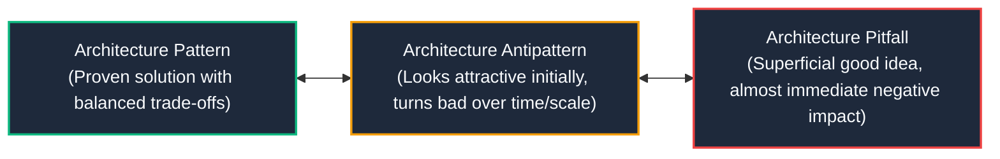

# Software Architecture Patterns, Antipatterns & Pitfalls: Complete Book Catalog

> **Source Attribution**: Extracted, analyzed, and synthesized directly from ***Software Architecture: Patterns, Antipatterns, and Pitfalls*** by Mark Richards, Neal Ford, and Raju Gandhi (O'Reilly Media).

---

## 1. Architectural Foundations: Patterns vs. Antipatterns vs. Pitfalls

In Chapter 1 (*Fundamental Patterns and Antipatterns…with Some Pitfalls*), the authors establish the **Pattern, Antipattern, and Pitfall Spectrum**:



### Core Distinctions Defined by Richards, Ford & Gandhi:
1. **Architecture Pattern**: A battle-tested structural arrangement designed to optimize specific architectural capabilities (e.g. scalability, fault tolerance, data consistency) while consciously accepting specific degraded trade-offs.
2. **Architecture Antipattern**: Martin Fowler's metaphor: *"A solution that initially looks like an attractive road lined with flowers… but further on leads you into a maze filled with monsters."* It appears beneficial in small contexts or early project stages, but degrades disastrously as scale, time, or complexity grows. More favorable alternatives exist.
3. **Architecture Pitfall**: A choice that only superficially seems like a good idea and produces **almost immediate negative consequences**. Unlike antipatterns, there is typically no alternative except to stop doing it.

---

## 2. Complete Catalog of Architectural Patterns

The following table details all 24 architectural patterns documented in the book, including their core architectural dilemma, mechanism, improved capabilities, and degraded trade-offs:

| Pattern Name & Chapter | Core Architectural Dilemma | Mechanism & Solution | Improved Capabilities | Degraded Capabilities / Trade-Offs |
| :--- | :--- | :--- | :--- | :--- |
| **Ambulance Pattern** (Ch 3) | *How do I prioritize urgent messages ahead of high-volume normal traffic?* | Introduces a dedicated "ambulance" high-priority fast-lane queue alongside standard queues, processed by dedicated worker pools with preemption. | **Responsiveness, Processing Order for VIP traffic, Throughput** | **Increased Complexity, Potential Starvation** of low-priority message queues. |
| **Async Chain of Persistence** (Ch 6) | *How do I prevent message loss in asynchronous distributed pipelines?* | Enforces synchronous write to persistent store or broker with client acknowledgement (`CLIENT_ACKNOWLEDGE`) before message consumption is committed. | **Reliability, Fault Tolerance, Data Integrity, Zero Message Loss** | **Reduced Throughput, Increased Latency** due to mandatory synchronous I/O synchronization barriers. |
| **Backend for Frontend (BFF)** (Ch 7) | *How can I support multiple user-interface types with diverse data needs?* | Deploys specialized gateway services customized per client type (e.g., Mobile BFF, Desktop Web BFF, Third-Party API BFF) rather than one generic API gateway. | **Agility, UI Performance, Modularity, Bandwidth Efficiency** | **Code Duplication across BFFs, Operational Overhead, Deployment Coordination**. |
| **Cache Aside** (Ch 8) | *How do I improve read performance without putting the cache in the critical write path?* | The application queries cache first; on a cache miss, it reads from the database and populates the cache. Writes bypass cache or invalidate it. | **Read Performance, Scalability, Fault Tolerance** (DB survives if cache dies) | **Eventual Consistency, Cache Stampede / Thundering Herd** risk on cold cache. |
| **Choreography** (Ch 9) | *How should I manage distributed workflows without a single point of failure?* | Decentralized reactive workflow where participating domain services react to domain events and emit follow-up events with no central orchestrator. | **Scalability, High Throughput, Loose Coupling, Fault Tolerance** | **Low Workflow Visibility, Difficult Error Recovery / Compensation, Difficult Debuggability**. |
| **CQRS Pattern** (Ch 10) | *How can I independently optimize data models for reads and writes?* | Separates the write model (commands that mutate state with strict validations) from the read model (denormalized, high-speed read projections). | **Read/Write Scalability, High Read Performance, Domain Model Purity** | **Eventual Consistency Lag, Data Synchronization Overhead, Dual-Model Code Complexity**. |
| **Compensating Updates** (Ch 11) | *How do I roll back a distributed transaction without two-phase commit (2PC)?* | Implements backward recovery in Sagas: when step $N$ fails, compensating semantic inverse transactions ($N-1, \dots, 1$) execute to undo partial state changes. | **Distributed Atomicity, Scalability, Avoids Distributed Locks** | **Complex Error Handling, Transient Inconsistent State** visible to other queries. |
| **Contextual Events** (Ch 12) | *How many events should I trigger from a single domain service action?* | Emits fine-grained events carrying explicit context for specific consumer actions rather than one giant ambiguous domain change event. | **Decoupled Consumer Evolution, Fine-Grained Filtering** | **Event Proliferation, Increased Event Bus Traffic and Governance Burden**. |
| **Cross-Cutting State** (Ch 13) | *How should I manage shared state across independent distributed workflow steps?* | Propagates correlation context and state through event envelopes or distributed caching rather than shared database tables. | **Workflow Decoupling, Horizontal Scalability** | **Payload Bloat, Security / Data Leakage** if sensitive state traverses external boundaries. |
| **Data-Based Event Contract** (Ch 14) | *How much data should I include in an event payload?* | The event payload contains the complete rich domain dataset (Fat Event) required for consumers to act without making follow-up queries. | **Consumer Performance, High Autonomy, Zero Back-Queries** | **Stamp Coupling, Heavy Network Bandwidth Usage, Contract Rigidity**. |
| **Domain-Broker Pattern** (Ch 15) | *How many brokers should I have in my distributed architecture?* | Partitions message brokers along bounded domain contexts instead of using a single monolithic enterprise message broker. | **Fault Domain Isolation, Autonomous Team Ownership, Scalability** | **Cross-Domain Messaging Overhead, Increased Infrastructure Costs**. |
| **Event Sourcing** (Ch 16) | *Should I capture my state as mutable rows or as an immutable event stream?* | Stores every state change as an immutable chronological append-only log of domain events; current state is derived by replaying events. | **Complete Auditability, Time-Travel Debugging, Zero State Mutation Bugs** | **Event Schema Evolution Complexity, Replay Performance Lag** (requires snapshots). |
| **Explicit Workflow State** (Ch 17) | *How should I manage and audit complex long-running business processes?* | Dedicated workflow state engine persists explicit state machine transitions and status flags in an authoritative persistent database. | **Auditability, Clear Debuggability, Deterministic Recovery** | **Central State Contention, Database Write Bottleneck**. |
| **Extensible Events** (Ch 18) | *Should I trigger an event if no consumer is currently listening for it?* | Publishes structured, forward-compatible domain events even before consumers exist, using schema extension points. | **Evolvability, Future Integration Agility** | **Wasted Serialization / Broker Overhead** for unconsumed events. |
| **Front Controller** (Ch 19) | *How do I handle request mediation and security without an explicit orchestrator?* | Centralized entry-point component intercepts all incoming requests to enforce security, routing, logging, and pre-processing. | **Centralized Security Enforcement, Consistent Routing & Auditing** | **Single Point of Bottleneck, Can degrade into a God Controller**. |
| **Implicit Workflow State** (Ch 22) | *How can I manage lightweight workflow state with minimal coordination?* | State is implicitly derived by the presence of messages in specific queues or by downstream entity statuses without a centralized coordinator. | **High Throughput, Low Storage Overhead, Simplicity** | **Poor Workflow Observability, Hard to Detect Stalled / Abandoned Workflows**. |
| **Key-Based Event Contract** (Ch 23) | *How do I avoid bandwidth bloat in high-frequency event architectures?* | Events carry only entity identifiers and timestamps (Thin Event); consumers query the originating service for full details if needed. | **Bandwidth Efficiency, Clean Loose Contracts, Security** | **N+1 Back-Queries from Consumers, Increased Latency** due to chatty secondary lookups. |
| **Multi-Broker Pattern** (Ch 25) | *How can I improve message throughput and eliminate cluster saturation?* | Distributes queues and topics across multiple physical/logical broker instances categorized by throughput and priority. | **Throughput, Scalability, High Availability, Fault Domain Isolation** | **Operational Complexity, Difficult Global Message Ordering**. |
| **Nexus Architecture** (Ch 26) | *How do I manage cross-cutting concerns (data, security, agents) across modern distributed fleets?* | Unified coordination mesh combining Service Mesh (networking/sidecars), Data Mesh (analytical domain quanta), and Agentic Mesh (LLM/MCP pipelines). | **Holistic Governance, Dynamic Evolvability, Enterprise Observability** | **High Cognitive Load, Steep Operational & Platform Engineering Overhead**. |
| **Orchestration** (Ch 27) | *How should I manage complex multi-step workflows with strict SLA requirements?* | A centralized orchestrator controls the workflow lifecycle, commanding services synchronously or asynchronously and handling errors deterministically. | **High Workflow Visibility, Deterministic Error & Compensation Handling** | **Central Bottleneck, Tight Coupling to Orchestrator, Single Point of Failure**. |
| **Read-Through / Write-Through** (Ch 29) | *How do I optimize data consistency between application cache and database?* | The cache sits directly in the data access path: reads fetch through cache, and writes update cache which synchronously updates the backing store. | **High Data Consistency, Simplified Application Code** | **Write Latency, Cache System is a Critical Single Point of Failure**. |
| **Service Sharding** (Ch 30) | *How should I implement atomicity and isolation in high-throughput distributed systems?* | Partitions both service compute and database storage by a shard key (e.g. customer ID, region), keeping transactions local to a shard. | **Elastic Scalability, High Transaction Throughput, Avoids Distributed Locks** | **Difficult Cross-Shard Aggregations / Queries, Uneven Data Skew (Hot Shards)**. |
| **Supervisor Consumer** (Ch 33) | *How can I scale message consumption elastically without over-subscribing queues?* | A supervisor consumer inspects queue depth and dynamically spawns/terminates worker consumers to match burst workloads. | **Consistent Response Times, Elastic Resource Efficiency** | **Coordination Overhead, Worker Lifecycle Churn**. |
| **Thread Delegate** (Ch 34) | *How can I guarantee message processing order across multithreaded consumers?* | A single dispatcher consumer receives messages, hashes the entity key, and delegates each message to a dedicated single-threaded queue. | **Strict In-Order Message Processing, High Parallel Throughput** | **Thread Starvation if One Entity Experiences Massive Traffic Spike**. |
| **Workflow Event** (Ch 35) | *How do I handle asynchronous errors in fire-and-forget message workflows?* | Routes processing failures to a dedicated workflow event processor with dead-letter storage, alerting dashboards, and replay capabilities. | **Fault Tolerance, Resilient Asynchronous Error Recovery** | **Increased Message Flow Complexity, Manual Intervention Bottlenecks**. |

---

## 3. Complete Catalog of Architectural Antipatterns

The book dedicates standalone chapters to the major architectural antipatterns that tempt teams with initial simplicity but cause structural failure over time:

| Antipattern Name & Chapter | The Seductive Initial Trap | Why It Turns into an Antipattern (The Monsters in the Maze) | How to Avoid & Refactor (Clean Solutions) |
| :--- | :--- | :--- | :--- |
| **Architecture by Implication** (Ch 4) | Teams rush into writing features without an intentional architecture, assuming architecture will "emerge naturally" as code grows. | As non-functional requirements (scale, security, reliability) emerge, the codebase has hardened into an accidental, unmaintainable tangled monolith with conflicting communication paths. | **Intentional Architectural Invariants**: Define architectural fitness functions, establish boundaries upfront, and govern architectural quantum coupling from day one. |
| **Architecture Sinkhole** (Ch 5) | In Layered Architecture, requests pass through multiple closed layers (Presentation -> Business -> Persistence -> Database) where layers perform zero business logic (pure pass-through). | Massive latency overhead, high CPU serialization waste, and developer frustration making trivial changes across 5 boilerplate files with zero added value. | **Open Layers Pragmatically**: Open specific pass-through layers so upper layers can bypass them directly; or migrate to a Modular Monolith or Microservices if layers no longer serve isolation. |
| **Overcentralization** (Ch 28) | Centralizing all shared logic, schemas, and workflows into a single global Enterprise Service Bus (ESB), shared database, or central gateway to maximize reuse. | Creates a massive single point of failure, severe deployment bottlenecks (every release requires global regression testing), and high blast radius for minor bugs. | **Federated / Domain-Driven Decentralization**: Shift to Domain Brokers, API Gateways per domain, and microservices sharing contracts rather than binary libraries. |
| **Stamp Coupling** (Ch 31) | Passing large, composite data contracts (e.g. an entire 150-field `CustomerRecord`) between services when the receiving service only requires 2 fields (`customerId`, `status`). | Extreme network bandwidth consumption, brittle consumer coupling (changes to unrelated fields break consumers), and severe security/PII leakage. | **Targeted Contracts & Payloads**: Adopt Consumer-Driven Contracts (Pact), GraphQL field selection, URL filtering, or Key-Based Event Contracts (Thin Events). |
| **Stovepipe Architecture** (Ch 32) | Building isolated, vertically integrated silos for each application or business unit from top to bottom, including custom copies of infrastructure and services. | Zero cross-system interoperability, runaway infrastructure and licensing costs, duplicated engineering efforts, and inability to build unified customer workflows. | **Iterative Architecture & Residuality Theory**: Identify shared core capabilities, extract reusable platform components, and decouple systems via event-driven integration. |

---

## 4. Complete Catalog of Architectural Pitfalls

Architectural pitfalls are immediate traps where negative consequences appear rapidly, with no valid alternative except to stop doing them:

| Pitfall Name & Chapter | The Superficial "Good Idea" | Immediate Negative Consequences | The Only Correct Remedy |
| :--- | :--- | :--- | :--- |
| **Frozen Caveman Pitfall** (Ch 20) | Architects basing all current architectural decisions strictly on past experiences, outdated paradigms (e.g. SOAP, CORBA), or obsolete constraints. | Modern systems fail to leverage asynchronous messaging, cloud elasticity, or containers; systems are over-engineered against constraints that no longer exist. | **Continuously Re-evaluate Trade-Offs**: Test assumptions against current hardware, cloud pricing, and architectural paradigms. |
| **Grains of Sand Pitfall** (Ch 21) | Decomposing services into microservices that are far too small (single functions or single database tables turned into individual services). | Catastrophic network latency cascades, distributed transaction failures, nightmare deployment dependencies, and impossible distributed tracing. | **Consolidate Service Granularity**: Group services by transactional boundaries, high-frequency data coupling, and single deployment units (Architecture Quanta). |
| **Microservice All the Things** (Ch 24) | Defaulting to Microservices for every greenfield project regardless of team size, operational maturity, or domain complexity. | Crushing operational overhead, distributed system complexity, Kubernetes tax, and delayed time-to-market for applications that would thrive as a Modular Monolith. | **Pragmatic Style Selection**: Start with a well-structured Modular Monolith or Service-Based Architecture; only decompose into Microservices when independent deployability and scalability are strictly proven necessary. |

---

## 5. Architectural Trade-Off Analysis Summary Matrix

```mermaid
quadrantChart
    title Architectural Spectrum: Governance vs Coupling Risk
    x-axis Low Structural Coupling --> High Structural Coupling
    y-axis High Autonomy & Scale --> Low Autonomy & Bottlenecks
    quadrant-1 Antipattern Zone (Overcentralization)
    quadrant-2 Modern Scalable Patterns (Choreography, BFF)
    quadrant-3 Pragmatic Structured Patterns (CQRS, Orchestration)
    quadrant-4 Pitfall Danger Zone (Grains of Sand, Sinkholes)
    "Choreography": [0.2, 0.85]
    "Service Sharding": [0.3, 0.8]
    "BFF": [0.25, 0.75]
    "CQRS": [0.4, 0.7]
    "Orchestration": [0.55, 0.55]
    "Cache Aside": [0.35, 0.65]
    "Overcentralization": [0.85, 0.2]
    "Architecture Sinkhole": [0.75, 0.3]
    "Stamp Coupling": [0.8, 0.35]
    "Grains of Sand": [0.9, 0.15]
```

### The Three Laws of Software Architecture (Richards & Ford):
1. **First Law**: *Everything in software architecture is a trade-off.*
2. **Second Law**: *Why is more important than how.*
3. **Third Law**: *Most architecture decisions aren’t binary but rather exist on a spectrum between extremes.*
