# Chapter 01: Introduction to UML Diagrams and Its Components

> **Book**: *UML Diagramming: A Case Study Approach* by Dr. Suriya Sundaramoorthy (CRC Press, 2022)  
> **Pages**: 1–22 (Total: 22 pages)  
> **Classification**: Theoretical Foundations & UP Phases  
> **Navigation**: [📚 Book Index](../UML_Book.md) | [Chapter_02_Design_of_UML_Diagrams_for_Webmed_Healthcare_Service_System_Services &rarr;](Chapter_02_Design_of_UML_Diagrams_for_Webmed_Healthcare_Service_System_Services.md)

---

## 📌 Executive Summary

Chapter 1 establishes the theoretical foundations of object-oriented software engineering modeling, the **Unified Process (UP)** development lifecycle, and the role of the **Unified Modeling Language (UML)** as the universal visual language for specifying, visualizing, constructing, and documenting software system artifacts. It structures the engineering lifecycle into four iterative, risk-driven phases (Inception, Elaboration, Construction, and Transition) and establishes the canonical taxonomy of structural and behavioral UML diagrams.

---

## 🎯 Problem Statement & Business Context

### 📋 Executive Summary & Problem Breakdown
- **Core Problem**: Building software without visual blueprints leads to severe miscommunication between clients and coders, causing project delays and failures.
- **Business Context**: Teams need standard visual models to estimate costs, identify risks early, and guide developers before writing code.
- **Key Solution**: Uses the **Unified Process (UP)** (Inception, Elaboration, Construction, Transition) and standard **UML Diagrams** (structural for code/servers, behavioral for user steps).

### 📖 Authentic Problem Description (with Key Diagram Drivers Highlighted)

> *Below is the complete authentic problem statement from the case study specification. The **bold highlighted sentences** denote explicit functional requirements, actors, entities, and workflows that directly drove the creation of the UML diagrams:*

**Chapter 1 establishes the theoretical foundations of object-oriented software engineering modeling, the Unified Process (UP) development lifecycle, and the role of the Unified Modeling Language (UML) as the universal visual language for specifying, visualizing, constructing, and documenting software system artifacts.** **It structures the engineering lifecycle into four iterative, risk-driven phases: Inception (scope and feasibility), Elaboration (baseline executable architecture), Construction (coding and alpha testing), and Transition (beta testing and customer deployment).** **Furthermore, it formalizes the canonical taxonomy of structural models (Class, Component, Deployment) and behavioral models (Use Case, Activity, Sequence, Communication, State Machine) necessary to represent software systems comprehensively from inception through production deployment.**

> 🔑 **Key Diagram Drivers Derived from Highlighted Requirements**:
> - **Lifecycle Phases (Figures 1.1–1.4)**: `Inception Phase`, `Elaboration Phase`, `Construction Phase`, `Transition Phase`.
> - **Taxonomy Hierarchy (Figure 1.5)**: `Structural Modeling` (Class, Component, Deployment) and `Behavioral Modeling` (Use Case, Activity, Sequence, State Machine).

---

## 🎯 Unified Process (UP) Lifecycle Phases

The **Unified Process (UP)** combines industry-proven best practices into an architecture-centric, iterative lifecycle designed to tackle critical architectural risks early. It organizes software development across four sequential phases:

1. **Inception Phase**: Evaluates initial project scope, business feasibility, boundary constraints, and stakeholder requirements. Traces key feasibility criteria (business context, risk assessment, cost-benefit trade-offs) to establish project authorization.
2. **Elaboration Phase**: Mitigates fundamental architectural risks by designing the baseline executable architecture, developing scheduling milestones, and formulating the core UML Use Case models.
3. **Construction Phase**: Iteratively implements code components, integrates subsystem modules, and conducts comprehensive Alpha testing in the developer environment to achieve production readiness.
4. **Transition Phase**: Orchestrates Beta testing at the client site, validates operational acceptance, conducts user training, deploys release artifacts, and incorporates customer feedback for operational fine-tuning.

---

## 📐 UML Diagram Taxonomy & Architectural Perspectives

UML diagrams are organized into two primary modeling categories across thirteen standard diagram types:

### 1. Structural Modeling (Static Structure)
- **Class Diagram**: The backbone of object-oriented systems; models static classifiers, attributes, operations, and associations (inheritance, composition, aggregation).
- **Component Diagram**: Architects modular software units, physical binary libraries, provided ball interfaces, and required socket dependencies.
- **Deployment Diagram**: Maps executable software artifacts onto hardware compute nodes, network topologies, database servers, and physical execution environments.
- **Object / Package / Composite Structure**: Models runtime object configurations, package dependencies, and internal collaborative structures.

### 2. Behavioral Modeling (Dynamic Interactions & Workflows)
- **Use Case Diagram**: Defines external actors, system boundaries, and business goals with `<<include>>` and `<<extend>>` relationships.
- **Activity Diagram**: Models step-by-step business workflows, decision branching, parallel fork/join execution, and state transitions.
- **Sequence Diagram**: Captures time-ordered object interactions, synchronous invocations, return values, and lifeline activations.
- **Communication (Collaboration) Diagram**: Illustrates structural link topologies overlaid with numbered chronological message exchanges.
- **State Machine Diagram**: Details entity lifecycle states, transition triggers, guard conditions, and entry/exit actions.

---

## 📊 Complete UML Diagram Suite & Architectural Walkthrough

This chapter incorporates **75 crystal-clear, high-resolution diagram(s)** (extracted losslessly from the source edition at up to 2,000+ px) illustrating the end-to-end design from functional use cases to physical hardware deployment:

### Figure 1.1: Inception Phase

**Diagram Category**: `Architectural Figure`  
**Architectural Role**: Structural schematic detailing domain requirements and workflow transitions.

**System Design Analysis**:
Structural architectural schematic detailing operational flow and functional requirements in **Introduction to UML Diagrams and Its Components**.

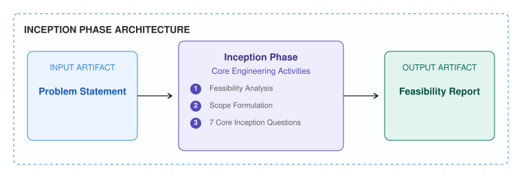

#### 🔍 Component Derivation from Problem Requirements

- **Methodology & Phase Focus Selection**:
  - **Engineering Need**: Complex software systems require progressive risk reduction before heavy capital investment; `Inception Phase` is derived from the Unified Process (UP) lifecycle to address critical feasibility, architecture, or deployment risks.
  - **Artifacts & Deliverables**: Formulates core engineering blueprints (Vision documents, Use Case models, Architecture Baselines, or Release Bundles) required to pass the lifecycle milestone gate.
- **Role & Stakeholder Involvement**:
  - **Business Analysts & Project Sponsors**: Own feasibility assessment, budget bounds, and business justification.
  - **Software Architects & Engineers**: Establish architectural baselines, executable prototypes, and subsystem modularity.
- **Structural Organization & Taxonomy**:
  - Organizes modeling artifacts into **Structural Perspectives** (static code, database schemas, component wiring, hardware deployment) and **Behavioral Perspectives** (dynamic operational workflows, time-ordered sequence calls, entity state changes).

#### 🛠️ Step-by-Step Construction Guide

1. **Define Lifecycle Stage & Milestone Goals**:
   - Establish the primary engineering objective of `Inception Phase` within the Unified Process development framework.
2. **Identify Required Input Artifacts & Stakeholder Goals**:
   - Map business requirements, risk assessments, and architectural hypotheses into actionable engineering artifacts.
3. **Model Process Workflows & Iteration Cycles**:
   - Draw sequential workflow stages depicting the transition from requirements capture to implementation and verification.
4. **Establish Review Gates & Exit Criteria**:
   - Define concrete milestone checkpoints (e.g., Lifecycle Architecture Milestone, Initial Operational Capability) needed to authorize transition to the next phase.
5. **Verify Methodological Consistency**:
   - Ensure alignment between business feasibility criteria and technical software engineering artifacts.

### Figure 1.2: Elaboration Phase

**Diagram Category**: `Architectural Figure`  
**Architectural Role**: Structural schematic detailing domain requirements and workflow transitions.

**System Design Analysis**:
Structural architectural schematic detailing operational flow and functional requirements in **Introduction to UML Diagrams and Its Components**.

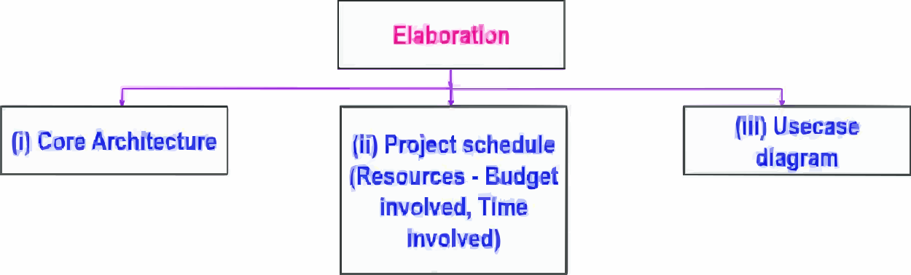

#### 🔍 Component Derivation from Problem Requirements

- **Methodology & Phase Focus Selection**:
  - **Engineering Need**: Complex software systems require progressive risk reduction before heavy capital investment; `Elaboration Phase` is derived from the Unified Process (UP) lifecycle to address critical feasibility, architecture, or deployment risks.
  - **Artifacts & Deliverables**: Formulates core engineering blueprints (Vision documents, Use Case models, Architecture Baselines, or Release Bundles) required to pass the lifecycle milestone gate.
- **Role & Stakeholder Involvement**:
  - **Business Analysts & Project Sponsors**: Own feasibility assessment, budget bounds, and business justification.
  - **Software Architects & Engineers**: Establish architectural baselines, executable prototypes, and subsystem modularity.
- **Structural Organization & Taxonomy**:
  - Organizes modeling artifacts into **Structural Perspectives** (static code, database schemas, component wiring, hardware deployment) and **Behavioral Perspectives** (dynamic operational workflows, time-ordered sequence calls, entity state changes).

#### 🛠️ Step-by-Step Construction Guide

1. **Define Lifecycle Stage & Milestone Goals**:
   - Establish the primary engineering objective of `Elaboration Phase` within the Unified Process development framework.
2. **Identify Required Input Artifacts & Stakeholder Goals**:
   - Map business requirements, risk assessments, and architectural hypotheses into actionable engineering artifacts.
3. **Model Process Workflows & Iteration Cycles**:
   - Draw sequential workflow stages depicting the transition from requirements capture to implementation and verification.
4. **Establish Review Gates & Exit Criteria**:
   - Define concrete milestone checkpoints (e.g., Lifecycle Architecture Milestone, Initial Operational Capability) needed to authorize transition to the next phase.
5. **Verify Methodological Consistency**:
   - Ensure alignment between business feasibility criteria and technical software engineering artifacts.

### Figure 1.3: Construction Phase

**Diagram Category**: `Architectural Figure`  
**Architectural Role**: Structural schematic detailing domain requirements and workflow transitions.

**System Design Analysis**:
Structural architectural schematic detailing operational flow and functional requirements in **Introduction to UML Diagrams and Its Components**.

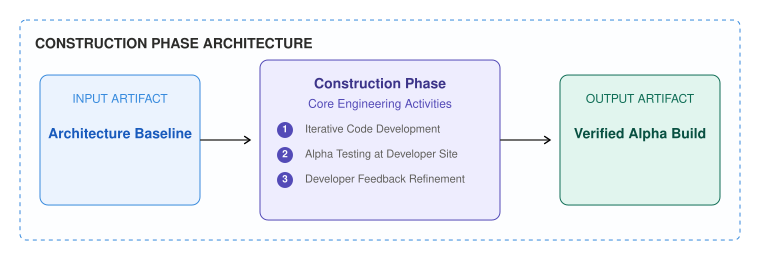

#### 🔍 Component Derivation from Problem Requirements

- **Methodology & Phase Focus Selection**:
  - **Engineering Need**: Complex software systems require progressive risk reduction before heavy capital investment; `Construction Phase` is derived from the Unified Process (UP) lifecycle to address critical feasibility, architecture, or deployment risks.
  - **Artifacts & Deliverables**: Formulates core engineering blueprints (Vision documents, Use Case models, Architecture Baselines, or Release Bundles) required to pass the lifecycle milestone gate.
- **Role & Stakeholder Involvement**:
  - **Business Analysts & Project Sponsors**: Own feasibility assessment, budget bounds, and business justification.
  - **Software Architects & Engineers**: Establish architectural baselines, executable prototypes, and subsystem modularity.
- **Structural Organization & Taxonomy**:
  - Organizes modeling artifacts into **Structural Perspectives** (static code, database schemas, component wiring, hardware deployment) and **Behavioral Perspectives** (dynamic operational workflows, time-ordered sequence calls, entity state changes).

#### 🛠️ Step-by-Step Construction Guide

1. **Define Lifecycle Stage & Milestone Goals**:
   - Establish the primary engineering objective of `Construction Phase` within the Unified Process development framework.
2. **Identify Required Input Artifacts & Stakeholder Goals**:
   - Map business requirements, risk assessments, and architectural hypotheses into actionable engineering artifacts.
3. **Model Process Workflows & Iteration Cycles**:
   - Draw sequential workflow stages depicting the transition from requirements capture to implementation and verification.
4. **Establish Review Gates & Exit Criteria**:
   - Define concrete milestone checkpoints (e.g., Lifecycle Architecture Milestone, Initial Operational Capability) needed to authorize transition to the next phase.
5. **Verify Methodological Consistency**:
   - Ensure alignment between business feasibility criteria and technical software engineering artifacts.

### Figure 1.4: Transition Phase

**Diagram Category**: `Architectural Figure`  
**Architectural Role**: Structural schematic detailing domain requirements and workflow transitions.

**System Design Analysis**:
Structural architectural schematic detailing operational flow and functional requirements in **Introduction to UML Diagrams and Its Components**.

#### 🔍 Component Derivation from Problem Requirements

- **Methodology & Phase Focus Selection**:
  - **Engineering Need**: Complex software systems require progressive risk reduction before heavy capital investment; `Transition Phase` is derived from the Unified Process (UP) lifecycle to address critical feasibility, architecture, or deployment risks.
  - **Artifacts & Deliverables**: Formulates core engineering blueprints (Vision documents, Use Case models, Architecture Baselines, or Release Bundles) required to pass the lifecycle milestone gate.
- **Role & Stakeholder Involvement**:
  - **Business Analysts & Project Sponsors**: Own feasibility assessment, budget bounds, and business justification.
  - **Software Architects & Engineers**: Establish architectural baselines, executable prototypes, and subsystem modularity.
- **Structural Organization & Taxonomy**:
  - Organizes modeling artifacts into **Structural Perspectives** (static code, database schemas, component wiring, hardware deployment) and **Behavioral Perspectives** (dynamic operational workflows, time-ordered sequence calls, entity state changes).

#### 🛠️ Step-by-Step Construction Guide

1. **Define Lifecycle Stage & Milestone Goals**:
   - Establish the primary engineering objective of `Transition Phase` within the Unified Process development framework.
2. **Identify Required Input Artifacts & Stakeholder Goals**:
   - Map business requirements, risk assessments, and architectural hypotheses into actionable engineering artifacts.
3. **Model Process Workflows & Iteration Cycles**:
   - Draw sequential workflow stages depicting the transition from requirements capture to implementation and verification.
4. **Establish Review Gates & Exit Criteria**:
   - Define concrete milestone checkpoints (e.g., Lifecycle Architecture Milestone, Initial Operational Capability) needed to authorize transition to the next phase.
5. **Verify Methodological Consistency**:
   - Ensure alignment between business feasibility criteria and technical software engineering artifacts.

### Figure 1.5: Pyramid Of UML Diagrams

**Diagram Category**: `Architectural Figure`  
**Architectural Role**: Structural schematic detailing domain requirements and workflow transitions.

**System Design Analysis**:
Structural architectural schematic detailing operational flow and functional requirements in **Introduction to UML Diagrams and Its Components**.

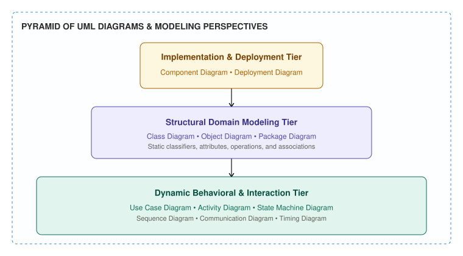

#### 🔍 Component Derivation from Problem Requirements

- **Methodology & Phase Focus Selection**:
  - **Engineering Need**: Complex software systems require progressive risk reduction before heavy capital investment; `Pyramid Of UML Diagrams` is derived from the Unified Process (UP) lifecycle to address critical feasibility, architecture, or deployment risks.
  - **Artifacts & Deliverables**: Formulates core engineering blueprints (Vision documents, Use Case models, Architecture Baselines, or Release Bundles) required to pass the lifecycle milestone gate.
- **Role & Stakeholder Involvement**:
  - **Business Analysts & Project Sponsors**: Own feasibility assessment, budget bounds, and business justification.
  - **Software Architects & Engineers**: Establish architectural baselines, executable prototypes, and subsystem modularity.
- **Structural Organization & Taxonomy**:
  - Organizes modeling artifacts into **Structural Perspectives** (static code, database schemas, component wiring, hardware deployment) and **Behavioral Perspectives** (dynamic operational workflows, time-ordered sequence calls, entity state changes).

#### 🛠️ Step-by-Step Construction Guide

1. **Define Lifecycle Stage & Milestone Goals**:
   - Establish the primary engineering objective of `Pyramid Of UML Diagrams` within the Unified Process development framework.
2. **Identify Required Input Artifacts & Stakeholder Goals**:
   - Map business requirements, risk assessments, and architectural hypotheses into actionable engineering artifacts.
3. **Model Process Workflows & Iteration Cycles**:
   - Draw sequential workflow stages depicting the transition from requirements capture to implementation and verification.
4. **Establish Review Gates & Exit Criteria**:
   - Define concrete milestone checkpoints (e.g., Lifecycle Architecture Milestone, Initial Operational Capability) needed to authorize transition to the next phase.
5. **Verify Methodological Consistency**:
   - Ensure alignment between business feasibility criteria and technical software engineering artifacts.

### Visual Artifacts & Supplementary Schematics

The following high-resolution schematics capture operational screen states, user dashboards, or notation components documented in this chapter:

#### Ch01 p004 img01

**Perspective**: `Conceptual Notation / Architecture Asset` — Supplemental conceptual illustration or notation reference from the source chapter.

#### Ch01 p004 img02

**Perspective**: `Conceptual Notation / Architecture Asset` — Supplemental conceptual illustration or notation reference from the source chapter.

#### Ch01 p004 img03

**Perspective**: `Conceptual Notation / Architecture Asset` — Supplemental conceptual illustration or notation reference from the source chapter.

#### Ch01 p005 img01

**Perspective**: `Conceptual Notation / Architecture Asset` — Supplemental conceptual illustration or notation reference from the source chapter.

#### Ch01 p005 img02

**Perspective**: `Conceptual Notation / Architecture Asset` — Supplemental conceptual illustration or notation reference from the source chapter.

#### Ch01 p005 img03

**Perspective**: `Conceptual Notation / Architecture Asset` — Supplemental conceptual illustration or notation reference from the source chapter.

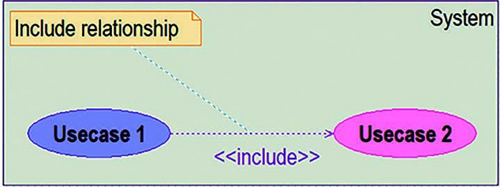

#### Ch01 p005 img04

**Perspective**: `Conceptual Notation / Architecture Asset` — Supplemental conceptual illustration or notation reference from the source chapter.

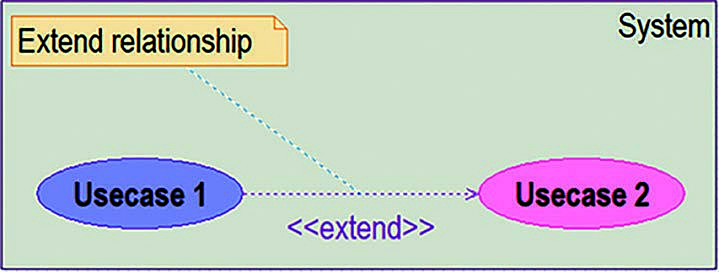

#### Ch01 p006 img01

**Perspective**: `Conceptual Notation / Architecture Asset` — Supplemental conceptual illustration or notation reference from the source chapter.

#### Ch01 p006 img02

**Perspective**: `Conceptual Notation / Architecture Asset` — Supplemental conceptual illustration or notation reference from the source chapter.

#### Ch01 p007 img01

**Perspective**: `Conceptual Notation / Architecture Asset` — Supplemental conceptual illustration or notation reference from the source chapter.

#### Ch01 p007 img02

**Perspective**: `Conceptual Notation / Architecture Asset` — Supplemental conceptual illustration or notation reference from the source chapter.

#### Ch01 p007 img03

**Perspective**: `Conceptual Notation / Architecture Asset` — Supplemental conceptual illustration or notation reference from the source chapter.

#### Ch01 p007 img04

**Perspective**: `Conceptual Notation / Architecture Asset` — Supplemental conceptual illustration or notation reference from the source chapter.

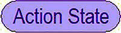

#### Ch01 p008 img01

**Perspective**: `Conceptual Notation / Architecture Asset` — Supplemental conceptual illustration or notation reference from the source chapter.

#### Ch01 p008 img02

**Perspective**: `Conceptual Notation / Architecture Asset` — Supplemental conceptual illustration or notation reference from the source chapter.

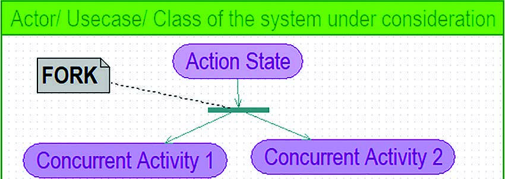

#### Ch01 p008 img03

**Perspective**: `Conceptual Notation / Architecture Asset` — Supplemental conceptual illustration or notation reference from the source chapter.

#### Ch01 p008 img04

**Perspective**: `Conceptual Notation / Architecture Asset` — Supplemental conceptual illustration or notation reference from the source chapter.

#### Ch01 p009 img01

**Perspective**: `Conceptual Notation / Architecture Asset` — Supplemental conceptual illustration or notation reference from the source chapter.

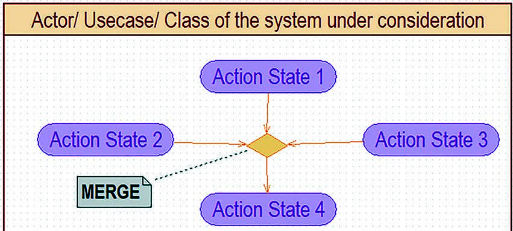

#### Ch01 p009 img02

**Perspective**: `Conceptual Notation / Architecture Asset` — Supplemental conceptual illustration or notation reference from the source chapter.

#### Ch01 p009 img03

**Perspective**: `Conceptual Notation / Architecture Asset` — Supplemental conceptual illustration or notation reference from the source chapter.

#### Ch01 p009 img04

**Perspective**: `Conceptual Notation / Architecture Asset` — Supplemental conceptual illustration or notation reference from the source chapter.

#### Ch01 p009 img05

**Perspective**: `Conceptual Notation / Architecture Asset` — Supplemental conceptual illustration or notation reference from the source chapter.

#### Ch01 p010 img01

**Perspective**: `Conceptual Notation / Architecture Asset` — Supplemental conceptual illustration or notation reference from the source chapter.

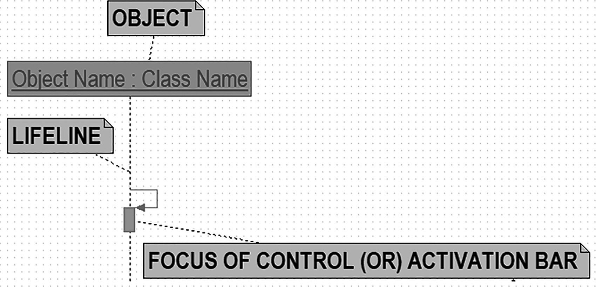

#### Ch01 p010 img02

**Perspective**: `Conceptual Notation / Architecture Asset` — Supplemental conceptual illustration or notation reference from the source chapter.

#### Ch01 p010 img03

**Perspective**: `Conceptual Notation / Architecture Asset` — Supplemental conceptual illustration or notation reference from the source chapter.

#### Ch01 p011 img01

**Perspective**: `Conceptual Notation / Architecture Asset` — Supplemental conceptual illustration or notation reference from the source chapter.

#### Ch01 p011 img02

**Perspective**: `Conceptual Notation / Architecture Asset` — Supplemental conceptual illustration or notation reference from the source chapter.

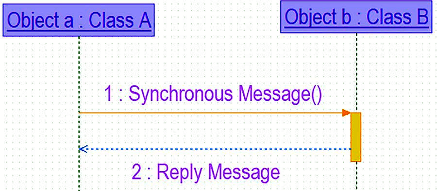

#### Ch01 p011 img03

**Perspective**: `Conceptual Notation / Architecture Asset` — Supplemental conceptual illustration or notation reference from the source chapter.

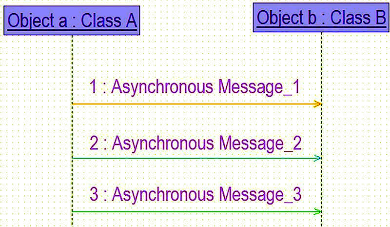

#### Ch01 p012 img01

**Perspective**: `Conceptual Notation / Architecture Asset` — Supplemental conceptual illustration or notation reference from the source chapter.

#### Ch01 p012 img02

**Perspective**: `Conceptual Notation / Architecture Asset` — Supplemental conceptual illustration or notation reference from the source chapter.

#### Ch01 p012 img03

**Perspective**: `Conceptual Notation / Architecture Asset` — Supplemental conceptual illustration or notation reference from the source chapter.

#### Ch01 p013 img01

**Perspective**: `Conceptual Notation / Architecture Asset` — Supplemental conceptual illustration or notation reference from the source chapter.

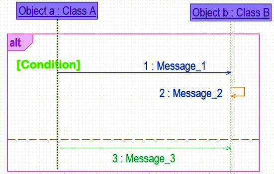

#### Ch01 p013 img02

**Perspective**: `Conceptual Notation / Architecture Asset` — Supplemental conceptual illustration or notation reference from the source chapter.

#### Ch01 p014 img01

**Perspective**: `Conceptual Notation / Architecture Asset` — Supplemental conceptual illustration or notation reference from the source chapter.

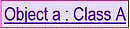

#### Ch01 p014 img02

**Perspective**: `Conceptual Notation / Architecture Asset` — Supplemental conceptual illustration or notation reference from the source chapter.

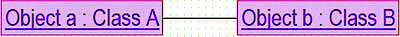

#### Ch01 p014 img03

**Perspective**: `Conceptual Notation / Architecture Asset` — Supplemental conceptual illustration or notation reference from the source chapter.

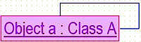

#### Ch01 p014 img04

**Perspective**: `Conceptual Notation / Architecture Asset` — Supplemental conceptual illustration or notation reference from the source chapter.

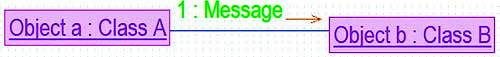

#### Ch01 p014 img05

**Perspective**: `Conceptual Notation / Architecture Asset` — Supplemental conceptual illustration or notation reference from the source chapter.

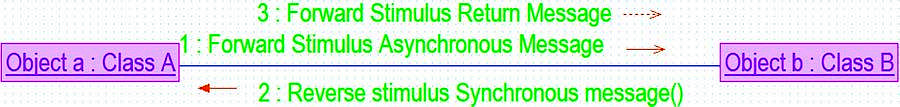

#### Ch01 p015 img01

**Perspective**: `Conceptual Notation / Architecture Asset` — Supplemental conceptual illustration or notation reference from the source chapter.

#### Ch01 p015 img02

**Perspective**: `Conceptual Notation / Architecture Asset` — Supplemental conceptual illustration or notation reference from the source chapter.

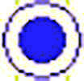

#### Ch01 p015 img03

**Perspective**: `Conceptual Notation / Architecture Asset` — Supplemental conceptual illustration or notation reference from the source chapter.

#### Ch01 p015 img04

**Perspective**: `Conceptual Notation / Architecture Asset` — Supplemental conceptual illustration or notation reference from the source chapter.

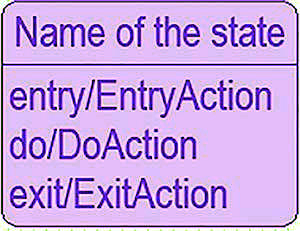

#### Ch01 p015 img05

**Perspective**: `Conceptual Notation / Architecture Asset` — Supplemental conceptual illustration or notation reference from the source chapter.

#### Ch01 p015 img06

**Perspective**: `Conceptual Notation / Architecture Asset` — Supplemental conceptual illustration or notation reference from the source chapter.

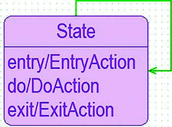

#### Ch01 p016 img01

**Perspective**: `Conceptual Notation / Architecture Asset` — Supplemental conceptual illustration or notation reference from the source chapter.

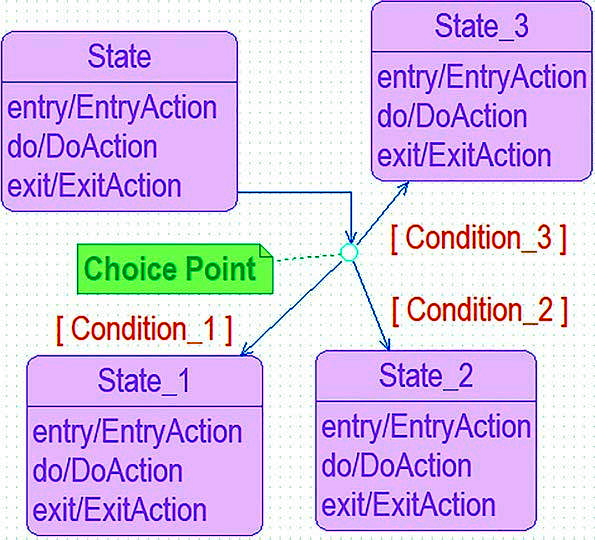

#### Ch01 p016 img02

**Perspective**: `Conceptual Notation / Architecture Asset` — Supplemental conceptual illustration or notation reference from the source chapter.

#### Ch01 p016 img03

**Perspective**: `Conceptual Notation / Architecture Asset` — Supplemental conceptual illustration or notation reference from the source chapter.

#### Ch01 p016 img04

**Perspective**: `Conceptual Notation / Architecture Asset` — Supplemental conceptual illustration or notation reference from the source chapter.

#### Ch01 p016 img05

**Perspective**: `Conceptual Notation / Architecture Asset` — Supplemental conceptual illustration or notation reference from the source chapter.

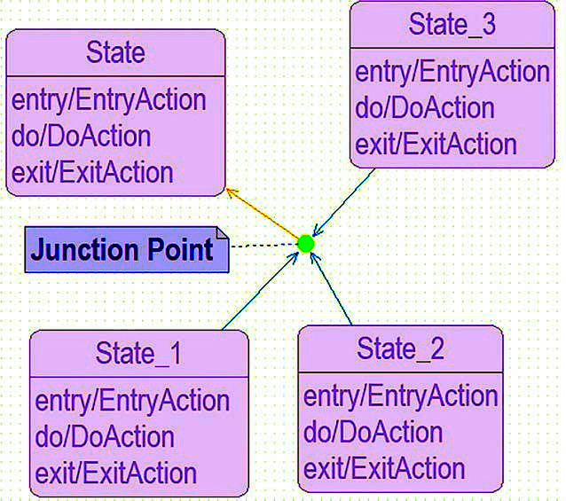

#### Ch01 p017 img01

**Perspective**: `Conceptual Notation / Architecture Asset` — Supplemental conceptual illustration or notation reference from the source chapter.

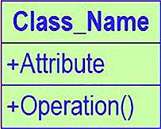

#### Ch01 p017 img02

**Perspective**: `Conceptual Notation / Architecture Asset` — Supplemental conceptual illustration or notation reference from the source chapter.

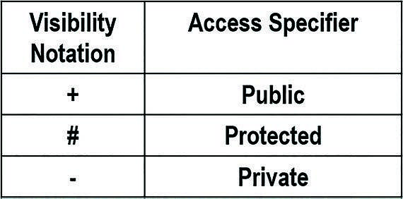

#### Ch01 p017 img03

**Perspective**: `Conceptual Notation / Architecture Asset` — Supplemental conceptual illustration or notation reference from the source chapter.

#### Ch01 p018 img01

**Perspective**: `Conceptual Notation / Architecture Asset` — Supplemental conceptual illustration or notation reference from the source chapter.

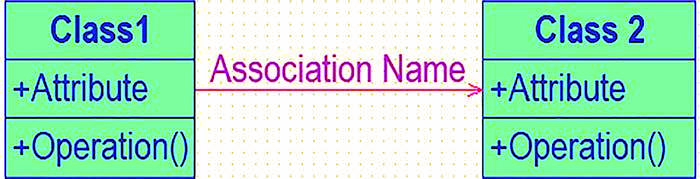

#### Ch01 p018 img02

**Perspective**: `Conceptual Notation / Architecture Asset` — Supplemental conceptual illustration or notation reference from the source chapter.

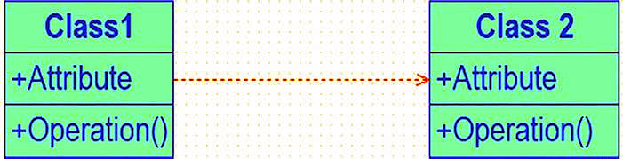

#### Ch01 p018 img03

**Perspective**: `Conceptual Notation / Architecture Asset` — Supplemental conceptual illustration or notation reference from the source chapter.

#### Ch01 p018 img04

**Perspective**: `Conceptual Notation / Architecture Asset` — Supplemental conceptual illustration or notation reference from the source chapter.

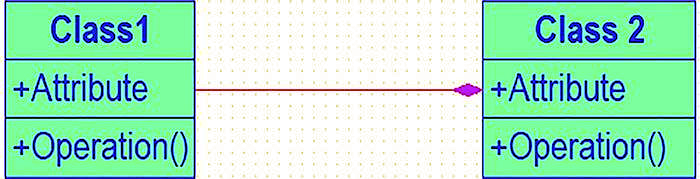

#### Ch01 p018 img05

**Perspective**: `Conceptual Notation / Architecture Asset` — Supplemental conceptual illustration or notation reference from the source chapter.

#### Ch01 p019 img01

**Perspective**: `Conceptual Notation / Architecture Asset` — Supplemental conceptual illustration or notation reference from the source chapter.

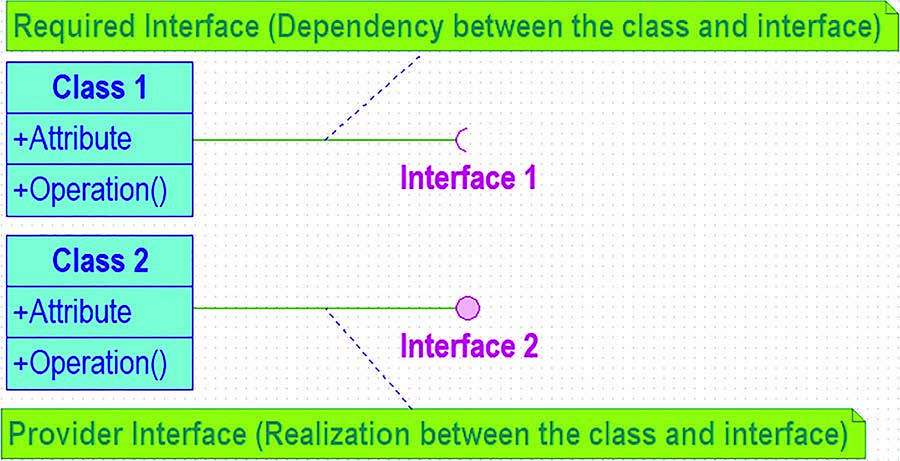

#### Ch01 p019 img02

**Perspective**: `Conceptual Notation / Architecture Asset` — Supplemental conceptual illustration or notation reference from the source chapter.

#### Ch01 p020 img01

**Perspective**: `Conceptual Notation / Architecture Asset` — Supplemental conceptual illustration or notation reference from the source chapter.

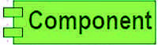

#### Ch01 p020 img02

**Perspective**: `Conceptual Notation / Architecture Asset` — Supplemental conceptual illustration or notation reference from the source chapter.

#### Ch01 p020 img03

**Perspective**: `Conceptual Notation / Architecture Asset` — Supplemental conceptual illustration or notation reference from the source chapter.

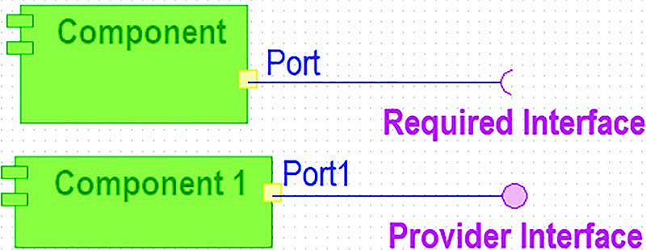

#### Ch01 p020 img04

**Perspective**: `Conceptual Notation / Architecture Asset` — Supplemental conceptual illustration or notation reference from the source chapter.

#### Ch01 p020 img05

**Perspective**: `Conceptual Notation / Architecture Asset` — Supplemental conceptual illustration or notation reference from the source chapter.

#### Ch01 p021 img01

**Perspective**: `Conceptual Notation / Architecture Asset` — Supplemental conceptual illustration or notation reference from the source chapter.

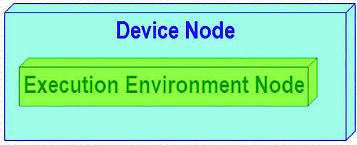

#### Ch01 p021 img02

**Perspective**: `Conceptual Notation / Architecture Asset` — Supplemental conceptual illustration or notation reference from the source chapter.

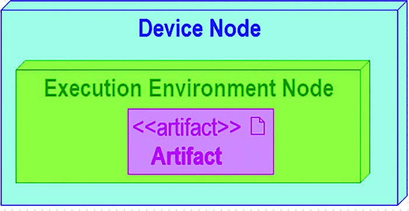

#### Ch01 p021 img03

**Perspective**: `Conceptual Notation / Architecture Asset` — Supplemental conceptual illustration or notation reference from the source chapter.

#### Ch01 p022 img01

**Perspective**: `Conceptual Notation / Architecture Asset` — Supplemental conceptual illustration or notation reference from the source chapter.

#### Ch01 p022 img02

**Perspective**: `Conceptual Notation / Architecture Asset` — Supplemental conceptual illustration or notation reference from the source chapter.

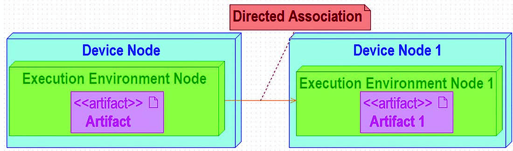

#### Ch01 p022 img03

**Perspective**: `Conceptual Notation / Architecture Asset` — Supplemental conceptual illustration or notation reference from the source chapter.

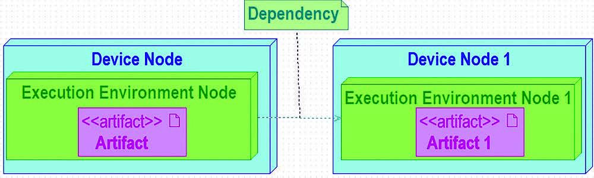

---

## 💡 Key Architectural Invariants & Domain Lessons

1. **Lifecycle Traceability**: Every UML artifact must trace back to explicit functional requirements defined during Inception and refined during Elaboration.
2. **Separation of Structure and Behavior**: Structural diagrams (Class, Component, Deployment) model static topology, while behavioral diagrams (Sequence, Activity, State Machine) govern runtime dynamics.
3. **Risk-Driven Iteration**: High-risk architectural uncertainties (concurrency, distributed consensus, external dependencies) must be addressed during Elaboration before scaling Construction.
4. **Deployment Realism**: Deployment diagrams must mirror physical infrastructure realities, network latencies, and security boundaries rather than idealized logical models.

---

## 🔗 Related Resources & Navigation

- **Navigation**: [📚 Book Index](../UML_Book.md) | [Chapter_02_Design_of_UML_Diagrams_for_Webmed_Healthcare_Service_System_Services &rarr;](Chapter_02_Design_of_UML_Diagrams_for_Webmed_Healthcare_Service_System_Services.md)
- **Master Book Catalog**: [`UML_Book.md`](../UML_Book.md)
- **High-Resolution Images Archive**: [`images/`](../images/)