# Chapter 01: Introduction to UML Diagrams and Its Components

> **Book**: *UML Diagramming: A Case Study Approach* by Dr. Suriya Sundaramoorthy (CRC Press, 2022)  
> **Pages**: 1–22 (Total: 22 pages)  
> **Classification**: Theoretical Foundations & UP Phases  
> **Navigation**: [📚 Book Index](../UML_Book.md) | [Chapter_02_Design_of_UML_Diagrams_for_Webmed_Healthcare_Service_System_Services &rarr;](Chapter_02_Design_of_UML_Diagrams_for_Webmed_Healthcare_Service_System_Services.md)

---

## 📌 Executive Summary

Chapter 1 establishes the theoretical foundations of software engineering modeling and the **Unified Process (UP)** lifecycle. It introduces the role of the Unified Modeling Language (UML) as the international standard visual language for specifying, constructing, visualizing, and documenting software artifacts. The chapter breaks down the four UP lifecycle phases (Inception, Elaboration, Construction, Transition) and provides a comprehensive structural and behavioral taxonomy of all major UML diagrams.

---

## 🎯 Problem Statement & System Context

The Unified Process (UP) is an iterative, architecture-centric, and risk-driven software development process for building object-oriented systems. UP structures software lifecycles into four sequential phases: Inception (feasibility and project boundary), Elaboration (core architecture and scheduling), Construction (coding, alpha testing, and component assembly), and Transition (beta testing, deployment, and customer validation). Across these phases, the Unified Modeling Language (UML) provides the standardized graphical grammar to model structural building blocks and dynamic behavioral interactions.

---

## 📊 Complete UML Diagram Suite & Architecture Specifications

This chapter incorporates **75 crystal-clear, high-resolution diagram(s)** (extracted losslessly from the source edition at up to 2,000+ px) illustrating the end-to-end design from functional use cases to physical hardware deployment:

### Figure 1.1: Inception Phase

**Diagram Category**: `Architectural Figure`  
**Architectural Role**: Structural schematic detailing domain requirements and workflow transitions.

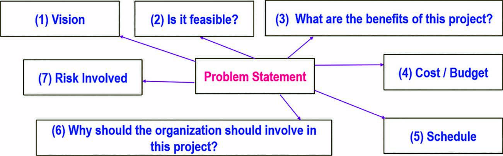

### Figure 1.2: Elaboration Phase

**Diagram Category**: `Architectural Figure`  
**Architectural Role**: Structural schematic detailing domain requirements and workflow transitions.

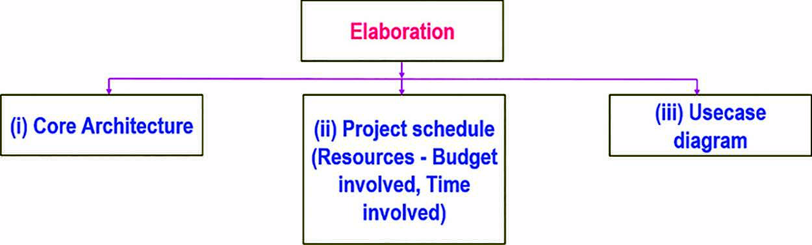

### Figure 1.3: Construction Phase

**Diagram Category**: `Architectural Figure`  
**Architectural Role**: Structural schematic detailing domain requirements and workflow transitions.

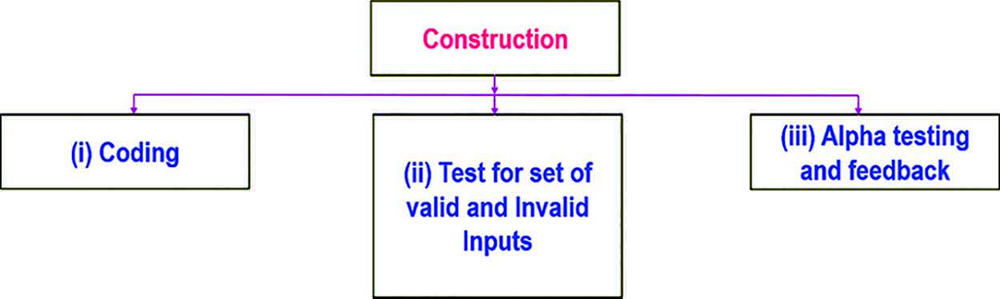

### Figure 1.4: Transition Phase

**Diagram Category**: `Architectural Figure`  
**Architectural Role**: Structural schematic detailing domain requirements and workflow transitions.

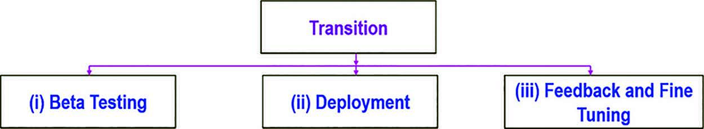

### Figure 1.5: Pyramid Of UML Diagrams

**Diagram Category**: `Architectural Figure`  
**Architectural Role**: Structural schematic detailing domain requirements and workflow transitions.

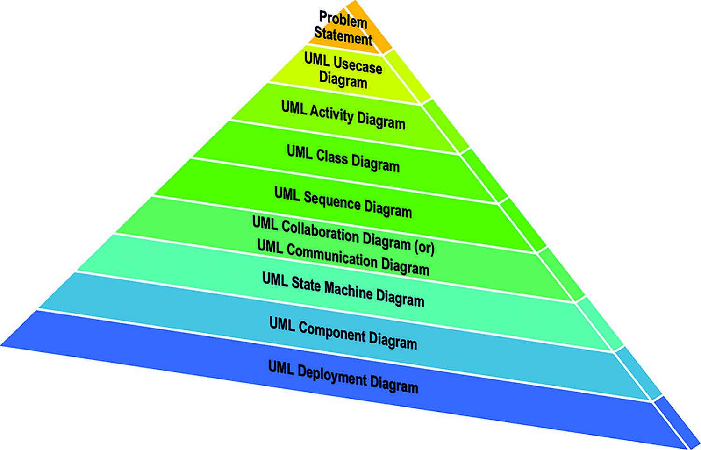

### Visual Artifacts & Supplementary Schematics

The following high-resolution schematics capture operational screen states, user dashboards, or notation components documented in this chapter:

#### Ch01 p004 img01

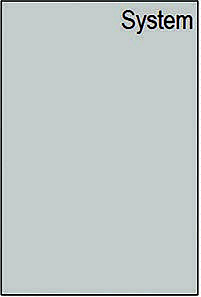

#### Ch01 p004 img02

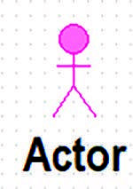

#### Ch01 p004 img03

#### Ch01 p005 img01

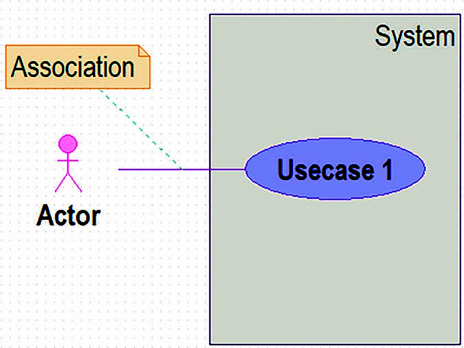

#### Ch01 p005 img02

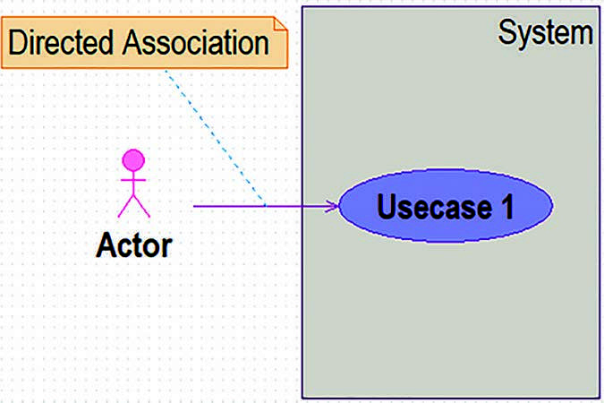

#### Ch01 p005 img03

#### Ch01 p005 img04

#### Ch01 p006 img01

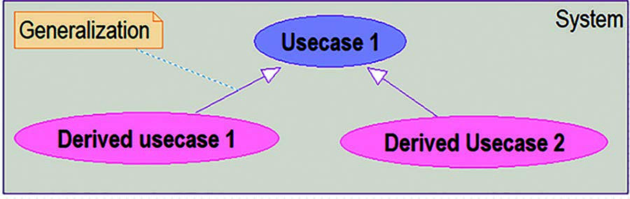

#### Ch01 p006 img02

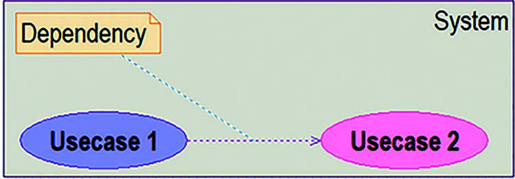

#### Ch01 p007 img01

#### Ch01 p007 img02

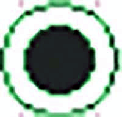

#### Ch01 p007 img03

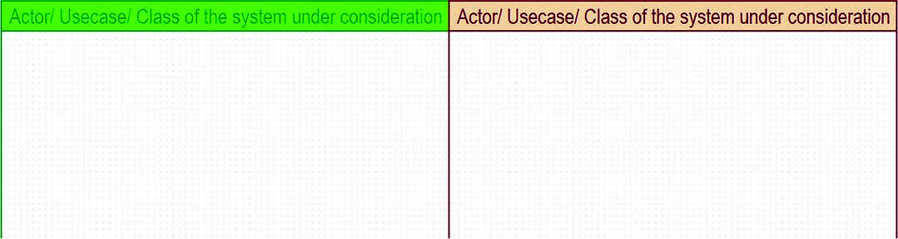

#### Ch01 p007 img04

#### Ch01 p008 img01

#### Ch01 p008 img02

#### Ch01 p008 img03

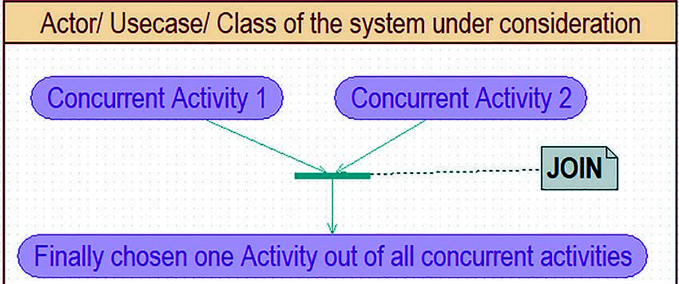

#### Ch01 p008 img04

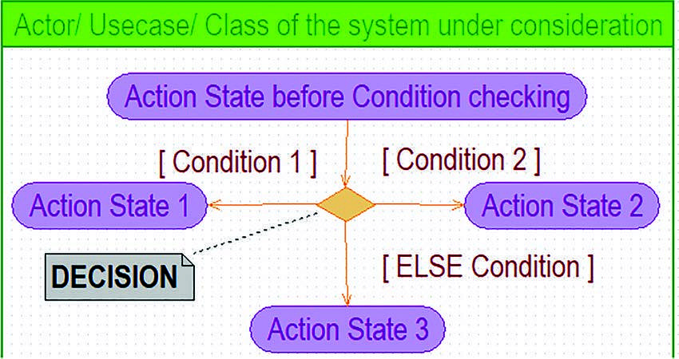

#### Ch01 p009 img01

#### Ch01 p009 img02

#### Ch01 p009 img03

#### Ch01 p009 img04

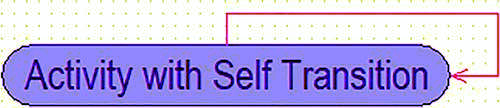

#### Ch01 p009 img05

#### Ch01 p010 img01

#### Ch01 p010 img02

#### Ch01 p010 img03

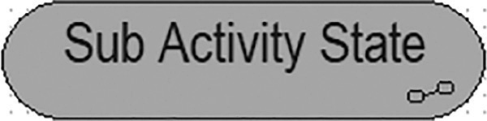

#### Ch01 p011 img01

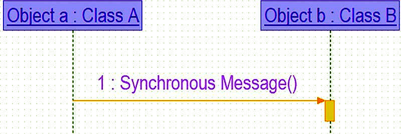

#### Ch01 p011 img02

#### Ch01 p011 img03

#### Ch01 p012 img01

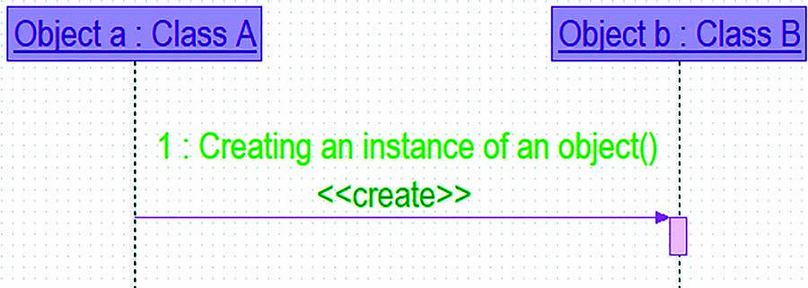

#### Ch01 p012 img02

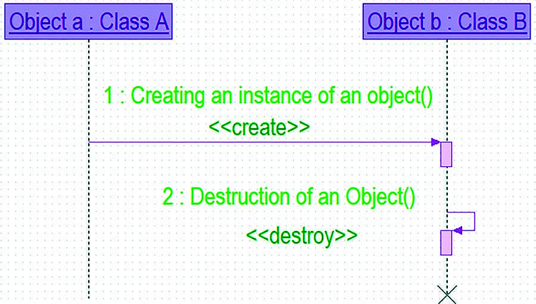

#### Ch01 p012 img03

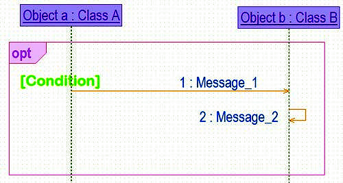

#### Ch01 p013 img01

#### Ch01 p013 img02

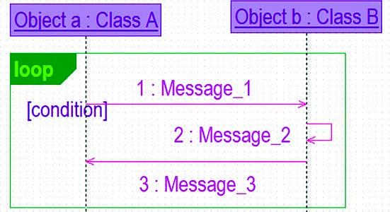

#### Ch01 p014 img01

#### Ch01 p014 img02

#### Ch01 p014 img03

#### Ch01 p014 img04

#### Ch01 p014 img05

#### Ch01 p015 img01

#### Ch01 p015 img02

#### Ch01 p015 img03

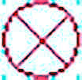

#### Ch01 p015 img04

#### Ch01 p015 img05

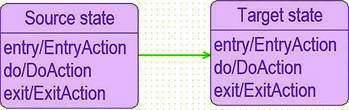

#### Ch01 p015 img06

#### Ch01 p016 img01

#### Ch01 p016 img02

#### Ch01 p016 img03

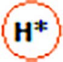

#### Ch01 p016 img04

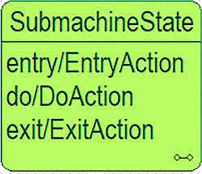

#### Ch01 p016 img05

#### Ch01 p017 img01

#### Ch01 p017 img02

#### Ch01 p017 img03

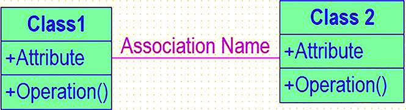

#### Ch01 p018 img01

#### Ch01 p018 img02

#### Ch01 p018 img03

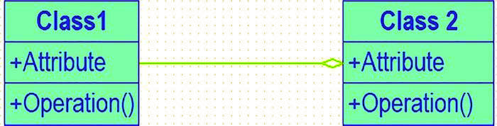

#### Ch01 p018 img04

#### Ch01 p018 img05

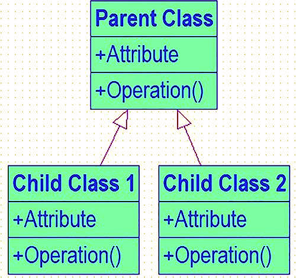

#### Ch01 p019 img01

#### Ch01 p019 img02

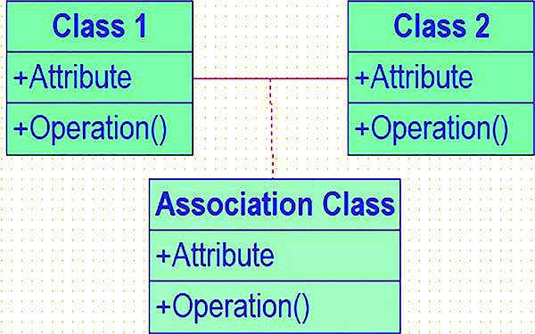

#### Ch01 p020 img01

#### Ch01 p020 img02

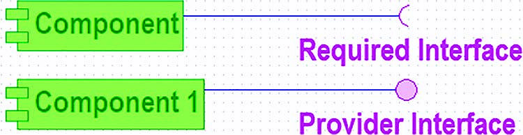

#### Ch01 p020 img03

#### Ch01 p020 img04

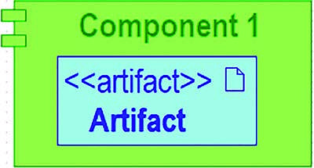

#### Ch01 p020 img05

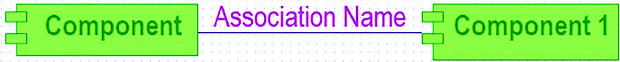

#### Ch01 p021 img01

#### Ch01 p021 img02

#### Ch01 p021 img03

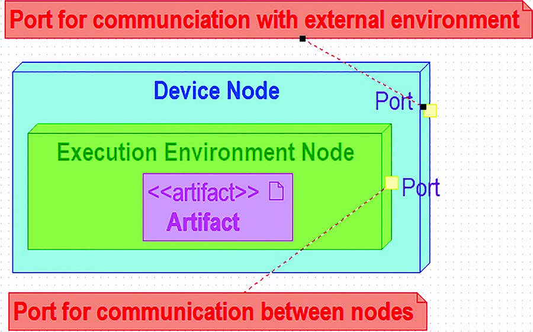

#### Ch01 p022 img01

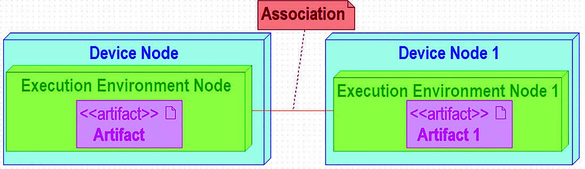

#### Ch01 p022 img02

#### Ch01 p022 img03

---

## 💡 Key Architectural Invariants & Modeling Lessons

1. **Traceability**: Every software model directly corresponds to explicit functional requirements defined during the initial domain specification.
2. **Separation of Concerns**: Structural models (Class, Component, Deployment) maintain clear boundaries separating business domain entities from physical infrastructure nodes.
3. **Behavioral Integrity**: Dynamic models (Activity, Sequence, State Machine) guarantee valid state transitions, prevent deadlocks, and verify message order consistency.
4. **Deployment Fidelity**: Physical nodes and execution environments accurately map runtime middleware, database engines, and client access channels.

---

## 🔗 Related Resources & Navigation

- **Navigation**: [📚 Book Index](../UML_Book.md) | [Chapter_02_Design_of_UML_Diagrams_for_Webmed_Healthcare_Service_System_Services &rarr;](Chapter_02_Design_of_UML_Diagrams_for_Webmed_Healthcare_Service_System_Services.md)
- **Master Book Catalog**: [`UML_Book.md`](../UML_Book.md)
- **High-Resolution Images Archive**: [`images/`](../images/)