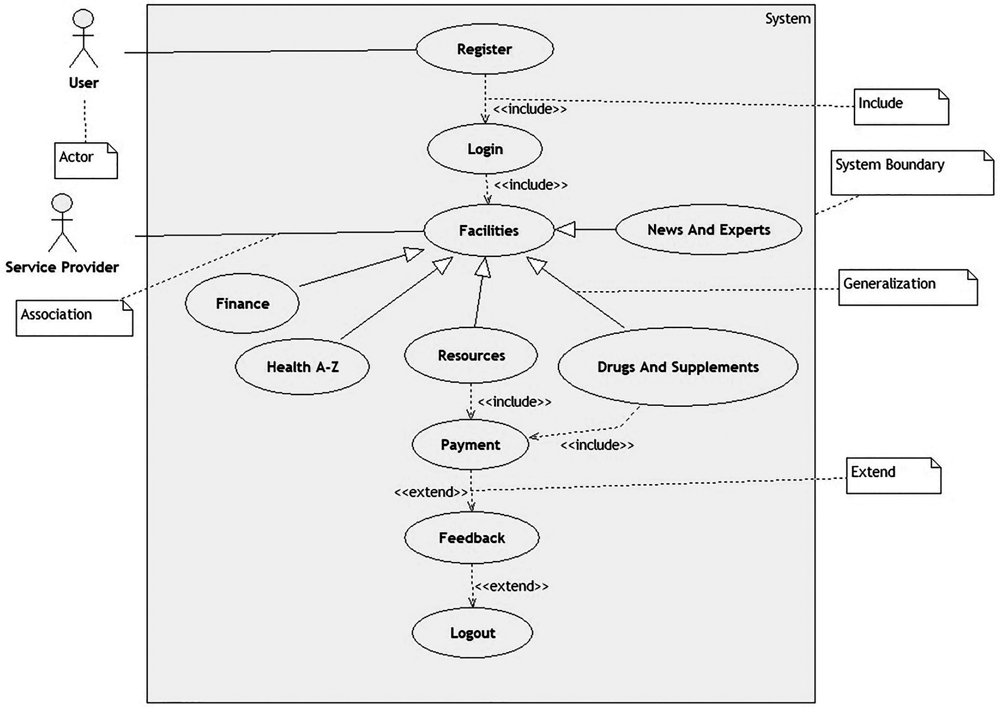
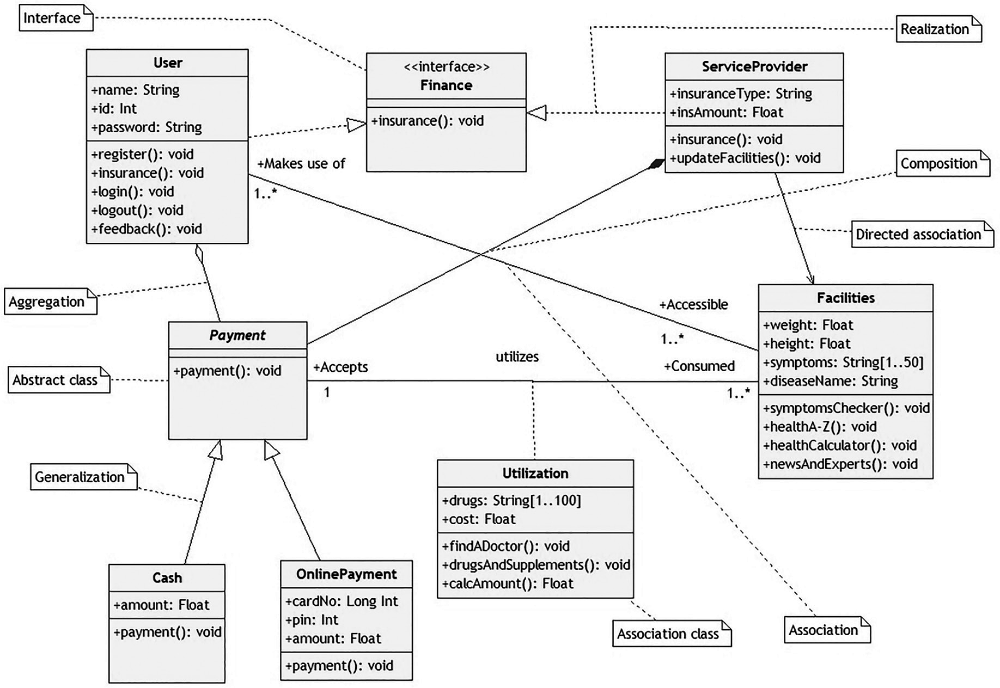
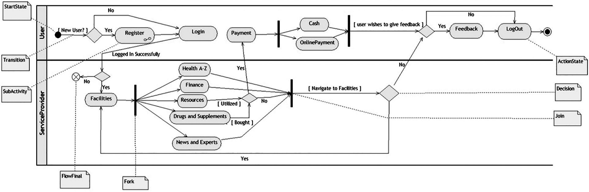
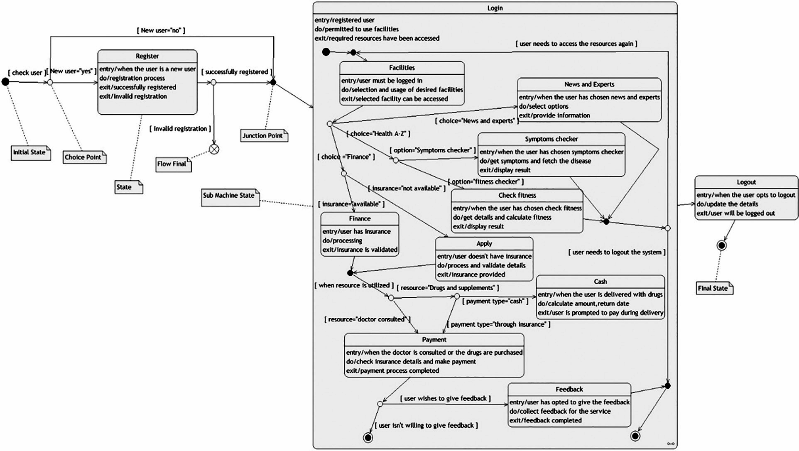
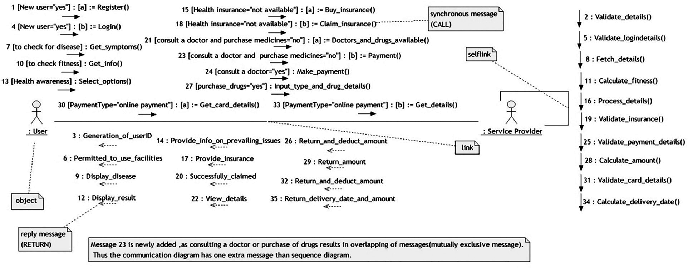
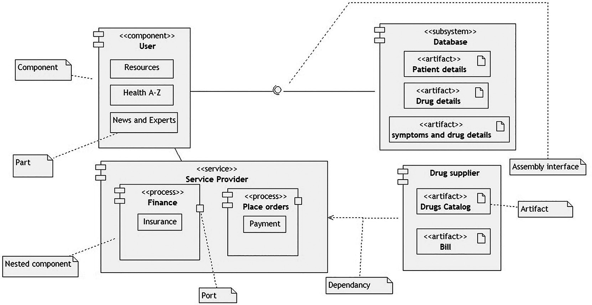

# Chapter 02: Design of UML Diagrams for Webmed Healthcare Service System Services

> **Book**: *UML Diagramming: A Case Study Approach* by Dr. Suriya Sundaramoorthy (CRC Press, 2022)  
> **Pages**: 23–38 (Total: 16 pages)  
> **Classification**: Industrial Case Study & UML Modeling Suite  
> **Navigation**: [&larr; Chapter_01_Introduction_to_UML_Diagrams_and_Its_Components](Chapter_01_Introduction_to_UML_Diagrams_and_Its_Components.md) | [📚 Book Index](../UML_Book.md) | [Chapter_03_Design_of_UML_Diagrams_for_Inventory_Management_System &rarr;](Chapter_03_Design_of_UML_Diagrams_for_Inventory_Management_System.md)

---

## 📌 Executive Summary

Chapter 2 presents an end-to-end software engineering case study for the **Design of UML Diagrams for Webmed Healthcare Service System Services**. This chapter demonstrates how business requirements and domain constraints are translated into formal architectural specifications through data-flow modeling and a complete suite of Unified Modeling Language (UML) structural and behavioral models.

The case study analyzes the system from multiple architectural perspectives: identifying external user and service actors, formalizing core operational capabilities, detailing procedural business workflows, specifying domain entity schemas, and architecting modular component deployment across distributed physical infrastructure.

---

## 🎯 Problem Statement & Business Context

Healthcare service has huge demand these days as it really helps in managing a hospital or a medical office. The scope of healthcare service systems is increasing by each day and it is true for the entire world. Some of these solutions include improved awareness about healthcare services and health policies. The objective of this system is to provide medical assistance to people instantly with the help of technology. This system eradicates the cultural sensitivity that prevails in many hospitals and improvises the quality of medical assistance. The captivating features of this system are online doctors, medicines at doorstep and bulletin of awareness. The users can also navigate and choose among various insurance schemes that are displayed. The primary objectives of Webmed healthcare system are to enable all citizens to receive healthcare services whenever needed, and to deliver health services that are cost-effective and meet pre-established standards of quality. The main functions of this system deal with finance, health A–Z, resources, drugs and supplements, news and experts, payment and feedback. Register function allows the patients or the caregivers to register on the website. Login function allows the patients to access the website. Financing focuses on the purchase of insurance. Health A–Z displays all the diseases along with their symptoms. Resources function consists of the sub-functions including symptoms checker, health calculator, find a doctor based on the geographical location of the patient, insurance guide and ambulance providence. Drugs and supplements include online medicine delivery, where people could shop for medicines online. News and experts function is to provide health awareness and threats that are prevailing. This function also gives information regarding counselling programs and blood donation camps. The payment function is to reimburse providers for services delivered. The feedback function collects user reviews for the website.

---

## ⚙️ System Architecture & Functional Capabilities

The **Design of UML Diagrams for Webmed Healthcare Service System Services** decomposes business operations into modular functional units. These capabilities address the operational bottlenecks of manual and legacy workflows by introducing automated, role-based, and auditable software processes:

- **Drugs and Supplements**: This functionality provides online delivery of medicines.
- **Facilities**: The service provider controls all the facilities on the website through this usecase and the user can utilize these facilities.
- **Feedback**: This Feedback section helps the users to give their honest opinions about the quality of services that have been provided. It also helps them to give their suggestions for further improvements.
- **Finance**: Negotiations regarding the financial status are done, eligibility for the insurance is checked and the appropriate schemes are issued.
- **Health A–Z**: This functionality acts as a dictionary of the diseases along with their symptoms and the drugs that can be consumed.
- **Login**: This functionality allows the patients and caregivers to login into the web - site to get the access to all the resources.
- **Logout**: This functionality ends the access to the website. So the user must log in again to access all the resources.
- **News and Experts**: A bulletin of news regarding the latest diseases that prevails in the envi - ronment, expert opinions to avoid those communicable and non-communicable diseases, awareness about the diseases will be displayed publicly.
- **Payment**: This functionality deals with the payment for the services consumed.
- **Register**: This acts as a membership functionality that allows the patients or caregiv - ers to register into this website to access all the resources
- **Resources**: The resources such as health calculator, ambulance services, symptoms checker, find a doctor and insurance guidance are unveiled in this segment.

---

## 📊 Complete UML Diagram Suite & Architectural Walkthrough

This chapter incorporates **12 crystal-clear, high-resolution diagram(s)** (extracted losslessly from the source edition at up to 2,000+ px) illustrating the end-to-end design from functional use cases to physical hardware deployment:

### Figure 2.2: Level 0 DFD

**Diagram Category**: `Data Flow Diagram (DFD)`  
**Architectural Role**: Models external entity inputs, core transformation processes, and data store read/write interactions.

**System Design Analysis**:
Represents data transformations and movement in **Design of UML Diagrams for Webmed Healthcare Service System Services**. Details data origins from external actors, functional processing steps, and persistence interactions with data stores without imposing strict control flow, providing an accessible high-level systems analysis perspective.

### Figure 2.3: Level 1 DFD

**Diagram Category**: `Data Flow Diagram (DFD)`  
**Architectural Role**: Models external entity inputs, core transformation processes, and data store read/write interactions.

**System Design Analysis**:
Represents data transformations and movement in **Design of UML Diagrams for Webmed Healthcare Service System Services**. Details data origins from external actors, functional processing steps, and persistence interactions with data stores without imposing strict control flow, providing an accessible high-level systems analysis perspective.

### Figure 2.4: UML Usecase Diagram

**Diagram Category**: `Use Case Diagram`  
**Architectural Role**: Specifies system boundary, primary external actors, and business use cases with include/extend relationships.

**System Design Analysis**:
Illustrates the functional boundary of the **Design of UML Diagrams for Webmed Healthcare Service System Services**. External actors trigger core use cases, demonstrating how business transactions, authorization checkpoints, and service requests flow into the system. Relationships (`<<include>>` for mandatory sub-routines like authentication and validation, and `<<extend>>` for optional or conditional exception branches) formalize the system's external functional contract.

### Figure 2.5: UML Class Diagram

**Diagram Category**: `Class Diagram`  
**Architectural Role**: Models static structural classifiers, entity attributes, operations, and associations (composition, aggregation, inheritance).

**System Design Analysis**:
Captures the static structural domain model for **Design of UML Diagrams for Webmed Healthcare Service System Services**. Defines primary entity classes, their private/public attributes, operational methods, and relationships. It enforces structural integrity through multiplicities, composition (strong lifecycle ownership of subsidiary records), aggregation, and inheritance hierarchies, forming the foundation for the relational database schema and domain entity classes.

### Figure 2.6: UML Activity Diagram 1

**Diagram Category**: `Activity Diagram`  
**Architectural Role**: Illustrates dynamic procedural workflow, decision branching, concurrent action forks, and synchronization joins.

**System Design Analysis**:
Details the step-by-step procedural execution flow for core operations in **Design of UML Diagrams for Webmed Healthcare Service System Services**. Begins at an initial state, navigates action states, evaluates guard conditions at decision diamonds, and models parallel execution branches using fork and join synchronizations before reaching the terminal state, ensuring business workflows are deterministic and free of race conditions.

### Figure 2.7: UML Activity Diagram 2

**Diagram Category**: `Activity Diagram`  
**Architectural Role**: Illustrates dynamic procedural workflow, decision branching, concurrent action forks, and synchronization joins.

**System Design Analysis**:
Details the step-by-step procedural execution flow for core operations in **Design of UML Diagrams for Webmed Healthcare Service System Services**. Begins at an initial state, navigates action states, evaluates guard conditions at decision diamonds, and models parallel execution branches using fork and join synchronizations before reaching the terminal state, ensuring business workflows are deterministic and free of race conditions.

### Figure 2.8: UML State Machine Diagram

**Diagram Category**: `State Machine Diagram`  
**Architectural Role**: Captures entity lifecycle states, transition triggers, event guards, and exit/entry actions.

**System Design Analysis**:
Models the complete lifecycle state transitions for central domain entities in **Design of UML Diagrams for Webmed Healthcare Service System Services**. Tracks transitions from initial creation through intermediate processing states to completion or cancellation. Explicit state triggers, guard expressions `[condition]`, and entry/exit actions guarantee valid business lifecycle states and eliminate invalid operational state jumps.

### Figure 2.9: UML Sequence Diagram

**Diagram Category**: `Sequence Diagram`  
**Architectural Role**: Details chronological object interactions, synchronous message exchanges, return flows, and activation lifelines.

**System Design Analysis**:
Traces the time-ordered message sequence between participating objects and services in **Design of UML Diagrams for Webmed Healthcare Service System Services**. Vertical dashed lifelines represent entity instances across time, while horizontal solid and dashed arrows show synchronous invocations, data lookups, and return values. Activation bars delineate execution duration, clarifying object collaboration during key transactional workflows.

### Figure 2.10: UML Communication Diagram

**Diagram Category**: `Communication Diagram`  
**Architectural Role**: Emphasizes structural object topology and numbered sequence messaging between collaborating entities.

**System Design Analysis**:
Emphasizes the spatial and structural organization of collaborating instances in **Design of UML Diagrams for Webmed Healthcare Service System Services**. Shows object links overlaid with numbered messages (e.g., 1.0, 1.1, 2.0), illustrating both structural connectivity and invocation hierarchy, complementing the temporal perspective of the sequence diagram.

### Figure 2.11: UML Component Diagram

**Diagram Category**: `Component Diagram`  
**Architectural Role**: Architects physical modular software components, provided ball interfaces, and required socket dependencies.

**System Design Analysis**:
Architects the modular software organization for **Design of UML Diagrams for Webmed Healthcare Service System Services**. Illustrates autonomous subsystems, business logic controllers, database access layers, and external service adapters. Provided interfaces (ball notation) and required dependencies (socket notation) define clear service contracts, supporting high cohesion and loose coupling.

### Figure 2.12: UML Deployment Diagram

**Diagram Category**: `Deployment Diagram`  
**Architectural Role**: Maps software execution artifacts to hardware computing nodes, client devices, application tiers, and database servers.

**System Design Analysis**:
Maps the physical runtime deployment architecture for **Design of UML Diagrams for Webmed Healthcare Service System Services**. Depicts client hardware devices (web browsers, mobile apps), application servers, network firewalls, and persistence database nodes. Communication paths and execution environments reflect production infrastructure, scalability considerations, and network security boundaries.

### Visual Artifacts & Supplementary Schematics

The following high-resolution schematics capture operational screen states, user dashboards, or notation components documented in this chapter:

#### Ch02 p038 img01

**Perspective**: `Conceptual Notation / Architecture Asset` — Supplemental conceptual illustration or notation reference from the source chapter.

---

## 💡 Key Architectural Invariants & Domain Lessons

1. **Requirement Traceability**: Every model in the **Design of UML Diagrams for Webmed Healthcare Service System Services** suite traces directly to business requirements and operational constraints established in the problem statement.
2. **State & Workflow Integrity**: Dynamic activity and sequence models guarantee deterministic workflow completion, enforce transactional atomicity, and prevent deadlocks.
3. **Modular Encapsulation**: Component boundaries decouple domain business logic from presentation controllers and external integration adapters, supporting high maintainability.
4. **Operational Security & RBAC**: Strict role-based authorization guards sensitive operations across external actor boundaries and administrative lifelines.
5. **High-Fidelity Deployment**: Physical node topologies reflect real-world tiered infrastructure (DMZ, application cluster, isolated persistence layer), ensuring scalability and fault tolerance.

---

## 🔗 Related Resources & Navigation

- **Navigation**: [&larr; Chapter_01_Introduction_to_UML_Diagrams_and_Its_Components](Chapter_01_Introduction_to_UML_Diagrams_and_Its_Components.md) | [📚 Book Index](../UML_Book.md) | [Chapter_03_Design_of_UML_Diagrams_for_Inventory_Management_System &rarr;](Chapter_03_Design_of_UML_Diagrams_for_Inventory_Management_System.md)
- **Master Book Catalog**: [`UML_Book.md`](../UML_Book.md)
- **High-Resolution Images Archive**: [`images/`](../images/)