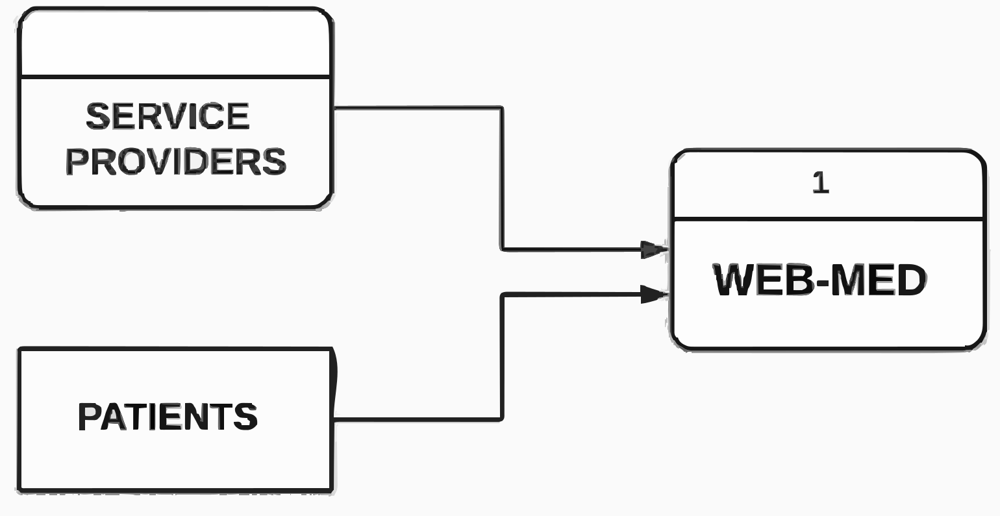
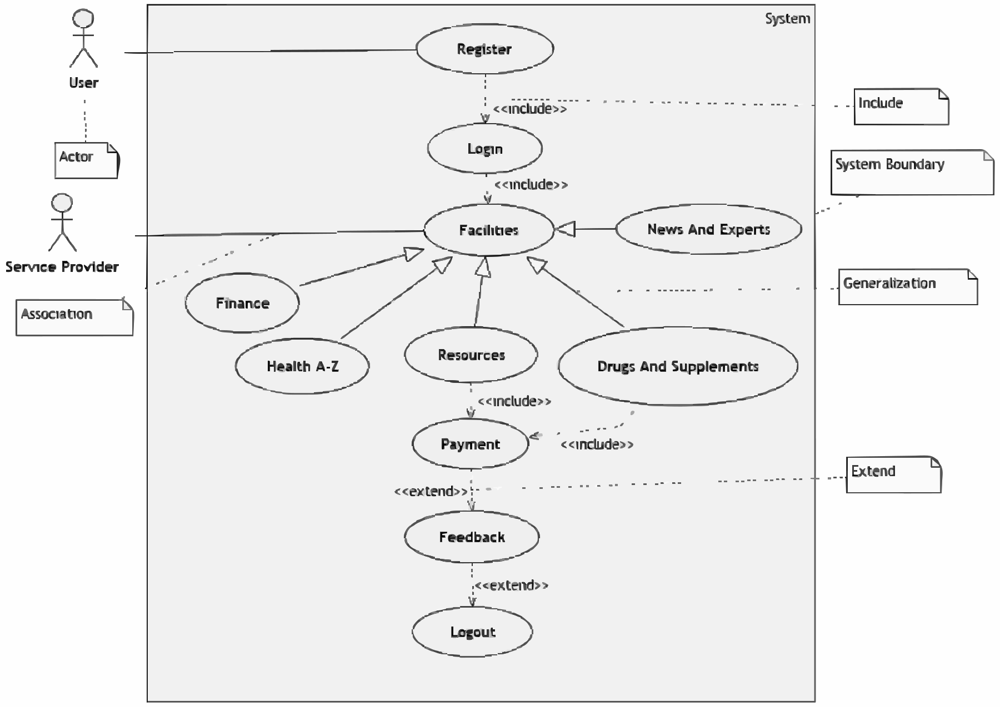
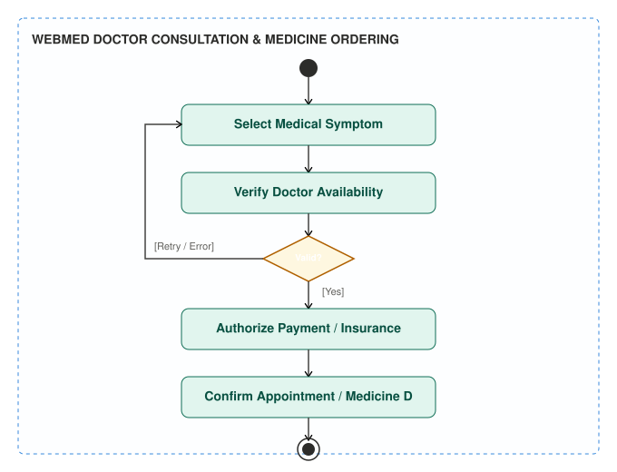
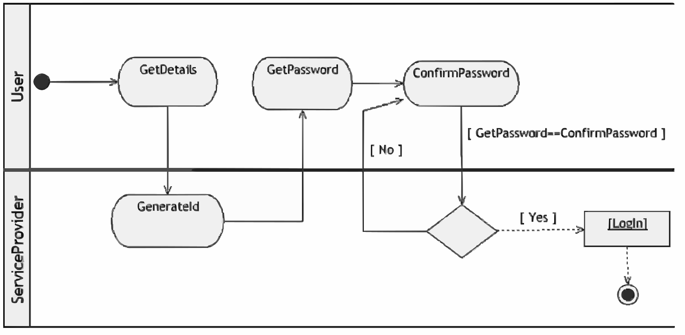
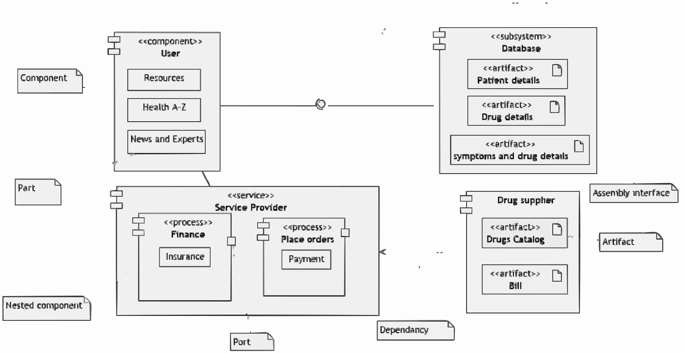
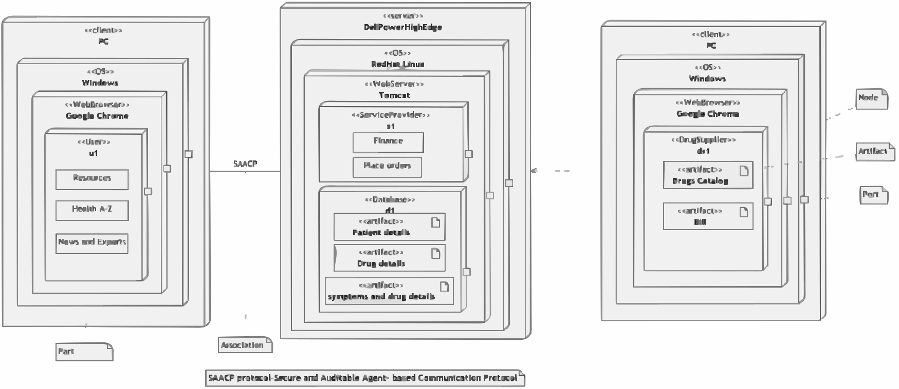

# Chapter 02: Design of UML Diagrams for Webmed Healthcare Service System Services

> **Book**: *UML Diagramming: A Case Study Approach* by Dr. Suriya Sundaramoorthy (CRC Press, 2022)  
> **Pages**: 23–38 (Total: 16 pages)  
> **Classification**: Industrial Case Study & Diagram Suite  
> **Navigation**: [&larr; Chapter_01_Introduction_to_UML_Diagrams_and_Its_Components](Chapter_01_Introduction_to_UML_Diagrams_and_Its_Components.md) | [📚 Book Index](../UML_Book.md) | [Chapter_03_Design_of_UML_Diagrams_for_Inventory_Management_System &rarr;](Chapter_03_Design_of_UML_Diagrams_for_Inventory_Management_System.md)

---

## 📌 Executive Summary

Chapter 2 presents an industrial software engineering case study for **Design of UML Diagrams for Webmed Healthcare Service System Services**. It details the transition from business requirements and domain constraints into formal software architecture specifications, leveraging data-flow modeling and a complete suite of Unified Modeling Language (UML) structural and behavioral diagrams.

---

## 🎯 Problem Statement & System Context

Healthcare service has huge demand these days as it really helps in managing a hospital or a medical office. The scope of healthcare service systems is increasing by each day and it is true for the entire world. Some of these solutions include improved awareness about healthcare services and health policies. The objective of this system is to provide medical assistance to people instantly with the help of technology. This system eradicates the cultural sensitivity that prevails in many hospitals and improvises the quality of medical assistance. The captivating features of this system are online doctors, medicines at doorstep and bulletin of awareness. The users can also navigate and choose among various insurance schemes that are displayed. The primary objectives of Webmed healthcare system are to enable all citizens to receive healthcare services whenever needed, and to deliver health services that are cost-effective and meet pre-established standards of quality. The main functions of this system deal with finance, health A–Z, resources, drugs and supplements, news and experts, payment and feedback. Register function allows the patients or the caregivers to register on the website. Login function allows the patients to access the website. Financing focuses on the purchase of insurance. Health A–Z displays all the diseases along with their symptoms. Resources function consists of the sub-functions including symptoms checker, health calculator, find a doctor based on the geographical location of the patient, insurance guide and ambulance providence. Drugs and supplements include online medicine delivery, where people could shop for medicines online. News and experts function is to provide health awareness and threats that are prevailing. This function also gives information regarding counselling programs and blood donation camps. The payment function is to reimburse providers for services delivered. The feedback function collects user reviews for the website.

### Key Functional Capabilities

- **Register**: this functionality acts as a membership functionality that allows the users, patients or caregivers to register into this website to access all the resources.
- **Login**: this functionality authenticates the user to provide access permissions.
- **Facilities**: this functionality allows us to access all the options available on the website.
- **Logout**: this functionality ends the access to the website.
- **Finance**: this functionality allows to purchase insurance, or to pay for healthcare services consumed.
- **Health A**: Z – this functionality provides details of all the diseases.
- **Resources**: this functionality has sub-functions, namely symptoms checker, health calculator, find a doctor, insurance guide and ambulance providence.
- **Drugs and supplements**: this functionality provides online delivery of medicines.
- **News and experts**: this functionality provides health awareness and threats that are prevailing.
- **Payment**: this functionality deals with the payment for the services consumed.
- **Feedback**: this functionality collects user reviews for this website.

---

## 📊 Complete UML Diagram Suite & Architecture Specifications

This chapter incorporates **12 standalone vector diagram(s)** illustrating the end-to-end design from functional use cases to physical hardware deployment:

### Figure 2.2: Level 0 DFD

**Diagram Category**: `Data Flow Diagram (DFD)`  
**Architectural Role**: Models external entity inputs, core transformation processes, and data store read/write interactions.

### Figure 2.3: Level 1 DFD

**Diagram Category**: `Data Flow Diagram (DFD)`  
**Architectural Role**: Models external entity inputs, core transformation processes, and data store read/write interactions.

### Figure 2.4: UML Usecase Diagram

**Diagram Category**: `Use Case Diagram`  
**Architectural Role**: Specifies system boundary, primary external actors, and business use cases with include/extend relationships.

### Figure 2.5: UML Class Diagram

**Diagram Category**: `Class Diagram`  
**Architectural Role**: Models static structural classifiers, entity attributes, operations, and associations (composition, aggregation, inheritance).

### Figure 2.6: UML Activity Diagram 1

**Diagram Category**: `Activity Diagram`  
**Architectural Role**: Illustrates dynamic procedural workflow, decision branching, concurrent action forks, and synchronization joins.

### Figure 2.7: UML Activity Diagram 2

**Diagram Category**: `Activity Diagram`  
**Architectural Role**: Illustrates dynamic procedural workflow, decision branching, concurrent action forks, and synchronization joins.

### Figure 2.8: UML State Machine Diagram

**Diagram Category**: `State Machine Diagram`  
**Architectural Role**: Captures entity lifecycle states, transition triggers, event guards, and exit/entry actions.

### Figure 2.9: UML Sequence Diagram

**Diagram Category**: `Sequence Diagram`  
**Architectural Role**: Details chronological object interactions, synchronous message exchanges, return flows, and activation lifelines.

### Figure 2.10: UML Communication Diagram

**Diagram Category**: `Communication Diagram`  
**Architectural Role**: Emphasizes structural object topology and numbered sequence messaging between collaborating entities.

### Figure 2.11: UML Component Diagram

**Diagram Category**: `Component Diagram`  
**Architectural Role**: Architects physical modular software components, provided ball interfaces, and required socket dependencies.

### Figure 2.12: UML Deployment Diagram

**Diagram Category**: `Deployment Diagram`  
**Architectural Role**: Maps software execution artifacts to hardware computing nodes, client devices, application tiers, and database servers.

### Visual Artifacts & Supplementary Schematics

The following vector schematics capture operational screen states, user dashboards, or notation components documented in this chapter:

#### Ch02 p038 img01

---

## 💡 Key Architectural Invariants & Modeling Lessons

1. **Traceability**: Every software model directly corresponds to explicit functional requirements defined during the initial domain specification.
2. **Separation of Concerns**: Structural models (Class, Component, Deployment) maintain clear boundaries separating business domain entities from physical infrastructure nodes.
3. **Behavioral Integrity**: Dynamic models (Activity, Sequence, State Machine) guarantee valid state transitions, prevent deadlocks, and verify message order consistency.
4. **Deployment Fidelity**: Physical nodes and execution environments accurately map runtime middleware, database engines, and client access channels.

---

## 🔗 Related Resources & Navigation

- **Navigation**: [&larr; Chapter_01_Introduction_to_UML_Diagrams_and_Its_Components](Chapter_01_Introduction_to_UML_Diagrams_and_Its_Components.md) | [📚 Book Index](../UML_Book.md) | [Chapter_03_Design_of_UML_Diagrams_for_Inventory_Management_System &rarr;](Chapter_03_Design_of_UML_Diagrams_for_Inventory_Management_System.md)
- **Master Book Catalog**: [`UML_Book.md`](../UML_Book.md)
- **Vector Images Catalog**: [`Vector_Images_Catalog.md`](../vector_images/Vector_Images_Catalog.md)