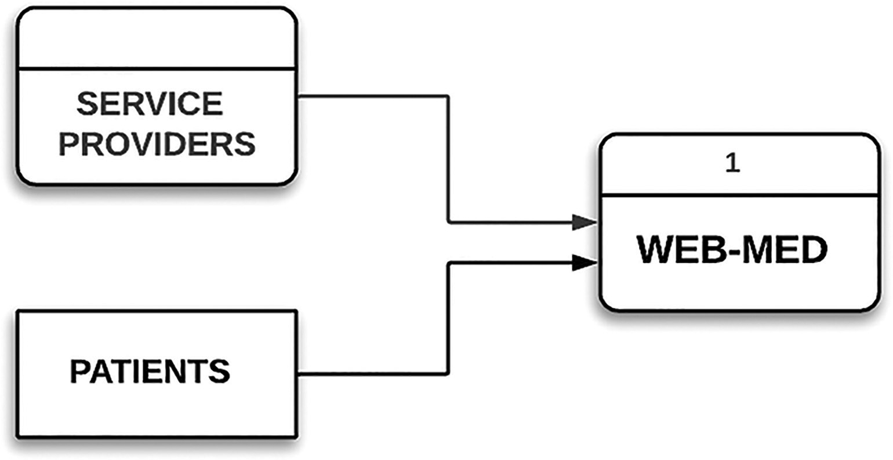
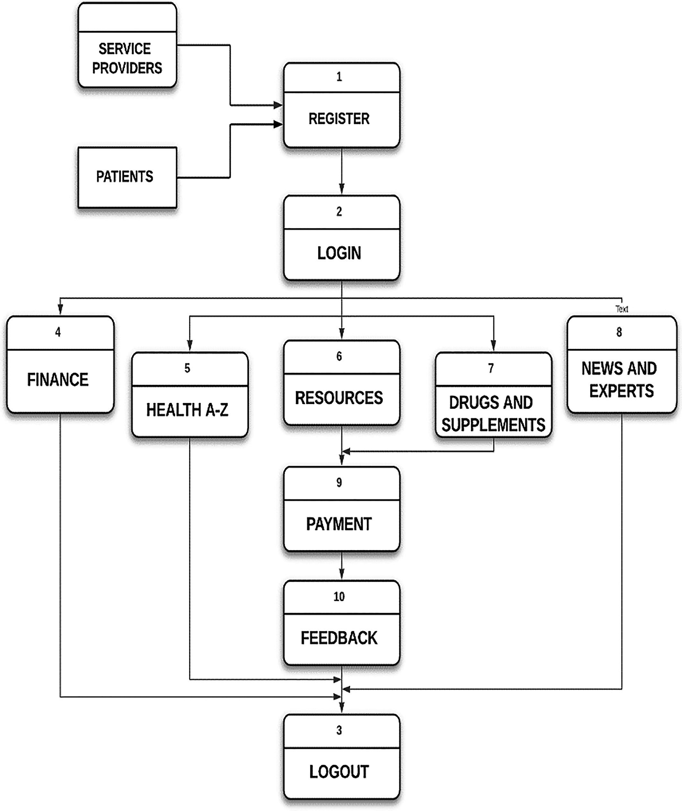
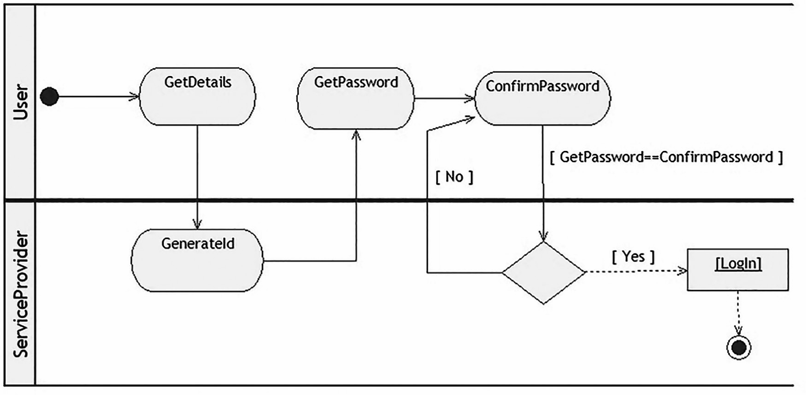
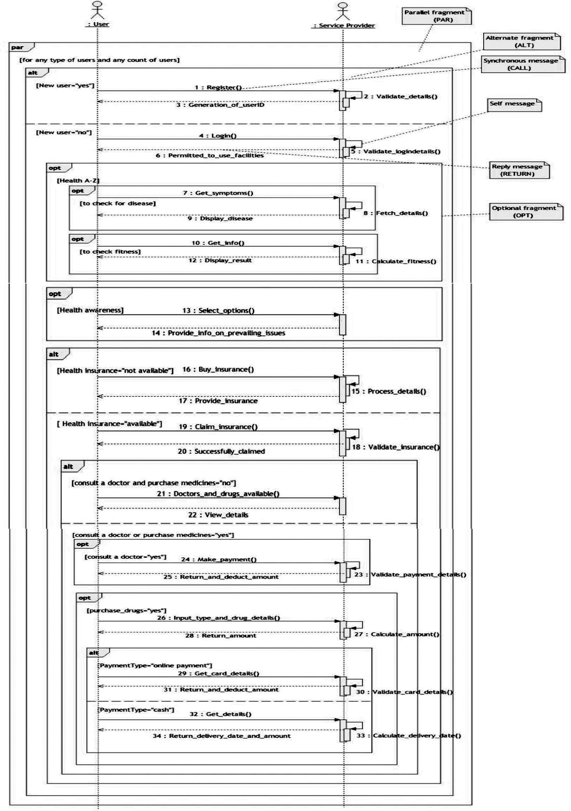
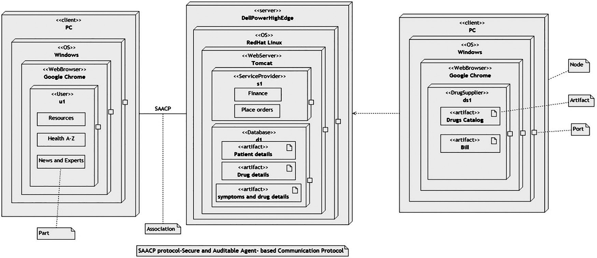

# Chapter 02: Design of UML Diagrams for Webmed Healthcare Service System Services

> **Book**: *UML Diagramming: A Case Study Approach* by Dr. Suriya Sundaramoorthy (CRC Press, 2022)  
> **Pages**: 23–38 (Total: 16 pages)  
> **Classification**: Industrial Case Study & Diagram Suite  
> **Navigation**: [&larr; Chapter_01_Introduction_to_UML_Diagrams_and_Its_Components](Chapter_01_Introduction_to_UML_Diagrams_and_Its_Components.md) | [📚 Book Index](../UML_Book.md) | [Chapter_03_Design_of_UML_Diagrams_for_Inventory_Management_System &rarr;](Chapter_03_Design_of_UML_Diagrams_for_Inventory_Management_System.md)

---

## 📌 Executive Summary

Chapter 2 presents an industrial software engineering case study for **Design of UML Diagrams for Webmed Healthcare Service System Services**. It details the transition from business requirements and domain constraints into formal software architecture specifications, leveraging data-flow modeling and a complete suite of Unified Modeling Language (UML) structural and behavioral diagrams.

---

## 🎯 Problem Statement & System Context

This chapter provides detailed software engineering analysis and UML modeling specifications.

---

## 📊 Complete UML Diagram Suite & Architecture Specifications

This chapter incorporates **12 crystal-clear, high-resolution diagram(s)** (extracted losslessly from the source edition at up to 2,000+ px) illustrating the end-to-end design from functional use cases to physical hardware deployment:

### Figure 2.2: Level 0 DFD

**Diagram Category**: `Data Flow Diagram (DFD)`  
**Architectural Role**: Models external entity inputs, core transformation processes, and data store read/write interactions.

### Figure 2.3: Level 1 DFD

**Diagram Category**: `Data Flow Diagram (DFD)`  
**Architectural Role**: Models external entity inputs, core transformation processes, and data store read/write interactions.

### Figure 2.4: UML Usecase Diagram

**Diagram Category**: `Use Case Diagram`  
**Architectural Role**: Specifies system boundary, primary external actors, and business use cases with include/extend relationships.

### Figure 2.5: UML Class Diagram

**Diagram Category**: `Class Diagram`  
**Architectural Role**: Models static structural classifiers, entity attributes, operations, and associations (composition, aggregation, inheritance).

### Figure 2.6: UML Activity Diagram 1

**Diagram Category**: `Activity Diagram`  
**Architectural Role**: Illustrates dynamic procedural workflow, decision branching, concurrent action forks, and synchronization joins.

### Figure 2.7: UML Activity Diagram 2

**Diagram Category**: `Activity Diagram`  
**Architectural Role**: Illustrates dynamic procedural workflow, decision branching, concurrent action forks, and synchronization joins.

### Figure 2.8: UML State Machine Diagram

**Diagram Category**: `State Machine Diagram`  
**Architectural Role**: Captures entity lifecycle states, transition triggers, event guards, and exit/entry actions.

### Figure 2.9: UML Sequence Diagram

**Diagram Category**: `Sequence Diagram`  
**Architectural Role**: Details chronological object interactions, synchronous message exchanges, return flows, and activation lifelines.

### Figure 2.10: UML Communication Diagram

**Diagram Category**: `Communication Diagram`  
**Architectural Role**: Emphasizes structural object topology and numbered sequence messaging between collaborating entities.

### Figure 2.11: UML Component Diagram

**Diagram Category**: `Component Diagram`  
**Architectural Role**: Architects physical modular software components, provided ball interfaces, and required socket dependencies.

### Figure 2.12: UML Deployment Diagram

**Diagram Category**: `Deployment Diagram`  
**Architectural Role**: Maps software execution artifacts to hardware computing nodes, client devices, application tiers, and database servers.

### Visual Artifacts & Supplementary Schematics

The following high-resolution schematics capture operational screen states, user dashboards, or notation components documented in this chapter:

#### Ch02 p038 img01

---

## 💡 Key Architectural Invariants & Modeling Lessons

1. **Traceability**: Every software model directly corresponds to explicit functional requirements defined during the initial domain specification.
2. **Separation of Concerns**: Structural models (Class, Component, Deployment) maintain clear boundaries separating business domain entities from physical infrastructure nodes.
3. **Behavioral Integrity**: Dynamic models (Activity, Sequence, State Machine) guarantee valid state transitions, prevent deadlocks, and verify message order consistency.
4. **Deployment Fidelity**: Physical nodes and execution environments accurately map runtime middleware, database engines, and client access channels.

---

## 🔗 Related Resources & Navigation

- **Navigation**: [&larr; Chapter_01_Introduction_to_UML_Diagrams_and_Its_Components](Chapter_01_Introduction_to_UML_Diagrams_and_Its_Components.md) | [📚 Book Index](../UML_Book.md) | [Chapter_03_Design_of_UML_Diagrams_for_Inventory_Management_System &rarr;](Chapter_03_Design_of_UML_Diagrams_for_Inventory_Management_System.md)
- **Master Book Catalog**: [`UML_Book.md`](../UML_Book.md)
- **High-Resolution Images Archive**: [`images/`](../images/)