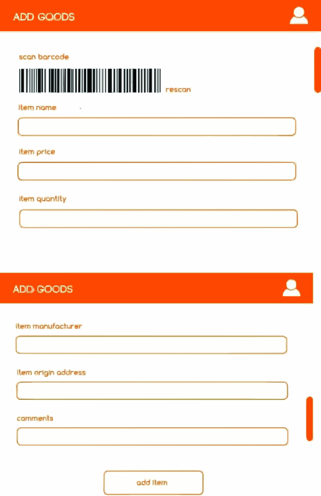
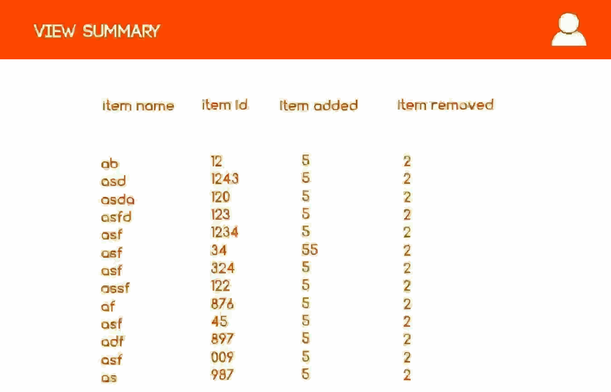
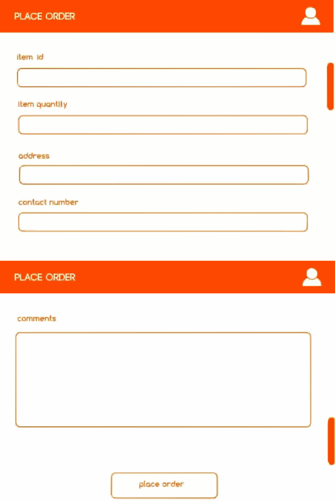
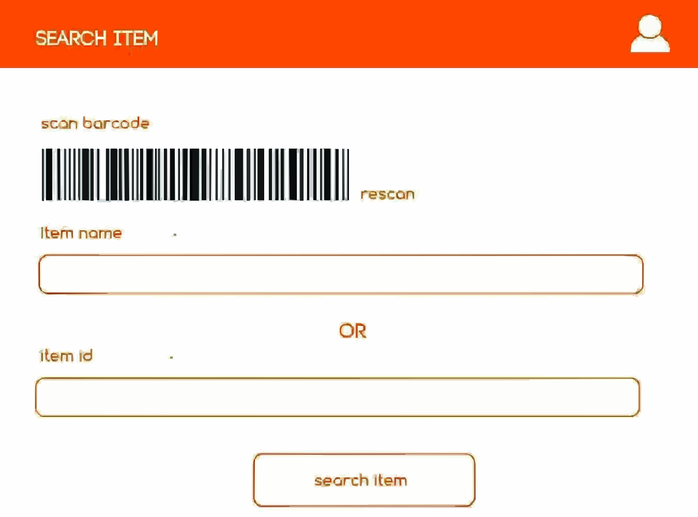
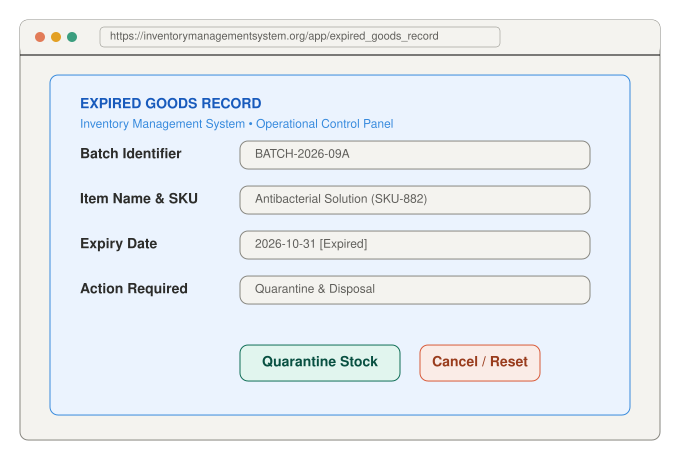
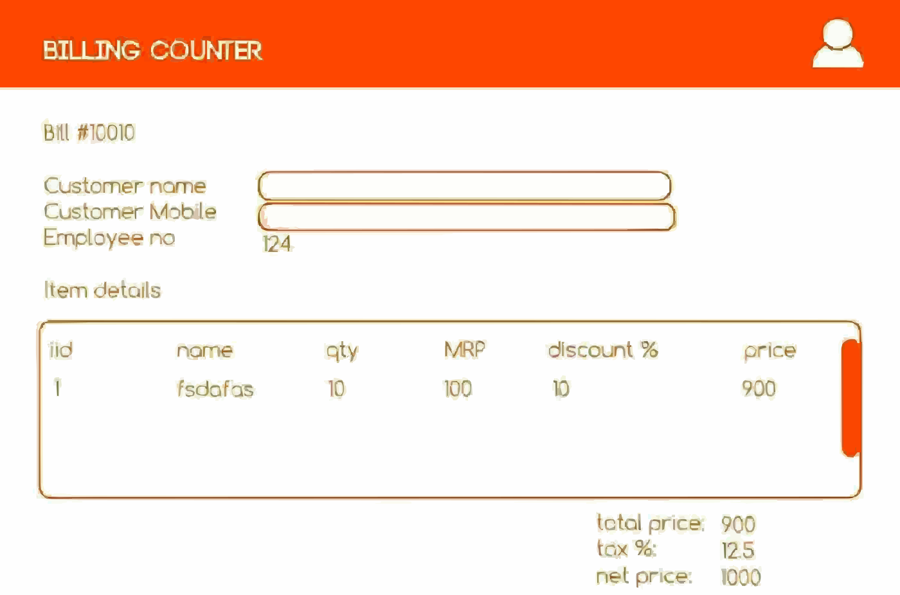

# Chapter 03: Design of UML Diagrams for Inventory Management System

> **Book**: *UML Diagramming: A Case Study Approach* by Dr. Suriya Sundaramoorthy (CRC Press, 2022)  
> **Pages**: 39–58 (Total: 20 pages)  
> **Classification**: Industrial Case Study & Diagram Suite  
> **Navigation**: [&larr; Chapter_02_Design_of_UML_Diagrams_for_Webmed_Healthcare_Service_System_Services](Chapter_02_Design_of_UML_Diagrams_for_Webmed_Healthcare_Service_System_Services.md) | [📚 Book Index](../UML_Book.md) | [Chapter_04_Design_of_UML_Diagrams_for_Business_Process_Outsourcing_BPO_Management_System &rarr;](Chapter_04_Design_of_UML_Diagrams_for_Business_Process_Outsourcing_BPO_Management_System.md)

---

## 📌 Executive Summary

Chapter 3 presents an industrial software engineering case study for **Design of UML Diagrams for Inventory Management System**. It details the transition from business requirements and domain constraints into formal software architecture specifications, leveraging data-flow modeling and a complete suite of Unified Modeling Language (UML) structural and behavioral diagrams.

---

## 🎯 Problem Statement & System Context

This chapter aims to create an inventory management system for the efficient management of goods. The performance will be guided by clear and concise strategic practices for each functional unit by an ongoing quest for perfection. The current systems use a manual method to keep track of the records at stores, but the current system is difficult to maintain due to the difficulty in searching and retrieving products, cost of material, human errors, less data integrity, and feasible loss of records and retrieving files. Therefore, by developing such a system, we propose to increase sales by creating the complete inventory records of stock, receipt, details of purchasers and sellers at the store and also to facilitate the salespersons and inventory managers. The ever-growing population creates a high demand. Thus, the responsibility of delivering goods on time lies in the hands of an effective inventory management system. The inventory management system will be installed in both the warehouse and at the billing counter thereby enabling the salespersons and the inventory managers to get instantaneous information and use it on demand. The customer billing process will happen at the main counter and the inventory management will happen in the background in the warehouse.

### Key Functional Capabilities

The current inventory system is difficult to maintain due to the difficulty in searching and retrieving products, cost of material, human errors, less data integrity, and feasible loss of records and retrieving files. So there is a need to create robust inventory management software that ensures a reduction in customer’s complaints as well as the reduction in inventory cost. The demand for goods accrues from the growing population. To meet these demands, the inventory managers and salespersons require an application with on-demand information retrieval and update. The system will feature a secure login for salespersons and inventory managers. At the warehouse, the inventory application will manage the available goods and resources. At the billing counter, the application will have the ability to create bills along with proper discount and tax evaluations.

---

## 📊 Complete UML Diagram Suite & Architecture Specifications

This chapter incorporates **23 standalone vector diagram(s)** illustrating the end-to-end design from functional use cases to physical hardware deployment:

### Figure 3.1: Login Functionality Home Dashboard

**Diagram Category**: `System Interface & Flow Schematic`  
**Architectural Role**: Depicts user interface states, administrative dashboards, or operational screen transitions.

### Figure 3.2: Dashboard Popup

**Diagram Category**: `System Interface & Flow Schematic`  
**Architectural Role**: Depicts user interface states, administrative dashboards, or operational screen transitions.

### Figure 3.3: Change Password

**Diagram Category**: `Architectural Figure`  
**Architectural Role**: Structural schematic detailing domain requirements and workflow transitions.

### Figure 3.4: Add Goods

**Diagram Category**: `System Interface & Flow Schematic`  
**Architectural Role**: Depicts user interface states, administrative dashboards, or operational screen transitions.

### Figure 3.5: Remove Goods

**Diagram Category**: `System Interface & Flow Schematic`  
**Architectural Role**: Depicts user interface states, administrative dashboards, or operational screen transitions.

### Figure 3.6: View Summary

**Diagram Category**: `System Interface & Flow Schematic`  
**Architectural Role**: Depicts user interface states, administrative dashboards, or operational screen transitions.

### Figure 3.7: Place Order

**Diagram Category**: `System Interface & Flow Schematic`  
**Architectural Role**: Depicts user interface states, administrative dashboards, or operational screen transitions.

### Figure 3.8: Tax Details

**Diagram Category**: `System Interface & Flow Schematic`  
**Architectural Role**: Depicts user interface states, administrative dashboards, or operational screen transitions.

### Figure 3.9: Search Item

**Diagram Category**: `System Interface & Flow Schematic`  
**Architectural Role**: Depicts user interface states, administrative dashboards, or operational screen transitions.

### Figure 3.10: Expired Goods

**Diagram Category**: `System Interface & Flow Schematic`  
**Architectural Role**: Depicts user interface states, administrative dashboards, or operational screen transitions.

### Figure 3.11: Billing Counter

**Diagram Category**: `System Interface & Flow Schematic`  
**Architectural Role**: Depicts user interface states, administrative dashboards, or operational screen transitions.

### Figure 3.12: UML Usecase Diagram

**Diagram Category**: `Use Case Diagram`  
**Architectural Role**: Specifies system boundary, primary external actors, and business use cases with include/extend relationships.

### Figure 3.13: UML Class Diagram

**Diagram Category**: `Class Diagram`  
**Architectural Role**: Models static structural classifiers, entity attributes, operations, and associations (composition, aggregation, inheritance).

### Figure 3.14: UML Activity Diagram

**Diagram Category**: `Activity Diagram`  
**Architectural Role**: Illustrates dynamic procedural workflow, decision branching, concurrent action forks, and synchronization joins.

### Figure 3.15: UML State Machine Diagram

**Diagram Category**: `State Machine Diagram`  
**Architectural Role**: Captures entity lifecycle states, transition triggers, event guards, and exit/entry actions.

### Figure 3.16: UML Sequence Diagram

**Diagram Category**: `Sequence Diagram`  
**Architectural Role**: Details chronological object interactions, synchronous message exchanges, return flows, and activation lifelines.

### Figure 3.17: UML Communication Diagram

**Diagram Category**: `Communication Diagram`  
**Architectural Role**: Emphasizes structural object topology and numbered sequence messaging between collaborating entities.

### Figure 3.18: UML Component Diagram

**Diagram Category**: `Component Diagram`  
**Architectural Role**: Architects physical modular software components, provided ball interfaces, and required socket dependencies.

### Figure 3.19: UML Deployment Diagram

**Diagram Category**: `Deployment Diagram`  
**Architectural Role**: Maps software execution artifacts to hardware computing nodes, client devices, application tiers, and database servers.

### Figure 3.20: Case 1

**Diagram Category**: `System Interface & Flow Schematic`  
**Architectural Role**: Depicts user interface states, administrative dashboards, or operational screen transitions.

### Figure 3.21: Case 2

**Diagram Category**: `System Interface & Flow Schematic`  
**Architectural Role**: Depicts user interface states, administrative dashboards, or operational screen transitions.

### Figure 3.22: Case 3

**Diagram Category**: `System Interface & Flow Schematic`  
**Architectural Role**: Depicts user interface states, administrative dashboards, or operational screen transitions.

### Visual Artifacts & Supplementary Schematics

The following vector schematics capture operational screen states, user dashboards, or notation components documented in this chapter:

#### Ch03 p058 img01

---

## 💡 Key Architectural Invariants & Modeling Lessons

1. **Traceability**: Every software model directly corresponds to explicit functional requirements defined during the initial domain specification.
2. **Separation of Concerns**: Structural models (Class, Component, Deployment) maintain clear boundaries separating business domain entities from physical infrastructure nodes.
3. **Behavioral Integrity**: Dynamic models (Activity, Sequence, State Machine) guarantee valid state transitions, prevent deadlocks, and verify message order consistency.
4. **Deployment Fidelity**: Physical nodes and execution environments accurately map runtime middleware, database engines, and client access channels.

---

## 🔗 Related Resources & Navigation

- **Navigation**: [&larr; Chapter_02_Design_of_UML_Diagrams_for_Webmed_Healthcare_Service_System_Services](Chapter_02_Design_of_UML_Diagrams_for_Webmed_Healthcare_Service_System_Services.md) | [📚 Book Index](../UML_Book.md) | [Chapter_04_Design_of_UML_Diagrams_for_Business_Process_Outsourcing_BPO_Management_System &rarr;](Chapter_04_Design_of_UML_Diagrams_for_Business_Process_Outsourcing_BPO_Management_System.md)
- **Master Book Catalog**: [`UML_Book.md`](../UML_Book.md)
- **Vector Images Catalog**: [`Vector_Images_Catalog.md`](../vector_images/Vector_Images_Catalog.md)