# Chapter 03: Design of UML Diagrams for Inventory Management System

> **Book**: *UML Diagramming: A Case Study Approach* by Dr. Suriya Sundaramoorthy (CRC Press, 2022)  
> **Pages**: 39–58 (Total: 20 pages)  
> **Classification**: Industrial Case Study & Diagram Suite  
> **Navigation**: [&larr; Chapter_02_Design_of_UML_Diagrams_for_Webmed_Healthcare_Service_System_Services](Chapter_02_Design_of_UML_Diagrams_for_Webmed_Healthcare_Service_System_Services.md) | [📚 Book Index](../UML_Book.md) | [Chapter_04_Design_of_UML_Diagrams_for_Business_Process_Outsourcing_BPO_Management_System &rarr;](Chapter_04_Design_of_UML_Diagrams_for_Business_Process_Outsourcing_BPO_Management_System.md)

---

## 📌 Executive Summary

Chapter 3 presents an industrial software engineering case study for **Design of UML Diagrams for Inventory Management System**. It details the transition from business requirements and domain constraints into formal software architecture specifications, leveraging data-flow modeling and a complete suite of Unified Modeling Language (UML) structural and behavioral diagrams.

---

## 🎯 Problem Statement & System Context

This chapter provides detailed software engineering analysis and UML modeling specifications.

---

## 📊 Complete UML Diagram Suite & Architecture Specifications

This chapter incorporates **23 crystal-clear, high-resolution diagram(s)** (extracted losslessly from the source edition at up to 2,000+ px) illustrating the end-to-end design from functional use cases to physical hardware deployment:

### Figure 3.1: Login Functionality Home Dashboard

**Diagram Category**: `System Interface & Flow Schematic`  
**Architectural Role**: Depicts user interface states, administrative dashboards, or operational screen transitions.

### Figure 3.2: Dashboard Popup

**Diagram Category**: `System Interface & Flow Schematic`  
**Architectural Role**: Depicts user interface states, administrative dashboards, or operational screen transitions.

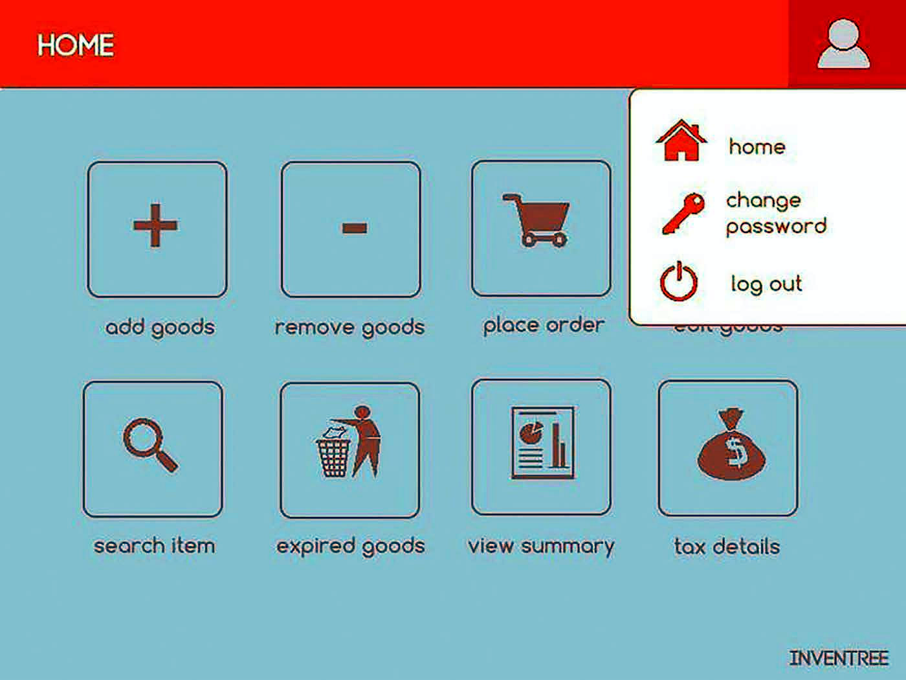

### Figure 3.3: Change Password

**Diagram Category**: `Architectural Figure`  
**Architectural Role**: Structural schematic detailing domain requirements and workflow transitions.

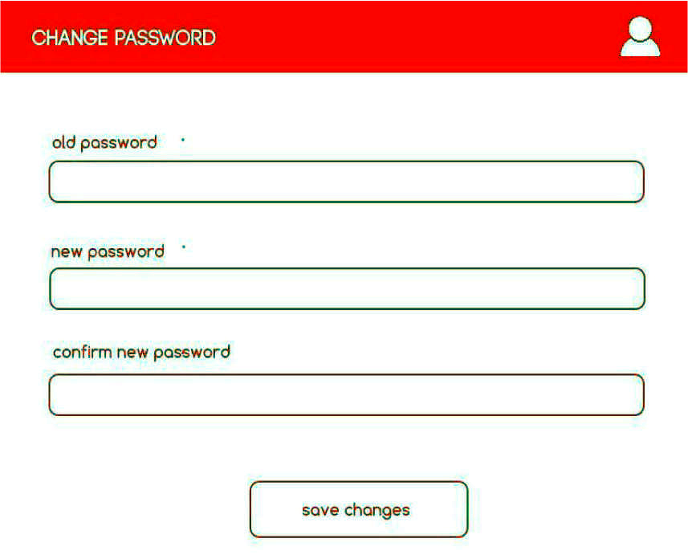

### Figure 3.4: Add Goods

**Diagram Category**: `System Interface & Flow Schematic`  
**Architectural Role**: Depicts user interface states, administrative dashboards, or operational screen transitions.

### Figure 3.5: Remove Goods

**Diagram Category**: `System Interface & Flow Schematic`  
**Architectural Role**: Depicts user interface states, administrative dashboards, or operational screen transitions.

### Figure 3.6: View Summary

**Diagram Category**: `System Interface & Flow Schematic`  
**Architectural Role**: Depicts user interface states, administrative dashboards, or operational screen transitions.

### Figure 3.7: Place Order

**Diagram Category**: `System Interface & Flow Schematic`  
**Architectural Role**: Depicts user interface states, administrative dashboards, or operational screen transitions.

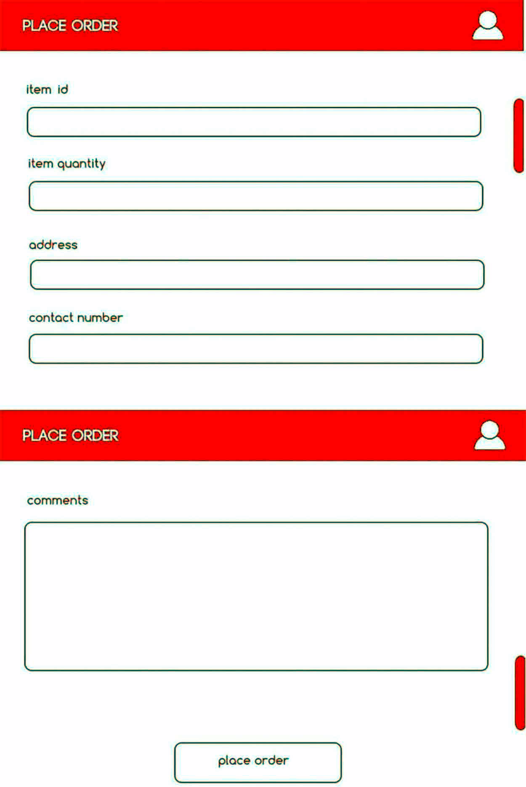

### Figure 3.8: Tax Details

**Diagram Category**: `System Interface & Flow Schematic`  
**Architectural Role**: Depicts user interface states, administrative dashboards, or operational screen transitions.

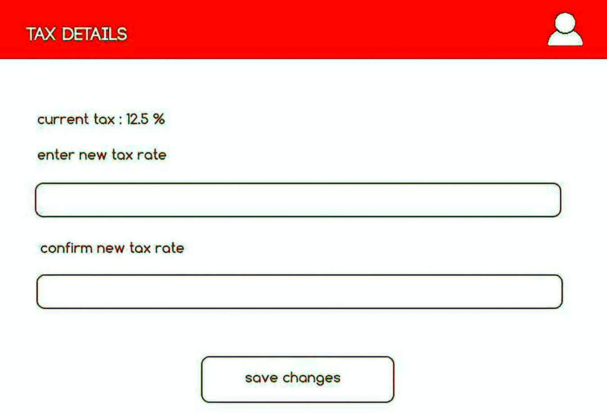

### Figure 3.9: Search Item

**Diagram Category**: `System Interface & Flow Schematic`  
**Architectural Role**: Depicts user interface states, administrative dashboards, or operational screen transitions.

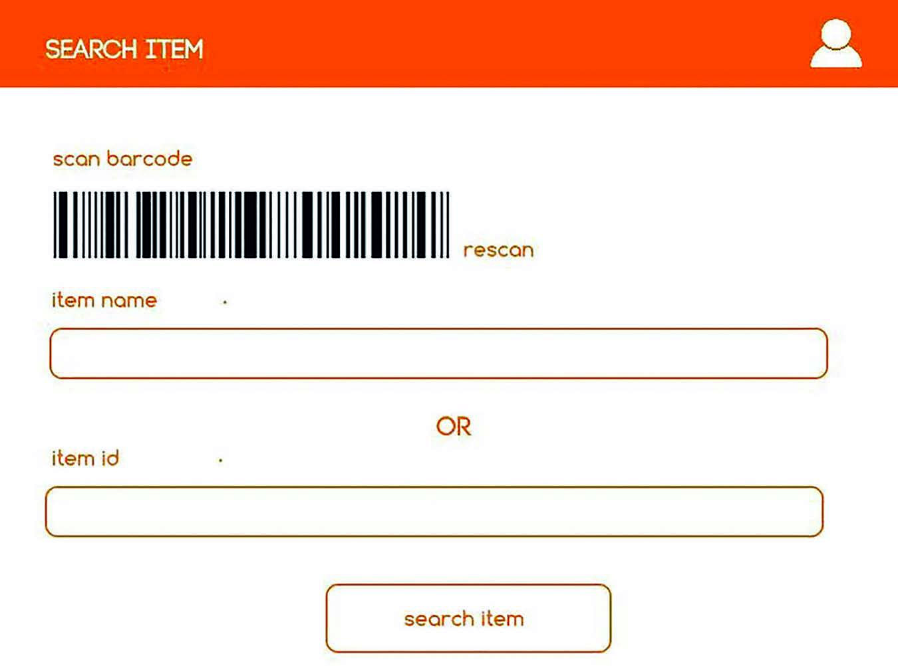

### Figure 3.10: Expired Goods

**Diagram Category**: `System Interface & Flow Schematic`  
**Architectural Role**: Depicts user interface states, administrative dashboards, or operational screen transitions.

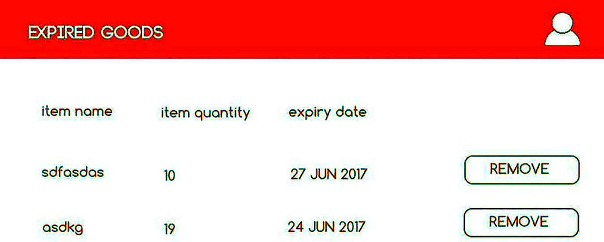

### Figure 3.11: Billing Counter

**Diagram Category**: `System Interface & Flow Schematic`  
**Architectural Role**: Depicts user interface states, administrative dashboards, or operational screen transitions.

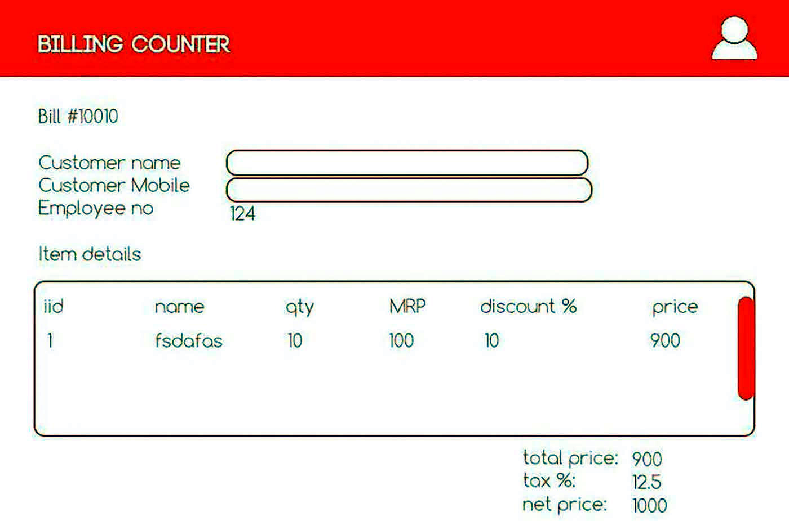

### Figure 3.12: UML Usecase Diagram

**Diagram Category**: `Use Case Diagram`  
**Architectural Role**: Specifies system boundary, primary external actors, and business use cases with include/extend relationships.

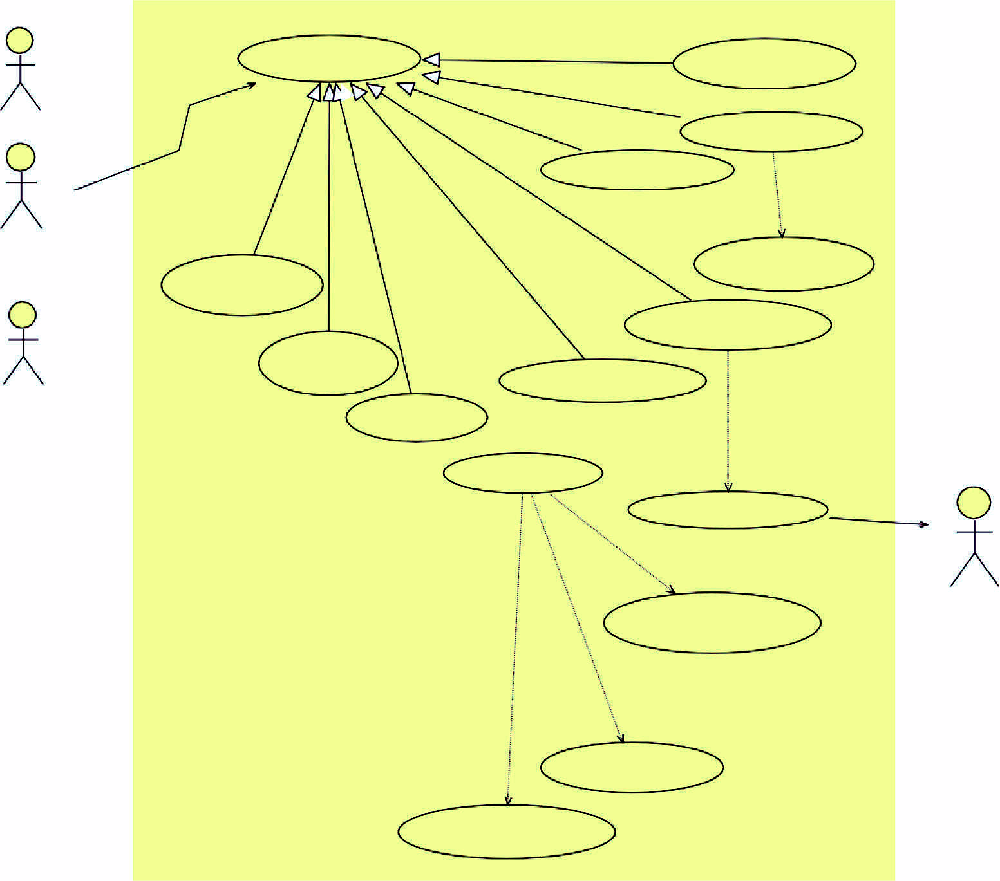

### Figure 3.13: UML Class Diagram

**Diagram Category**: `Class Diagram`  
**Architectural Role**: Models static structural classifiers, entity attributes, operations, and associations (composition, aggregation, inheritance).

### Figure 3.14: UML Activity Diagram

**Diagram Category**: `Activity Diagram`  
**Architectural Role**: Illustrates dynamic procedural workflow, decision branching, concurrent action forks, and synchronization joins.

### Figure 3.15: UML State Machine Diagram

**Diagram Category**: `State Machine Diagram`  
**Architectural Role**: Captures entity lifecycle states, transition triggers, event guards, and exit/entry actions.

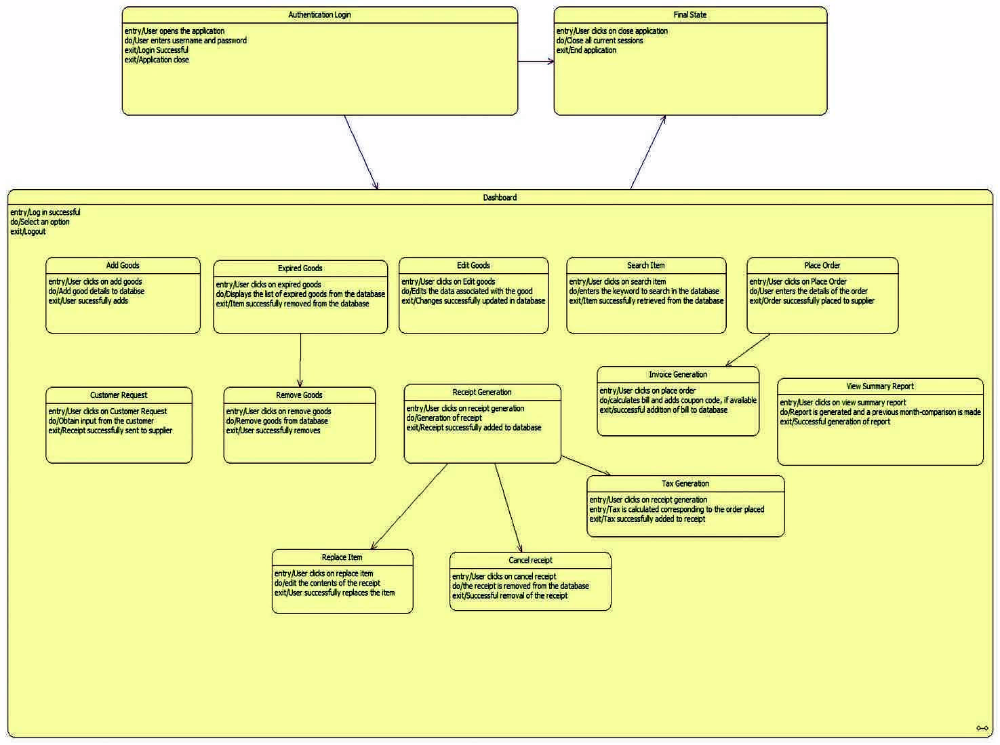

### Figure 3.16: UML Sequence Diagram

**Diagram Category**: `Sequence Diagram`  
**Architectural Role**: Details chronological object interactions, synchronous message exchanges, return flows, and activation lifelines.

### Figure 3.17: UML Communication Diagram

**Diagram Category**: `Communication Diagram`  
**Architectural Role**: Emphasizes structural object topology and numbered sequence messaging between collaborating entities.

### Figure 3.18: UML Component Diagram

**Diagram Category**: `Component Diagram`  
**Architectural Role**: Architects physical modular software components, provided ball interfaces, and required socket dependencies.

### Figure 3.19: UML Deployment Diagram

**Diagram Category**: `Deployment Diagram`  
**Architectural Role**: Maps software execution artifacts to hardware computing nodes, client devices, application tiers, and database servers.

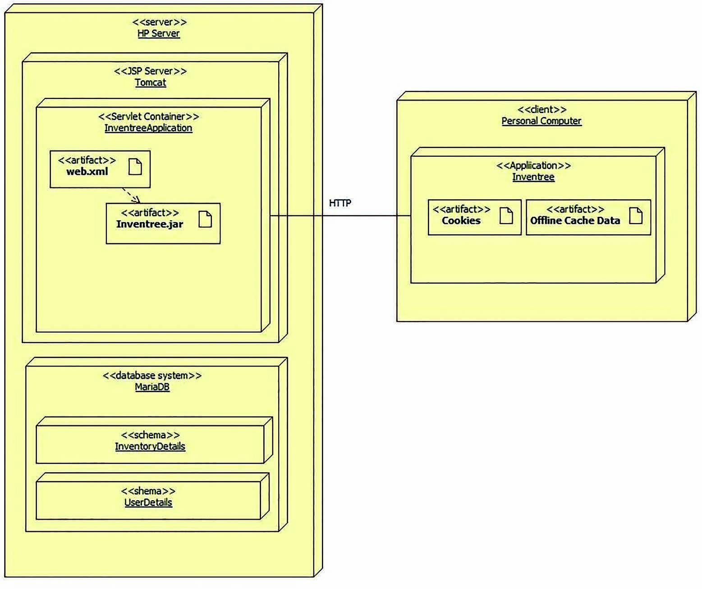

### Figure 3.20: Case 1

**Diagram Category**: `System Interface & Flow Schematic`  
**Architectural Role**: Depicts user interface states, administrative dashboards, or operational screen transitions.

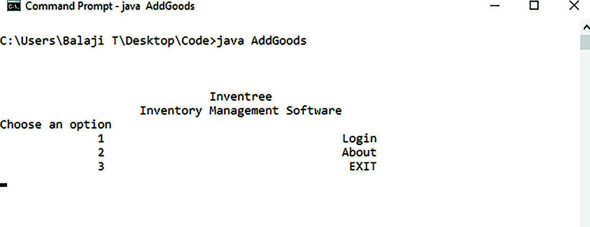

### Figure 3.21: Case 2

**Diagram Category**: `System Interface & Flow Schematic`  
**Architectural Role**: Depicts user interface states, administrative dashboards, or operational screen transitions.

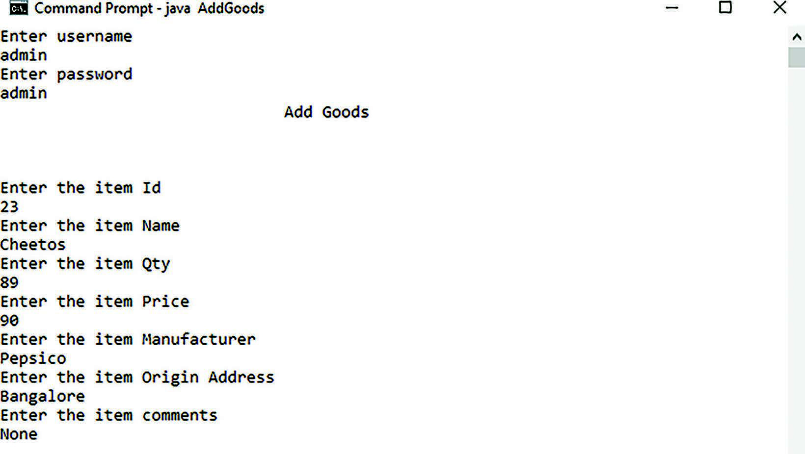

### Figure 3.22: Case 3

**Diagram Category**: `System Interface & Flow Schematic`  
**Architectural Role**: Depicts user interface states, administrative dashboards, or operational screen transitions.

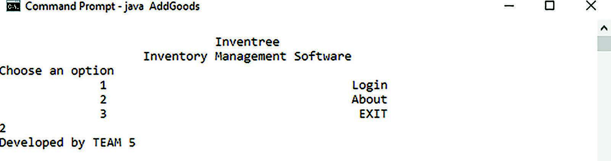

### Visual Artifacts & Supplementary Schematics

The following high-resolution schematics capture operational screen states, user dashboards, or notation components documented in this chapter:

#### Ch03 p058 img01

---

## 💡 Key Architectural Invariants & Modeling Lessons

1. **Traceability**: Every software model directly corresponds to explicit functional requirements defined during the initial domain specification.
2. **Separation of Concerns**: Structural models (Class, Component, Deployment) maintain clear boundaries separating business domain entities from physical infrastructure nodes.
3. **Behavioral Integrity**: Dynamic models (Activity, Sequence, State Machine) guarantee valid state transitions, prevent deadlocks, and verify message order consistency.
4. **Deployment Fidelity**: Physical nodes and execution environments accurately map runtime middleware, database engines, and client access channels.

---

## 🔗 Related Resources & Navigation

- **Navigation**: [&larr; Chapter_02_Design_of_UML_Diagrams_for_Webmed_Healthcare_Service_System_Services](Chapter_02_Design_of_UML_Diagrams_for_Webmed_Healthcare_Service_System_Services.md) | [📚 Book Index](../UML_Book.md) | [Chapter_04_Design_of_UML_Diagrams_for_Business_Process_Outsourcing_BPO_Management_System &rarr;](Chapter_04_Design_of_UML_Diagrams_for_Business_Process_Outsourcing_BPO_Management_System.md)
- **Master Book Catalog**: [`UML_Book.md`](../UML_Book.md)
- **High-Resolution Images Archive**: [`images/`](../images/)