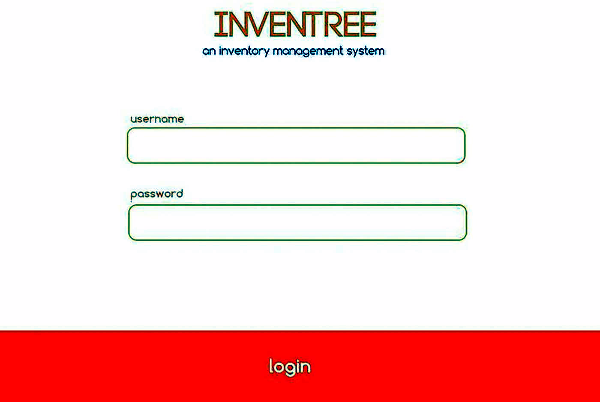
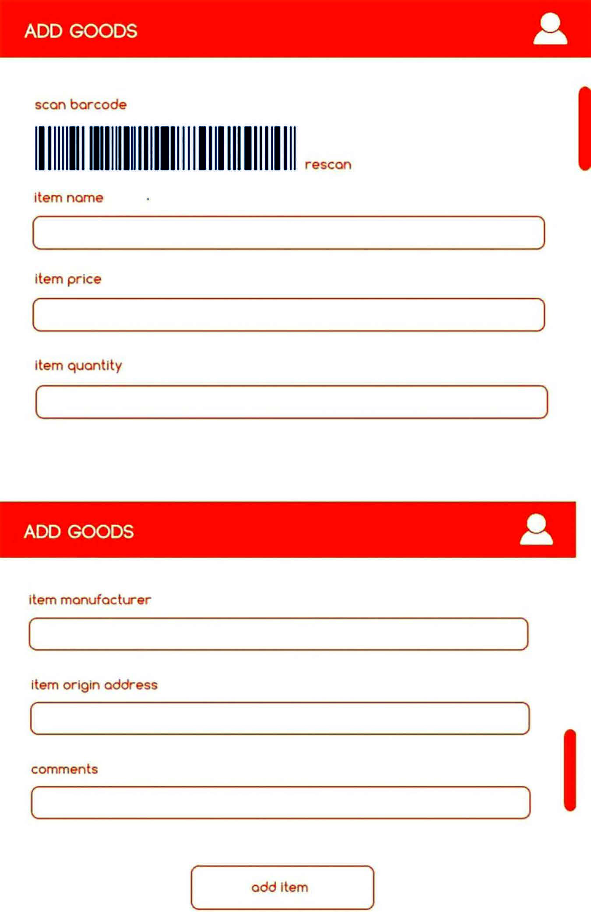
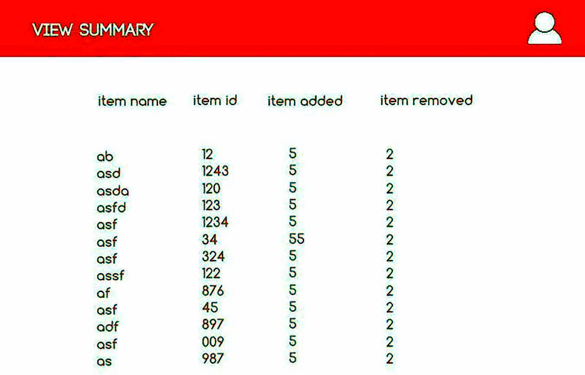
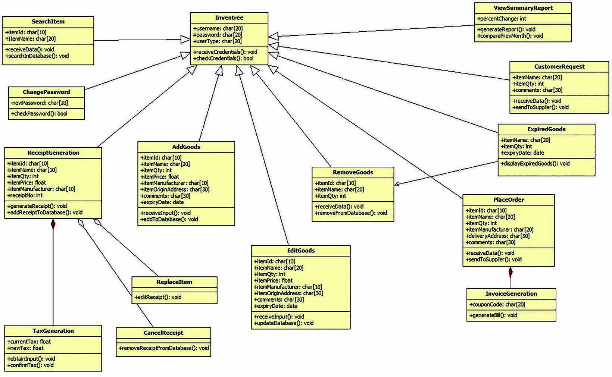
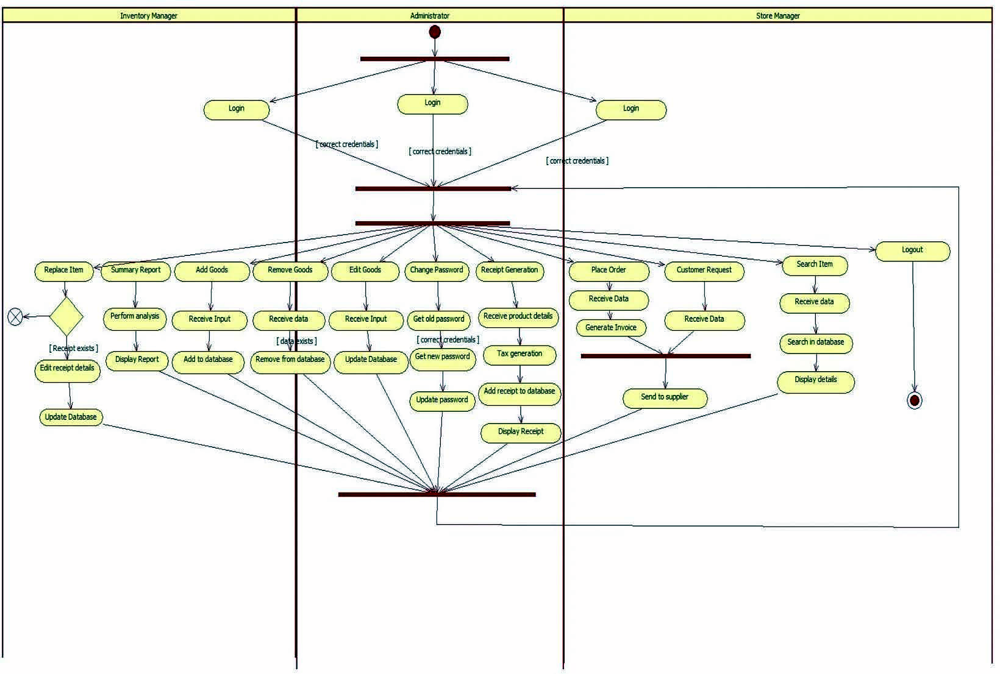
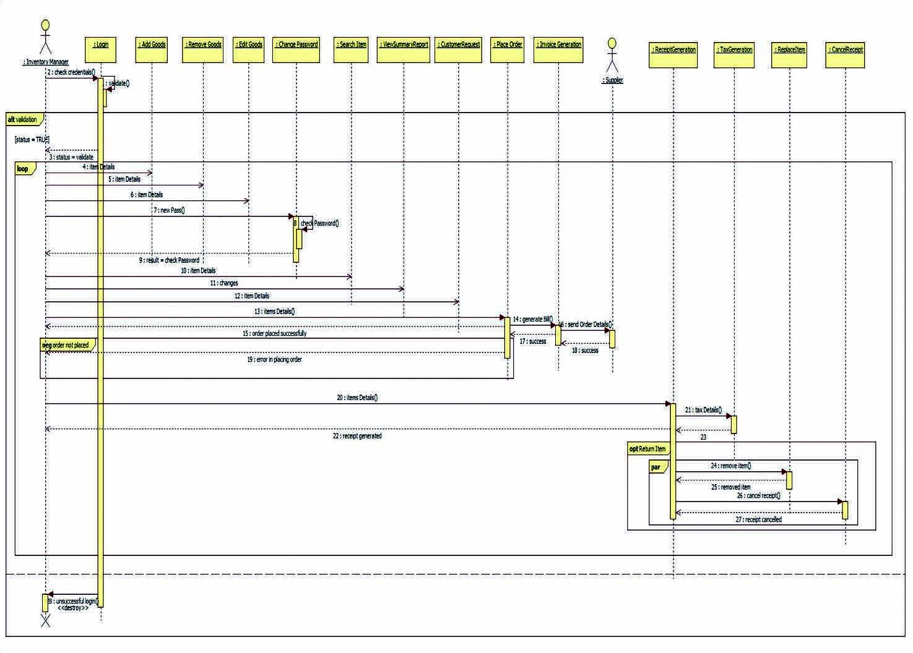
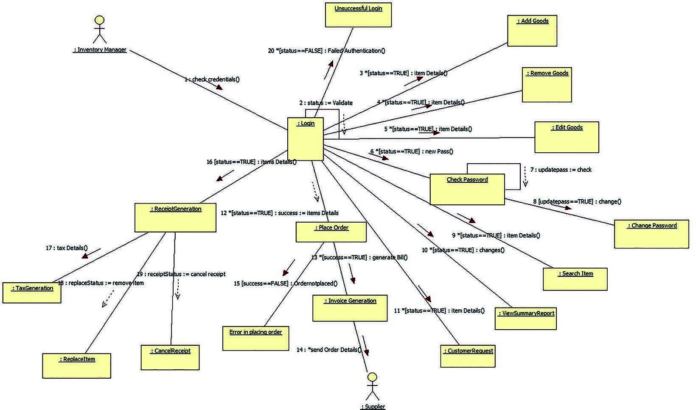
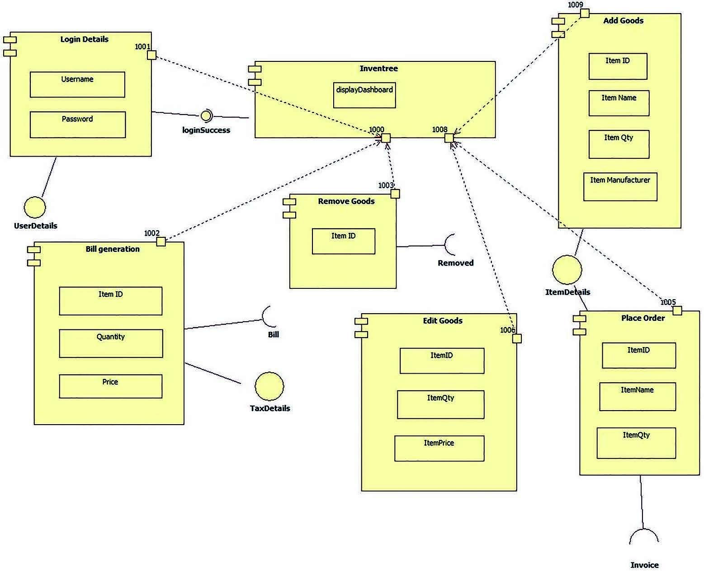
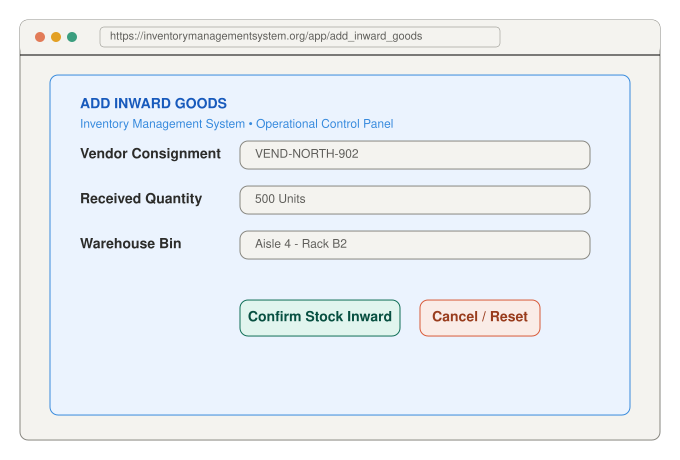

# Chapter 03: Design of UML Diagrams for Inventory Management System

> **Book**: *UML Diagramming: A Case Study Approach* by Dr. Suriya Sundaramoorthy (CRC Press, 2022)  
> **Pages**: 39–58 (Total: 20 pages)  
> **Classification**: Industrial Case Study & UML Modeling Suite  
> **Navigation**: [&larr; Chapter_02_Design_of_UML_Diagrams_for_Webmed_Healthcare_Service_System_Services](Chapter_02_Design_of_UML_Diagrams_for_Webmed_Healthcare_Service_System_Services.md) | [📚 Book Index](../UML_Book.md) | [Chapter_04_Design_of_UML_Diagrams_for_Business_Process_Outsourcing_BPO_Management_System &rarr;](Chapter_04_Design_of_UML_Diagrams_for_Business_Process_Outsourcing_BPO_Management_System.md)

---

## 📌 Executive Summary

Chapter 3 presents an end-to-end software engineering case study for the **Design of UML Diagrams for Inventory Management System**. This chapter demonstrates how business requirements and domain constraints are translated into formal architectural specifications through data-flow modeling and a complete suite of Unified Modeling Language (UML) structural and behavioral models.

The case study analyzes the system from multiple architectural perspectives: identifying external user and service actors, formalizing core operational capabilities, detailing procedural business workflows, specifying domain entity schemas, and architecting modular component deployment across distributed physical infrastructure.

---

## 🎯 Problem Statement & Business Context

- **Core Problem**: Manual paper-and-ledger tracking in warehouses causes stock count errors, lost sales, misplaced items, and slow customer checkouts.
- **Business Context**: Retailers and warehouses need real-time stock visibility to prevent stockouts and speed up order fulfillment.
- **Key Solution**: Automatically syncs front-counter cash registers with back-office warehouse inventory, generating low-stock alerts and purchase orders.

---

## ⚙️ System Architecture & Functional Capabilities

The **Design of UML Diagrams for Inventory Management System** decomposes business operations into modular functional units. These capabilities address the operational bottlenecks of manual and legacy workflows by introducing automated, role-based, and auditable software processes:

- **Login**: This usecase allows the actors to login to the system with the credentials.
- **Change Password**: This allows the users to change the already set password to a new one.
- **Add Goods**: This usecase allows the actors to add goods to the inventory.
- **Remove Goods**: This usecase allows the actors to remove one or more goods from the inventory.
- **Expired Goods**: This usecase allows the actors to view all the expired goods and allow them to remove those goods from the inventory.
- **Place Order**: This usecase allows the actors to place an order from the inventory.
- **Invoice Generation**: This usecase generates the invoice for the items that are bought from the supplier.
- **Search Item**: The usecase allows the actors to search for an item that is present in the inventory.
- **Edit Goods**: This usecase allows the actors to edit the details regarding the goods that have been entered already.
- **Customer Request**: This usecase allows the customers (actors) to place a request for the item they need.
- **Receipt Generation**: This usecase generates the receipt for the items that the customers buy.
- **Discount and Tax Generation**: This usecase calculates the discount and tax for the total bill amount.
- **Cancel Receipt**: This allows the actors to cancel a generated receipt.
- **Replace Item**: This usecase allows the actors to replace an item from the inventory.
- **View Summary Report**: This usecase allows the actors to view the summary report of all transactions.

---

## 📊 Complete UML Diagram Suite & Architectural Walkthrough

This chapter incorporates **23 crystal-clear, high-resolution diagram(s)** (extracted losslessly from the source edition at up to 2,000+ px) illustrating the end-to-end design from functional use cases to physical hardware deployment:

### Figure 3.1: Login Functionality Home Dashboard

**Diagram Category**: `System Interface & Flow Schematic`  
**Architectural Role**: Depicts user interface states, administrative dashboards, or operational screen transitions.

**System Design Analysis**:
Illustrates practical user interaction screens and administrative interfaces for **Design of UML Diagrams for Inventory Management System**, demonstrating how human actors interact with software controls, query forms, and reporting dashboards.

### Figure 3.2: Dashboard Popup

**Diagram Category**: `System Interface & Flow Schematic`  
**Architectural Role**: Depicts user interface states, administrative dashboards, or operational screen transitions.

**System Design Analysis**:
Illustrates practical user interaction screens and administrative interfaces for **Design of UML Diagrams for Inventory Management System**, demonstrating how human actors interact with software controls, query forms, and reporting dashboards.

### Figure 3.3: Change Password

**Diagram Category**: `Architectural Figure`  
**Architectural Role**: Structural schematic detailing domain requirements and workflow transitions.

**System Design Analysis**:
Structural architectural schematic detailing operational flow and functional requirements in **Design of UML Diagrams for Inventory Management System**.

### Figure 3.4: Add Goods

**Diagram Category**: `System Interface & Flow Schematic`  
**Architectural Role**: Depicts user interface states, administrative dashboards, or operational screen transitions.

**System Design Analysis**:
Illustrates practical user interaction screens and administrative interfaces for **Design of UML Diagrams for Inventory Management System**, demonstrating how human actors interact with software controls, query forms, and reporting dashboards.

### Figure 3.5: Remove Goods

**Diagram Category**: `System Interface & Flow Schematic`  
**Architectural Role**: Depicts user interface states, administrative dashboards, or operational screen transitions.

**System Design Analysis**:
Illustrates practical user interaction screens and administrative interfaces for **Design of UML Diagrams for Inventory Management System**, demonstrating how human actors interact with software controls, query forms, and reporting dashboards.

### Figure 3.6: View Summary

**Diagram Category**: `System Interface & Flow Schematic`  
**Architectural Role**: Depicts user interface states, administrative dashboards, or operational screen transitions.

**System Design Analysis**:
Illustrates practical user interaction screens and administrative interfaces for **Design of UML Diagrams for Inventory Management System**, demonstrating how human actors interact with software controls, query forms, and reporting dashboards.

### Figure 3.7: Place Order

**Diagram Category**: `System Interface & Flow Schematic`  
**Architectural Role**: Depicts user interface states, administrative dashboards, or operational screen transitions.

**System Design Analysis**:
Illustrates practical user interaction screens and administrative interfaces for **Design of UML Diagrams for Inventory Management System**, demonstrating how human actors interact with software controls, query forms, and reporting dashboards.

### Figure 3.8: Tax Details

**Diagram Category**: `System Interface & Flow Schematic`  
**Architectural Role**: Depicts user interface states, administrative dashboards, or operational screen transitions.

**System Design Analysis**:
Illustrates practical user interaction screens and administrative interfaces for **Design of UML Diagrams for Inventory Management System**, demonstrating how human actors interact with software controls, query forms, and reporting dashboards.

### Figure 3.9: Search Item

**Diagram Category**: `System Interface & Flow Schematic`  
**Architectural Role**: Depicts user interface states, administrative dashboards, or operational screen transitions.

**System Design Analysis**:
Illustrates practical user interaction screens and administrative interfaces for **Design of UML Diagrams for Inventory Management System**, demonstrating how human actors interact with software controls, query forms, and reporting dashboards.

### Figure 3.10: Expired Goods

**Diagram Category**: `System Interface & Flow Schematic`  
**Architectural Role**: Depicts user interface states, administrative dashboards, or operational screen transitions.

**System Design Analysis**:
Illustrates practical user interaction screens and administrative interfaces for **Design of UML Diagrams for Inventory Management System**, demonstrating how human actors interact with software controls, query forms, and reporting dashboards.

### Figure 3.11: Billing Counter

**Diagram Category**: `System Interface & Flow Schematic`  
**Architectural Role**: Depicts user interface states, administrative dashboards, or operational screen transitions.

**System Design Analysis**:
Illustrates practical user interaction screens and administrative interfaces for **Design of UML Diagrams for Inventory Management System**, demonstrating how human actors interact with software controls, query forms, and reporting dashboards.

### Figure 3.12: UML Usecase Diagram

**Diagram Category**: `Use Case Diagram`  
**Architectural Role**: Specifies system boundary, primary external actors, and business use cases with include/extend relationships.

**System Design Analysis**:
Illustrates the functional boundary of the **Design of UML Diagrams for Inventory Management System**. External actors trigger core use cases, demonstrating how business transactions, authorization checkpoints, and service requests flow into the system. Relationships (`<<include>>` for mandatory sub-routines like authentication and validation, and `<<extend>>` for optional or conditional exception branches) formalize the system's external functional contract.

### Figure 3.13: UML Class Diagram

**Diagram Category**: `Class Diagram`  
**Architectural Role**: Models static structural classifiers, entity attributes, operations, and associations (composition, aggregation, inheritance).

**System Design Analysis**:
Captures the static structural domain model for **Design of UML Diagrams for Inventory Management System**. Defines primary entity classes, their private/public attributes, operational methods, and relationships. It enforces structural integrity through multiplicities, composition (strong lifecycle ownership of subsidiary records), aggregation, and inheritance hierarchies, forming the foundation for the relational database schema and domain entity classes.

### Figure 3.14: UML Activity Diagram

**Diagram Category**: `Activity Diagram`  
**Architectural Role**: Illustrates dynamic procedural workflow, decision branching, concurrent action forks, and synchronization joins.

**System Design Analysis**:
Details the step-by-step procedural execution flow for core operations in **Design of UML Diagrams for Inventory Management System**. Begins at an initial state, navigates action states, evaluates guard conditions at decision diamonds, and models parallel execution branches using fork and join synchronizations before reaching the terminal state, ensuring business workflows are deterministic and free of race conditions.

### Figure 3.15: UML State Machine Diagram

**Diagram Category**: `State Machine Diagram`  
**Architectural Role**: Captures entity lifecycle states, transition triggers, event guards, and exit/entry actions.

**System Design Analysis**:
Models the complete lifecycle state transitions for central domain entities in **Design of UML Diagrams for Inventory Management System**. Tracks transitions from initial creation through intermediate processing states to completion or cancellation. Explicit state triggers, guard expressions `[condition]`, and entry/exit actions guarantee valid business lifecycle states and eliminate invalid operational state jumps.

### Figure 3.16: UML Sequence Diagram

**Diagram Category**: `Sequence Diagram`  
**Architectural Role**: Details chronological object interactions, synchronous message exchanges, return flows, and activation lifelines.

**System Design Analysis**:
Traces the time-ordered message sequence between participating objects and services in **Design of UML Diagrams for Inventory Management System**. Vertical dashed lifelines represent entity instances across time, while horizontal solid and dashed arrows show synchronous invocations, data lookups, and return values. Activation bars delineate execution duration, clarifying object collaboration during key transactional workflows.

### Figure 3.17: UML Communication Diagram

**Diagram Category**: `Communication Diagram`  
**Architectural Role**: Emphasizes structural object topology and numbered sequence messaging between collaborating entities.

**System Design Analysis**:
Emphasizes the spatial and structural organization of collaborating instances in **Design of UML Diagrams for Inventory Management System**. Shows object links overlaid with numbered messages (e.g., 1.0, 1.1, 2.0), illustrating both structural connectivity and invocation hierarchy, complementing the temporal perspective of the sequence diagram.

### Figure 3.18: UML Component Diagram

**Diagram Category**: `Component Diagram`  
**Architectural Role**: Architects physical modular software components, provided ball interfaces, and required socket dependencies.

**System Design Analysis**:
Architects the modular software organization for **Design of UML Diagrams for Inventory Management System**. Illustrates autonomous subsystems, business logic controllers, database access layers, and external service adapters. Provided interfaces (ball notation) and required dependencies (socket notation) define clear service contracts, supporting high cohesion and loose coupling.

### Figure 3.19: UML Deployment Diagram

**Diagram Category**: `Deployment Diagram`  
**Architectural Role**: Maps software execution artifacts to hardware computing nodes, client devices, application tiers, and database servers.

**System Design Analysis**:
Maps the physical runtime deployment architecture for **Design of UML Diagrams for Inventory Management System**. Depicts client hardware devices (web browsers, mobile apps), application servers, network firewalls, and persistence database nodes. Communication paths and execution environments reflect production infrastructure, scalability considerations, and network security boundaries.

### Figure 3.20: Case 1

**Diagram Category**: `System Interface & Flow Schematic`  
**Architectural Role**: Depicts user interface states, administrative dashboards, or operational screen transitions.

**System Design Analysis**:
Illustrates practical user interaction screens and administrative interfaces for **Design of UML Diagrams for Inventory Management System**, demonstrating how human actors interact with software controls, query forms, and reporting dashboards.

### Figure 3.21: Case 2

**Diagram Category**: `System Interface & Flow Schematic`  
**Architectural Role**: Depicts user interface states, administrative dashboards, or operational screen transitions.

**System Design Analysis**:
Illustrates practical user interaction screens and administrative interfaces for **Design of UML Diagrams for Inventory Management System**, demonstrating how human actors interact with software controls, query forms, and reporting dashboards.

### Figure 3.22: Case 3

**Diagram Category**: `System Interface & Flow Schematic`  
**Architectural Role**: Depicts user interface states, administrative dashboards, or operational screen transitions.

**System Design Analysis**:
Illustrates practical user interaction screens and administrative interfaces for **Design of UML Diagrams for Inventory Management System**, demonstrating how human actors interact with software controls, query forms, and reporting dashboards.

### Visual Artifacts & Supplementary Schematics

The following high-resolution schematics capture operational screen states, user dashboards, or notation components documented in this chapter:

#### Ch03 p058 img01

**Perspective**: `Conceptual Notation / Architecture Asset` — Supplemental conceptual illustration or notation reference from the source chapter.

---

## 💡 Key Architectural Invariants & Domain Lessons

1. **Requirement Traceability**: Every model in the **Design of UML Diagrams for Inventory Management System** suite traces directly to business requirements and operational constraints established in the problem statement.
2. **State & Workflow Integrity**: Dynamic activity and sequence models guarantee deterministic workflow completion, enforce transactional atomicity, and prevent deadlocks.
3. **Modular Encapsulation**: Component boundaries decouple domain business logic from presentation controllers and external integration adapters, supporting high maintainability.
4. **Operational Security & RBAC**: Strict role-based authorization guards sensitive operations across external actor boundaries and administrative lifelines.
5. **High-Fidelity Deployment**: Physical node topologies reflect real-world tiered infrastructure (DMZ, application cluster, isolated persistence layer), ensuring scalability and fault tolerance.

---

## 🔗 Related Resources & Navigation

- **Navigation**: [&larr; Chapter_02_Design_of_UML_Diagrams_for_Webmed_Healthcare_Service_System_Services](Chapter_02_Design_of_UML_Diagrams_for_Webmed_Healthcare_Service_System_Services.md) | [📚 Book Index](../UML_Book.md) | [Chapter_04_Design_of_UML_Diagrams_for_Business_Process_Outsourcing_BPO_Management_System &rarr;](Chapter_04_Design_of_UML_Diagrams_for_Business_Process_Outsourcing_BPO_Management_System.md)
- **Master Book Catalog**: [`UML_Book.md`](../UML_Book.md)
- **High-Resolution Images Archive**: [`images/`](../images/)