# Chapter 04: Design of UML Diagrams for Business Process Outsourcing BPO Management System

> **Book**: *UML Diagramming: A Case Study Approach* by Dr. Suriya Sundaramoorthy (CRC Press, 2022)  
> **Pages**: 59–74 (Total: 16 pages)  
> **Classification**: Industrial Case Study & Diagram Suite  
> **Navigation**: [&larr; Chapter_03_Design_of_UML_Diagrams_for_Inventory_Management_System](Chapter_03_Design_of_UML_Diagrams_for_Inventory_Management_System.md) | [📚 Book Index](../UML_Book.md) | [Chapter_05_Design_of_UML_Diagrams_for_E_Ticketing_for_Buses &rarr;](Chapter_05_Design_of_UML_Diagrams_for_E_Ticketing_for_Buses.md)

---

## 📌 Executive Summary

Chapter 4 presents an industrial software engineering case study for **Design of UML Diagrams for Business Process Outsourcing BPO Management System**. It details the transition from business requirements and domain constraints into formal software architecture specifications, leveraging data-flow modeling and a complete suite of Unified Modeling Language (UML) structural and behavioral diagrams.

---

## 🎯 Problem Statement & System Context

The proposed software will be user-friendly, so that all interactions between a BPO (Business process outsourcing) organization and clients can be done through the software. The required source documents can be easily uploaded and sent to the BPO organization and vice versa. One of the problems is the communication between the client and the BPO organization being limited to face-to-face interaction for assurance, which is costly and time-consuming. There are costs due to printing and the security of documents, which can be prevented as document are stored in digital form with high security. The system should mainly focus on providing login for the separate users (client and BPO organization), and a facility to search the other party to initiate any project agreements. Source documents can be easily uploaded, and the service provided by the BPO organization can also be uploaded for quality testing. The core motive of the software is to provide communication between the users, with the least cost. The BPO management system proves to be essential because of the over growth of the BPO segment in the present economy. This system will be crucial when organizations wish to outsource their work. It will affect the BPO organizations and the clients who wish to seek their service. If this software gets implemented, conveying information will be easier as it is through the internet.

### Key Functional Capabilities

- **Login**: provides a personalized profile for each user, to ensure security.
- **Profile changes**: each user can personalize their account, and change their password.
- **Post project request**: clients post their request with requirements for BPO organizations to choose from.
- **Search project requests**: BPO organizations can search and respond to the requests.
- **Upload source documents**: the documents required by the BPO organization can be transferred through the system, and the receiver can download them.
- **Check progress**: clients should be constantly updated with the progress of the work.
- **Quality check and testing**: the clients can check their product and quote any modifications.
- **Upload product/service**: BPO organization should upload their product/service for the further procedure (payment, shipment, etc.
- **Payment**: clients should pay the BPO organization at the end of their agreement.
- **Shipment**: the product/service should be delivered to the clients.
- **Rating**: the clients can rate the service provided by the BPO organization (Figures 4.
- **1**: 4.

---

## 📊 Complete UML Diagram Suite & Architecture Specifications

This chapter incorporates **22 standalone vector diagram(s)** illustrating the end-to-end design from functional use cases to physical hardware deployment:

### Figure 4.1: Login Page

**Diagram Category**: `System Interface & Flow Schematic`  
**Architectural Role**: Depicts user interface states, administrative dashboards, or operational screen transitions.

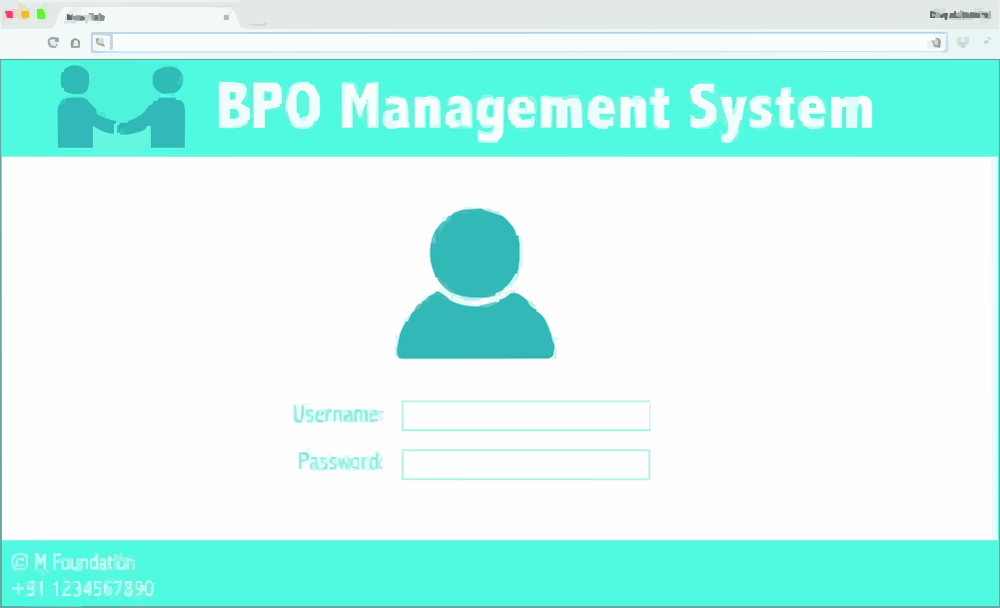

### Figure 4.2: Client Profile Upload Request

**Diagram Category**: `Architectural Figure`  
**Architectural Role**: Structural schematic detailing domain requirements and workflow transitions.

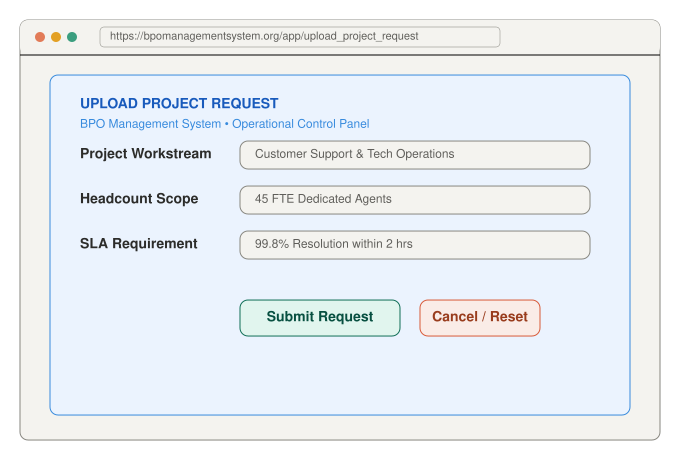

### Figure 4.3: Client Profile Current Deals

**Diagram Category**: `Architectural Figure`  
**Architectural Role**: Structural schematic detailing domain requirements and workflow transitions.

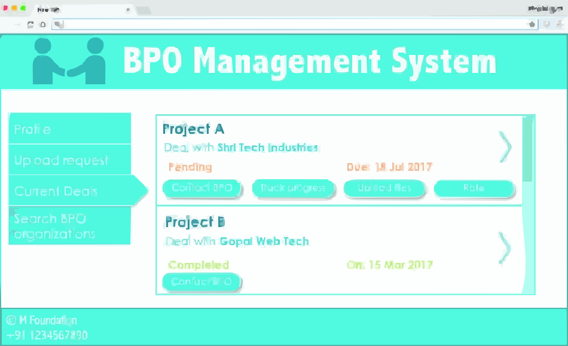

### Figure 4.4: Client Profile Search Bpo Organization

**Diagram Category**: `System Interface & Flow Schematic`  
**Architectural Role**: Depicts user interface states, administrative dashboards, or operational screen transitions.

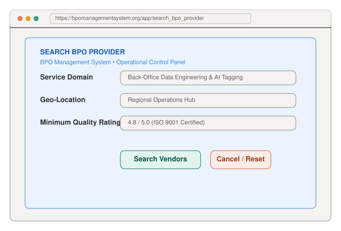

### Figure 4.5: UML Usecase Diagram

**Diagram Category**: `Use Case Diagram`  
**Architectural Role**: Specifies system boundary, primary external actors, and business use cases with include/extend relationships.

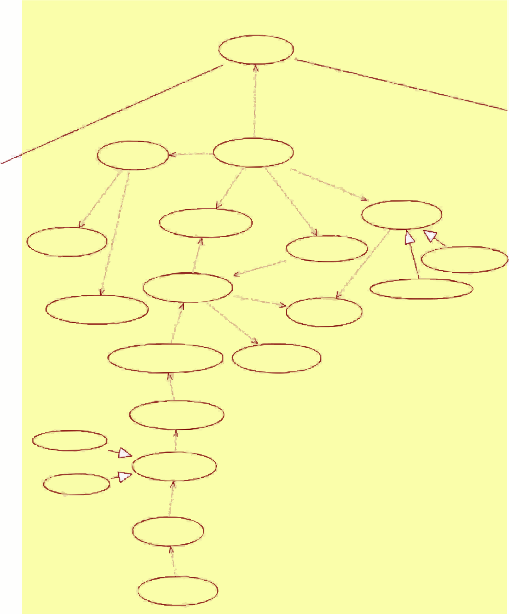

### Figure 4.6: UML Class Diagram

**Diagram Category**: `Class Diagram`  
**Architectural Role**: Models static structural classifiers, entity attributes, operations, and associations (composition, aggregation, inheritance).

### Figure 4.7: UML Activity Diagram Part 1

**Diagram Category**: `Activity Diagram`  
**Architectural Role**: Illustrates dynamic procedural workflow, decision branching, concurrent action forks, and synchronization joins.

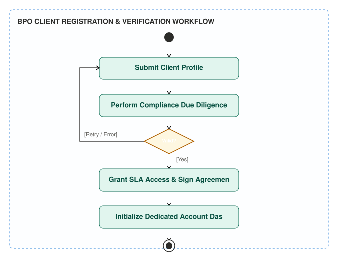

### Figure 4.8: UML Activity Diagram Part 2

**Diagram Category**: `Activity Diagram`  
**Architectural Role**: Illustrates dynamic procedural workflow, decision branching, concurrent action forks, and synchronization joins.

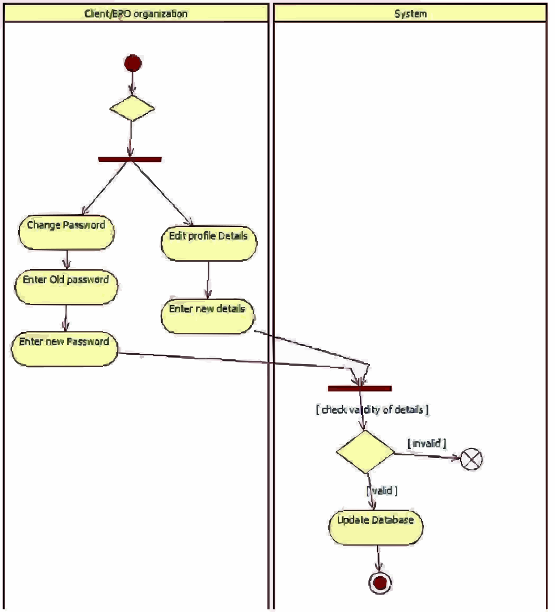

### Figure 4.9: UML Activity Diagram Part 3

**Diagram Category**: `Activity Diagram`  
**Architectural Role**: Illustrates dynamic procedural workflow, decision branching, concurrent action forks, and synchronization joins.

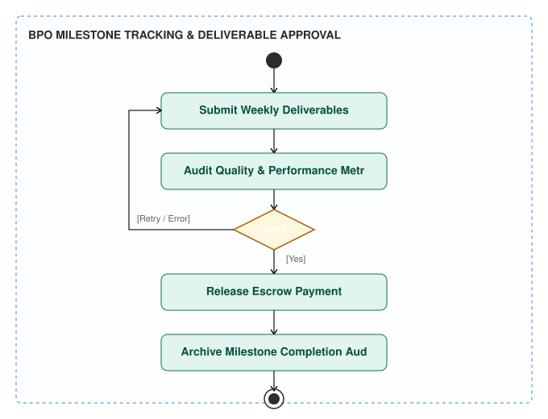

### Figure 4.10: UML Activity Diagram Part 4

**Diagram Category**: `Activity Diagram`  
**Architectural Role**: Illustrates dynamic procedural workflow, decision branching, concurrent action forks, and synchronization joins.

### Figure 4.11: UML Activity Diagram Part 5

**Diagram Category**: `Activity Diagram`  
**Architectural Role**: Illustrates dynamic procedural workflow, decision branching, concurrent action forks, and synchronization joins.

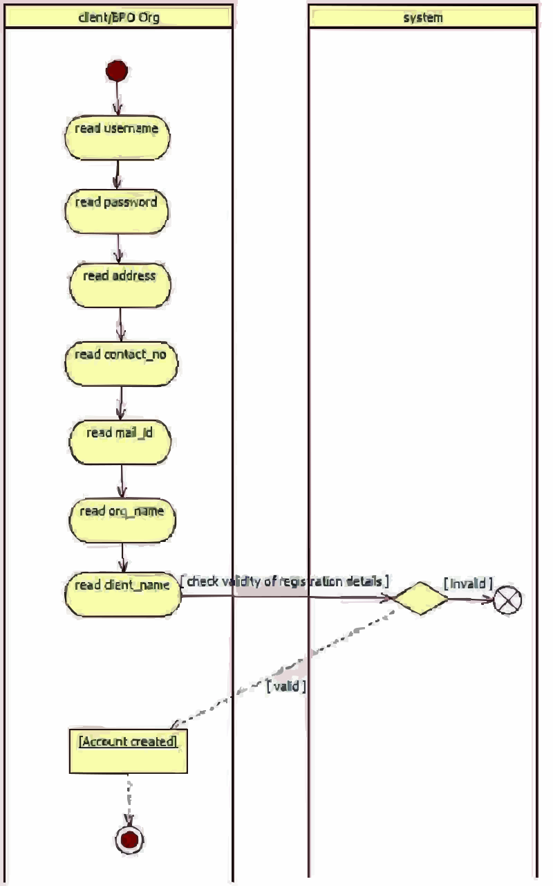

### Figure 4.12: UML Collaboration Diagram

**Diagram Category**: `Communication Diagram`  
**Architectural Role**: Emphasizes structural object topology and numbered sequence messaging between collaborating entities.

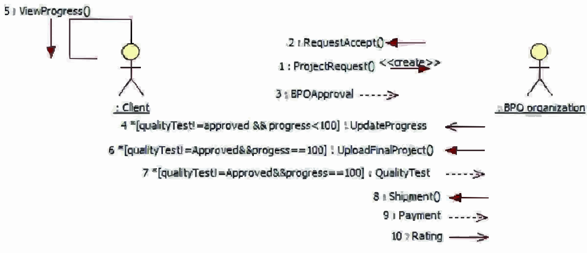

### Figure 4.13: UML Sequence Diagram

**Diagram Category**: `Sequence Diagram`  
**Architectural Role**: Details chronological object interactions, synchronous message exchanges, return flows, and activation lifelines.

### Figure 4.14: UML State Machine Diagram Part 1

**Diagram Category**: `State Machine Diagram`  
**Architectural Role**: Captures entity lifecycle states, transition triggers, event guards, and exit/entry actions.

### Figure 4.15: UML State Machine Diagram Part 2

**Diagram Category**: `State Machine Diagram`  
**Architectural Role**: Captures entity lifecycle states, transition triggers, event guards, and exit/entry actions.

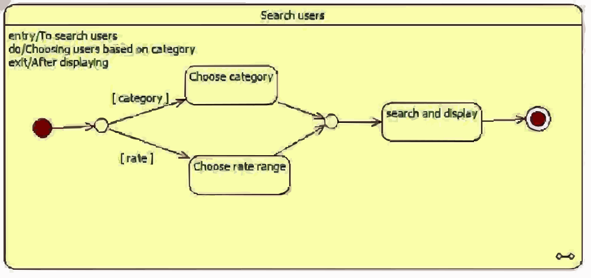

### Figure 4.16: UML State Machine Diagram Part 3

**Diagram Category**: `State Machine Diagram`  
**Architectural Role**: Captures entity lifecycle states, transition triggers, event guards, and exit/entry actions.

### Figure 4.17: UML State Machine Diagram Part 4

**Diagram Category**: `State Machine Diagram`  
**Architectural Role**: Captures entity lifecycle states, transition triggers, event guards, and exit/entry actions.

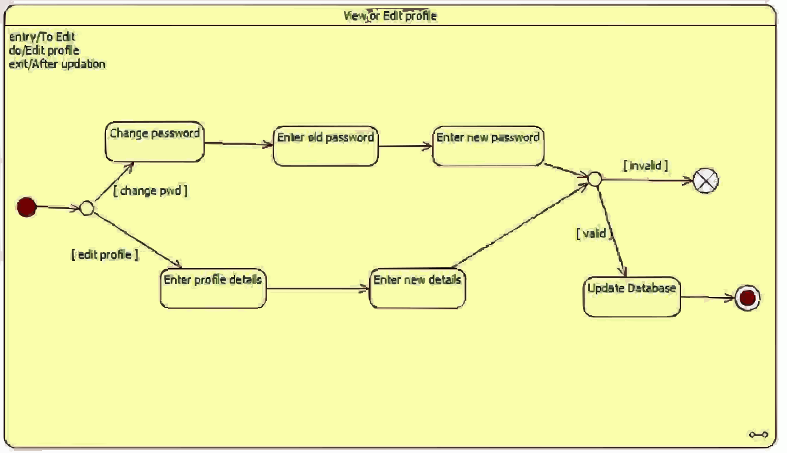

### Figure 4.18: UML Component Diagram

**Diagram Category**: `Component Diagram`  
**Architectural Role**: Architects physical modular software components, provided ball interfaces, and required socket dependencies.

### Figure 4.19: UML Deployment Diagram

**Diagram Category**: `Deployment Diagram`  
**Architectural Role**: Maps software execution artifacts to hardware computing nodes, client devices, application tiers, and database servers.

### Visual Artifacts & Supplementary Schematics

The following vector schematics capture operational screen states, user dashboards, or notation components documented in this chapter:

#### Ch04 p062 img02

#### Ch04 p062 img03

#### Ch04 p074 img01

---

## 💡 Key Architectural Invariants & Modeling Lessons

1. **Traceability**: Every software model directly corresponds to explicit functional requirements defined during the initial domain specification.
2. **Separation of Concerns**: Structural models (Class, Component, Deployment) maintain clear boundaries separating business domain entities from physical infrastructure nodes.
3. **Behavioral Integrity**: Dynamic models (Activity, Sequence, State Machine) guarantee valid state transitions, prevent deadlocks, and verify message order consistency.
4. **Deployment Fidelity**: Physical nodes and execution environments accurately map runtime middleware, database engines, and client access channels.

---

## 🔗 Related Resources & Navigation

- **Navigation**: [&larr; Chapter_03_Design_of_UML_Diagrams_for_Inventory_Management_System](Chapter_03_Design_of_UML_Diagrams_for_Inventory_Management_System.md) | [📚 Book Index](../UML_Book.md) | [Chapter_05_Design_of_UML_Diagrams_for_E_Ticketing_for_Buses &rarr;](Chapter_05_Design_of_UML_Diagrams_for_E_Ticketing_for_Buses.md)
- **Master Book Catalog**: [`UML_Book.md`](../UML_Book.md)
- **Vector Images Catalog**: [`Vector_Images_Catalog.md`](../vector_images/Vector_Images_Catalog.md)