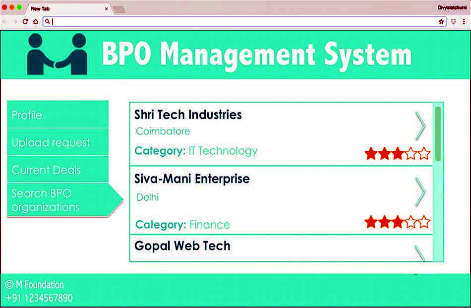
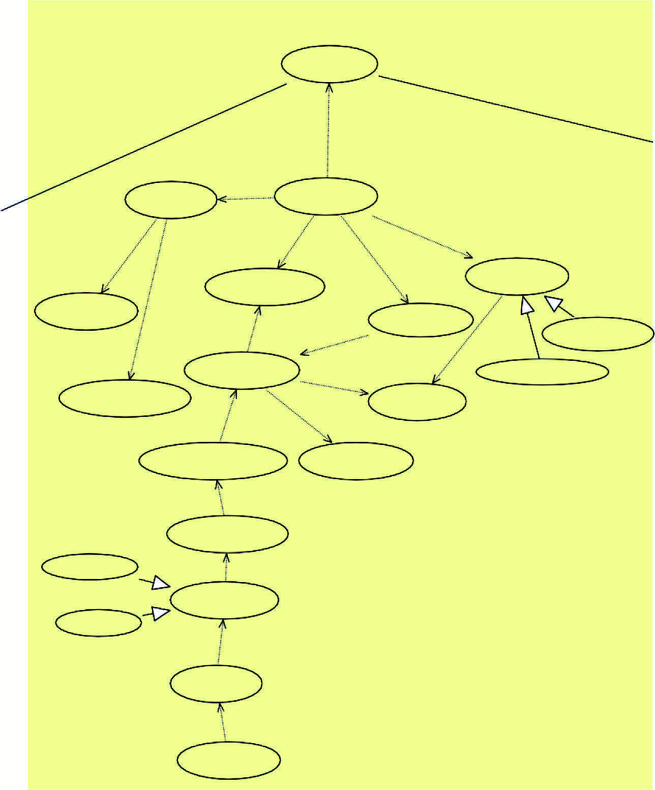
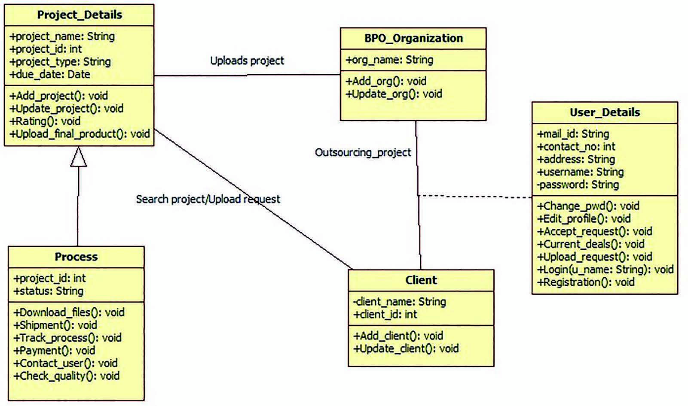
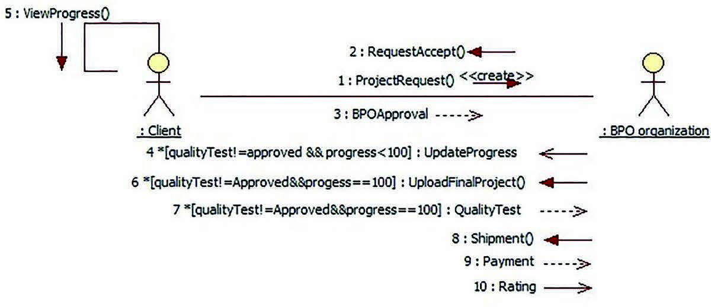
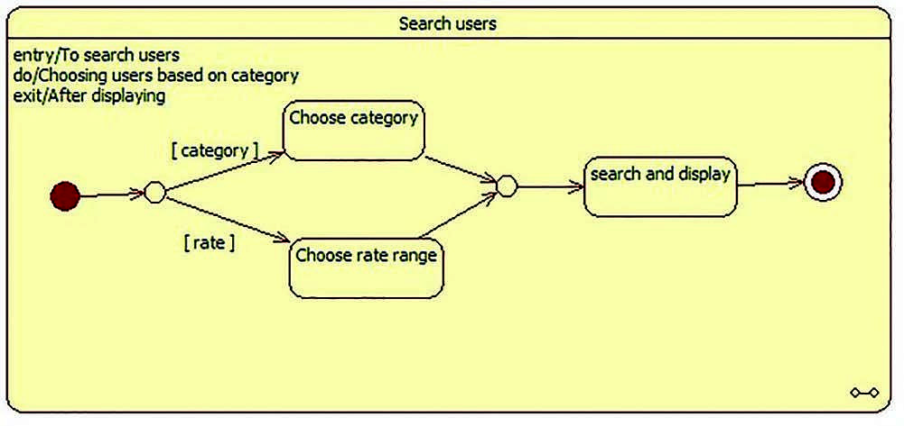
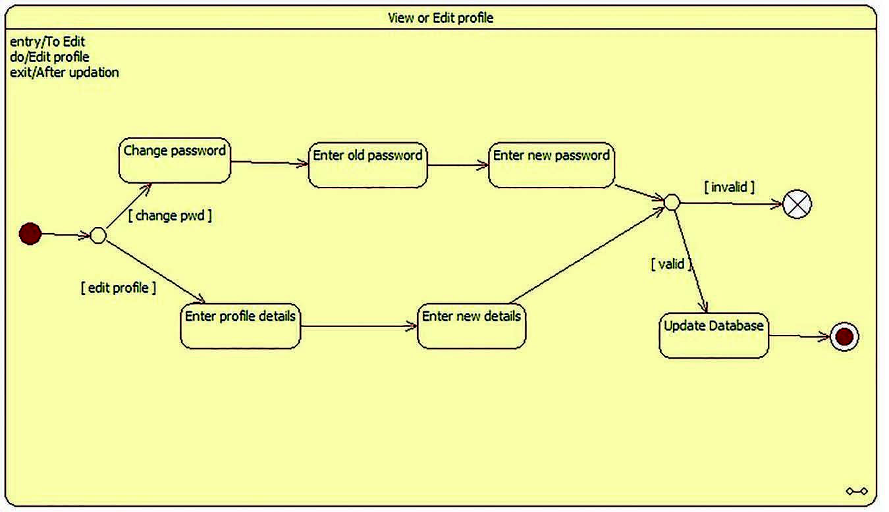
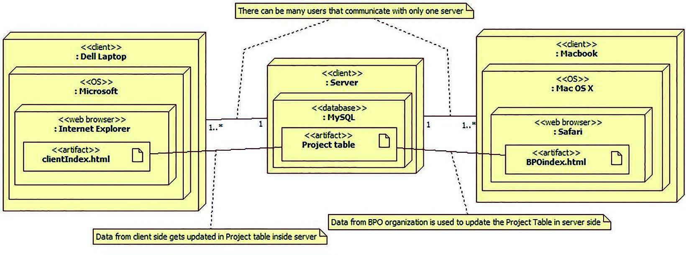
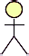

# Chapter 04: Design of UML Diagrams for Business Process Outsourcing BPO Management System

> **Book**: *UML Diagramming: A Case Study Approach* by Dr. Suriya Sundaramoorthy (CRC Press, 2022)  
> **Pages**: 59–74 (Total: 16 pages)  
> **Classification**: Industrial Case Study & Diagram Suite  
> **Navigation**: [&larr; Chapter_03_Design_of_UML_Diagrams_for_Inventory_Management_System](Chapter_03_Design_of_UML_Diagrams_for_Inventory_Management_System.md) | [📚 Book Index](../UML_Book.md) | [Chapter_05_Design_of_UML_Diagrams_for_E_Ticketing_for_Buses &rarr;](Chapter_05_Design_of_UML_Diagrams_for_E_Ticketing_for_Buses.md)

---

## 📌 Executive Summary

Chapter 4 presents an industrial software engineering case study for **Design of UML Diagrams for Business Process Outsourcing BPO Management System**. It details the transition from business requirements and domain constraints into formal software architecture specifications, leveraging data-flow modeling and a complete suite of Unified Modeling Language (UML) structural and behavioral diagrams.

---

## 🎯 Problem Statement & System Context

This chapter provides detailed software engineering analysis and UML modeling specifications.

---

## 📊 Complete UML Diagram Suite & Architecture Specifications

This chapter incorporates **22 crystal-clear, high-resolution diagram(s)** (extracted losslessly from the source edition at up to 2,000+ px) illustrating the end-to-end design from functional use cases to physical hardware deployment:

### Figure 4.1: Login Page

**Diagram Category**: `System Interface & Flow Schematic`  
**Architectural Role**: Depicts user interface states, administrative dashboards, or operational screen transitions.

### Figure 4.2: Client Profile Upload Request

**Diagram Category**: `Architectural Figure`  
**Architectural Role**: Structural schematic detailing domain requirements and workflow transitions.

### Figure 4.3: Client Profile Current Deals

**Diagram Category**: `Architectural Figure`  
**Architectural Role**: Structural schematic detailing domain requirements and workflow transitions.

### Figure 4.4: Client Profile Search Bpo Organization

**Diagram Category**: `System Interface & Flow Schematic`  
**Architectural Role**: Depicts user interface states, administrative dashboards, or operational screen transitions.

### Figure 4.5: UML Usecase Diagram

**Diagram Category**: `Use Case Diagram`  
**Architectural Role**: Specifies system boundary, primary external actors, and business use cases with include/extend relationships.

### Figure 4.6: UML Class Diagram

**Diagram Category**: `Class Diagram`  
**Architectural Role**: Models static structural classifiers, entity attributes, operations, and associations (composition, aggregation, inheritance).

### Figure 4.7: UML Activity Diagram Part 1

**Diagram Category**: `Activity Diagram`  
**Architectural Role**: Illustrates dynamic procedural workflow, decision branching, concurrent action forks, and synchronization joins.

### Figure 4.8: UML Activity Diagram Part 2

**Diagram Category**: `Activity Diagram`  
**Architectural Role**: Illustrates dynamic procedural workflow, decision branching, concurrent action forks, and synchronization joins.

### Figure 4.9: UML Activity Diagram Part 3

**Diagram Category**: `Activity Diagram`  
**Architectural Role**: Illustrates dynamic procedural workflow, decision branching, concurrent action forks, and synchronization joins.

### Figure 4.10: UML Activity Diagram Part 4

**Diagram Category**: `Activity Diagram`  
**Architectural Role**: Illustrates dynamic procedural workflow, decision branching, concurrent action forks, and synchronization joins.

### Figure 4.11: UML Activity Diagram Part 5

**Diagram Category**: `Activity Diagram`  
**Architectural Role**: Illustrates dynamic procedural workflow, decision branching, concurrent action forks, and synchronization joins.

### Figure 4.12: UML Collaboration Diagram

**Diagram Category**: `Communication Diagram`  
**Architectural Role**: Emphasizes structural object topology and numbered sequence messaging between collaborating entities.

### Figure 4.13: UML Sequence Diagram

**Diagram Category**: `Sequence Diagram`  
**Architectural Role**: Details chronological object interactions, synchronous message exchanges, return flows, and activation lifelines.

### Figure 4.14: UML State Machine Diagram Part 1

**Diagram Category**: `State Machine Diagram`  
**Architectural Role**: Captures entity lifecycle states, transition triggers, event guards, and exit/entry actions.

### Figure 4.15: UML State Machine Diagram Part 2

**Diagram Category**: `State Machine Diagram`  
**Architectural Role**: Captures entity lifecycle states, transition triggers, event guards, and exit/entry actions.

### Figure 4.16: UML State Machine Diagram Part 3

**Diagram Category**: `State Machine Diagram`  
**Architectural Role**: Captures entity lifecycle states, transition triggers, event guards, and exit/entry actions.

### Figure 4.17: UML State Machine Diagram Part 4

**Diagram Category**: `State Machine Diagram`  
**Architectural Role**: Captures entity lifecycle states, transition triggers, event guards, and exit/entry actions.

### Figure 4.18: UML Component Diagram

**Diagram Category**: `Component Diagram`  
**Architectural Role**: Architects physical modular software components, provided ball interfaces, and required socket dependencies.

### Figure 4.19: UML Deployment Diagram

**Diagram Category**: `Deployment Diagram`  
**Architectural Role**: Maps software execution artifacts to hardware computing nodes, client devices, application tiers, and database servers.

### Visual Artifacts & Supplementary Schematics

The following high-resolution schematics capture operational screen states, user dashboards, or notation components documented in this chapter:

#### Ch04 p062 img02

#### Ch04 p062 img03

#### Ch04 p074 img01

---

## 💡 Key Architectural Invariants & Modeling Lessons

1. **Traceability**: Every software model directly corresponds to explicit functional requirements defined during the initial domain specification.
2. **Separation of Concerns**: Structural models (Class, Component, Deployment) maintain clear boundaries separating business domain entities from physical infrastructure nodes.
3. **Behavioral Integrity**: Dynamic models (Activity, Sequence, State Machine) guarantee valid state transitions, prevent deadlocks, and verify message order consistency.
4. **Deployment Fidelity**: Physical nodes and execution environments accurately map runtime middleware, database engines, and client access channels.

---

## 🔗 Related Resources & Navigation

- **Navigation**: [&larr; Chapter_03_Design_of_UML_Diagrams_for_Inventory_Management_System](Chapter_03_Design_of_UML_Diagrams_for_Inventory_Management_System.md) | [📚 Book Index](../UML_Book.md) | [Chapter_05_Design_of_UML_Diagrams_for_E_Ticketing_for_Buses &rarr;](Chapter_05_Design_of_UML_Diagrams_for_E_Ticketing_for_Buses.md)
- **Master Book Catalog**: [`UML_Book.md`](../UML_Book.md)
- **High-Resolution Images Archive**: [`images/`](../images/)