# Chapter 04: Design of UML Diagrams for Business Process Outsourcing BPO Management System

> **Book**: *UML Diagramming: A Case Study Approach* by Dr. Suriya Sundaramoorthy (CRC Press, 2022)  
> **Pages**: 59–74 (Total: 16 pages)  
> **Classification**: Industrial Case Study & UML Modeling Suite  
> **Navigation**: [&larr; Chapter_03_Design_of_UML_Diagrams_for_Inventory_Management_System](Chapter_03_Design_of_UML_Diagrams_for_Inventory_Management_System.md) | [📚 Book Index](../UML_Book.md) | [Chapter_05_Design_of_UML_Diagrams_for_E_Ticketing_for_Buses &rarr;](Chapter_05_Design_of_UML_Diagrams_for_E_Ticketing_for_Buses.md)

---

## 📌 Executive Summary

Chapter 4 presents an end-to-end software engineering case study for the **Design of UML Diagrams for Business Process Outsourcing BPO Management System**. This chapter demonstrates how business requirements and domain constraints are translated into formal architectural specifications through data-flow modeling and a complete suite of Unified Modeling Language (UML) structural and behavioral models.

The case study analyzes the system from multiple architectural perspectives: identifying external user and service actors, formalizing core operational capabilities, detailing procedural business workflows, specifying domain entity schemas, and architecting modular component deployment across distributed physical infrastructure.

---

## 🎯 Problem Statement & Business Context

The proposed software will be user-friendly, so that all interactions between a BPO (Business process outsourcing) organization and clients can be done through the software. The required source documents can be easily uploaded and sent to the BPO organization and vice versa. One of the problems is the communication between the client and the BPO organization being limited to face-to-face interaction for assurance, which is costly and time-consuming. There are costs due to printing and the security of documents, which can be prevented as document are stored in digital form with high security. The system should mainly focus on providing login for the separate users (client and BPO organization), and a facility to search the other party to initiate any project agreements. Source documents can be easily uploaded, and the service provided by the BPO organization can also be uploaded for quality testing. The core motive of the software is to provide communication between the users, with the least cost. The BPO management system proves to be essential because of the over growth of the BPO segment in the present economy. This system will be crucial when organizations wish to outsource their work. It will affect the BPO organizations and the clients who wish to seek their service. If this software gets implemented, conveying information will be easier as it is through the internet.

---

## ⚙️ System Architecture & Functional Capabilities

The **Design of UML Diagrams for Business Process Outsourcing BPO Management System** decomposes business operations into modular functional units. These capabilities address the operational bottlenecks of manual and legacy workflows by introducing automated, role-based, and auditable software processes:

- **Accept Request**: It allows BPO organization to accept the request.
- **Card**: It is sub-usecase of payment, where this method can be chosen in case the client wishes to pay by card.
- **Cash**: It is sub-usecase of payment, where this method can be chosen in case the client wishes to pay by cash.
- **Change Password**: This allows you to change your password.
- **Contact User**: This provides a communication between users.
- **Current Deals**: The users are allowed to view all of their deals.
- **Edit Profile**: The users are allowed to edit their profiles.
- **Filter by Category**: This is a sub-usecase of searching users, where the users can be filtered by category (finance, etc.).
- **Filter by Rating**: This is a sub-usecase of searching users, where the users can be filtered by rating value, which ranges between 0 and 5 stars.
- **Login**: The users are allowed to login.
- **Payment**: At the end of the deal, the client should pay the BPO organization for their service, which will be provided by this functionality.
- **Profile**: The user can view their basic provided details in the profile view
- **Quality Check**: The client should be able to check the quality of the product before proceeding to payment.
- **Rating**: One user can rate the other user’s service based on their previous dealings.
- **Registration**: The user should be registered to have a profile in the system
- **Search Users**: Among the two user types, client and BPO organization, and they can search the other.
- **Shipment**: The product after payment can be shipped from the BPO organization to the client as per the client’s wish.
- **Track Progress**: The client can track the progress of their product or service that has been service.
- **Upload Request**: This allows the client to post a request
- **Upload Final Product**: It will allow the BPO organization to upload their end product/service for further procedures (quality check, payment, shipment).

---

## 📊 Complete UML Diagram Suite & Architectural Walkthrough

This chapter incorporates **22 crystal-clear, high-resolution diagram(s)** (extracted losslessly from the source edition at up to 2,000+ px) illustrating the end-to-end design from functional use cases to physical hardware deployment:

### Figure 4.1: Login Page

**Diagram Category**: `System Interface & Flow Schematic`  
**Architectural Role**: Depicts user interface states, administrative dashboards, or operational screen transitions.

**System Design Analysis**:
Illustrates practical user interaction screens and administrative interfaces for **Design of UML Diagrams for Business Process Outsourcing BPO Management System**, demonstrating how human actors interact with software controls, query forms, and reporting dashboards.

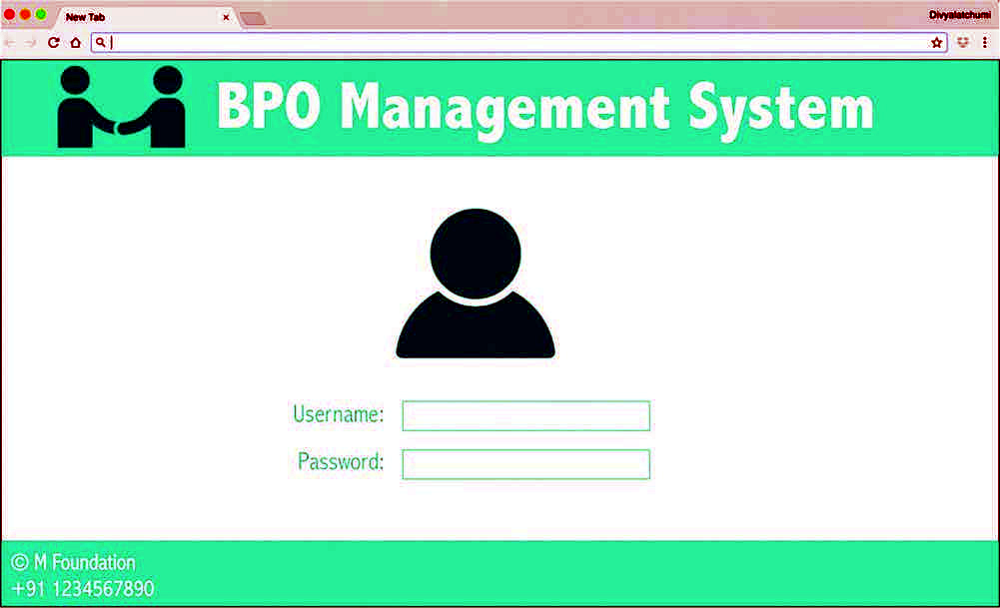

### Figure 4.2: Client Profile Upload Request

**Diagram Category**: `Architectural Figure`  
**Architectural Role**: Structural schematic detailing domain requirements and workflow transitions.

**System Design Analysis**:
Structural architectural schematic detailing operational flow and functional requirements in **Design of UML Diagrams for Business Process Outsourcing BPO Management System**.

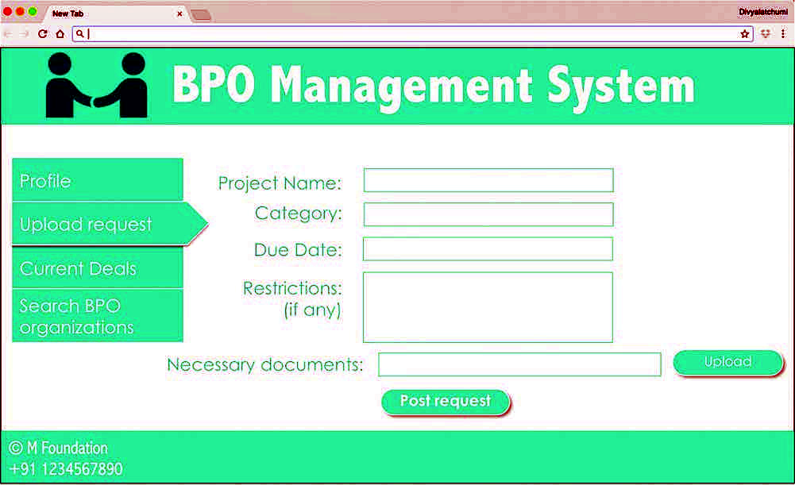

### Figure 4.3: Client Profile Current Deals

**Diagram Category**: `Architectural Figure`  
**Architectural Role**: Structural schematic detailing domain requirements and workflow transitions.

**System Design Analysis**:
Structural architectural schematic detailing operational flow and functional requirements in **Design of UML Diagrams for Business Process Outsourcing BPO Management System**.

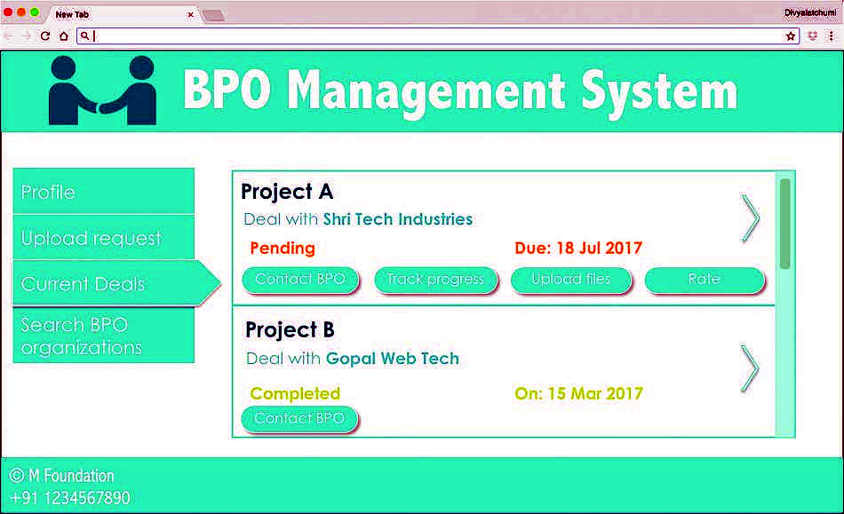

### Figure 4.4: Client Profile Search Bpo Organization

**Diagram Category**: `System Interface & Flow Schematic`  
**Architectural Role**: Depicts user interface states, administrative dashboards, or operational screen transitions.

**System Design Analysis**:
Illustrates practical user interaction screens and administrative interfaces for **Design of UML Diagrams for Business Process Outsourcing BPO Management System**, demonstrating how human actors interact with software controls, query forms, and reporting dashboards.

### Figure 4.5: UML Usecase Diagram

**Diagram Category**: `Use Case Diagram`  
**Architectural Role**: Specifies system boundary, primary external actors, and business use cases with include/extend relationships.

**System Design Analysis**:
Illustrates the functional boundary of the **Design of UML Diagrams for Business Process Outsourcing BPO Management System**. External actors trigger core use cases, demonstrating how business transactions, authorization checkpoints, and service requests flow into the system. Relationships (`<<include>>` for mandatory sub-routines like authentication and validation, and `<<extend>>` for optional or conditional exception branches) formalize the system's external functional contract.

### Figure 4.6: UML Class Diagram

**Diagram Category**: `Class Diagram`  
**Architectural Role**: Models static structural classifiers, entity attributes, operations, and associations (composition, aggregation, inheritance).

**System Design Analysis**:
Captures the static structural domain model for **Design of UML Diagrams for Business Process Outsourcing BPO Management System**. Defines primary entity classes, their private/public attributes, operational methods, and relationships. It enforces structural integrity through multiplicities, composition (strong lifecycle ownership of subsidiary records), aggregation, and inheritance hierarchies, forming the foundation for the relational database schema and domain entity classes.

### Figure 4.7: UML Activity Diagram Part 1

**Diagram Category**: `Activity Diagram`  
**Architectural Role**: Illustrates dynamic procedural workflow, decision branching, concurrent action forks, and synchronization joins.

**System Design Analysis**:
Details the step-by-step procedural execution flow for core operations in **Design of UML Diagrams for Business Process Outsourcing BPO Management System**. Begins at an initial state, navigates action states, evaluates guard conditions at decision diamonds, and models parallel execution branches using fork and join synchronizations before reaching the terminal state, ensuring business workflows are deterministic and free of race conditions.

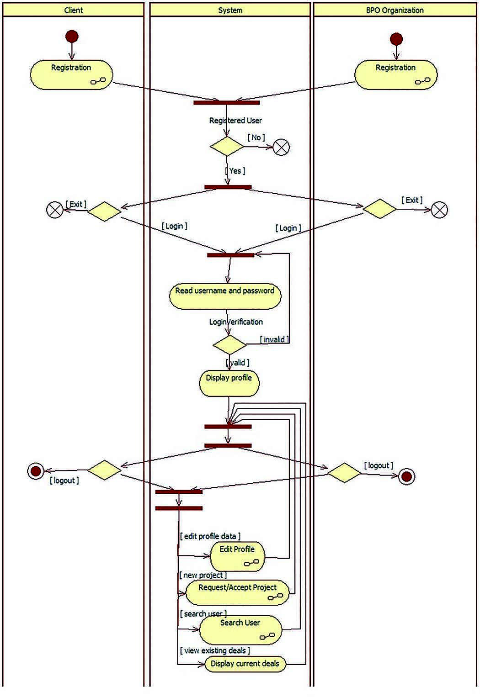

### Figure 4.8: UML Activity Diagram Part 2

**Diagram Category**: `Activity Diagram`  
**Architectural Role**: Illustrates dynamic procedural workflow, decision branching, concurrent action forks, and synchronization joins.

**System Design Analysis**:
Details the step-by-step procedural execution flow for core operations in **Design of UML Diagrams for Business Process Outsourcing BPO Management System**. Begins at an initial state, navigates action states, evaluates guard conditions at decision diamonds, and models parallel execution branches using fork and join synchronizations before reaching the terminal state, ensuring business workflows are deterministic and free of race conditions.

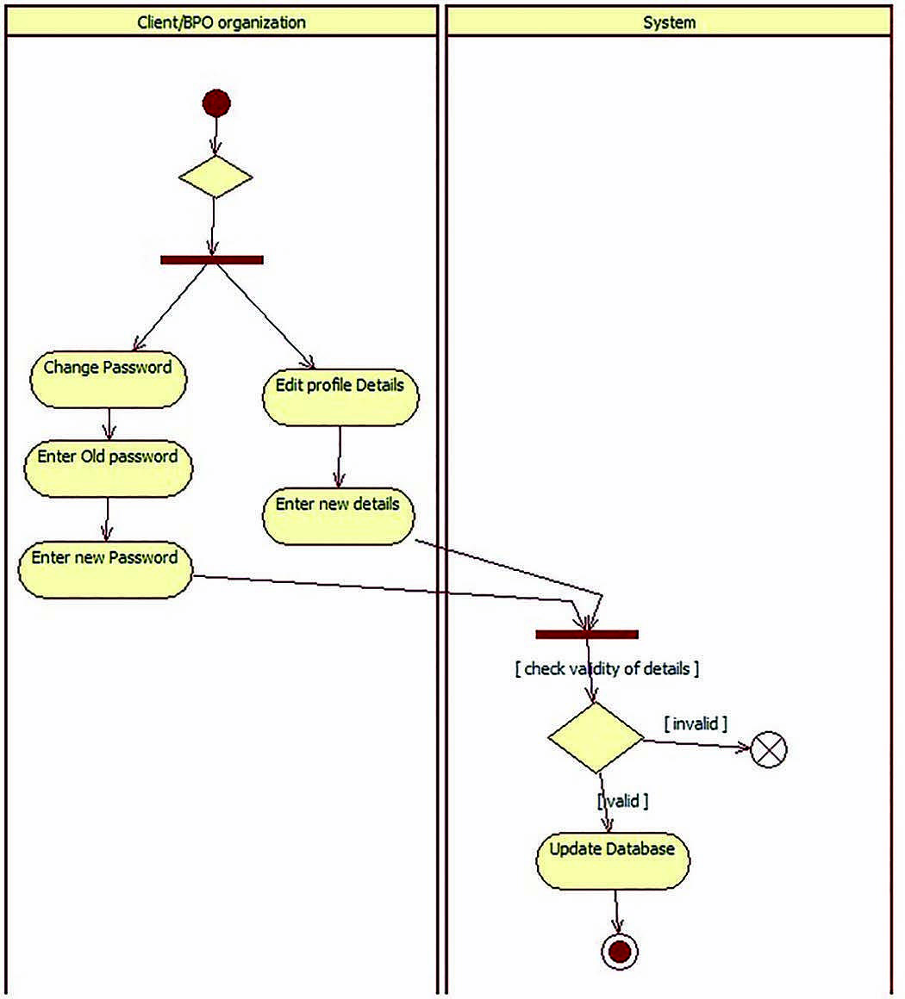

### Figure 4.9: UML Activity Diagram Part 3

**Diagram Category**: `Activity Diagram`  
**Architectural Role**: Illustrates dynamic procedural workflow, decision branching, concurrent action forks, and synchronization joins.

**System Design Analysis**:
Details the step-by-step procedural execution flow for core operations in **Design of UML Diagrams for Business Process Outsourcing BPO Management System**. Begins at an initial state, navigates action states, evaluates guard conditions at decision diamonds, and models parallel execution branches using fork and join synchronizations before reaching the terminal state, ensuring business workflows are deterministic and free of race conditions.

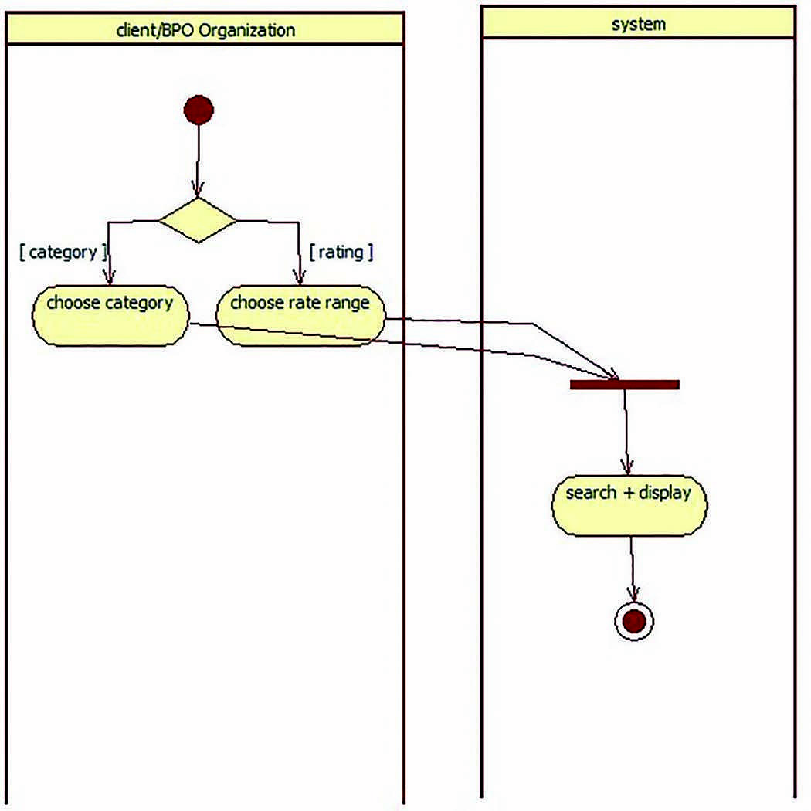

### Figure 4.10: UML Activity Diagram Part 4

**Diagram Category**: `Activity Diagram`  
**Architectural Role**: Illustrates dynamic procedural workflow, decision branching, concurrent action forks, and synchronization joins.

**System Design Analysis**:
Details the step-by-step procedural execution flow for core operations in **Design of UML Diagrams for Business Process Outsourcing BPO Management System**. Begins at an initial state, navigates action states, evaluates guard conditions at decision diamonds, and models parallel execution branches using fork and join synchronizations before reaching the terminal state, ensuring business workflows are deterministic and free of race conditions.

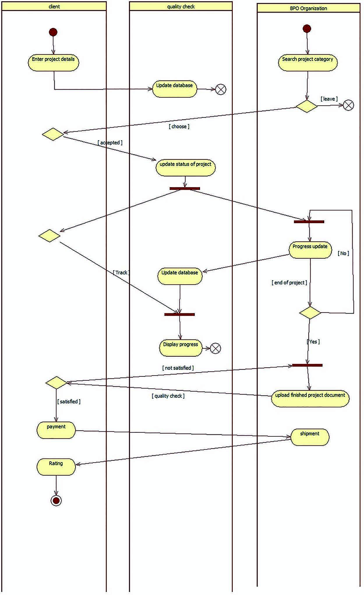

### Figure 4.11: UML Activity Diagram Part 5

**Diagram Category**: `Activity Diagram`  
**Architectural Role**: Illustrates dynamic procedural workflow, decision branching, concurrent action forks, and synchronization joins.

**System Design Analysis**:
Details the step-by-step procedural execution flow for core operations in **Design of UML Diagrams for Business Process Outsourcing BPO Management System**. Begins at an initial state, navigates action states, evaluates guard conditions at decision diamonds, and models parallel execution branches using fork and join synchronizations before reaching the terminal state, ensuring business workflows are deterministic and free of race conditions.

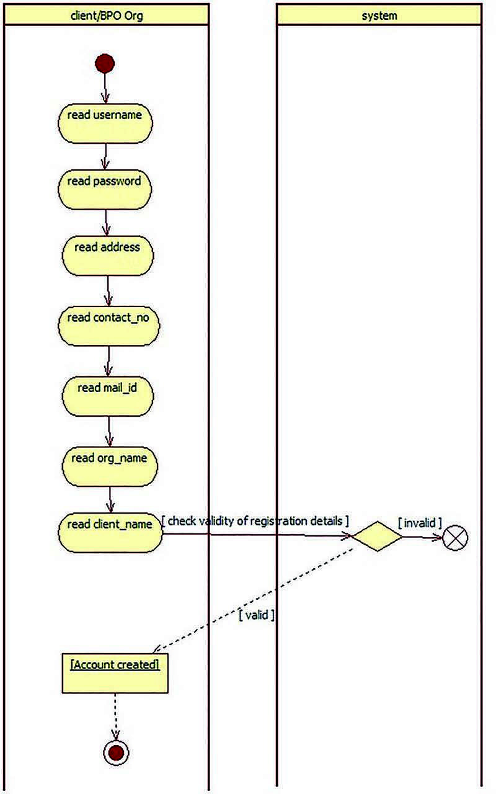

### Figure 4.12: UML Collaboration Diagram

**Diagram Category**: `Communication Diagram`  
**Architectural Role**: Emphasizes structural object topology and numbered sequence messaging between collaborating entities.

**System Design Analysis**:
Emphasizes the spatial and structural organization of collaborating instances in **Design of UML Diagrams for Business Process Outsourcing BPO Management System**. Shows object links overlaid with numbered messages (e.g., 1.0, 1.1, 2.0), illustrating both structural connectivity and invocation hierarchy, complementing the temporal perspective of the sequence diagram.

### Figure 4.13: UML Sequence Diagram

**Diagram Category**: `Sequence Diagram`  
**Architectural Role**: Details chronological object interactions, synchronous message exchanges, return flows, and activation lifelines.

**System Design Analysis**:
Traces the time-ordered message sequence between participating objects and services in **Design of UML Diagrams for Business Process Outsourcing BPO Management System**. Vertical dashed lifelines represent entity instances across time, while horizontal solid and dashed arrows show synchronous invocations, data lookups, and return values. Activation bars delineate execution duration, clarifying object collaboration during key transactional workflows.

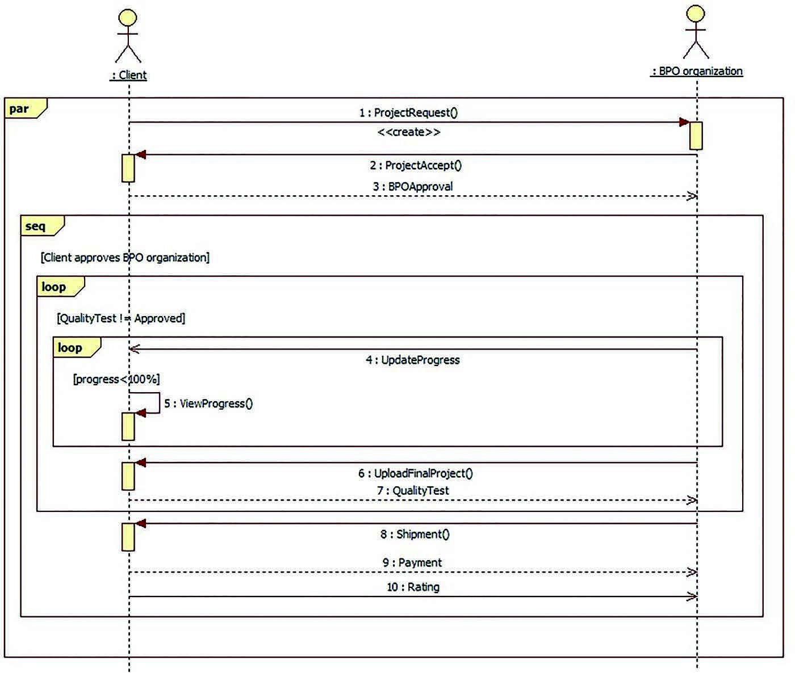

### Figure 4.14: UML State Machine Diagram Part 1

**Diagram Category**: `State Machine Diagram`  
**Architectural Role**: Captures entity lifecycle states, transition triggers, event guards, and exit/entry actions.

**System Design Analysis**:
Models the complete lifecycle state transitions for central domain entities in **Design of UML Diagrams for Business Process Outsourcing BPO Management System**. Tracks transitions from initial creation through intermediate processing states to completion or cancellation. Explicit state triggers, guard expressions `[condition]`, and entry/exit actions guarantee valid business lifecycle states and eliminate invalid operational state jumps.

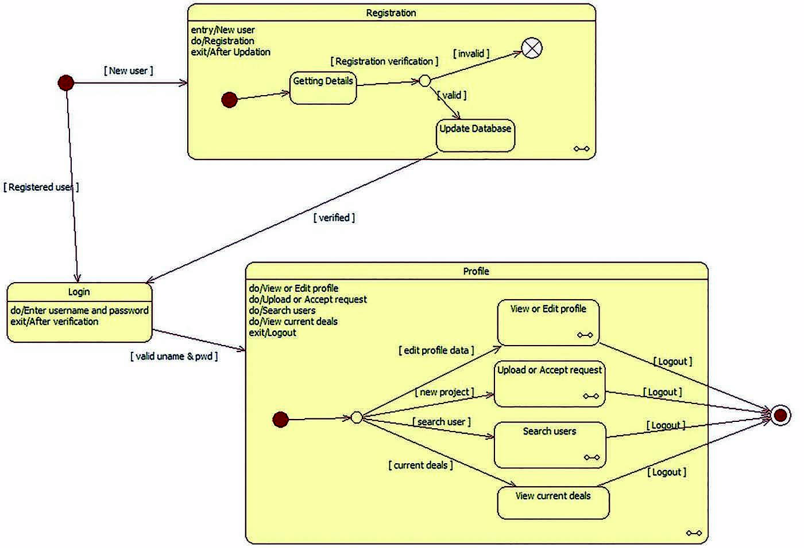

### Figure 4.15: UML State Machine Diagram Part 2

**Diagram Category**: `State Machine Diagram`  
**Architectural Role**: Captures entity lifecycle states, transition triggers, event guards, and exit/entry actions.

**System Design Analysis**:
Models the complete lifecycle state transitions for central domain entities in **Design of UML Diagrams for Business Process Outsourcing BPO Management System**. Tracks transitions from initial creation through intermediate processing states to completion or cancellation. Explicit state triggers, guard expressions `[condition]`, and entry/exit actions guarantee valid business lifecycle states and eliminate invalid operational state jumps.

### Figure 4.16: UML State Machine Diagram Part 3

**Diagram Category**: `State Machine Diagram`  
**Architectural Role**: Captures entity lifecycle states, transition triggers, event guards, and exit/entry actions.

**System Design Analysis**:
Models the complete lifecycle state transitions for central domain entities in **Design of UML Diagrams for Business Process Outsourcing BPO Management System**. Tracks transitions from initial creation through intermediate processing states to completion or cancellation. Explicit state triggers, guard expressions `[condition]`, and entry/exit actions guarantee valid business lifecycle states and eliminate invalid operational state jumps.

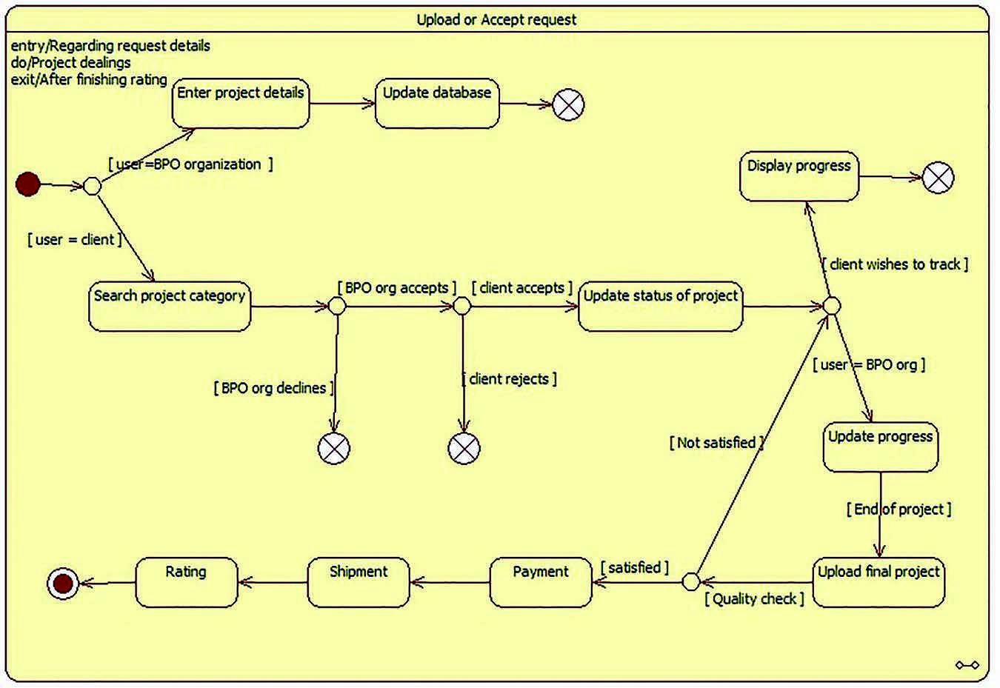

### Figure 4.17: UML State Machine Diagram Part 4

**Diagram Category**: `State Machine Diagram`  
**Architectural Role**: Captures entity lifecycle states, transition triggers, event guards, and exit/entry actions.

**System Design Analysis**:
Models the complete lifecycle state transitions for central domain entities in **Design of UML Diagrams for Business Process Outsourcing BPO Management System**. Tracks transitions from initial creation through intermediate processing states to completion or cancellation. Explicit state triggers, guard expressions `[condition]`, and entry/exit actions guarantee valid business lifecycle states and eliminate invalid operational state jumps.

### Figure 4.18: UML Component Diagram

**Diagram Category**: `Component Diagram`  
**Architectural Role**: Architects physical modular software components, provided ball interfaces, and required socket dependencies.

**System Design Analysis**:
Architects the modular software organization for **Design of UML Diagrams for Business Process Outsourcing BPO Management System**. Illustrates autonomous subsystems, business logic controllers, database access layers, and external service adapters. Provided interfaces (ball notation) and required dependencies (socket notation) define clear service contracts, supporting high cohesion and loose coupling.

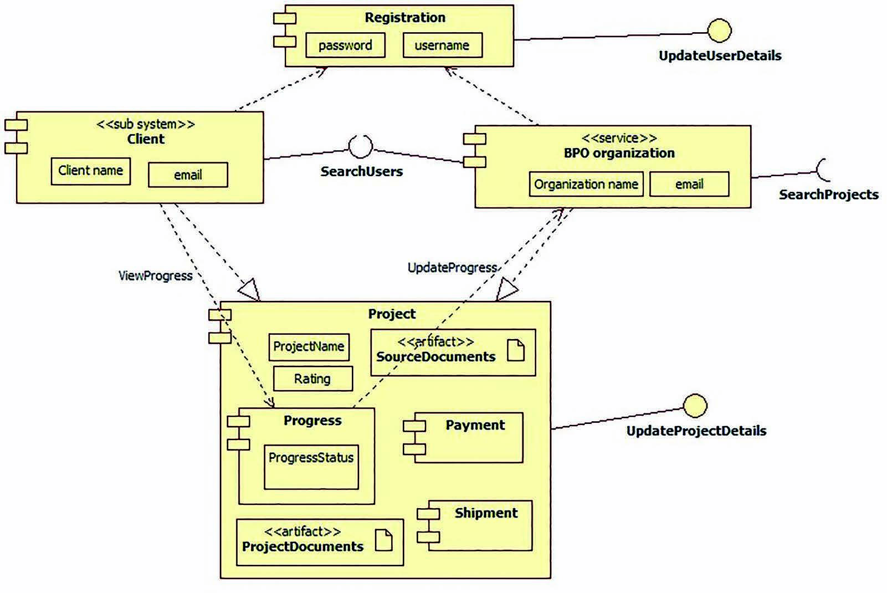

### Figure 4.19: UML Deployment Diagram

**Diagram Category**: `Deployment Diagram`  
**Architectural Role**: Maps software execution artifacts to hardware computing nodes, client devices, application tiers, and database servers.

**System Design Analysis**:
Maps the physical runtime deployment architecture for **Design of UML Diagrams for Business Process Outsourcing BPO Management System**. Depicts client hardware devices (web browsers, mobile apps), application servers, network firewalls, and persistence database nodes. Communication paths and execution environments reflect production infrastructure, scalability considerations, and network security boundaries.

### Visual Artifacts & Supplementary Schematics

The following high-resolution schematics capture operational screen states, user dashboards, or notation components documented in this chapter:

#### Ch04 p062 img02

**Perspective**: `Conceptual Notation / Architecture Asset` — Supplemental conceptual illustration or notation reference from the source chapter.

#### Ch04 p062 img03

**Perspective**: `Conceptual Notation / Architecture Asset` — Supplemental conceptual illustration or notation reference from the source chapter.

#### Ch04 p074 img01

**Perspective**: `Conceptual Notation / Architecture Asset` — Supplemental conceptual illustration or notation reference from the source chapter.

---

## 💡 Key Architectural Invariants & Domain Lessons

1. **Requirement Traceability**: Every model in the **Design of UML Diagrams for Business Process Outsourcing BPO Management System** suite traces directly to business requirements and operational constraints established in the problem statement.
2. **State & Workflow Integrity**: Dynamic activity and sequence models guarantee deterministic workflow completion, enforce transactional atomicity, and prevent deadlocks.
3. **Modular Encapsulation**: Component boundaries decouple domain business logic from presentation controllers and external integration adapters, supporting high maintainability.
4. **Operational Security & RBAC**: Strict role-based authorization guards sensitive operations across external actor boundaries and administrative lifelines.
5. **High-Fidelity Deployment**: Physical node topologies reflect real-world tiered infrastructure (DMZ, application cluster, isolated persistence layer), ensuring scalability and fault tolerance.

---

## 🔗 Related Resources & Navigation

- **Navigation**: [&larr; Chapter_03_Design_of_UML_Diagrams_for_Inventory_Management_System](Chapter_03_Design_of_UML_Diagrams_for_Inventory_Management_System.md) | [📚 Book Index](../UML_Book.md) | [Chapter_05_Design_of_UML_Diagrams_for_E_Ticketing_for_Buses &rarr;](Chapter_05_Design_of_UML_Diagrams_for_E_Ticketing_for_Buses.md)
- **Master Book Catalog**: [`UML_Book.md`](../UML_Book.md)
- **High-Resolution Images Archive**: [`images/`](../images/)