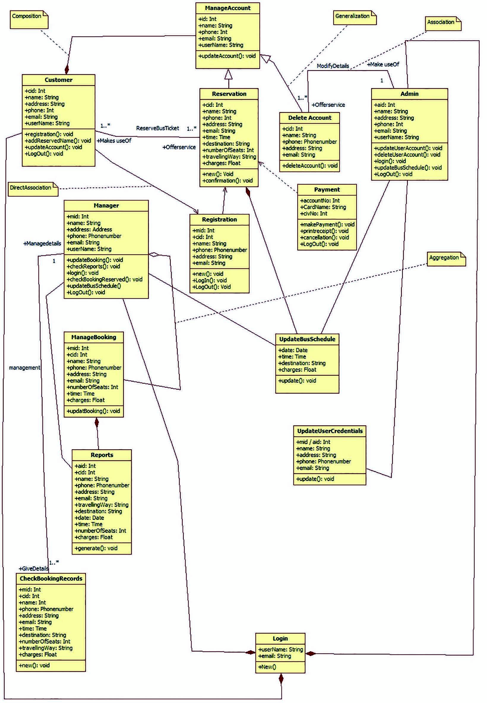
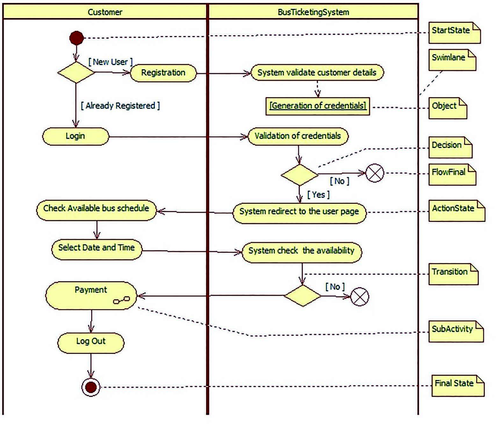
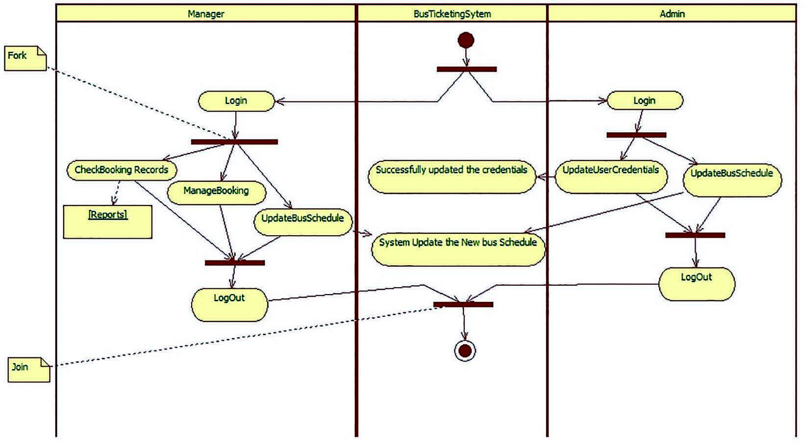
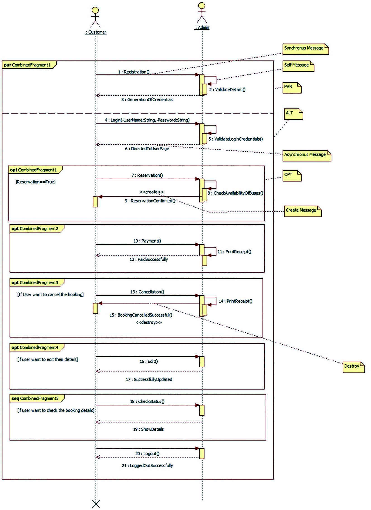
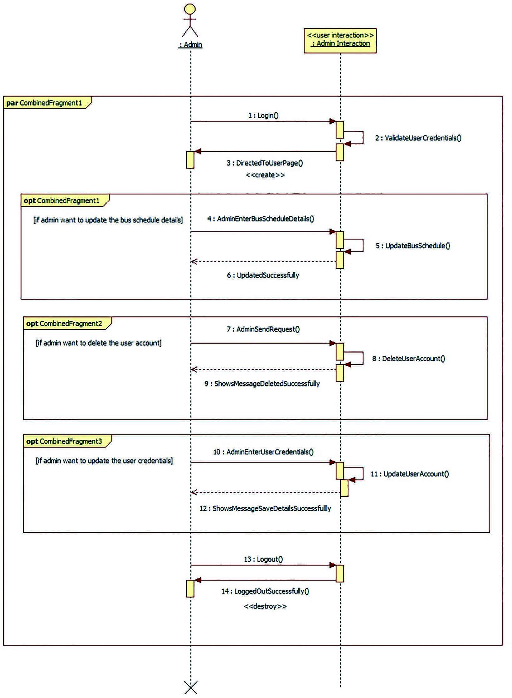
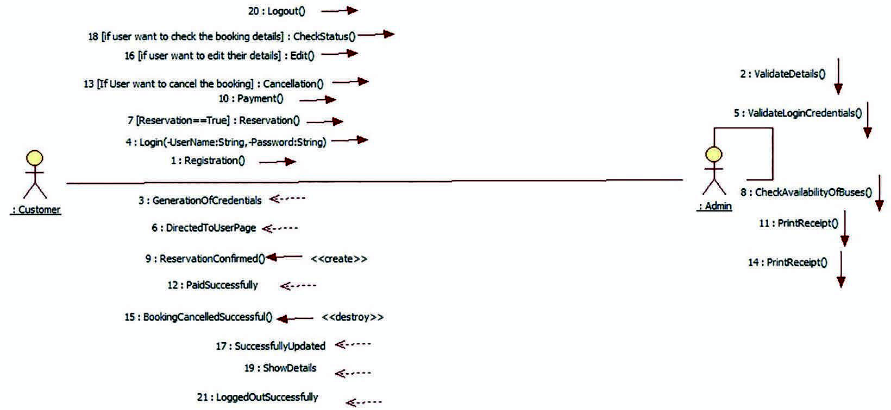
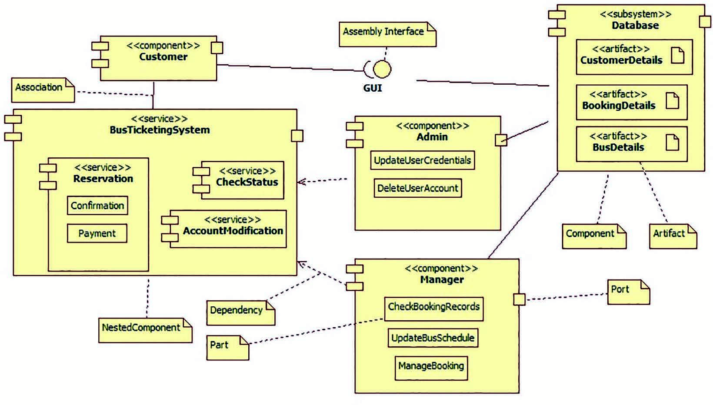
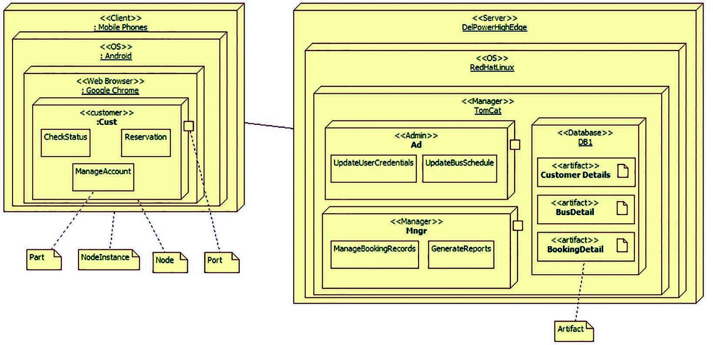
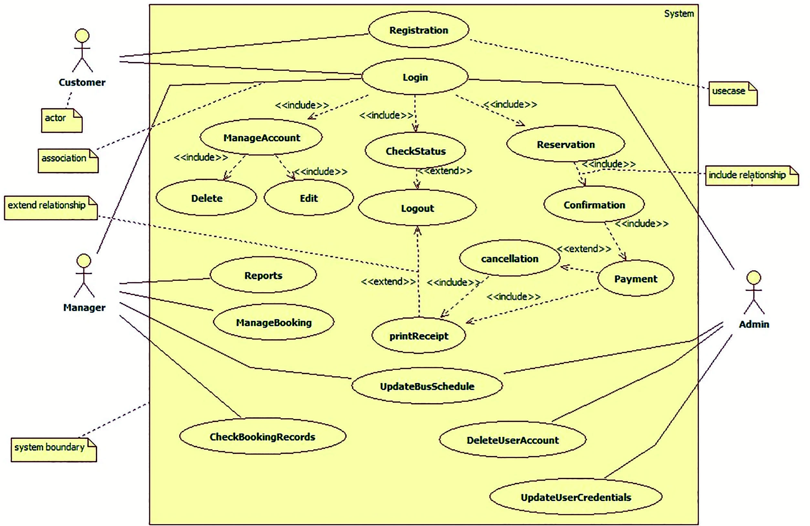
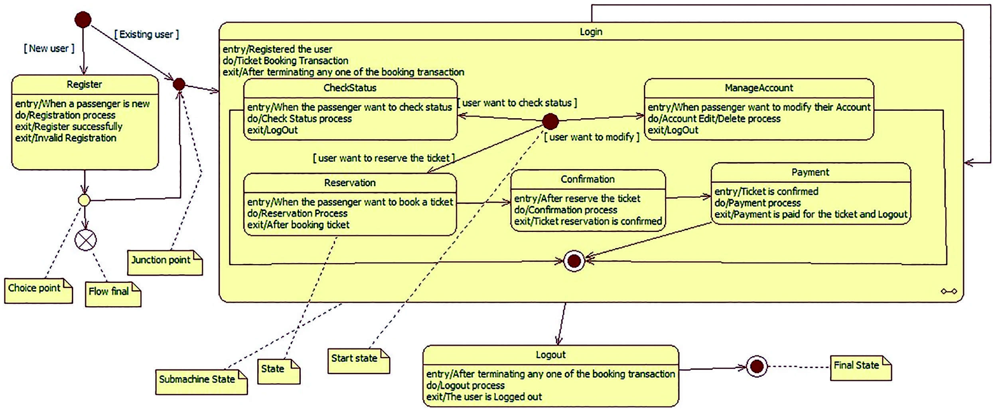

# Chapter 05: Design of UML Diagrams for E Ticketing for Buses

> **Book**: *UML Diagramming: A Case Study Approach* by Dr. Suriya Sundaramoorthy (CRC Press, 2022)  
> **Pages**: 75–84 (Total: 10 pages)  
> **Classification**: Industrial Case Study & UML Modeling Suite  
> **Navigation**: [&larr; Chapter_04_Design_of_UML_Diagrams_for_Business_Process_Outsourcing_BPO_Management_System](Chapter_04_Design_of_UML_Diagrams_for_Business_Process_Outsourcing_BPO_Management_System.md) | [📚 Book Index](../UML_Book.md) | [Chapter_06_Design_of_UML_Diagrams_for_Weather_Monitoring_System &rarr;](Chapter_06_Design_of_UML_Diagrams_for_Weather_Monitoring_System.md)

---

## 📌 Executive Summary

Chapter 5 presents an end-to-end software engineering case study for the **Design of UML Diagrams for E Ticketing for Buses**. This chapter demonstrates how business requirements and domain constraints are translated into formal architectural specifications through data-flow modeling and a complete suite of Unified Modeling Language (UML) structural and behavioral models.

The case study analyzes the system from multiple architectural perspectives: identifying external user and service actors, formalizing core operational capabilities, detailing procedural business workflows, specifying domain entity schemas, and architecting modular component deployment across distributed physical infrastructure.

---

## 🎯 Problem Statement & Business Context

In this case study, a software package to automate the manual procedures of reserving a bus ticket is made through Software Maintenance and Development Center (SMDC) Travels. Specifically, the objectives of this case study consist of providing a web-based bus ticket reservation function where a customer can buy a bus ticket through the online system without a need to queue up at the counter to purchase a bus ticket, enabling customers to check the availability and types of buses online. Customer can check the time departure for every Indian Tourist Centre (ITC) bus through the system, easing bus ticket payment by obtaining a bank pin after payments is made to the various designated banks, the ability of customers to cancel their reservation, admin user privileges in updating and cancelling payment, route and vehicle records (Figures 5.1–5.11).

---

## ⚙️ System Architecture & Functional Capabilities

The **Design of UML Diagrams for E Ticketing for Buses** decomposes business operations into modular functional units. These capabilities address the operational bottlenecks of manual and legacy workflows by introducing automated, role-based, and auditable software processes:

- **Online Ticket Reservation**: Enables customers to search bus availability, choose seating, and reserve tickets online without queuing at physical terminals.
- **Bus Schedule & Route Lookup**: Provides real-time departure schedules, bus types (AC, Sleeper, Deluxe), and route details for Indian Tourist Centre (ITC) operations.
- **Payment & Bank PIN Issuance**: Facilitates online payment reconciliation across designated partner banks and issues unique transaction verification PINs.
- **Reservation Cancellation & Refunds**: Allows passengers to cancel existing bookings, calculate refund deductions according to travel policies, and release seats back to inventory.
- **Fleet & Route Administration**: Equips SMDC travel administrators with privileges to update bus schedules, modify fare tariffs, cancel routes, and inspect passenger manifests.

---

## 📊 Complete UML Diagram Suite & Architectural Walkthrough

This chapter incorporates **12 crystal-clear, high-resolution diagram(s)** (extracted losslessly from the source edition at up to 2,000+ px) illustrating the end-to-end design from functional use cases to physical hardware deployment:

### Figure 5.2: UML Class Diagram

**Diagram Category**: `Class Diagram`  
**Architectural Role**: Models static structural classifiers, entity attributes, operations, and associations (composition, aggregation, inheritance).

**System Design Analysis**:
Captures the static structural domain model for **Design of UML Diagrams for E Ticketing for Buses**. Defines primary entity classes, their private/public attributes, operational methods, and relationships. It enforces structural integrity through multiplicities, composition (strong lifecycle ownership of subsidiary records), aggregation, and inheritance hierarchies, forming the foundation for the relational database schema and domain entity classes.

### Figure 5.3: UML Activity Diagram Part 1

**Diagram Category**: `Activity Diagram`  
**Architectural Role**: Illustrates dynamic procedural workflow, decision branching, concurrent action forks, and synchronization joins.

**System Design Analysis**:
Details the step-by-step procedural execution flow for core operations in **Design of UML Diagrams for E Ticketing for Buses**. Begins at an initial state, navigates action states, evaluates guard conditions at decision diamonds, and models parallel execution branches using fork and join synchronizations before reaching the terminal state, ensuring business workflows are deterministic and free of race conditions.

### Figure 5.4: UML Activity Diagram Part 2

**Diagram Category**: `Activity Diagram`  
**Architectural Role**: Illustrates dynamic procedural workflow, decision branching, concurrent action forks, and synchronization joins.

**System Design Analysis**:
Details the step-by-step procedural execution flow for core operations in **Design of UML Diagrams for E Ticketing for Buses**. Begins at an initial state, navigates action states, evaluates guard conditions at decision diamonds, and models parallel execution branches using fork and join synchronizations before reaching the terminal state, ensuring business workflows are deterministic and free of race conditions.

### Figure 5.6: UML Sequence Diagram Part 1

**Diagram Category**: `Sequence Diagram`  
**Architectural Role**: Details chronological object interactions, synchronous message exchanges, return flows, and activation lifelines.

**System Design Analysis**:
Traces the time-ordered message sequence between participating objects and services in **Design of UML Diagrams for E Ticketing for Buses**. Vertical dashed lifelines represent entity instances across time, while horizontal solid and dashed arrows show synchronous invocations, data lookups, and return values. Activation bars delineate execution duration, clarifying object collaboration during key transactional workflows.

### Figure 5.7: UML Sequence Diagram Part 2

**Diagram Category**: `Sequence Diagram`  
**Architectural Role**: Details chronological object interactions, synchronous message exchanges, return flows, and activation lifelines.

**System Design Analysis**:
Traces the time-ordered message sequence between participating objects and services in **Design of UML Diagrams for E Ticketing for Buses**. Vertical dashed lifelines represent entity instances across time, while horizontal solid and dashed arrows show synchronous invocations, data lookups, and return values. Activation bars delineate execution duration, clarifying object collaboration during key transactional workflows.

### Figure 5.8: UML Collaboration Diagram Part 1

**Diagram Category**: `Communication Diagram`  
**Architectural Role**: Emphasizes structural object topology and numbered sequence messaging between collaborating entities.

**System Design Analysis**:
Emphasizes the spatial and structural organization of collaborating instances in **Design of UML Diagrams for E Ticketing for Buses**. Shows object links overlaid with numbered messages (e.g., 1.0, 1.1, 2.0), illustrating both structural connectivity and invocation hierarchy, complementing the temporal perspective of the sequence diagram.

### Figure 5.9: UML Collaboration Diagram Part 2

**Diagram Category**: `Communication Diagram`  
**Architectural Role**: Emphasizes structural object topology and numbered sequence messaging between collaborating entities.

**System Design Analysis**:
Emphasizes the spatial and structural organization of collaborating instances in **Design of UML Diagrams for E Ticketing for Buses**. Shows object links overlaid with numbered messages (e.g., 1.0, 1.1, 2.0), illustrating both structural connectivity and invocation hierarchy, complementing the temporal perspective of the sequence diagram.

### Figure 5.10: UML Component Diagram

**Diagram Category**: `Component Diagram`  
**Architectural Role**: Architects physical modular software components, provided ball interfaces, and required socket dependencies.

**System Design Analysis**:
Architects the modular software organization for **Design of UML Diagrams for E Ticketing for Buses**. Illustrates autonomous subsystems, business logic controllers, database access layers, and external service adapters. Provided interfaces (ball notation) and required dependencies (socket notation) define clear service contracts, supporting high cohesion and loose coupling.

### Figure 5.11: UML Deployment Diagram

**Diagram Category**: `Deployment Diagram`  
**Architectural Role**: Maps software execution artifacts to hardware computing nodes, client devices, application tiers, and database servers.

**System Design Analysis**:
Maps the physical runtime deployment architecture for **Design of UML Diagrams for E Ticketing for Buses**. Depicts client hardware devices (web browsers, mobile apps), application servers, network firewalls, and persistence database nodes. Communication paths and execution environments reflect production infrastructure, scalability considerations, and network security boundaries.

### Visual Artifacts & Supplementary Schematics

The following high-resolution schematics capture operational screen states, user dashboards, or notation components documented in this chapter:

#### Ch05 p076 img01

**Perspective**: `Conceptual Notation / Architecture Asset` — Supplemental conceptual illustration or notation reference from the source chapter.

#### Ch05 p079 img01

**Perspective**: `Conceptual Notation / Architecture Asset` — Supplemental conceptual illustration or notation reference from the source chapter.

#### Ch05 p084 img01

**Perspective**: `Conceptual Notation / Architecture Asset` — Supplemental conceptual illustration or notation reference from the source chapter.

---

## 💡 Key Architectural Invariants & Domain Lessons

1. **Requirement Traceability**: Every model in the **Design of UML Diagrams for E Ticketing for Buses** suite traces directly to business requirements and operational constraints established in the problem statement.
2. **State & Workflow Integrity**: Dynamic activity and sequence models guarantee deterministic workflow completion, enforce transactional atomicity, and prevent deadlocks.
3. **Modular Encapsulation**: Component boundaries decouple domain business logic from presentation controllers and external integration adapters, supporting high maintainability.
4. **Operational Security & RBAC**: Strict role-based authorization guards sensitive operations across external actor boundaries and administrative lifelines.
5. **High-Fidelity Deployment**: Physical node topologies reflect real-world tiered infrastructure (DMZ, application cluster, isolated persistence layer), ensuring scalability and fault tolerance.

---

## 🔗 Related Resources & Navigation

- **Navigation**: [&larr; Chapter_04_Design_of_UML_Diagrams_for_Business_Process_Outsourcing_BPO_Management_System](Chapter_04_Design_of_UML_Diagrams_for_Business_Process_Outsourcing_BPO_Management_System.md) | [📚 Book Index](../UML_Book.md) | [Chapter_06_Design_of_UML_Diagrams_for_Weather_Monitoring_System &rarr;](Chapter_06_Design_of_UML_Diagrams_for_Weather_Monitoring_System.md)
- **Master Book Catalog**: [`UML_Book.md`](../UML_Book.md)
- **High-Resolution Images Archive**: [`images/`](../images/)