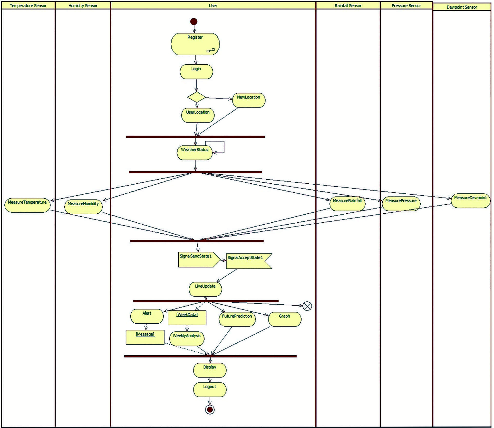
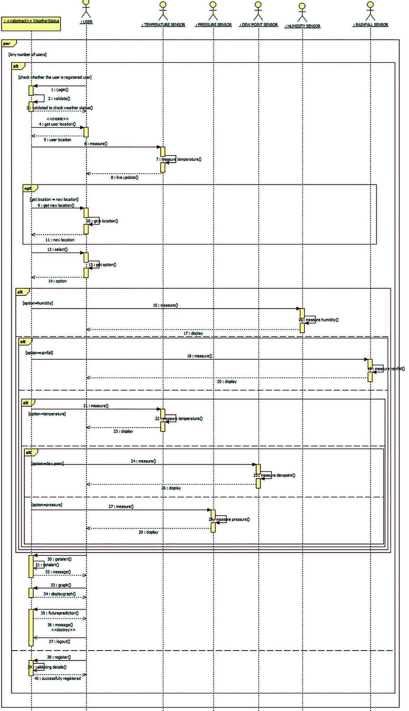
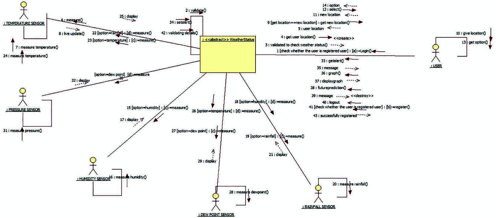
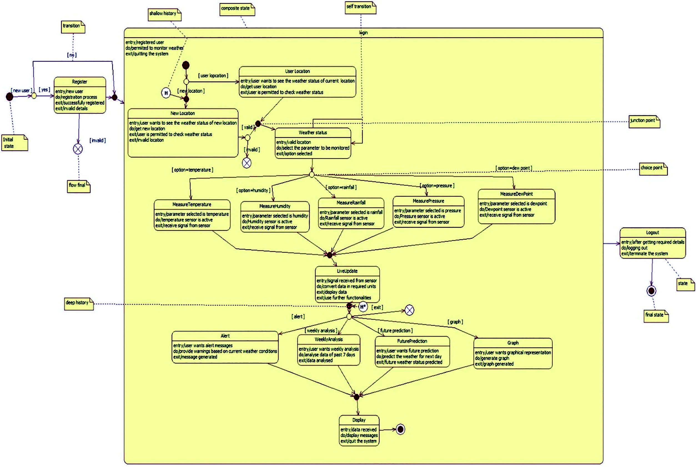

# Chapter 06: Design of UML Diagrams for Weather Monitoring System

> **Book**: *UML Diagramming: A Case Study Approach* by Dr. Suriya Sundaramoorthy (CRC Press, 2022)  
> **Pages**: 85–94 (Total: 10 pages)  
> **Classification**: Industrial Case Study & UML Modeling Suite  
> **Navigation**: [&larr; Chapter_05_Design_of_UML_Diagrams_for_E_Ticketing_for_Buses](Chapter_05_Design_of_UML_Diagrams_for_E_Ticketing_for_Buses.md) | [📚 Book Index](../UML_Book.md) | [Chapter_07_Design_of_UML_Diagrams_for_E_Province &rarr;](Chapter_07_Design_of_UML_Diagrams_for_E_Province.md)

---

## 📌 Executive Summary

Chapter 6 presents an end-to-end software engineering case study for the **Design of UML Diagrams for Weather Monitoring System**. This chapter demonstrates how business requirements and domain constraints are translated into formal architectural specifications through data-flow modeling and a complete suite of Unified Modeling Language (UML) structural and behavioral models.

The case study analyzes the system from multiple architectural perspectives: identifying external user and service actors, formalizing core operational capabilities, detailing procedural business workflows, specifying domain entity schemas, and architecting modular component deployment across distributed physical infrastructure.

---

## 🎯 Problem Statement & Business Context

This Weather Monitoring Case study allows people to directly check the weather status online. The functionalities are Weather Status, Live Updating, Alert, Graphical Representation, Future Prediction and Weekly. Weather Status – With this function, temperature, humidity, rainfall, pressure and dew point are measured using sensors. Live Updating – Data are live updated to be viewed by the user. Alert – This functionality provides tips and alerts to the user on certain weather conditions. Graphical Representation – Plotting of graphs based on variations in temperature for easier analysis. Future Prediction – This functionality helps in predicting the weather for the next few days. Weekly Analysis – Displaying the average, the highest and lowest temperature of the week. The final goal is to provide detailed weather conditions for the user based on his/her location (Figures 6.1 and 6.2).

---

## ⚙️ System Architecture & Functional Capabilities

The **Design of UML Diagrams for Weather Monitoring System** decomposes business operations into modular functional units. These capabilities address the operational bottlenecks of manual and legacy workflows by introducing automated, role-based, and auditable software processes:

- **Weather Status**: With this function, temperature, humidity, rainfall, pressure and dew point are measured using sensors.
- **Live Updating**: Data are live updated to be viewed by the user.
- **Alert**: This functionality provides tips and alerts to the user on certain weather conditions.
- **Graphical Representation**: Plotting of graphs based on variations in temperature for easier analysis.
- **Future Prediction**: This functionality helps in predicting the weather for the next few days.
- **Weekly

Analysis**: Displaying the average, the highest and lowest temperature of the week.

---

## 📊 Complete UML Diagram Suite & Architectural Walkthrough

This chapter incorporates **9 crystal-clear, high-resolution diagram(s)** (extracted losslessly from the source edition at up to 2,000+ px) illustrating the end-to-end design from functional use cases to physical hardware deployment:

### Figure 6.3: UML Usecase Diagram

**Diagram Category**: `Use Case Diagram`  
**Architectural Role**: Specifies system boundary, primary external actors, and business use cases with include/extend relationships.

**System Design Analysis**:
Illustrates the functional boundary of the **Design of UML Diagrams for Weather Monitoring System**. External actors trigger core use cases, demonstrating how business transactions, authorization checkpoints, and service requests flow into the system. Relationships (`<<include>>` for mandatory sub-routines like authentication and validation, and `<<extend>>` for optional or conditional exception branches) formalize the system's external functional contract.

### Figure 6.4: UML Class Diagram

**Diagram Category**: `Class Diagram`  
**Architectural Role**: Models static structural classifiers, entity attributes, operations, and associations (composition, aggregation, inheritance).

**System Design Analysis**:
Captures the static structural domain model for **Design of UML Diagrams for Weather Monitoring System**. Defines primary entity classes, their private/public attributes, operational methods, and relationships. It enforces structural integrity through multiplicities, composition (strong lifecycle ownership of subsidiary records), aggregation, and inheritance hierarchies, forming the foundation for the relational database schema and domain entity classes.

### Figure 6.5: UML Activity Diagram

**Diagram Category**: `Activity Diagram`  
**Architectural Role**: Illustrates dynamic procedural workflow, decision branching, concurrent action forks, and synchronization joins.

**System Design Analysis**:
Details the step-by-step procedural execution flow for core operations in **Design of UML Diagrams for Weather Monitoring System**. Begins at an initial state, navigates action states, evaluates guard conditions at decision diamonds, and models parallel execution branches using fork and join synchronizations before reaching the terminal state, ensuring business workflows are deterministic and free of race conditions.

### Figure 6.7: UML Sequence Diagram

**Diagram Category**: `Sequence Diagram`  
**Architectural Role**: Details chronological object interactions, synchronous message exchanges, return flows, and activation lifelines.

**System Design Analysis**:
Traces the time-ordered message sequence between participating objects and services in **Design of UML Diagrams for Weather Monitoring System**. Vertical dashed lifelines represent entity instances across time, while horizontal solid and dashed arrows show synchronous invocations, data lookups, and return values. Activation bars delineate execution duration, clarifying object collaboration during key transactional workflows.

### Figure 6.8: UML Collaboration Diagram

**Diagram Category**: `Communication Diagram`  
**Architectural Role**: Emphasizes structural object topology and numbered sequence messaging between collaborating entities.

**System Design Analysis**:
Emphasizes the spatial and structural organization of collaborating instances in **Design of UML Diagrams for Weather Monitoring System**. Shows object links overlaid with numbered messages (e.g., 1.0, 1.1, 2.0), illustrating both structural connectivity and invocation hierarchy, complementing the temporal perspective of the sequence diagram.

### Figure 6.9: UML Component Diagram

**Diagram Category**: `Component Diagram`  
**Architectural Role**: Architects physical modular software components, provided ball interfaces, and required socket dependencies.

**System Design Analysis**:
Architects the modular software organization for **Design of UML Diagrams for Weather Monitoring System**. Illustrates autonomous subsystems, business logic controllers, database access layers, and external service adapters. Provided interfaces (ball notation) and required dependencies (socket notation) define clear service contracts, supporting high cohesion and loose coupling.

### Visual Artifacts & Supplementary Schematics

The following high-resolution schematics capture operational screen states, user dashboards, or notation components documented in this chapter:

#### Ch06 p090 img01

**Perspective**: `Conceptual Notation / Architecture Asset` — Supplemental conceptual illustration or notation reference from the source chapter.

#### Ch06 p093 img01

**Perspective**: `Conceptual Notation / Architecture Asset` — Supplemental conceptual illustration or notation reference from the source chapter.

#### Ch06 p094 img01

**Perspective**: `Conceptual Notation / Architecture Asset` — Supplemental conceptual illustration or notation reference from the source chapter.

---

## 💡 Key Architectural Invariants & Domain Lessons

1. **Requirement Traceability**: Every model in the **Design of UML Diagrams for Weather Monitoring System** suite traces directly to business requirements and operational constraints established in the problem statement.
2. **State & Workflow Integrity**: Dynamic activity and sequence models guarantee deterministic workflow completion, enforce transactional atomicity, and prevent deadlocks.
3. **Modular Encapsulation**: Component boundaries decouple domain business logic from presentation controllers and external integration adapters, supporting high maintainability.
4. **Operational Security & RBAC**: Strict role-based authorization guards sensitive operations across external actor boundaries and administrative lifelines.
5. **High-Fidelity Deployment**: Physical node topologies reflect real-world tiered infrastructure (DMZ, application cluster, isolated persistence layer), ensuring scalability and fault tolerance.

---

## 🔗 Related Resources & Navigation

- **Navigation**: [&larr; Chapter_05_Design_of_UML_Diagrams_for_E_Ticketing_for_Buses](Chapter_05_Design_of_UML_Diagrams_for_E_Ticketing_for_Buses.md) | [📚 Book Index](../UML_Book.md) | [Chapter_07_Design_of_UML_Diagrams_for_E_Province &rarr;](Chapter_07_Design_of_UML_Diagrams_for_E_Province.md)
- **Master Book Catalog**: [`UML_Book.md`](../UML_Book.md)
- **High-Resolution Images Archive**: [`images/`](../images/)