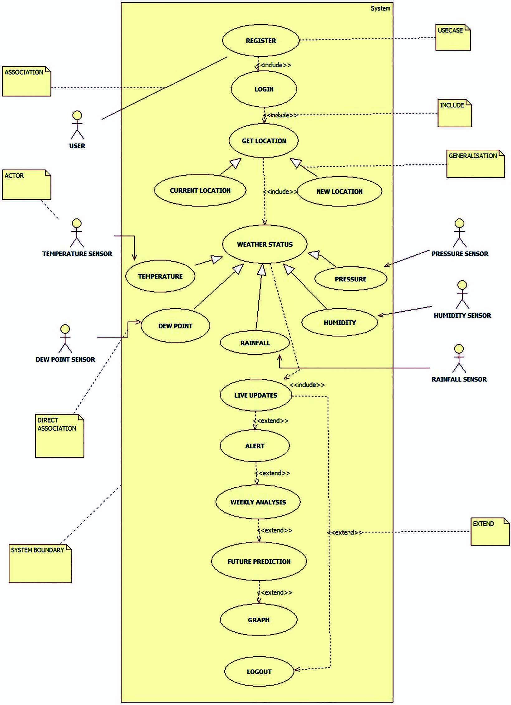
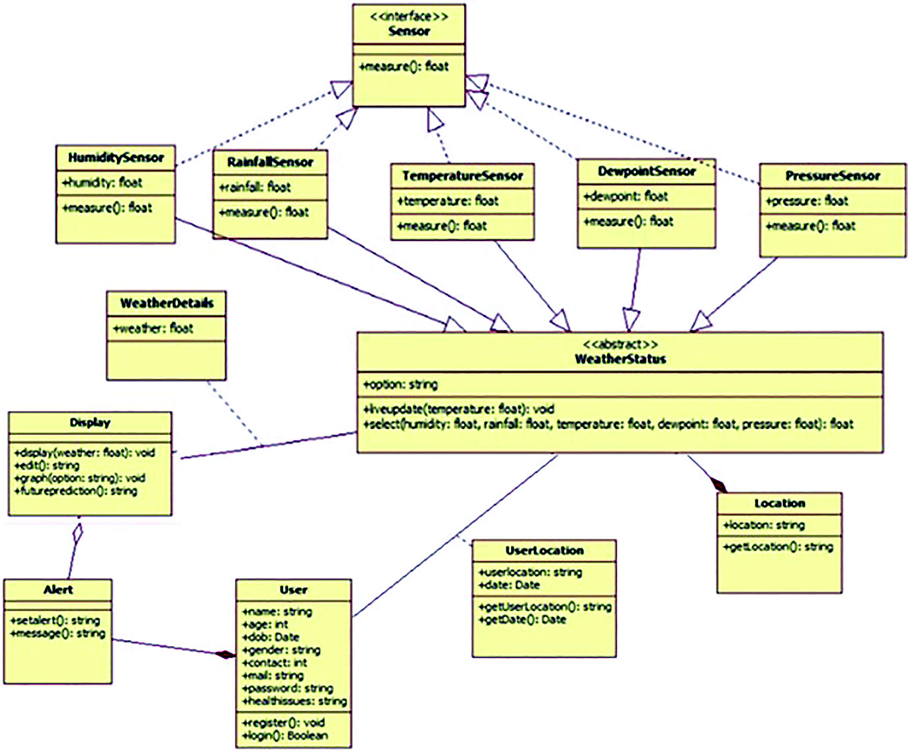
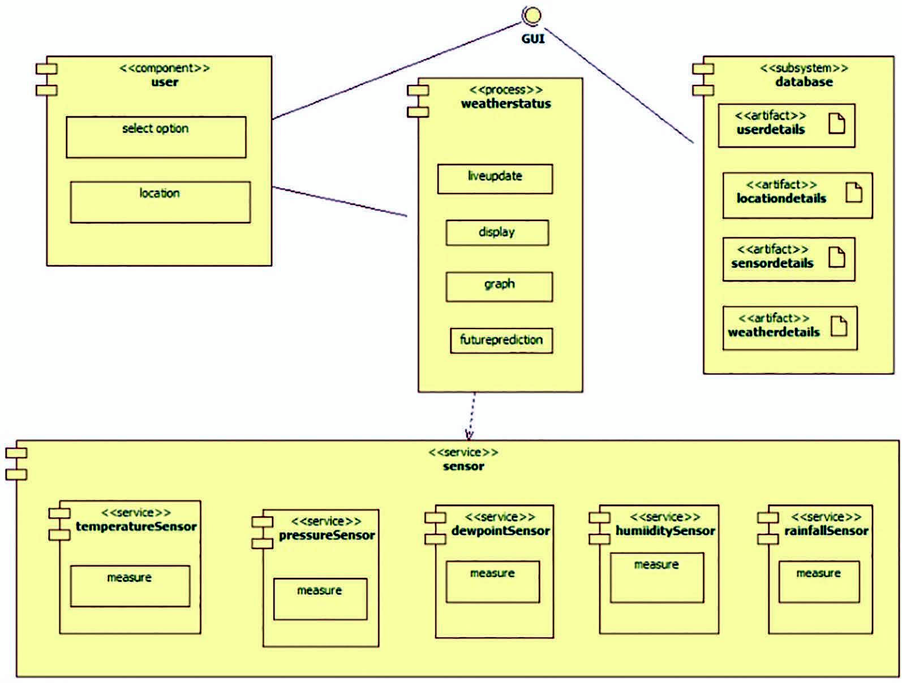
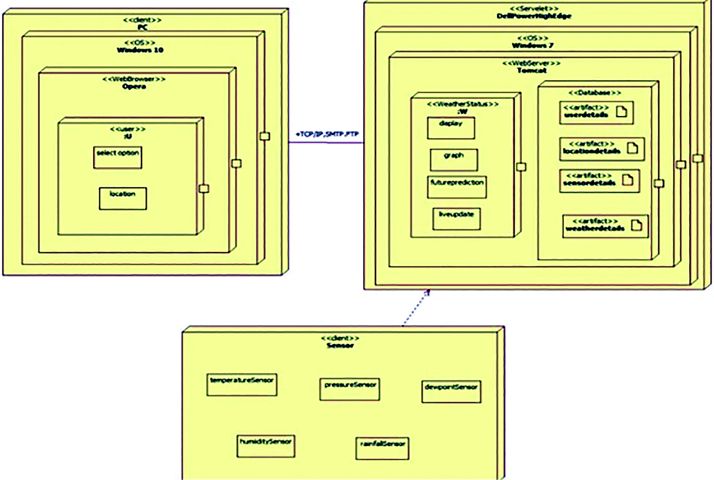

# Chapter 06: Design of UML Diagrams for Weather Monitoring System

> **Book**: *UML Diagramming: A Case Study Approach* by Dr. Suriya Sundaramoorthy (CRC Press, 2022)  
> **Pages**: 85–94 (Total: 10 pages)  
> **Classification**: Industrial Case Study & Diagram Suite  
> **Navigation**: [&larr; Chapter_05_Design_of_UML_Diagrams_for_E_Ticketing_for_Buses](Chapter_05_Design_of_UML_Diagrams_for_E_Ticketing_for_Buses.md) | [📚 Book Index](../UML_Book.md) | [Chapter_07_Design_of_UML_Diagrams_for_E_Province &rarr;](Chapter_07_Design_of_UML_Diagrams_for_E_Province.md)

---

## 📌 Executive Summary

Chapter 6 presents an industrial software engineering case study for **Design of UML Diagrams for Weather Monitoring System**. It details the transition from business requirements and domain constraints into formal software architecture specifications, leveraging data-flow modeling and a complete suite of Unified Modeling Language (UML) structural and behavioral diagrams.

---

## 🎯 Problem Statement & System Context

This chapter provides detailed software engineering analysis and UML modeling specifications.

---

## 📊 Complete UML Diagram Suite & Architecture Specifications

This chapter incorporates **9 crystal-clear, high-resolution diagram(s)** (extracted losslessly from the source edition at up to 2,000+ px) illustrating the end-to-end design from functional use cases to physical hardware deployment:

### Figure 6.3: UML Usecase Diagram

**Diagram Category**: `Use Case Diagram`  
**Architectural Role**: Specifies system boundary, primary external actors, and business use cases with include/extend relationships.

### Figure 6.4: UML Class Diagram

**Diagram Category**: `Class Diagram`  
**Architectural Role**: Models static structural classifiers, entity attributes, operations, and associations (composition, aggregation, inheritance).

### Figure 6.5: UML Activity Diagram

**Diagram Category**: `Activity Diagram`  
**Architectural Role**: Illustrates dynamic procedural workflow, decision branching, concurrent action forks, and synchronization joins.

### Figure 6.7: UML Sequence Diagram

**Diagram Category**: `Sequence Diagram`  
**Architectural Role**: Details chronological object interactions, synchronous message exchanges, return flows, and activation lifelines.

### Figure 6.8: UML Collaboration Diagram

**Diagram Category**: `Communication Diagram`  
**Architectural Role**: Emphasizes structural object topology and numbered sequence messaging between collaborating entities.

### Figure 6.9: UML Component Diagram

**Diagram Category**: `Component Diagram`  
**Architectural Role**: Architects physical modular software components, provided ball interfaces, and required socket dependencies.

### Visual Artifacts & Supplementary Schematics

The following high-resolution schematics capture operational screen states, user dashboards, or notation components documented in this chapter:

#### Ch06 p090 img01

#### Ch06 p093 img01

#### Ch06 p094 img01

---

## 💡 Key Architectural Invariants & Modeling Lessons

1. **Traceability**: Every software model directly corresponds to explicit functional requirements defined during the initial domain specification.
2. **Separation of Concerns**: Structural models (Class, Component, Deployment) maintain clear boundaries separating business domain entities from physical infrastructure nodes.
3. **Behavioral Integrity**: Dynamic models (Activity, Sequence, State Machine) guarantee valid state transitions, prevent deadlocks, and verify message order consistency.
4. **Deployment Fidelity**: Physical nodes and execution environments accurately map runtime middleware, database engines, and client access channels.

---

## 🔗 Related Resources & Navigation

- **Navigation**: [&larr; Chapter_05_Design_of_UML_Diagrams_for_E_Ticketing_for_Buses](Chapter_05_Design_of_UML_Diagrams_for_E_Ticketing_for_Buses.md) | [📚 Book Index](../UML_Book.md) | [Chapter_07_Design_of_UML_Diagrams_for_E_Province &rarr;](Chapter_07_Design_of_UML_Diagrams_for_E_Province.md)
- **Master Book Catalog**: [`UML_Book.md`](../UML_Book.md)
- **High-Resolution Images Archive**: [`images/`](../images/)