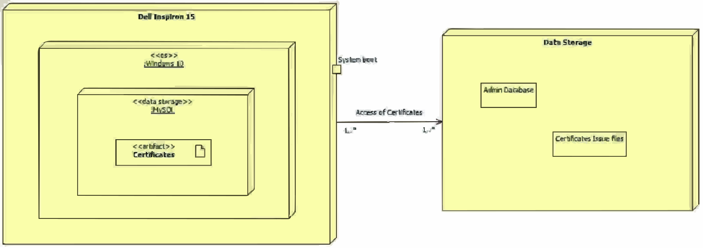

# Chapter 07: Design of UML Diagrams for E Province

> **Book**: *UML Diagramming: A Case Study Approach* by Dr. Suriya Sundaramoorthy (CRC Press, 2022)  
> **Pages**: 95–104 (Total: 10 pages)  
> **Classification**: Industrial Case Study & UML Modeling Suite  
> **Navigation**: [&larr; Chapter_06_Design_of_UML_Diagrams_for_Weather_Monitoring_System](Chapter_06_Design_of_UML_Diagrams_for_Weather_Monitoring_System.md) | [📚 Book Index](../UML_Book.md) | [Chapter_08_Design_of_UML_Diagrams_for_DigiDocLocker &rarr;](Chapter_08_Design_of_UML_Diagrams_for_DigiDocLocker.md)

---

## 📌 Executive Summary

Chapter 7 presents an end-to-end software engineering case study for the **Design of UML Diagrams for E Province**. This chapter demonstrates how business requirements and domain constraints are translated into formal architectural specifications through data-flow modeling and a complete suite of Unified Modeling Language (UML) structural and behavioral models.

The case study analyzes the system from multiple architectural perspectives: identifying external user and service actors, formalizing core operational capabilities, detailing procedural business workflows, specifying domain entity schemas, and architecting modular component deployment across distributed physical infrastructure.

---

## 🎯 Problem Statement & Business Context

- **Core Problem**: Citizens must repeatedly visit crowded government offices and fill out paper forms to obtain basic certificates and welfare pensions.
- **Business Context**: District administrations need an e-Governance portal to deliver citizen services transparently and reduce bureaucratic delay.
- **Key Solution**: Lets citizens apply online for birth, death, caste, and income certificates, apply for pensions, and track application approval stages live.

---

## ⚙️ System Architecture & Functional Capabilities

The **Design of UML Diagrams for E Province** decomposes business operations into modular functional units. These capabilities address the operational bottlenecks of manual and legacy workflows by introducing automated, role-based, and auditable software processes:

- **Registration Process**: This process allows new users to the register to e-Province Website online and verify the account once the user is verified.
- **Login Process**: This process allows the authorized users to login to the website using their unique ID.
- **Registration for Certificate Process**: This process creates the forms for the required certificate that the user has requested and when the users filled the details with the valid prerequisites, the registration for certificate process completes.
- **Certificate Issuing Process**: This process validates the details of the form and issues the certificates if it is approved.
- **User Profile Viewing Process**: This process allows the user whenever he needs to view his profile and even he is updated when the certificate is approved.

---

## 📊 Complete UML Diagram Suite & Architectural Walkthrough

This chapter incorporates **9 crystal-clear, high-resolution diagram(s)** (extracted losslessly from the source edition at up to 2,000+ px) illustrating the end-to-end design from functional use cases to physical hardware deployment:

### Figure 7.2: UML Activity Diagram

**Diagram Category**: `Activity Diagram`  
**Architectural Role**: Illustrates dynamic procedural workflow, decision branching, concurrent action forks, and synchronization joins.

**System Design Analysis**:
Details the step-by-step procedural execution flow for core operations in **Design of UML Diagrams for E Province**. Begins at an initial state, navigates action states, evaluates guard conditions at decision diamonds, and models parallel execution branches using fork and join synchronizations before reaching the terminal state, ensuring business workflows are deterministic and free of race conditions.

#### 🛠️ Step-by-Step Construction Guide

1. **Establish Initial Node & Execution Swimlanes**:
   - Start the workflow with a solid black circle (Initial Node) representing the trigger event in **E Province**.
   - Organize participating roles and subsystems into vertical or horizontal swimlanes to establish organizational accountability.
2. **Plot Sequential Action & State Steps**:
   - Draw rounded rectangles for each discrete functional task in chronological order.
   - Connect sequential actions with directed control flow arrows indicating the progression of execution.
3. **Incorporate Decision & Branching Diamonds**:
   - Place diamond decision nodes where the business logic branches based on conditions.
   - Label outgoing paths with explicit boolean guard conditions in brackets (e.g., `[Valid Input]` vs `[Invalid Input]`).
4. **Model Concurrency with Fork & Join Bars**:
   - Use solid horizontal or vertical synchronization bars (Forks) to divide a single flow into simultaneous parallel operations.
   - Pair each Fork with a corresponding Join bar to synchronize parallel tasks before advancing to subsequent stages.
5. **Terminate Flow at Final State Nodes**:
   - Guide successful workflow branches to an encircled solid black dot (Activity Final Node).
   - Use flow final nodes (circle with an X) to terminate individual canceled sub-branches without stopping the entire workflow.

### Figure 7.3: UML Sequence Diagram

**Diagram Category**: `Sequence Diagram`  
**Architectural Role**: Details chronological object interactions, synchronous message exchanges, return flows, and activation lifelines.

**System Design Analysis**:
Traces the time-ordered message sequence between participating objects and services in **Design of UML Diagrams for E Province**. Vertical dashed lifelines represent entity instances across time, while horizontal solid and dashed arrows show synchronous invocations, data lookups, and return values. Activation bars delineate execution duration, clarifying object collaboration during key transactional workflows.

#### 🛠️ Step-by-Step Construction Guide

1. **Arrange Participating Lifelines Horizontally**:
   - Position actors, boundary controllers, service managers, and persistence models horizontally across the top of the diagram.
   - Drop vertical dashed lines (lifelines) downward from each participant to represent the passage of time from top to bottom.
2. **Overlay Activation Focus Bars**:
   - Place thin vertical rectangular boxes on lifelines to indicate active execution periods where an object is processing instructions.
3. **Model Synchronous & Asynchronous Invocations**:
   - Draw solid horizontal arrows with filled triangular arrowheads for synchronous method calls (e.g., `validateCredentials()`).
   - Draw open arrowheads for asynchronous events or non-blocking notification dispatches.
4. **Represent Return Messages & Reply Payloads**:
   - Draw dashed horizontal lines with open arrowheads pointing back to the calling lifeline to model return data or acknowledgment signals.
   - Label return lines with explicit payload descriptions (e.g., `confirmationToken: String`).
5. **Structure Logic with Combined Interaction Fragments**:
   - Enclose conditional logic within an `alt` fragment box partitioned into alternative execution compartments with bracketed guard expressions.
   - Utilize `opt` frames for optional branches and `loop` frames for iterative business operations.

### Figure 7.5: UML State Machine Diagram

**Diagram Category**: `State Machine Diagram`  
**Architectural Role**: Captures entity lifecycle states, transition triggers, event guards, and exit/entry actions.

**System Design Analysis**:
Models the complete lifecycle state transitions for central domain entities in **Design of UML Diagrams for E Province**. Tracks transitions from initial creation through intermediate processing states to completion or cancellation. Explicit state triggers, guard expressions `[condition]`, and entry/exit actions guarantee valid business lifecycle states and eliminate invalid operational state jumps.

#### 🛠️ Step-by-Step Construction Guide

1. **Identify the Initial Pseudostate**:
   - Begin with a solid black circle (Initial State) marking the creation or activation trigger of the target entity in **E Province**.
2. **Define Distinct Operational States**:
   - Draw rounded rectangles representing every discrete state the entity can assume during its lifecycle (e.g., `Created`, `Pending`, `Processing`, `Completed`, `Failed`).
   - Add internal behavior compartments for `entry /`, `do /`, and `exit /` action routines where applicable.
3. **Map State Transitions & Triggers**:
   - Connect states using directed transition arrows indicating valid status changes.
   - Label transitions using the formal UML format: `TriggerEvent [GuardCondition] / ActionEffect` (e.g., `submitPayment [balanceSufficient] / generateReceipt()`).
4. **Model Superstates & Substates (Hierarchical States)**:
   - Group related substates within an enclosing composite state rectangle when multiple states share common exit or exception transitions.
5. **Terminate at Final State Nodes**:
   - Direct all terminal lifecycle outcomes (successful fulfillment or terminal rejection) to an encircled black dot (Final State).

### Figure 7.6: UML Class Diagram

**Diagram Category**: `Class Diagram`  
**Architectural Role**: Models static structural classifiers, entity attributes, operations, and associations (composition, aggregation, inheritance).

**System Design Analysis**:
Captures the static structural domain model for **Design of UML Diagrams for E Province**. Defines primary entity classes, their private/public attributes, operational methods, and relationships. It enforces structural integrity through multiplicities, composition (strong lifecycle ownership of subsidiary records), aggregation, and inheritance hierarchies, forming the foundation for the relational database schema and domain entity classes.

#### 🛠️ Step-by-Step Construction Guide

1. **Identify Domain Entities & Boundary Objects**:
   - Analyze requirements for **E Province** to extract core business entities, controllers, and data structures.
   - Represent each entity as a three-compartment rectangular classifier (Class Name, Attributes, Operations).
2. **Define Attributes with Visibility & Data Types**:
   - Populate the middle compartment with private (`-`), protected (`#`), or public (`+`) attributes.
   - Assign standardized data types (e.g., `- id: String`, `- status: Boolean`, `- createdAt: DateTime`).
3. **Specify Member Operations & Business Methods**:
   - Populate the bottom compartment with functions and interface methods that define class behavior.
   - Include parameter types and return signatures (e.g., `+ executeTransaction(amount: Float): Boolean`).
4. **Establish Structural Relationships & Multiplicities**:
   - Connect related classes using solid association lines annotated with numerical multiplicities (e.g., `1`, `0..*`, `1..*`).
   - Apply Composition (solid diamond) where parts cannot exist without the whole, and Aggregation (hollow diamond) for shared references.
   - Model inheritance hierarchies using Generalization (solid line with closed hollow triangular arrowhead).
5. **Validate Architecture & Reduce Coupling**:
   - Review class cohesion to verify single-responsibility principles across data access and business logic layers.
   - Ensure abstract classes or interfaces isolate clients from implementation changes.

### Figure 7.7: UML Component Diagram

**Diagram Category**: `Component Diagram`  
**Architectural Role**: Architects physical modular software components, provided ball interfaces, and required socket dependencies.

**System Design Analysis**:
Architects the modular software organization for **Design of UML Diagrams for E Province**. Illustrates autonomous subsystems, business logic controllers, database access layers, and external service adapters. Provided interfaces (ball notation) and required dependencies (socket notation) define clear service contracts, supporting high cohesion and loose coupling.

#### 🛠️ Step-by-Step Construction Guide

1. **Identify Autonomous Modular Units**:
   - Analyze **E Province** to identify independent deployable subsystems, microservices, databases, and third-party integrations.
   - Represent each unit as a rectangular component symbol adorned with the `<<component>>` stereotype or component icon tabs.
2. **Define Provided Interfaces (Ball / Lollipop Notation)**:
   - Attach solid circle "ball" connectors to components that provide public API endpoints, RPC interfaces, or query services to external callers.
3. **Define Required Interfaces (Socket Notation)**:
   - Attach semicircular "socket" connectors to components that depend on external services or client data contracts.
4. **Assemble Ball-and-Socket Connectors**:
   - Align matching ball and socket connectors to model direct architectural wiring, loose coupling, and dependency injection.
5. **Group into Architectural Subsystems**:
   - Enclose related components inside package boundaries (e.g., Presentation Layer, Business Core, Data Storage) to enforce clean layer isolation.

### Figure 7.8: UML Deployment Diagram

**Diagram Category**: `Deployment Diagram`  
**Architectural Role**: Maps software execution artifacts to hardware computing nodes, client devices, application tiers, and database servers.

**System Design Analysis**:
Maps the physical runtime deployment architecture for **Design of UML Diagrams for E Province**. Depicts client hardware devices (web browsers, mobile apps), application servers, network firewalls, and persistence database nodes. Communication paths and execution environments reflect production infrastructure, scalability considerations, and network security boundaries.

#### 🛠️ Step-by-Step Construction Guide

1. **Identify Physical & Virtual Hardware Nodes**:
   - Draw 3D isometric box cubes representing physical host servers, cloud instances, client smartphones, and database clusters for **E Province**.
   - Label nodes with stereotypic descriptions (e.g., `<<device>>`, `<<database server>>`, `<<cloud container>>`).
2. **Specify Runtime Execution Environments**:
   - Nest runtime environments inside node cubes (e.g., `<<execution environment>> Web Browser`, `Docker Engine`, `JVM Runtime`).
3. **Assign Executable Artifacts to Nodes**:
   - Place software artifacts (rectangles with `<<artifact>>` stereotype, `.jar`, `.war`, `.apk`, `.sql`) inside their corresponding hosting execution environments.
4. **Draw Network Communication Paths & Protocols**:
   - Connect nodes using solid communication lines labeled with transport protocols and security stereotypes (e.g., `<<HTTPS/TLS>>`, `<<TCP/IP>>`, `<<JDBC>>`, `<<gRPC>>`).
5. **Verify High Availability & Security Boundaries**:
   - Ensure clear physical separation between public demilitarized zones (DMZ), application compute layers, and protected private database networks.

### Visual Artifacts & Supplementary Schematics

The following high-resolution schematics capture operational screen states, user dashboards, or notation components documented in this chapter:

#### Ch07 p096 img01

**Perspective**: `Conceptual Notation / Architecture Asset` — Supplemental conceptual illustration or notation reference from the source chapter.

#### Ch07 p099 img01

**Perspective**: `Conceptual Notation / Architecture Asset` — Supplemental conceptual illustration or notation reference from the source chapter.

#### Ch07 p104 img01

**Perspective**: `Conceptual Notation / Architecture Asset` — Supplemental conceptual illustration or notation reference from the source chapter.

---

## 💡 Key Architectural Invariants & Domain Lessons

1. **Requirement Traceability**: Every model in the **Design of UML Diagrams for E Province** suite traces directly to business requirements and operational constraints established in the problem statement.
2. **State & Workflow Integrity**: Dynamic activity and sequence models guarantee deterministic workflow completion, enforce transactional atomicity, and prevent deadlocks.
3. **Modular Encapsulation**: Component boundaries decouple domain business logic from presentation controllers and external integration adapters, supporting high maintainability.
4. **Operational Security & RBAC**: Strict role-based authorization guards sensitive operations across external actor boundaries and administrative lifelines.
5. **High-Fidelity Deployment**: Physical node topologies reflect real-world tiered infrastructure (DMZ, application cluster, isolated persistence layer), ensuring scalability and fault tolerance.

---

## 🔗 Related Resources & Navigation

- **Navigation**: [&larr; Chapter_06_Design_of_UML_Diagrams_for_Weather_Monitoring_System](Chapter_06_Design_of_UML_Diagrams_for_Weather_Monitoring_System.md) | [📚 Book Index](../UML_Book.md) | [Chapter_08_Design_of_UML_Diagrams_for_DigiDocLocker &rarr;](Chapter_08_Design_of_UML_Diagrams_for_DigiDocLocker.md)
- **Master Book Catalog**: [`UML_Book.md`](../UML_Book.md)
- **High-Resolution Images Archive**: [`images/`](../images/)