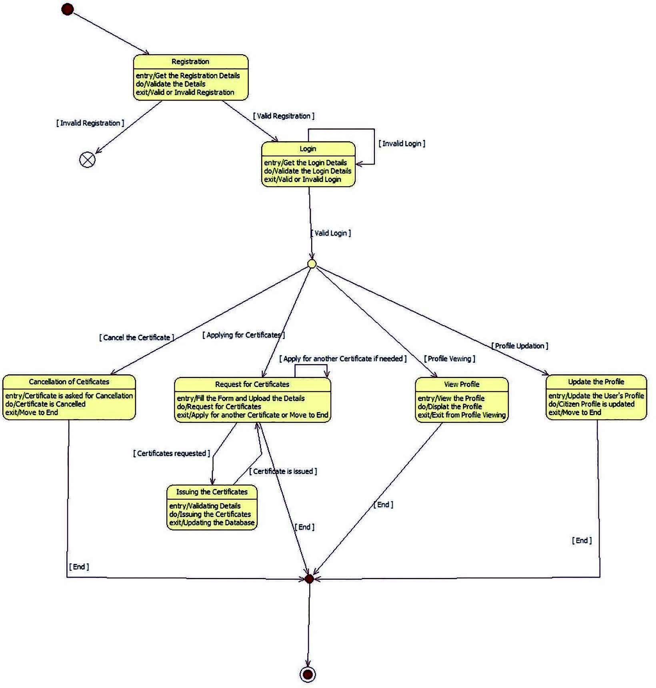
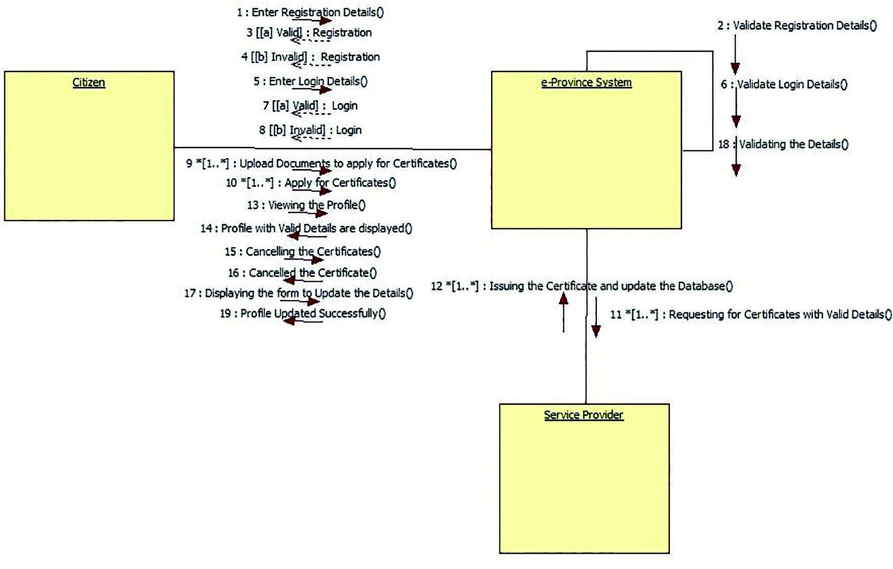

# Chapter 07: Design of UML Diagrams for E Province

> **Book**: *UML Diagramming: A Case Study Approach* by Dr. Suriya Sundaramoorthy (CRC Press, 2022)  
> **Pages**: 95–104 (Total: 10 pages)  
> **Classification**: Industrial Case Study & UML Modeling Suite  
> **Navigation**: [&larr; Chapter_06_Design_of_UML_Diagrams_for_Weather_Monitoring_System](Chapter_06_Design_of_UML_Diagrams_for_Weather_Monitoring_System.md) | [📚 Book Index](../UML_Book.md) | [Chapter_08_Design_of_UML_Diagrams_for_DigiDocLocker &rarr;](Chapter_08_Design_of_UML_Diagrams_for_DigiDocLocker.md)

---

## 📌 Executive Summary

Chapter 7 presents an end-to-end software engineering case study for the **Design of UML Diagrams for E Province**. This chapter demonstrates how business requirements and domain constraints are translated into formal architectural specifications through data-flow modeling and a complete suite of Unified Modeling Language (UML) structural and behavioral models.

The case study analyzes the system from multiple architectural perspectives: identifying external user and service actors, formalizing core operational capabilities, detailing procedural business workflows, specifying domain entity schemas, and architecting modular component deployment across distributed physical infrastructure.

---

## 🎯 Problem Statement & Business Context

Citizens in every district face the difficulty with the of government certificates like birth/death certificates, income and caste certificates, old age and widow pensions, etc. This can be done with e-Province. This case study demonstrates how make the government services available to the citizens in a convenient, efficient and transparent manner, by enabling it simple by reliable access over the Internet. The main objective is to bring the public services closer to the citizens. To fulfil the vision of providing an easy and convenient service to the citizens through remote access primarily through Common Service Centre (CSCs), e-Province project is created. This case study aims to develop a State Portal (SP) to provide all the citizens of the respective province to access the services under a single interface mechanism in the form of the Portal. The various modules in the e-Province project are an Admin module that creates, updates, deactivates the users and performs various other tasks. A Login module that allows the users to login with their unique Application number with approved status. A User module that allows the approved users to register for the respective certificates. A User Profile module that creates the pre-requisite information of the user that needs to be stored in the database. The Certificate module contains the required forms that are to be filled with the information of the users (Figures 7.1–7.8).

---

## ⚙️ System Architecture & Functional Capabilities

The **Design of UML Diagrams for E Province** decomposes business operations into modular functional units. These capabilities address the operational bottlenecks of manual and legacy workflows by introducing automated, role-based, and auditable software processes:

- **Registration Process**: This process allows new users to the register to e-Province Website online and verify the account once the user is verified.
- **Login Process**: This process allows the authorized users to login to the website using their unique ID.
- **Registration for Certificate Process**: This process creates the forms for the required certificate that the user has requested and when the users filled the details with the valid prerequisites, the registration for certificate process completes.
- **Certificate Issuing Process**: This process validates the details of the form and issues the certificates if it is approved.
- **User Profile Viewing Process**: This process allows the user whenever he needs to view his profile and even he is updated when the certificate is approved.

---

## 📊 Complete UML Diagram Suite & Architectural Walkthrough

This chapter incorporates **9 crystal-clear, high-resolution diagram(s)** (extracted losslessly from the source edition at up to 2,000+ px) illustrating the end-to-end design from functional use cases to physical hardware deployment:

### Figure 7.2: UML Activity Diagram

**Diagram Category**: `Activity Diagram`  
**Architectural Role**: Illustrates dynamic procedural workflow, decision branching, concurrent action forks, and synchronization joins.

**System Design Analysis**:
Details the step-by-step procedural execution flow for core operations in **Design of UML Diagrams for E Province**. Begins at an initial state, navigates action states, evaluates guard conditions at decision diamonds, and models parallel execution branches using fork and join synchronizations before reaching the terminal state, ensuring business workflows are deterministic and free of race conditions.

### Figure 7.3: UML Sequence Diagram

**Diagram Category**: `Sequence Diagram`  
**Architectural Role**: Details chronological object interactions, synchronous message exchanges, return flows, and activation lifelines.

**System Design Analysis**:
Traces the time-ordered message sequence between participating objects and services in **Design of UML Diagrams for E Province**. Vertical dashed lifelines represent entity instances across time, while horizontal solid and dashed arrows show synchronous invocations, data lookups, and return values. Activation bars delineate execution duration, clarifying object collaboration during key transactional workflows.

### Figure 7.5: UML State Machine Diagram

**Diagram Category**: `State Machine Diagram`  
**Architectural Role**: Captures entity lifecycle states, transition triggers, event guards, and exit/entry actions.

**System Design Analysis**:
Models the complete lifecycle state transitions for central domain entities in **Design of UML Diagrams for E Province**. Tracks transitions from initial creation through intermediate processing states to completion or cancellation. Explicit state triggers, guard expressions `[condition]`, and entry/exit actions guarantee valid business lifecycle states and eliminate invalid operational state jumps.

### Figure 7.6: UML Class Diagram

**Diagram Category**: `Class Diagram`  
**Architectural Role**: Models static structural classifiers, entity attributes, operations, and associations (composition, aggregation, inheritance).

**System Design Analysis**:
Captures the static structural domain model for **Design of UML Diagrams for E Province**. Defines primary entity classes, their private/public attributes, operational methods, and relationships. It enforces structural integrity through multiplicities, composition (strong lifecycle ownership of subsidiary records), aggregation, and inheritance hierarchies, forming the foundation for the relational database schema and domain entity classes.

### Figure 7.7: UML Component Diagram

**Diagram Category**: `Component Diagram`  
**Architectural Role**: Architects physical modular software components, provided ball interfaces, and required socket dependencies.

**System Design Analysis**:
Architects the modular software organization for **Design of UML Diagrams for E Province**. Illustrates autonomous subsystems, business logic controllers, database access layers, and external service adapters. Provided interfaces (ball notation) and required dependencies (socket notation) define clear service contracts, supporting high cohesion and loose coupling.

### Figure 7.8: UML Deployment Diagram

**Diagram Category**: `Deployment Diagram`  
**Architectural Role**: Maps software execution artifacts to hardware computing nodes, client devices, application tiers, and database servers.

**System Design Analysis**:
Maps the physical runtime deployment architecture for **Design of UML Diagrams for E Province**. Depicts client hardware devices (web browsers, mobile apps), application servers, network firewalls, and persistence database nodes. Communication paths and execution environments reflect production infrastructure, scalability considerations, and network security boundaries.

### Visual Artifacts & Supplementary Schematics

The following high-resolution schematics capture operational screen states, user dashboards, or notation components documented in this chapter:

#### Ch07 p096 img01

**Perspective**: `Conceptual Notation / Architecture Asset` — Supplemental conceptual illustration or notation reference from the source chapter.

#### Ch07 p099 img01

**Perspective**: `Conceptual Notation / Architecture Asset` — Supplemental conceptual illustration or notation reference from the source chapter.

#### Ch07 p104 img01

**Perspective**: `Conceptual Notation / Architecture Asset` — Supplemental conceptual illustration or notation reference from the source chapter.

---

## 💡 Key Architectural Invariants & Domain Lessons

1. **Requirement Traceability**: Every model in the **Design of UML Diagrams for E Province** suite traces directly to business requirements and operational constraints established in the problem statement.
2. **State & Workflow Integrity**: Dynamic activity and sequence models guarantee deterministic workflow completion, enforce transactional atomicity, and prevent deadlocks.
3. **Modular Encapsulation**: Component boundaries decouple domain business logic from presentation controllers and external integration adapters, supporting high maintainability.
4. **Operational Security & RBAC**: Strict role-based authorization guards sensitive operations across external actor boundaries and administrative lifelines.
5. **High-Fidelity Deployment**: Physical node topologies reflect real-world tiered infrastructure (DMZ, application cluster, isolated persistence layer), ensuring scalability and fault tolerance.

---

## 🔗 Related Resources & Navigation

- **Navigation**: [&larr; Chapter_06_Design_of_UML_Diagrams_for_Weather_Monitoring_System](Chapter_06_Design_of_UML_Diagrams_for_Weather_Monitoring_System.md) | [📚 Book Index](../UML_Book.md) | [Chapter_08_Design_of_UML_Diagrams_for_DigiDocLocker &rarr;](Chapter_08_Design_of_UML_Diagrams_for_DigiDocLocker.md)
- **Master Book Catalog**: [`UML_Book.md`](../UML_Book.md)
- **High-Resolution Images Archive**: [`images/`](../images/)