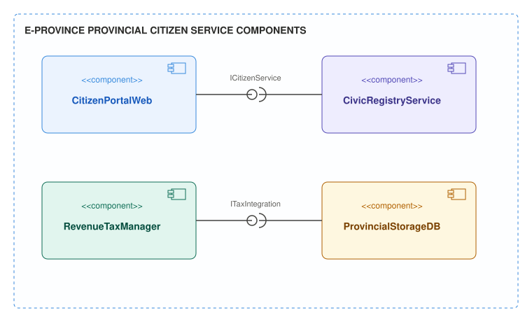

# Chapter 07: Design of UML Diagrams for E Province

> **Book**: *UML Diagramming: A Case Study Approach* by Dr. Suriya Sundaramoorthy (CRC Press, 2022)  
> **Pages**: 95–104 (Total: 10 pages)  
> **Classification**: Industrial Case Study & Diagram Suite  
> **Navigation**: [&larr; Chapter_06_Design_of_UML_Diagrams_for_Weather_Monitoring_System](Chapter_06_Design_of_UML_Diagrams_for_Weather_Monitoring_System.md) | [📚 Book Index](../UML_Book.md) | [Chapter_08_Design_of_UML_Diagrams_for_DigiDocLocker &rarr;](Chapter_08_Design_of_UML_Diagrams_for_DigiDocLocker.md)

---

## 📌 Executive Summary

Chapter 7 presents an industrial software engineering case study for **Design of UML Diagrams for E Province**. It details the transition from business requirements and domain constraints into formal software architecture specifications, leveraging data-flow modeling and a complete suite of Unified Modeling Language (UML) structural and behavioral diagrams.

---

## 🎯 Problem Statement & System Context

Citizens in every district face the difficulty with the of government certificates like birth/death certificates, income and caste certificates, old age and widow pensions, etc. This can be done with e-Province. This case study demonstrates how make the government services available to the citizens in a convenient, efficient and transparent manner, by enabling it simple by reliable access over the Internet. The main objective is to bring the public services closer to the citizens. To fulfil the vision of providing an easy and convenient service to the citizens through remote access primarily through Common Service Centre (CSCs), e-Province project is created. This case study aims to develop a State Portal (SP) to provide all the citizens of the respective province to access the services under a single interface mechanism in the form of the Portal. The various modules in the e-Province project are an Admin module that creates, updates, deactivates the users and performs various other tasks. A Login module that allows the users to login with their unique Application number with approved status. A User module that allows the approved users to register for the respective certificates. A User Profile module that creates the pre-requisite information of the user that needs to be stored in the database. The Certificate module contains the required forms that are to be filled with the information of the users (Figures 7.1–7.8).

---

## 📊 Complete UML Diagram Suite & Architecture Specifications

This chapter incorporates **9 standalone vector diagram(s)** illustrating the end-to-end design from functional use cases to physical hardware deployment:

### Figure 7.2: UML Activity Diagram

**Diagram Category**: `Activity Diagram`  
**Architectural Role**: Illustrates dynamic procedural workflow, decision branching, concurrent action forks, and synchronization joins.

### Figure 7.3: UML Sequence Diagram

**Diagram Category**: `Sequence Diagram`  
**Architectural Role**: Details chronological object interactions, synchronous message exchanges, return flows, and activation lifelines.

### Figure 7.5: UML State Machine Diagram

**Diagram Category**: `State Machine Diagram`  
**Architectural Role**: Captures entity lifecycle states, transition triggers, event guards, and exit/entry actions.

### Figure 7.6: UML Class Diagram

**Diagram Category**: `Class Diagram`  
**Architectural Role**: Models static structural classifiers, entity attributes, operations, and associations (composition, aggregation, inheritance).

### Figure 7.7: UML Component Diagram

**Diagram Category**: `Component Diagram`  
**Architectural Role**: Architects physical modular software components, provided ball interfaces, and required socket dependencies.

### Figure 7.8: UML Deployment Diagram

**Diagram Category**: `Deployment Diagram`  
**Architectural Role**: Maps software execution artifacts to hardware computing nodes, client devices, application tiers, and database servers.

### Visual Artifacts & Supplementary Schematics

The following vector schematics capture operational screen states, user dashboards, or notation components documented in this chapter:

#### Ch07 p096 img01

#### Ch07 p099 img01

#### Ch07 p104 img01

---

## 💡 Key Architectural Invariants & Modeling Lessons

1. **Traceability**: Every software model directly corresponds to explicit functional requirements defined during the initial domain specification.
2. **Separation of Concerns**: Structural models (Class, Component, Deployment) maintain clear boundaries separating business domain entities from physical infrastructure nodes.
3. **Behavioral Integrity**: Dynamic models (Activity, Sequence, State Machine) guarantee valid state transitions, prevent deadlocks, and verify message order consistency.
4. **Deployment Fidelity**: Physical nodes and execution environments accurately map runtime middleware, database engines, and client access channels.

---

## 🔗 Related Resources & Navigation

- **Navigation**: [&larr; Chapter_06_Design_of_UML_Diagrams_for_Weather_Monitoring_System](Chapter_06_Design_of_UML_Diagrams_for_Weather_Monitoring_System.md) | [📚 Book Index](../UML_Book.md) | [Chapter_08_Design_of_UML_Diagrams_for_DigiDocLocker &rarr;](Chapter_08_Design_of_UML_Diagrams_for_DigiDocLocker.md)
- **Master Book Catalog**: [`UML_Book.md`](../UML_Book.md)
- **Vector Images Catalog**: [`Vector_Images_Catalog.md`](../vector_images/Vector_Images_Catalog.md)