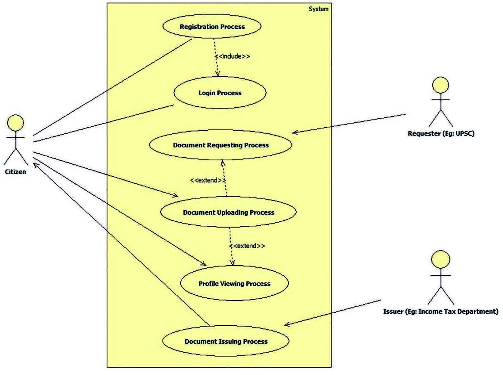
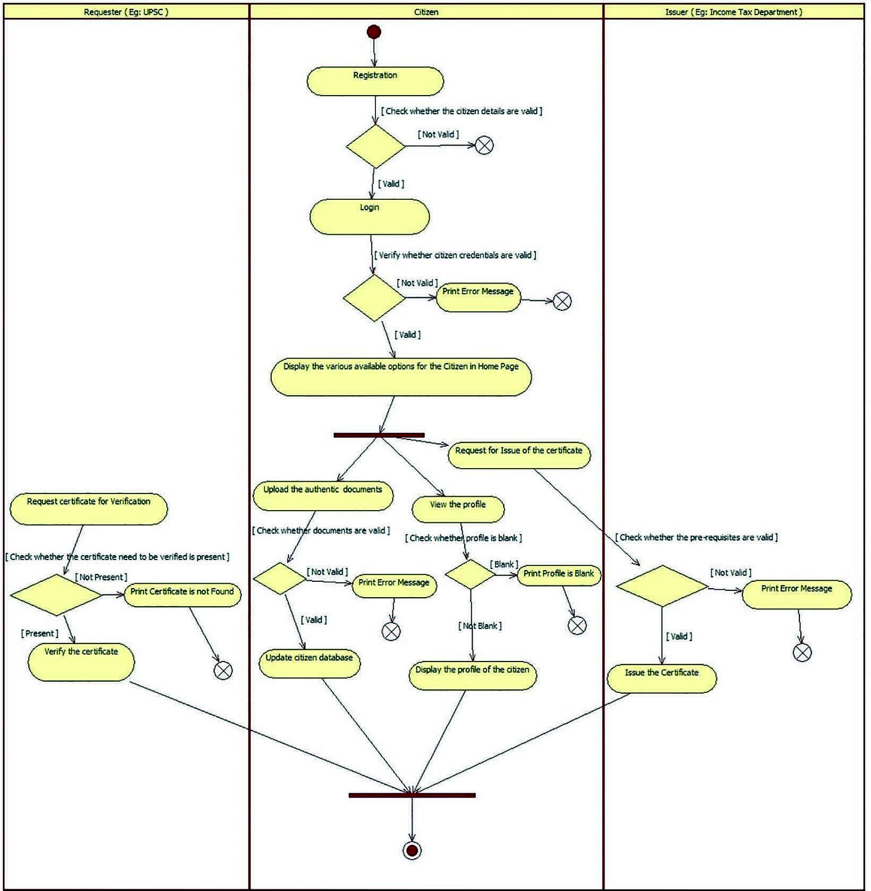
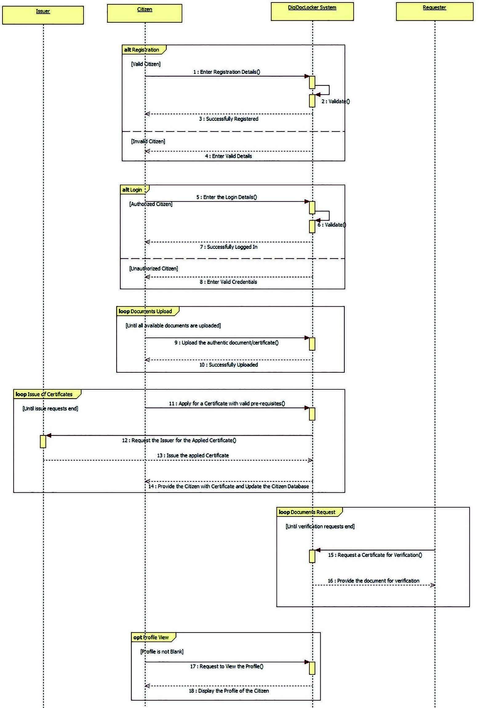
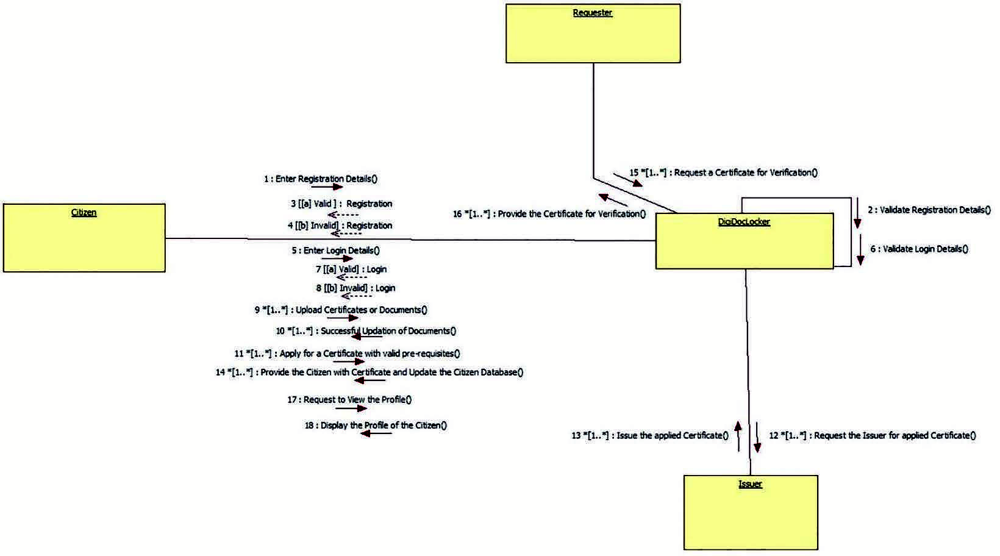
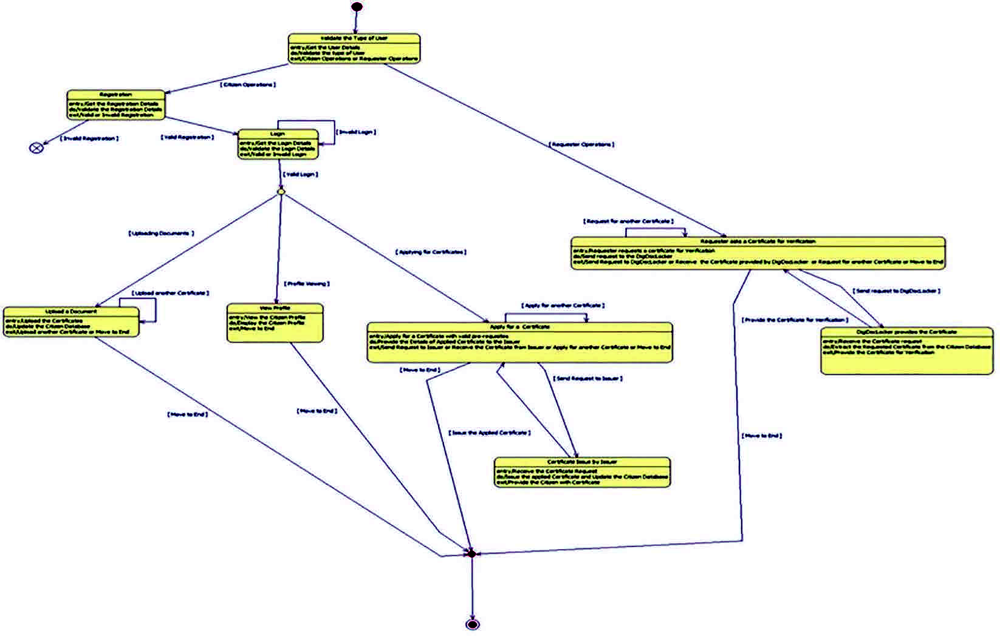
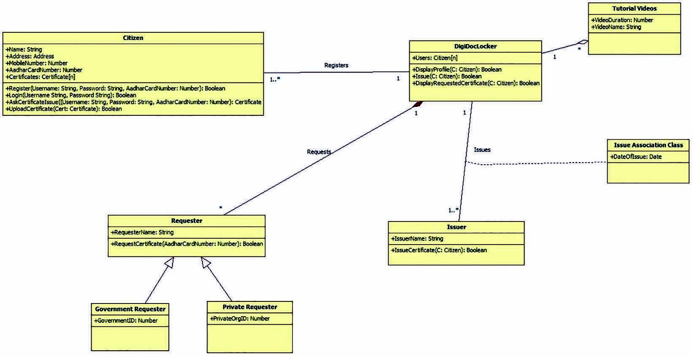
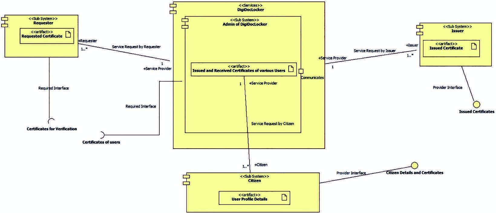
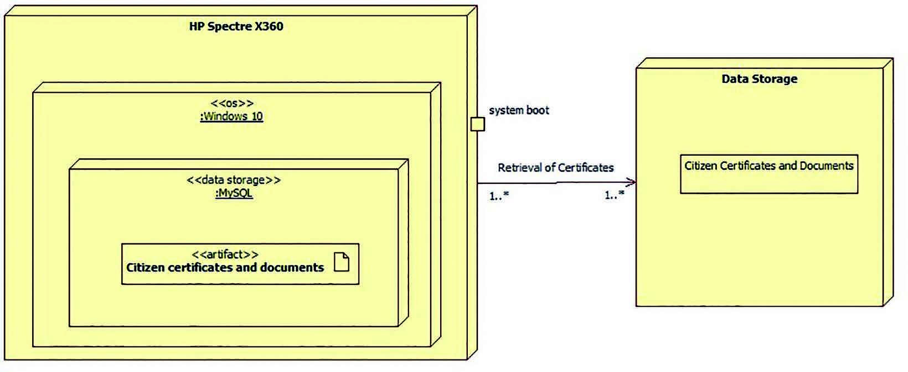

# Chapter 08: Design of UML Diagrams for DigiDocLocker

> **Book**: *UML Diagramming: A Case Study Approach* by Dr. Suriya Sundaramoorthy (CRC Press, 2022)  
> **Pages**: 105–112 (Total: 8 pages)  
> **Classification**: Industrial Case Study & UML Modeling Suite  
> **Navigation**: [&larr; Chapter_07_Design_of_UML_Diagrams_for_E_Province](Chapter_07_Design_of_UML_Diagrams_for_E_Province.md) | [📚 Book Index](../UML_Book.md) | [Chapter_09_Design_of_UML_Diagrams_for_Online_Marketplace &rarr;](Chapter_09_Design_of_UML_Diagrams_for_Online_Marketplace.md)

---

## 📌 Executive Summary

Chapter 8 presents an end-to-end software engineering case study for the **Design of UML Diagrams for DigiDocLocker**. This chapter demonstrates how business requirements and domain constraints are translated into formal architectural specifications through data-flow modeling and a complete suite of Unified Modeling Language (UML) structural and behavioral models.

The case study analyzes the system from multiple architectural perspectives: identifying external user and service actors, formalizing core operational capabilities, detailing procedural business workflows, specifying domain entity schemas, and architecting modular component deployment across distributed physical infrastructure.

---

## 🎯 Problem Statement & Business Context

Maintaining the authentic documents physically in a single location is considered to be a challenging task. Thus, digitizing documents enables centralized storage of all the physical documents enabling easy retrieval from anywhere at anytime. It also prevents the troubles caused by missing any of those physical certificates. This can be achieved through the DigiDocLocker which is a platform for issuance and verification of documents and certificates in a digital format, thereby eliminating the use of physical documents. DigiDocLocker aims at benefitting all the citizens of the country by providing to access authentic documents/certificates such as driving licence, vehicle registration and academic mark sheet in digital format from the original issuers of these certificates. DigiDocLocker has the following functionalities: i. A Registration module allows the users to register and a Login module that allows the authorized users. ii. An Upload Document module allows the users to upload documents such as driving licence, vehicle registration, academic mark sheet and other relevant documents in various file formats. iii. A Profile module displays the complete profile of the user as available in the database. iv. An Issuer module displays the certificate issuers’ names and the number of documents issued to the user by the issuer. For example, the Income Tax Department, Government of India has provided PAN Verification Records to Indian citizens via DigiLocker. v. A Requester module displays the requesters’ names and the number of documents requested from the user by the requesters. For example, Citizen applying through Union Public Service Commission (UPSC)’s Online Recruitment Application (ORA) can upload documents through DigiDocLocker as well (Figures 8.1–8.8).

---

## ⚙️ System Architecture & Functional Capabilities

The **Design of UML Diagrams for DigiDocLocker** decomposes business operations into modular functional units. These capabilities address the operational bottlenecks of manual and legacy workflows by introducing automated, role-based, and auditable software processes:

- **Registration Process**: This process enables the new users to register with the DigiDocLocker System.
- **Login Process**: This process enables the authorized users to login into the DigiDocLocker System.
- **Document Requesting Process**: This process enables the Requesters (e.g. UPSC) to request for various authentic documents/certificates of the citizens that are to be verified online.
- **Document Uploading Process**: This process enables the users to upload authentic documents/certificates such as driving licence, vehicle registration, academic mark sheet and other relevant documents in various file formats online.
- **Profile Viewing Process**: This process enables the users to view their complete profile as available in the database.
- **Document Issuing Process**: This process enables the citizens to apply for various authentic documents/ certificates online which will be provided by the Issuers (e.g. Income Tax Department).

---

## 📊 Complete UML Diagram Suite & Architectural Walkthrough

This chapter incorporates **9 crystal-clear, high-resolution diagram(s)** (extracted losslessly from the source edition at up to 2,000+ px) illustrating the end-to-end design from functional use cases to physical hardware deployment:

### Figure 8.1: UML Usecase Diagram

**Diagram Category**: `Use Case Diagram`  
**Architectural Role**: Specifies system boundary, primary external actors, and business use cases with include/extend relationships.

**System Design Analysis**:
Illustrates the functional boundary of the **Design of UML Diagrams for DigiDocLocker**. External actors trigger core use cases, demonstrating how business transactions, authorization checkpoints, and service requests flow into the system. Relationships (`<<include>>` for mandatory sub-routines like authentication and validation, and `<<extend>>` for optional or conditional exception branches) formalize the system's external functional contract.

### Figure 8.2: UML Class Diagram

**Diagram Category**: `Class Diagram`  
**Architectural Role**: Models static structural classifiers, entity attributes, operations, and associations (composition, aggregation, inheritance).

**System Design Analysis**:
Captures the static structural domain model for **Design of UML Diagrams for DigiDocLocker**. Defines primary entity classes, their private/public attributes, operational methods, and relationships. It enforces structural integrity through multiplicities, composition (strong lifecycle ownership of subsidiary records), aggregation, and inheritance hierarchies, forming the foundation for the relational database schema and domain entity classes.

### Figure 8.3: UML Sequence Diagram

**Diagram Category**: `Sequence Diagram`  
**Architectural Role**: Details chronological object interactions, synchronous message exchanges, return flows, and activation lifelines.

**System Design Analysis**:
Traces the time-ordered message sequence between participating objects and services in **Design of UML Diagrams for DigiDocLocker**. Vertical dashed lifelines represent entity instances across time, while horizontal solid and dashed arrows show synchronous invocations, data lookups, and return values. Activation bars delineate execution duration, clarifying object collaboration during key transactional workflows.

### Figure 8.4: UML Collaboration Diagram

**Diagram Category**: `Communication Diagram`  
**Architectural Role**: Emphasizes structural object topology and numbered sequence messaging between collaborating entities.

**System Design Analysis**:
Emphasizes the spatial and structural organization of collaborating instances in **Design of UML Diagrams for DigiDocLocker**. Shows object links overlaid with numbered messages (e.g., 1.0, 1.1, 2.0), illustrating both structural connectivity and invocation hierarchy, complementing the temporal perspective of the sequence diagram.

### Figure 8.5: UML State Machine Diagram

**Diagram Category**: `State Machine Diagram`  
**Architectural Role**: Captures entity lifecycle states, transition triggers, event guards, and exit/entry actions.

**System Design Analysis**:
Models the complete lifecycle state transitions for central domain entities in **Design of UML Diagrams for DigiDocLocker**. Tracks transitions from initial creation through intermediate processing states to completion or cancellation. Explicit state triggers, guard expressions `[condition]`, and entry/exit actions guarantee valid business lifecycle states and eliminate invalid operational state jumps.

### Figure 8.6: UML Class Diagram

**Diagram Category**: `Class Diagram`  
**Architectural Role**: Models static structural classifiers, entity attributes, operations, and associations (composition, aggregation, inheritance).

**System Design Analysis**:
Captures the static structural domain model for **Design of UML Diagrams for DigiDocLocker**. Defines primary entity classes, their private/public attributes, operational methods, and relationships. It enforces structural integrity through multiplicities, composition (strong lifecycle ownership of subsidiary records), aggregation, and inheritance hierarchies, forming the foundation for the relational database schema and domain entity classes.

### Figure 8.7: UML Component Diagram

**Diagram Category**: `Component Diagram`  
**Architectural Role**: Architects physical modular software components, provided ball interfaces, and required socket dependencies.

**System Design Analysis**:
Architects the modular software organization for **Design of UML Diagrams for DigiDocLocker**. Illustrates autonomous subsystems, business logic controllers, database access layers, and external service adapters. Provided interfaces (ball notation) and required dependencies (socket notation) define clear service contracts, supporting high cohesion and loose coupling.

### Figure 8.8: UML Deployment Diagram

**Diagram Category**: `Deployment Diagram`  
**Architectural Role**: Maps software execution artifacts to hardware computing nodes, client devices, application tiers, and database servers.

**System Design Analysis**:
Maps the physical runtime deployment architecture for **Design of UML Diagrams for DigiDocLocker**. Depicts client hardware devices (web browsers, mobile apps), application servers, network firewalls, and persistence database nodes. Communication paths and execution environments reflect production infrastructure, scalability considerations, and network security boundaries.

### Visual Artifacts & Supplementary Schematics

The following high-resolution schematics capture operational screen states, user dashboards, or notation components documented in this chapter:

#### Ch08 p112 img01

**Perspective**: `Conceptual Notation / Architecture Asset` — Supplemental conceptual illustration or notation reference from the source chapter.

---

## 💡 Key Architectural Invariants & Domain Lessons

1. **Requirement Traceability**: Every model in the **Design of UML Diagrams for DigiDocLocker** suite traces directly to business requirements and operational constraints established in the problem statement.
2. **State & Workflow Integrity**: Dynamic activity and sequence models guarantee deterministic workflow completion, enforce transactional atomicity, and prevent deadlocks.
3. **Modular Encapsulation**: Component boundaries decouple domain business logic from presentation controllers and external integration adapters, supporting high maintainability.
4. **Operational Security & RBAC**: Strict role-based authorization guards sensitive operations across external actor boundaries and administrative lifelines.
5. **High-Fidelity Deployment**: Physical node topologies reflect real-world tiered infrastructure (DMZ, application cluster, isolated persistence layer), ensuring scalability and fault tolerance.

---

## 🔗 Related Resources & Navigation

- **Navigation**: [&larr; Chapter_07_Design_of_UML_Diagrams_for_E_Province](Chapter_07_Design_of_UML_Diagrams_for_E_Province.md) | [📚 Book Index](../UML_Book.md) | [Chapter_09_Design_of_UML_Diagrams_for_Online_Marketplace &rarr;](Chapter_09_Design_of_UML_Diagrams_for_Online_Marketplace.md)
- **Master Book Catalog**: [`UML_Book.md`](../UML_Book.md)
- **High-Resolution Images Archive**: [`images/`](../images/)