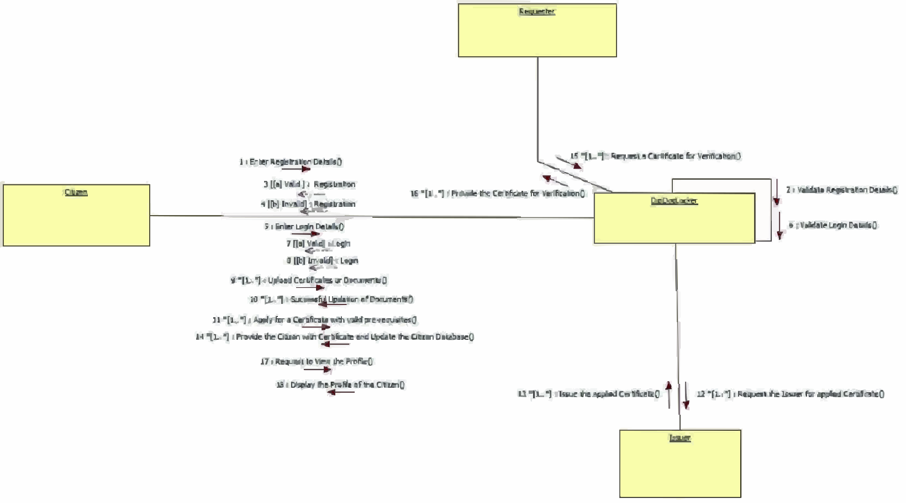
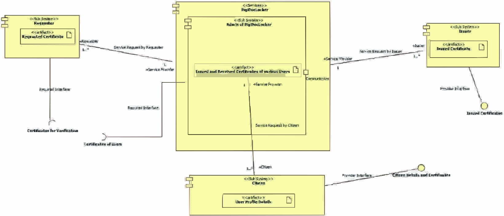
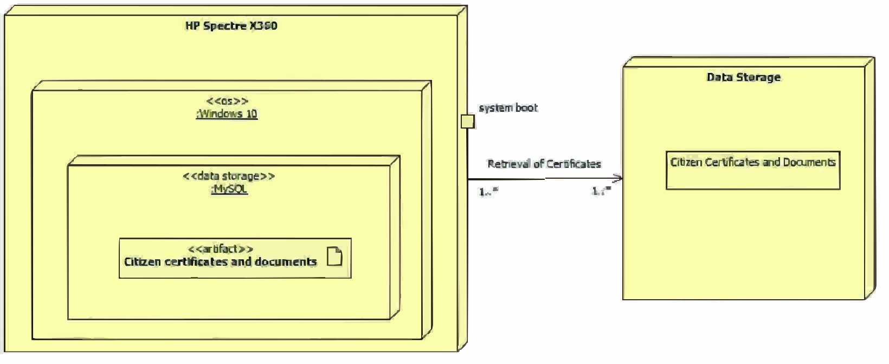

# Chapter 08: Design of UML Diagrams for DigiDocLocker

> **Book**: *UML Diagramming: A Case Study Approach* by Dr. Suriya Sundaramoorthy (CRC Press, 2022)  
> **Pages**: 105–112 (Total: 8 pages)  
> **Classification**: Industrial Case Study & Diagram Suite  
> **Navigation**: [&larr; Chapter_07_Design_of_UML_Diagrams_for_E_Province](Chapter_07_Design_of_UML_Diagrams_for_E_Province.md) | [📚 Book Index](../UML_Book.md) | [Chapter_09_Design_of_UML_Diagrams_for_Online_Marketplace &rarr;](Chapter_09_Design_of_UML_Diagrams_for_Online_Marketplace.md)

---

## 📌 Executive Summary

Chapter 8 presents an industrial software engineering case study for **Design of UML Diagrams for DigiDocLocker**. It details the transition from business requirements and domain constraints into formal software architecture specifications, leveraging data-flow modeling and a complete suite of Unified Modeling Language (UML) structural and behavioral diagrams.

---

## 🎯 Problem Statement & System Context

Maintaining the authentic documents physically in a single location is considered to be a challenging task. Thus, digitizing documents enables centralized storage of all the physical documents enabling easy retrieval from anywhere at anytime. It also prevents the troubles caused by missing any of those physical certificates. This can be achieved through the DigiDocLocker which is a platform for issuance and verification of documents and certificates in a digital format, thereby eliminating the use of physical documents. DigiDocLocker aims at benefitting all the citizens of the country by providing to access authentic documents/certificates such as driving licence, vehicle registration and academic mark sheet in digital format from the original issuers of these certificates. DigiDocLocker has the following functionalities: i. A Registration module allows the users to register and a Login module that allows the authorized users. ii. An Upload Document module allows the users to upload documents such as driving licence, vehicle registration, academic mark sheet and other relevant documents in various file formats. iii. A Profile module displays the complete profile of the user as available in the database. iv. An Issuer module displays the certificate issuers’ names and the number of documents issued to the user by the issuer. For example, the Income Tax Department, Government of India has provided PAN Verification Records to Indian citizens via DigiLocker. v. A Requester module displays the requesters’ names and the number of documents requested from the user by the requesters. For example, Citizen applying through Union Public Service Commission (UPSC)’s Online Recruitment Application (ORA) can upload documents through DigiDocLocker as well (Figures 8.1–8.8).

---

## 📊 Complete UML Diagram Suite & Architecture Specifications

This chapter incorporates **9 standalone vector diagram(s)** illustrating the end-to-end design from functional use cases to physical hardware deployment:

### Figure 8.1: UML Usecase Diagram

**Diagram Category**: `Use Case Diagram`  
**Architectural Role**: Specifies system boundary, primary external actors, and business use cases with include/extend relationships.

### Figure 8.2: UML Class Diagram

**Diagram Category**: `Class Diagram`  
**Architectural Role**: Models static structural classifiers, entity attributes, operations, and associations (composition, aggregation, inheritance).

### Figure 8.3: UML Sequence Diagram

**Diagram Category**: `Sequence Diagram`  
**Architectural Role**: Details chronological object interactions, synchronous message exchanges, return flows, and activation lifelines.

### Figure 8.4: UML Collaboration Diagram

**Diagram Category**: `Communication Diagram`  
**Architectural Role**: Emphasizes structural object topology and numbered sequence messaging between collaborating entities.

### Figure 8.5: UML State Machine Diagram

**Diagram Category**: `State Machine Diagram`  
**Architectural Role**: Captures entity lifecycle states, transition triggers, event guards, and exit/entry actions.

### Figure 8.6: UML Class Diagram

**Diagram Category**: `Class Diagram`  
**Architectural Role**: Models static structural classifiers, entity attributes, operations, and associations (composition, aggregation, inheritance).

### Figure 8.7: UML Component Diagram

**Diagram Category**: `Component Diagram`  
**Architectural Role**: Architects physical modular software components, provided ball interfaces, and required socket dependencies.

### Figure 8.8: UML Deployment Diagram

**Diagram Category**: `Deployment Diagram`  
**Architectural Role**: Maps software execution artifacts to hardware computing nodes, client devices, application tiers, and database servers.

### Visual Artifacts & Supplementary Schematics

The following vector schematics capture operational screen states, user dashboards, or notation components documented in this chapter:

#### Ch08 p112 img01

---

## 💡 Key Architectural Invariants & Modeling Lessons

1. **Traceability**: Every software model directly corresponds to explicit functional requirements defined during the initial domain specification.
2. **Separation of Concerns**: Structural models (Class, Component, Deployment) maintain clear boundaries separating business domain entities from physical infrastructure nodes.
3. **Behavioral Integrity**: Dynamic models (Activity, Sequence, State Machine) guarantee valid state transitions, prevent deadlocks, and verify message order consistency.
4. **Deployment Fidelity**: Physical nodes and execution environments accurately map runtime middleware, database engines, and client access channels.

---

## 🔗 Related Resources & Navigation

- **Navigation**: [&larr; Chapter_07_Design_of_UML_Diagrams_for_E_Province](Chapter_07_Design_of_UML_Diagrams_for_E_Province.md) | [📚 Book Index](../UML_Book.md) | [Chapter_09_Design_of_UML_Diagrams_for_Online_Marketplace &rarr;](Chapter_09_Design_of_UML_Diagrams_for_Online_Marketplace.md)
- **Master Book Catalog**: [`UML_Book.md`](../UML_Book.md)
- **Vector Images Catalog**: [`Vector_Images_Catalog.md`](../vector_images/Vector_Images_Catalog.md)