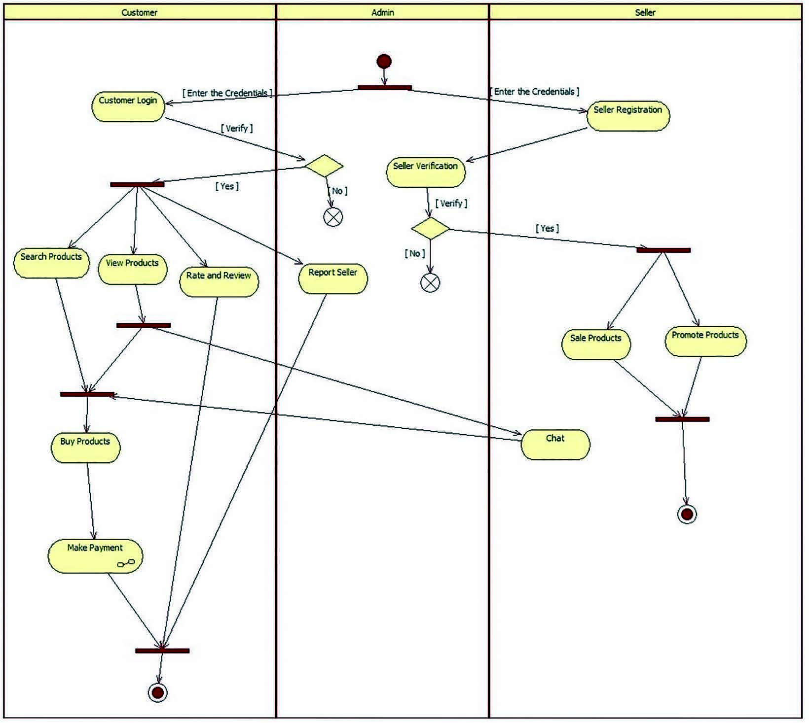
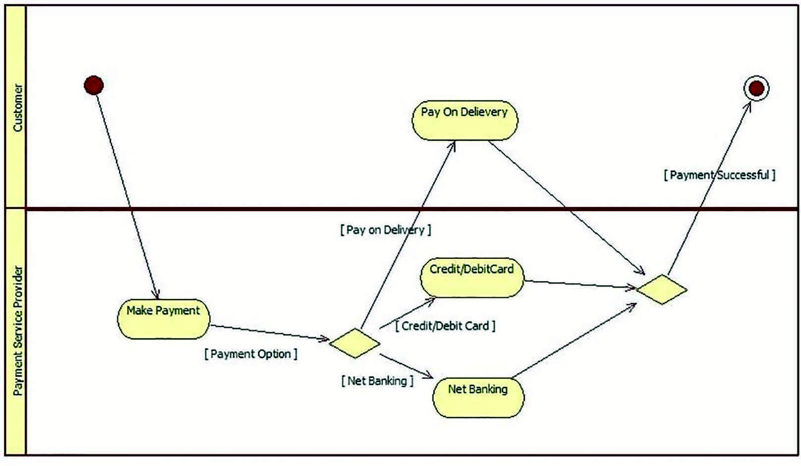
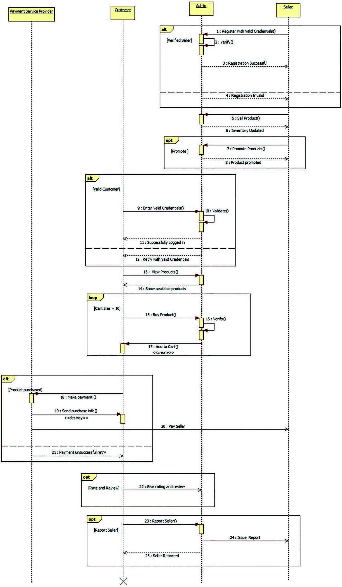
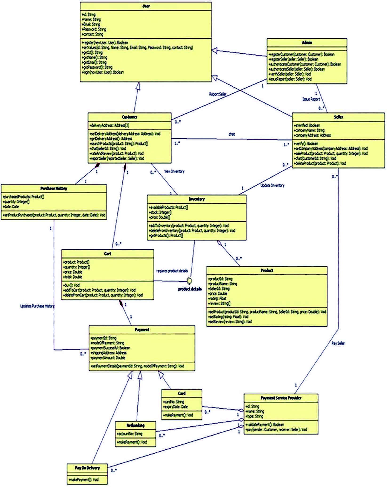

# Chapter 09: Design of UML Diagrams for Online Marketplace

> **Book**: *UML Diagramming: A Case Study Approach* by Dr. Suriya Sundaramoorthy (CRC Press, 2022)  
> **Pages**: 113–122 (Total: 10 pages)  
> **Classification**: Industrial Case Study & UML Modeling Suite  
> **Navigation**: [&larr; Chapter_08_Design_of_UML_Diagrams_for_DigiDocLocker](Chapter_08_Design_of_UML_Diagrams_for_DigiDocLocker.md) | [📚 Book Index](../UML_Book.md) | [Chapter_10_Design_of_UML_Diagrams_for_Product_Recommendation_System &rarr;](Chapter_10_Design_of_UML_Diagrams_for_Product_Recommendation_System.md)

---

## 📌 Executive Summary

Chapter 9 presents an end-to-end software engineering case study for the **Design of UML Diagrams for Online Marketplace**. This chapter demonstrates how business requirements and domain constraints are translated into formal architectural specifications through data-flow modeling and a complete suite of Unified Modeling Language (UML) structural and behavioral models.

The case study analyzes the system from multiple architectural perspectives: identifying external user and service actors, formalizing core operational capabilities, detailing procedural business workflows, specifying domain entity schemas, and architecting modular component deployment across distributed physical infrastructure.

---

## 🎯 Problem Statement & Business Context

Various new small scale and medium scale sellers face difficulties to reach out to the customers and sell their products along with other competing products in the market. This increases their overall cost, thus reducing their profit or even causing loss. E-Retail is an online marketplace application case study where small and medium scale sellers can list, showcase, advertise and sell their products directly to the customers without any physical store. E-Retail aims in providing a dynamic platform for all small and medium scale sellers to reach out and sell their products directly to all range of customers at a competing price without the need of any physical store. This enables the sellers to eliminate the cost of rent or maintenance of a physical store and to minimize other related costs. It also aims in promoting direct communication between the seller and customer, hence providing a trusted relationship between them. New sellers can easily authenticate and signup to the portal and sell their products in the portal. The application offers separate login for sellers and customers, where the sellers and customers can sign in and start using the application. Customers can view all the products available from various sellers and buy those products. It also facilitates online payments for purchasing the products. Customers can rate or give a review for the product and seller. Customers can also report a seller for any violations in delivery or if the product does not meet the specified requirement. Customers can also view the contact information and the rating of the seller before buying the product (Figures 9.1–9.9).

---

## ⚙️ System Architecture & Functional Capabilities

The **Design of UML Diagrams for Online Marketplace** decomposes business operations into modular functional units. These capabilities address the operational bottlenecks of manual and legacy workflows by introducing automated, role-based, and auditable software processes:

- **Customer Login**: Each customer has to login to the system using a username and password for using the application.
- **Seller Registration**: Each Seller has to register themselves in the system to sell their products.
- **Seller Verification**: After registration, each seller is verified before being able to sell.
- **Sale Products**: Verified Sellers can showcase their products for sale.
- **Promote Products**: Sellers can promote their products listed for sale.
- **View Products**: Customers can view all the products listed for sale from various sellers.
- **Search Products**: Customers can search for products using keywords.
- **Buy Products**: Customers can buy the product available.
- **Make Payment**: Customers are asked for a payment option after checkout
- **Credit/Debit Card**: Products can be purchased using Credit/Debit card for payment.
- **Net Banking**: Products can be purchased by using net banking for payment.
- **Pay on Delivery**: Customers can make the payment at the time of delivery.
- **Rating and Review**: Customers can share their reviews and ratings for the purchased product.
- **Chat**: Customers can chat with the Seller to enquire on their products.
- **Report Seller**: Customer can report a seller if their sold product does not meet the specified requirement.

---

## 📊 Complete UML Diagram Suite & Architectural Walkthrough

This chapter incorporates **9 crystal-clear, high-resolution diagram(s)** (extracted losslessly from the source edition at up to 2,000+ px) illustrating the end-to-end design from functional use cases to physical hardware deployment:

### Figure 9.1: UML Usecase Diagram

**Diagram Category**: `Use Case Diagram`  
**Architectural Role**: Specifies system boundary, primary external actors, and business use cases with include/extend relationships.

**System Design Analysis**:
Illustrates the functional boundary of the **Design of UML Diagrams for Online Marketplace**. External actors trigger core use cases, demonstrating how business transactions, authorization checkpoints, and service requests flow into the system. Relationships (`<<include>>` for mandatory sub-routines like authentication and validation, and `<<extend>>` for optional or conditional exception branches) formalize the system's external functional contract.

### Figure 9.2: UML Activity Diagram Part 1

**Diagram Category**: `Activity Diagram`  
**Architectural Role**: Illustrates dynamic procedural workflow, decision branching, concurrent action forks, and synchronization joins.

**System Design Analysis**:
Details the step-by-step procedural execution flow for core operations in **Design of UML Diagrams for Online Marketplace**. Begins at an initial state, navigates action states, evaluates guard conditions at decision diamonds, and models parallel execution branches using fork and join synchronizations before reaching the terminal state, ensuring business workflows are deterministic and free of race conditions.

### Figure 9.3: UML Activity Diagram For Sub Activity Make Payment

**Diagram Category**: `Activity Diagram`  
**Architectural Role**: Illustrates dynamic procedural workflow, decision branching, concurrent action forks, and synchronization joins.

**System Design Analysis**:
Details the step-by-step procedural execution flow for core operations in **Design of UML Diagrams for Online Marketplace**. Begins at an initial state, navigates action states, evaluates guard conditions at decision diamonds, and models parallel execution branches using fork and join synchronizations before reaching the terminal state, ensuring business workflows are deterministic and free of race conditions.

### Figure 9.4: UML Sequence Diagram

**Diagram Category**: `Sequence Diagram`  
**Architectural Role**: Details chronological object interactions, synchronous message exchanges, return flows, and activation lifelines.

**System Design Analysis**:
Traces the time-ordered message sequence between participating objects and services in **Design of UML Diagrams for Online Marketplace**. Vertical dashed lifelines represent entity instances across time, while horizontal solid and dashed arrows show synchronous invocations, data lookups, and return values. Activation bars delineate execution duration, clarifying object collaboration during key transactional workflows.

### Figure 9.5: UML Collaboration Diagram

**Diagram Category**: `Communication Diagram`  
**Architectural Role**: Emphasizes structural object topology and numbered sequence messaging between collaborating entities.

**System Design Analysis**:
Emphasizes the spatial and structural organization of collaborating instances in **Design of UML Diagrams for Online Marketplace**. Shows object links overlaid with numbered messages (e.g., 1.0, 1.1, 2.0), illustrating both structural connectivity and invocation hierarchy, complementing the temporal perspective of the sequence diagram.

### Figure 9.6: UML State Machine Diagram

**Diagram Category**: `State Machine Diagram`  
**Architectural Role**: Captures entity lifecycle states, transition triggers, event guards, and exit/entry actions.

**System Design Analysis**:
Models the complete lifecycle state transitions for central domain entities in **Design of UML Diagrams for Online Marketplace**. Tracks transitions from initial creation through intermediate processing states to completion or cancellation. Explicit state triggers, guard expressions `[condition]`, and entry/exit actions guarantee valid business lifecycle states and eliminate invalid operational state jumps.

### Figure 9.7: UML Class Diagram

**Diagram Category**: `Class Diagram`  
**Architectural Role**: Models static structural classifiers, entity attributes, operations, and associations (composition, aggregation, inheritance).

**System Design Analysis**:
Captures the static structural domain model for **Design of UML Diagrams for Online Marketplace**. Defines primary entity classes, their private/public attributes, operational methods, and relationships. It enforces structural integrity through multiplicities, composition (strong lifecycle ownership of subsidiary records), aggregation, and inheritance hierarchies, forming the foundation for the relational database schema and domain entity classes.

### Figure 9.8: UML Component Diagram

**Diagram Category**: `Component Diagram`  
**Architectural Role**: Architects physical modular software components, provided ball interfaces, and required socket dependencies.

**System Design Analysis**:
Architects the modular software organization for **Design of UML Diagrams for Online Marketplace**. Illustrates autonomous subsystems, business logic controllers, database access layers, and external service adapters. Provided interfaces (ball notation) and required dependencies (socket notation) define clear service contracts, supporting high cohesion and loose coupling.

### Figure 9.9: UML Deployment Diagram

**Diagram Category**: `Deployment Diagram`  
**Architectural Role**: Maps software execution artifacts to hardware computing nodes, client devices, application tiers, and database servers.

**System Design Analysis**:
Maps the physical runtime deployment architecture for **Design of UML Diagrams for Online Marketplace**. Depicts client hardware devices (web browsers, mobile apps), application servers, network firewalls, and persistence database nodes. Communication paths and execution environments reflect production infrastructure, scalability considerations, and network security boundaries.

---

## 💡 Key Architectural Invariants & Domain Lessons

1. **Requirement Traceability**: Every model in the **Design of UML Diagrams for Online Marketplace** suite traces directly to business requirements and operational constraints established in the problem statement.
2. **State & Workflow Integrity**: Dynamic activity and sequence models guarantee deterministic workflow completion, enforce transactional atomicity, and prevent deadlocks.
3. **Modular Encapsulation**: Component boundaries decouple domain business logic from presentation controllers and external integration adapters, supporting high maintainability.
4. **Operational Security & RBAC**: Strict role-based authorization guards sensitive operations across external actor boundaries and administrative lifelines.
5. **High-Fidelity Deployment**: Physical node topologies reflect real-world tiered infrastructure (DMZ, application cluster, isolated persistence layer), ensuring scalability and fault tolerance.

---

## 🔗 Related Resources & Navigation

- **Navigation**: [&larr; Chapter_08_Design_of_UML_Diagrams_for_DigiDocLocker](Chapter_08_Design_of_UML_Diagrams_for_DigiDocLocker.md) | [📚 Book Index](../UML_Book.md) | [Chapter_10_Design_of_UML_Diagrams_for_Product_Recommendation_System &rarr;](Chapter_10_Design_of_UML_Diagrams_for_Product_Recommendation_System.md)
- **Master Book Catalog**: [`UML_Book.md`](../UML_Book.md)
- **High-Resolution Images Archive**: [`images/`](../images/)